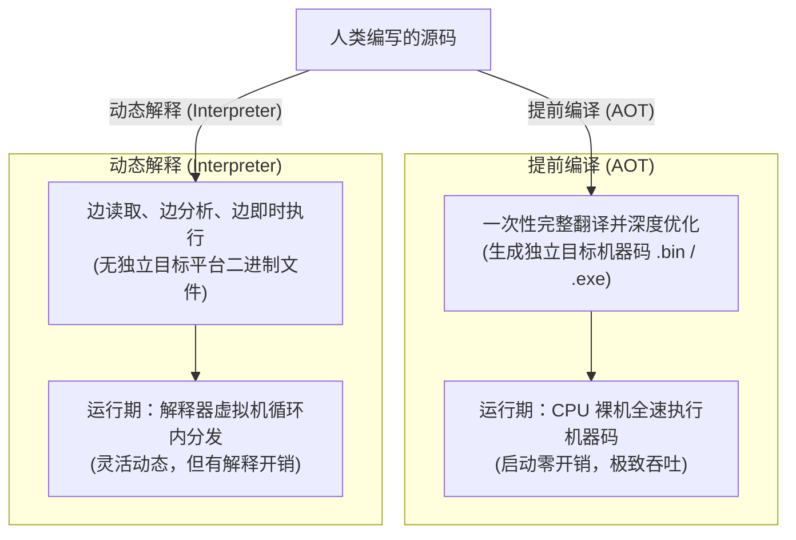
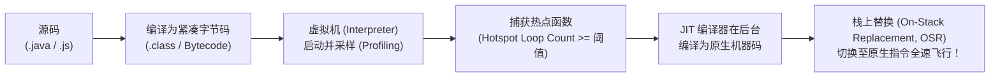

import StepVisualizer from '../../../components/interactive/StepVisualizer';
import QuizCard from '../../../components/interactive/QuizCard';

# 01. 引子与直觉建立：为什么需要编译器？

> “计算机科学领域的任何问题，都可以通过增加一个间接中间层来解决。” —— David Wheeler

平时写代码时，我们在编辑器里敲下的是充满人类逻辑思考的文本：

```c
int total = count + 42 * base;
```

但这对于物理 CPU 硬件来说，它根本不知道什么是 `int`，什么是变量名 `total`，它眼里只有高低电平、寄存器编号和一长串由 `0` 与 `1` 编码的机器指令。

编译器（Compiler），本质上就是软件工程领域里最精密、最强大的“**超级翻译官**”——它把人类编写的高级语言，跨越数个抽象层级，严密无误地翻译成物理硅片能直接运行的底层指令。

---

## 机器码与高级语言的鸿沟

在 1950 年代计算机初创期，程序员写程序需要对着芯片手册，手工把打孔纸带上的孔位或者八进制/十六进制机器码送入内存：

```text
B8 2A 00 00 00   ; mov eax, 42
0F AF 05 10 00   ; imul eax, dword ptr [base]
03 05 14 00 00   ; add eax, dword ptr [count]
A3 18 00 00 00   ; mov dword ptr [total], eax
```

如果代码中需要插入一行逻辑，后续所有跳转目标地址（Jump Labels）都要人工重新计算一遍。

* **机器语言 / 汇编语言**：面向硬件，极致高效，但与物理机器架构强绑定，心智负担沉重，难以表达复杂数据抽象与业务逻辑。
* **高级语言（C / Rust / Go / Python）**：面向人类思维，支持类型系统、作用域控制、结构化控制流与面向对象/函数式范式。

为了抹平二者之间的巨大鸿沟，编译器诞生了。它不仅是“翻译器”，更是人类逻辑与机器现实之间的**语义桥梁**和**性能放大器**。

---

## 编译 vs 解释：出版整书 vs 同声传译

计算机语言在将源代码转化为物理执行结果时，历史上形成了两条截然不同的核心哲学路线：



### 1. 编译（Compilation，以 C/C++、Rust 为代表）—— “出版整本译作”
* **运作方式**：在程序**运行之前**（编译期 Ahead-Of-Time, AOT），编译器对整个代码工程进行词法、语法、语义分析，并施加全局数据流优化，最终吐出目标平台的物理二进制文件（如 ELF 或 PE 格式）。
* **优势**：
  * **运行速度极快**：CPU 直接读取硬件指令流水线，无额外翻译开销。
  * **运行环境轻量**：目标主机无需安装庞大的编译工具链或运行时解释器。
  * **源码保密性好**：分发给用户的是二进制指令，逆向难度高。
* **劣势**：
  * 跨平台门槛高：在 x86 上编译的二进制文件无法在 ARM 架构芯片上直接运行，必须针对目标芯片重新交叉编译。
  * 调试反馈循环慢：大型工程全量编译耗时可达数分钟甚至数小时。

### 2. 解释（Interpretation，以早期 Python、Shell、原生 JS 为代表）—— “同声传译”
* **运作方式**：程序运行期间，解释器（Interpreter）驻留在内存中，“读一句、解一句、执行一句”，不在磁盘上生成独立的机器码文件。
* **优势**：
  * **天生跨平台（Write Once, Run Anywhere）**：只要目标平台上装有对应版本的解释器，同一份脚本即可直接跑通。
  * **交互式开发利器**：支持 REPL（交互式命令行求值），所改即所得，动态反射与元编程极度灵活。
* **劣势**：
  * **性能损耗显著**：每次执行循环都要重复经过解释器内部的派发循环（Dispatch Loop），性能通常比原生机器码慢 5 到 50 倍。

---

## 现代折中方案：JIT 与字节码虚拟机

纯粹的 AOT 编译和纯粹的解释执行各有其不可调和的矛盾。现代高性能运行时（如 Java HotSpot VM、JavaScript V8、.NET Core CLR）探索出了工业界黄金折中方案：“**字节码中间层 + JIT（Just-In-Time 动态即时编译）**”。



### 为什么 JIT 有可能比静态 AOT 跑得更快？
静态编译器在编译期只能“静态猜想”，面对虚函数多态调用或者动态类型分支，只能保守生成通用分支。
而现代 JIT 编译器在程序**真正运行时**通过 Profiler 监控真实输入分布：
1. **投机优化（Speculative Inlining）**：如果监控发现某个多态接口在 99.9% 的场景下实际调用的都是 `Class A`，JIT 会大胆将其内联为平坦代码。
2. **消歧与反优化（Deoptimization）**：一旦偶发情况传入了 `Class B`，JIT 会安全触发反优化保护机制，退回解释器稳妥执行。

---

## 交互演练：解释执行 vs JIT 热点编译执行轨迹

下面的交互演算器模拟了一个运行 10,000 次热循环的函数。观察解释器分发、热点探测（Profiler 计数）以及 JIT 触发栈上替换（OSR）切换至全速原生机器码的动态全过程：

<StepVisualizer
  client:visible
  title="解释器采样到 JIT 机器码热替换全流程演练"
  algorithmName="JIT Tiered Compilation"
  steps={[
    {
      title: "阶段 1：冷启动与解释器初始分发",
      badge: "Tier 0: Cold Start",
      description: "程序刚启动时，JIT 尚未介入。虚拟机采用解释器逐条分发字节码。解释器在执行每个循环头部时，悄悄累加循环计数器（Invocation Counter / Backedge Counter）。此时运行速度基准为 350 ops/ms。",
      code: "0x00: iconst_0\n0x01: istore_1       ; int i = 0\n0x02: iload_1\n0x03: sipush 10000\n0x04: if_icmpge 0x18 ; if (i >= 10000) goto exit\n0x07: ... (loop body: bytecode dispatch loop)",
      stateView: (
        <div className="grid grid-cols-1 md:grid-cols-3 gap-3">
          <div className="p-3 rounded-xl border border-slate-800 bg-slate-950">
            <div className="text-[11px] text-slate-400 font-mono">当前执行引擎</div>
            <div className="text-sm font-bold text-amber-400 mt-1">Bytecode Interpreter</div>
          </div>
          <div className="p-3 rounded-xl border border-slate-800 bg-slate-950">
            <div className="text-[11px] text-slate-400 font-mono">热点迭代计数</div>
            <div className="text-sm font-bold text-cyan-400 mt-1">i = 120 / 10000</div>
          </div>
          <div className="p-3 rounded-xl border border-slate-800 bg-slate-950">
            <div className="text-[11px] text-slate-400 font-mono">机器码状态</div>
            <div className="text-sm font-bold text-slate-500 mt-1">未生成 (无 JIT)</div>
          </div>
        </div>
      )
    },
    {
      title: "阶段 2：热点阈值突破与后台分析器介入",
      badge: "Profiling & Hotspot Detect",
      description: "当循环计数超过预设阈值（例如 1,500 次），虚拟机 Profiler 发出警报：检测到高频热点函数！后台 JIT 编译线程被唤醒，开始采集该循环内操作数类型特征，并着手将字节码降级并优化为 SSA IR。",
      code: "[Profiler Alert] Method hotLoop() crossed threshold (count = 1500)!\n[JIT Thread] Triggering Background JIT Compilation...\n[Optimizer] Inline candidates detected; Loop invariant motion scheduled.",
      stateView: (
        <div className="grid grid-cols-1 md:grid-cols-3 gap-3">
          <div className="p-3 rounded-xl border border-amber-800/60 bg-amber-950/30">
            <div className="text-[11px] text-amber-300 font-mono">当前执行引擎</div>
            <div className="text-sm font-bold text-amber-300 mt-1">Interpreter + JIT Profiler</div>
          </div>
          <div className="p-3 rounded-xl border border-slate-800 bg-slate-950">
            <div className="text-[11px] text-slate-400 font-mono">热点迭代计数</div>
            <div className="text-sm font-bold text-cyan-400 mt-1">i = 1500 / 10000</div>
          </div>
          <div className="p-3 rounded-xl border border-slate-800 bg-slate-950">
            <div className="text-[11px] text-slate-400 font-mono">JIT 编译队列</div>
            <div className="text-sm font-bold text-purple-400 mt-1">Compiling to x86-64...</div>
          </div>
        </div>
      )
    },
    {
      title: "阶段 3：栈上替换 (OSR) 切换至原生指令",
      badge: "OSR Handshake",
      description: "JIT 编译器在后台完成了寄存器分配和原生汇编代码生成。此时循环正在执行，虚拟机通过栈上替换（On-Stack Replacement, OSR）将解释器的栈帧数据直接无缝重构为物理寄存器状态，移交控制权！",
      code: "; JIT 生成的高性能原生汇编代码片段\n.loop:\n  add   rax, rdx\n  inc   rcx\n  cmp   rcx, 10000\n  jl    .loop\n; 寄存器直接运算，消除所有字节码分发与指令解码",
      stateView: (
        <div className="grid grid-cols-1 md:grid-cols-3 gap-3">
          <div className="p-3 rounded-xl border border-cyan-800/60 bg-cyan-950/30">
            <div className="text-[11px] text-cyan-300 font-mono">当前执行引擎</div>
            <div className="text-sm font-bold text-cyan-300 mt-1">On-Stack Replacement (OSR)</div>
          </div>
          <div className="p-3 rounded-xl border border-slate-800 bg-slate-950">
            <div className="text-[11px] text-slate-400 font-mono">热点迭代计数</div>
            <div className="text-sm font-bold text-cyan-400 mt-1">i = 2100 / 10000</div>
          </div>
          <div className="p-3 rounded-xl border border-emerald-800/60 bg-emerald-950/30">
            <div className="text-[11px] text-emerald-300 font-mono">机器码状态</div>
            <div className="text-sm font-bold text-emerald-400 mt-1">Native Code Active</div>
          </div>
        </div>
      )
    },
    {
      title: "阶段 4：原生机器码全速飞行至结束",
      badge: "Tier 1: Native Flight",
      description: "后续数千次迭代直接在 CPU 物理硬件流水线上无间断飞行，吞吐量跃升至 35,000 ops/ms（提速 100 倍）！最终兼顾了秒开启动（冷启动不卡顿）与满血吞吐性能。",
      code: "[Execution Completed]\nTotal iterations: 10000\nAverage speed: 28,400 ops/ms\nInterpreter time: 4.2ms | JIT compilation: 1.8ms | Native execution: 0.3ms",
      stateView: (
        <div className="grid grid-cols-1 md:grid-cols-3 gap-3">
          <div className="p-3 rounded-xl border border-emerald-800/60 bg-emerald-950/30">
            <div className="text-[11px] text-emerald-300 font-mono">当前执行引擎</div>
            <div className="text-sm font-bold text-emerald-300 mt-1">Full Native Machine Code</div>
          </div>
          <div className="p-3 rounded-xl border border-slate-800 bg-slate-950">
            <div className="text-[11px] text-slate-400 font-mono">热点迭代计数</div>
            <div className="text-sm font-bold text-cyan-400 mt-1">i = 10000 / 10000 (完成)</div>
          </div>
          <div className="p-3 rounded-xl border border-emerald-800/60 bg-emerald-950/30">
            <div className="text-[11px] text-emerald-300 font-mono">加速比</div>
            <div className="text-sm font-bold text-emerald-400 mt-1">~95x 相对纯解释</div>
          </div>
        </div>
      )
    }
  ]}
/>

---

## 概念巩固自测

<QuizCard
  client:visible
  category="核心概念自测"
  question="关于提前编译（AOT）与即时编译（JIT）的权衡，下列哪一项陈述是真正准确的？"
  options={[
    "JIT 编译器在所有场景下的整体执行性能必然低于 AOT 编译器，因为 JIT 占用了运行时的 CPU 和内存来进行动态编译。",
    "现代 JIT 能够基于运行时实际收集到的类型与分支偏好（Profile）进行激进的推测性内联优化，在某些高度多态的动态代码段上甚至可能超越无特征采样的通用 AOT 编译代码。",
    "AOT 编译产生的二进制文件具有完全的机器架构通用性，在 x86 机器上编译的 ELF 二进制文件无需修改即可在 ARM64 处理器上直接运行。",
    "解释型语言完全不包含任何编译行为，解释器直接把由字符组成的文本文件送入 CPU 的运算器（ALU）进行物理高低电平运算。"
  ]}
  answer={1}
  explanation="选项 B 正确：现代 JIT（如 Java HotSpot C2、V8 TurboFan）能够获取运行时真实的分支概率和类层次数据，进行激进的投机内联（Speculative Inlining）。若猜想成立则消除间接跳转，若猜想失效则通过反优化安全退回。选项 A 忽视了运行时 Profile 带来的超线性收益；选项 C 中 AOT 生成的是物理机器指令，与 CPU 架构强绑定；选项 D 中 CPU 无法直接读懂源码字符，解释器仍需内部解析或解释字节码。"
/>

---

## 总结与下一步

在本章中，我们明确了：
1. 编译器是连接人类逻辑抽象世界与底层硅片物理硬件的**精密翻译系统**。
2. **AOT 编译**以出版整书的方式，换取了极致的原生执行性能；**动态解释**以同传的方式，带来了卓越的灵活性与便携度。
3. **现代 JIT** 结合了字节码虚拟机的跨平台优势与运行时推测优化的极致吞吐。

然而，无论最终是编译成 x86 机器指令还是虚拟机字节码，编译器究竟是如何一步步拆解源代码的？下一章，我们将拉开“**编译器流水线全景图**”，见证六大经典工序的工程奇迹！
