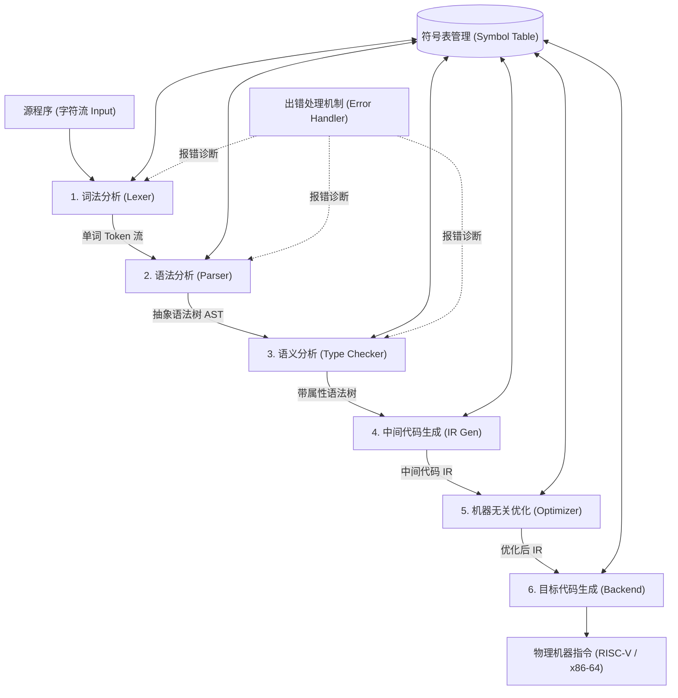
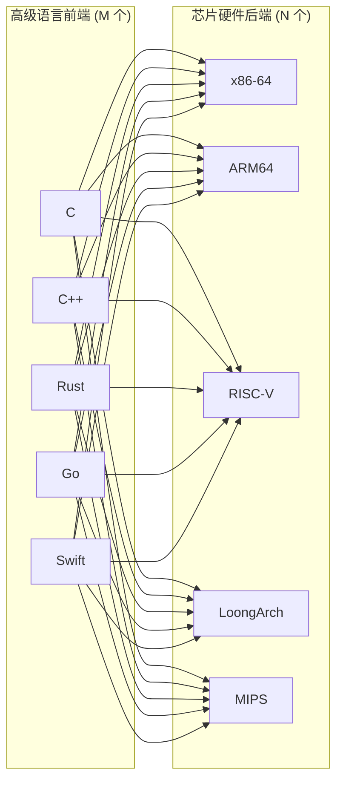
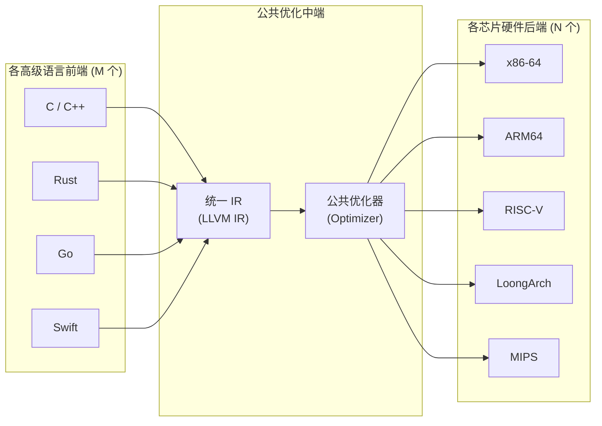

import StepVisualizer from '../../../components/interactive/StepVisualizer';
import QuizCard from '../../../components/interactive/QuizCard';

# 02. 编译器的流水线全景：六大工序与工程奇迹

> “复杂的系统是由简单模块的精密组合构成的，现代编译器流水线是计算机软件工程史上的最伟大奇迹之一。”

当编译器面对一段看似简短的源码时：

```c
int total = count + 42 * base;
```

它绝不是靠一个几万行代码的黑盒函数一蹴而就的。任何工业级编译器（如 GCC、LLVM、Rustc）都会将整个过程拆分为**六大经典工序**，并依靠贯穿始终的**符号表管理**与**出错处理**协同运作。

---

## 编译器六大经典工序全景图



### 1. 词法分析（Lexical Analysis / Scanner / Lexer）
* **输入**：物理磁盘上的源码字符流（`c`, `h`, `a`, `r`, `\n`, `\t`...）。
* **任务**：依据词法规则（通常由正则表达式定义），剔除无意义的空格、缩进与注释，将一维字符流切分为结构化的**词法单元（Token）**。
* **输出**：形如 `<种别码, 属性值>` 的 Token 流。
* **典型错误**：未闭合的字符串字面量、包含非法字符（如变量名中包含非法的 `@` 或中文字符）。

### 2. 语法分析（Syntax Analysis / Parser）
* **输入**：扁平的 Token 流。
* **任务**：依据编程语言的**上下文无关文法（Context-Free Grammar, CFG）**，验证 Token 序列是否符合句法规则，并将其组装成一棵展现运算符优先级与嵌套关系的**抽象语法树（Abstract Syntax Tree, AST）**。
* **输出**：分层的 AST 树状数据结构。
* **典型错误**：语法错误（Syntax Error），如丢失右括号 `()`、条件语句缺少分号、连续两个二元运算符（`a ++ * b`）。

### 3. 语义分析（Semantic Analysis / Type Checker）
* **输入**：抽象语法树（AST）。
* **任务**：检查代码在逻辑上是否“说得通”。包括但不限于：
  * **作用域与声明检查**：变量是否未声明即被使用？是否在同一作用域内重复声明？
  * **类型检查与推导**：赋值两端的类型是否兼容？是否把字符串与浮点数进行了不合法的位运算？
  * **控制流合法性**：`break` 是否出现在循环体外部？函数是否有遗漏的 `return` 路径？
* **输出**：标注了类型、作用域及符号引用的**带属性语法树（Decorated AST）**。

### 4. 中间代码生成（Intermediate Code Generation / IR Gen）
* **输入**：带属性的抽象语法树。
* **任务**：剥离源编程语言的复杂句法糖，将嵌套的树状结构平坦化为线性的、与具体物理硬件架构完全无关的**中间表示（Intermediate Representation, IR）**。
* **常见形态**：三地址码（Three-Address Code, 3AC）、四元式（Quadruple）、LLVM IR 或静态单赋值（SSA, Static Single Assignment）形式。

### 5. 机器无关代码优化（Machine-Independent Optimization）
* **输入**：原始线性 IR。
* **任务**：在不改变程序语义的前提下，压榨执行性能与缩减体积：
  * **常量折叠（Constant Folding）**：编译期计算 `42 * 2` 直接替换为 `84`。
  * **公共子表达式消除（Common Subexpression Elimination, CSE）**：避免重复计算已计算过的中间量。
  * **死代码消除（Dead Code Elimination, DCE）**：删除不可达代码或从未被读取的赋值。
  * **循环优化**：将与循环变量无关的计算外提（Loop-Invariant Code Motion）。

### 6. 目标代码生成（Target Code Generation / Backend）
* **输入**：优化后的高级 IR。
* **任务**：深入物理底层，与特定芯片微架构展开搏斗：
  * **指令选择（Instruction Selection）**：将高层 IR 指令模式匹配并映射为目标架构（如 x86-64、ARM64 或 RISC-V）的最高效指令序列。
  * **寄存器分配（Register Allocation）**：利用图着色（Graph Coloring）等启发式算法，将 IR 中无限的虚拟临时变量分配到 CPU 极为有限的几十个物理寄存器中，最小化访存开销。
  * **栈帧与调用约定**：生成函数前言（Prolog）与后语（Epilog），维护调用栈平衡。
* **输出**：目标机器汇编代码或直接生成可重定位目标二进制文件（`.o`）。

---

## 为什么需要中间代码（IR）？$M \times N \to M+N$ 的工程奇迹

在早期的编译器设计中，许多编译器直接从抽象语法树生成特定硬件的汇编语言。但如果世界上存在 $M$ 种高级编程语言（C、C++、Rust、Go、Swift...），同时市场上存在 $N$ 款主流物理处理器芯片（x86-64、ARM64、RISC-V、LoongArch、MIPS...）：

$$
\text{无 IR 架构复杂度} = M \times N
$$

如果有 10 种编程语言面对 10 款硬件芯片，工业界需要从零开发并维护 **100 个完全独立的完整编译器**！

> **没有 IR 的网状耦合架构（$M \times N$）**：前端与后端两两直接连线，极其混乱，任何语言支持新芯片都必须从头重写后端。



然而，现代编译器大师引入了统一的**中间代码（IR）**，编译器被彻底解耦为**前端（Front-End）** 与**后端（Back-End）** 两阶段：

$$
\text{引入 IR 后的架构复杂度} = M + N
$$

> **引入统一 IR 的漏斗解耦架构（$M + N$ · LLVM 范式）**



### 这一架构革命带来了三大不可估量的工业收益：
1. **模块开发量急剧降低**：同样是 10 种语言与 10 种硬件，开发模块由 100 个剧降为 **20 个**（10 个前端 + 10 个后端）。
2. **极速拥抱新事物**：
   * 诞生了一种全新的编程语言？只需要写一个输出该 IR 的前端，就能**瞬间跑在全世界所有芯片上**！
   * 诞生了一款全新国产芯片？只需要写一个消费该 IR 的后端，就能**瞬间享受到所有现成语言生态**！
3. **优化成果万国通用**：在统一 IR 上开发一个极其精密的“循环展开”或“死代码消除”算法，所有前端语言在所有硬件架构上，**全部免费自动获得性能加速**！

---

## 交互演练：代码语句在六大工序中的一步步蜕变

观察代码语句 `int total = count + 42 * base;` 是如何穿梭于编译器的 6 个车间，从最初的一串纯文本字符，逐步变形为底层 RISC-V 物理机器指令的：

<StepVisualizer
  client:visible
  title="编译全工序流动演练 (从字符流到 RISC-V 汇编)"
  algorithmName="Pipeline Stages"
  steps={[
    {
      title: "工序 0：物理字符流输入 (Raw Character Stream)",
      badge: "输入层",
      description: "磁盘上的源文件在硬件眼中只是一串一维 ASCII / UTF-8 连续字符序列（包含换行符与空格），共 31 字节。此时编译器完全不知道这行文本的语法含义。",
      code: "int total = count + 42 * base;\n// 包含 31 个 ASCII 字符，内存表现为连续字节序列",
      stateView: (
        <div className="p-3 rounded-xl border border-slate-800 bg-slate-950 font-mono text-xs text-slate-300">
          <span className="text-slate-500">HEX Dump: </span>
          69 6E 74 20 74 6F 74 61 6C 20 3D 20 63 6F 75 6E 74 20 2B 20 34 32 20 2A 20 62 61 73 65 3B
        </div>
      )
    },
    {
      title: "工序 1：词法分析 (Tokenization)",
      badge: "词法层",
      description: "词法分析器扫过字符流，剔除多余空格，识别出关键字、标识符、运算符和常量，将其打包为结构化 Token 二元组流吐出给语法分析器。",
      code: "<KW_INT, \"int\">\n<ID, \"total\">\n<ASSIGN, \"=\">\n<ID, \"count\">\n<PLUS, \"+\">\n<NUM, 42>\n<STAR, \"*\">\n<ID, \"base\">\n<SEMI, \";\">",
      stateView: (
        <div className="flex flex-wrap gap-1.5 p-3 rounded-xl border border-cyan-800/40 bg-cyan-950/20">
          {['<KW_INT>', '<ID: "total">', '<ASSIGN: "=">', '<ID: "count">', '<PLUS: "+">', '<NUM: 42>', '<STAR: "*">', '<ID: "base">', '<SEMI: ";">'].map((tok, i) => (
            <span key={i} className="px-2 py-1 rounded bg-slate-900 border border-cyan-600/50 text-cyan-300 font-mono text-xs">
              {tok}
            </span>
          ))}
        </div>
      )
    },
    {
      title: "工序 2：语法分析 (Parse Tree / AST)",
      badge: "语法层",
      description: "语法分析器依照运算符优先级（乘法强于加法），将扁平的 Token 流构筑为多层次的抽象语法树（AST）。树的层次天然确立了计算次序。",
      code: "AssignmentStmt\n├── Target: Variable(total)\n└── ValueExpr: BinaryOp(+)\n    ├── Left: Variable(count)\n    └── Right: BinaryOp(*)\n        ├── Left: ConstantLiteral(42)\n        └── Right: Variable(base)",
      stateView: (
        <div className="p-3.5 rounded-xl border border-blue-800/50 bg-blue-950/30 text-xs font-mono text-blue-200">
          ● 运算符结合性：42 与 base 处于子树低位，必须优先于加法求值！
        </div>
      )
    },
    {
      title: "工序 3：语义分析与符号表注入 (Semantic Check)",
      badge: "语义层",
      description: "检查符号表中 count 与 base 是否已在当前作用域内声明？类型是否为合法的整数？乘法运算与加法运算的类型转换规则是否成立？并将符号偏移注入符号表。",
      code: "DecoratedAST [Scope: LocalFunction (ID: 0)]\n├── Check total: Type: int32 (Allocated offset: -4(%s0))\n├── Check count: Resolved in SymbolTable -> Type: int32\n├── Check base:  Resolved in SymbolTable -> Type: int32\n└── TypeCheck: (int32 * int32) -> int32; (int32 + int32) -> int32 [PASS]",
      stateView: (
        <div className="p-3.5 rounded-xl border border-purple-800/50 bg-purple-950/30 text-xs font-mono text-purple-200">
          ● 符号表更新：count @ -8(s0), base @ -12(s0), total @ -4(s0)
        </div>
      )
    },
    {
      title: "工序 4：中间代码生成 (3-Address Code / IR)",
      badge: "中间代码",
      description: "消除树状嵌套，引入临时变量 t1 和 t2，生成平坦的线性三地址码。三地址码保证每条指令至多只有两个源操作数和一个目标操作数。",
      code: "; 原始未优化的三地址码 (3AC)\nt1 = 42 * base\nt2 = count + t1\ntotal = t2",
      stateView: (
        <div className="p-3.5 rounded-xl border border-amber-800/50 bg-amber-950/30 text-xs font-mono text-amber-200">
          ● 平台无关：此三地址码既不依赖 x86 也不依赖 ARM，可输入给任何硬件后端。
        </div>
      )
    },
    {
      title: "工序 5：机器无关优化 (Optimization Pass)",
      badge: "优化中端",
      description: "优化器介入：将昂贵的整数乘法 42*base（42 = 32 + 8 + 2）通过强度削弱（Strength Reduction）优化为移位与加法组合，并消除无用的冗余赋值 t2。",
      code: "; 优化后 IR\n; 乘法优化: 42 * base => (base << 5) + (base << 3) + (base << 1)\nt1 = mul_strength_reduced(base, 42)\ntotal = count + t1",
      stateView: (
        <div className="p-3.5 rounded-xl border border-emerald-800/50 bg-emerald-950/30 text-xs font-mono text-emerald-200">
          ● 优化生效：消除冗余赋值，大幅缩减指令执行周期数。
        </div>
      )
    },
    {
      title: "工序 6：目标代码生成 (RISC-V 目标汇编)",
      badge: "物理后端",
      description: "后端依据 RISC-V 调用约定，将虚拟变量分配至物理寄存器（a0, a1, a2, t0, t1），生成可被 GNU as 汇编器编译的物理机器汇编代码。",
      code: "# RISC-V 64-bit Assembly\nlw   a0, -8(s0)       # a0 = 装载 count\nlw   a1, -12(s0)      # a1 = 装载 base\nli   t0, 42           # t0 = 加载立即数 42\nmul  t1, a1, t0       # t1 = a1 * t0\nadd  a2, a0, t1       # a2 = a0 + t1\nsw   a2, -4(s0)       # 将 a2 写入 total 对应的栈内存槽",
      stateView: (
        <div className="p-3.5 rounded-xl border border-rose-800/50 bg-rose-950/30 text-xs font-mono text-rose-200">
          ● 物理收工：程序已化身芯片引脚能够驱动的真实机器电平指令！
        </div>
      )
    }
  ]}
/>

---

## 概念巩固自测

<QuizCard
  client:visible
  category="工序设计与 IR 自测"
  question="关于现代编译器流水线与中间代码（IR）的设计，下列说法中最为准确的是？"
  options={[
    "中间代码（IR）必须设计得尽可能贴近特定硬件架构（如包含 x86 的具体物理寄存器名称），否则无法在后端生成高效机器码。",
    "将编译器严格划分为前端（Front-End）与后端（Back-End），并通过统一 IR 解耦，使得支持 M 种源语言与 N 款目标芯片的系统工程开发量从 M × N 下降到 M + N。",
    "语法分析器（Parser）在生成语法树的同时，能够自动判定变量是否在内存中发生数组越界访问或空指针解引用等运行时错误。",
    "代码优化阶段只能在目标汇编指令生成之后进行，因为中间代码没有物理寄存器概念，无法进行任何有效的优化。"
  ]}
  answer={1}
  explanation="选项 B 正确：这正是现代通用编译器基础设施（如 LLVM 与 GCC）统一工业界的核心架构设计思想。选项 A 错误，IR 必须保持平台无关才能跨芯片复用；选项 C 错误，数组越界或空指针解引用属于动态运行时行为或高阶静态语义分析范畴，纯语法分析只负责句法结构；选项 D 错误，大部分高阶优化（常量传播、公共子表达式消除、死代码消除、循环展开）都是在机器无关的 IR 层面完成的。"
/>

---

## 总结与下一步

在这一章中，我们建立了编译器全生命周期的全景视野：
1. **六大阶段流水线**：词法分析 $\to$ 语法分析 $\to$ 语义分析 $\to$ 中间代码生成 $\to$ 机器无关优化 $\to$ 目标代码生成。
2. **解耦工程哲学**：中间代码（IR）的引入将工业复杂度从 $M \times N$ 锐降至 $M + N$。

在下一章中，我们将正式推开第一道大门，深入第一位流水线工人——**词法分析器（Lexer）** 的世界，看它是如何依靠**有限自动机（DFA/NFA）**，在纳秒级时间内精准切分千变万化的程序单词的！
