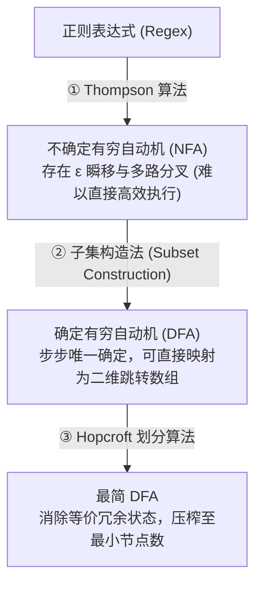

import GraphStepVisualizer from '../../../components/interactive/GraphStepVisualizer';
import QuizCard from '../../../components/interactive/QuizCard';

# 03. 词法分析：从字符流到单词 Token

> “语言的边界，即是思想的边界。” —— 维特根斯坦

词法分析器（Lexer，又称 Scanner 扫描器）是编译流水线的第一道工序。它的神圣职责是：**以高速线性扫描整个一维源文本字符流，滤除干扰性的空白与注释，将具有独立语法含义的字符序列识别并打包为结构化的词法单元（Token）**。

---

## 1. 词法单元 Token 与二元组表示

在编译器内部，每个被识别出来的单词不是简单的字符串，而是用一个标准规范的**二元组**表示：

$$
\langle \text{种别码 (Token Kind)}, \; \text{属性值 (Attribute Value)} \rangle
$$

* **种别码（Token Kind）**：该单词所属的语法大类（供后续语法分析器进行文法归约时使用，通常是一个整数或枚举常量）。
* **属性值（Attribute Value）**：该单词独一无二的具体值或指向符号表项的指针（供语义分析与代码生成时使用）。

### 常见五大词法单元分类对照表

| 词法分类 | 说明 | 示例源码片段 | 词法分析器输出二元组 |
| :--- | :--- | :--- | :--- |
| **关键字 (Keyword)** | 编程语言保留字，种别码一词一码 | `if`, `while`, `int` | $\langle \text{KW\_INT}, \; \text{"int"} \rangle$ |
| **标识符 (Identifier)** | 用户定义的变量、函数、类名 | `total`, `fetchData` | $\langle \text{ID}, \; \text{"total"} \rangle$ 或指向符号表指针 |
| **常数 (Literal)** | 数值、字符串、布尔字面量 | `42`, `3.14`, `"hello"` | $\langle \text{NUM}, \; 42 \rangle$ |
| **运算符 (Operator)** | 算术、逻辑、位运算符号 | `+`, `-`, `*`, `&&` | $\langle \text{PLUS}, \; \text{"+"} \rangle$ |
| **界符 (Delimiter)** | 分隔标点、括号、分号 | `;`, `{`, `}`, `(` | $\langle \text{SEMI}, \; \text{";"} \rangle$ |

---

## 2. 正则表达式与有限自动机（FA）

人类程序员书写规则喜欢使用简洁直观的**正则表达式（Regular Expression, RE）**。例如，C 语言标识符规则：

$$
\text{Letter} = [a\text{-}zA\text{-}Z\_]
$$
$$
\text{Digit} = [0\text{-}9]
$$
$$
\text{Identifier} = \text{Letter} (\text{Letter} \mid \text{Digit})^*
$$

但是，物理计算机无法直接“执行”一串正则表达式文本。为了实现以 $O(1)$ 时间复杂度每读入一个字符就推进一次状态，必须将正则表达式转化为**有穷状态自动机（Finite Automata, FA）**。

### DFA vs NFA：铁面单行道 vs 量子分叉路

| 对比维度 | 确定有穷自动机 (DFA) | 不确定有穷自动机 (NFA) |
| :--- | :--- | :--- |
| **状态转移唯一性** | $\delta(s, a)$ 映射到**唯一确定的单个状态** | $\delta(s, a)$ 可以映射到**一个状态集合** |
| **$\epsilon$ 弧（空转移）** | **绝对不允许**存在 $\epsilon$ 弧 | **允许**存在不消耗字符的 $\epsilon$ 弧 |
| **执行性能** | 极快，$O(N)$ 匹配时间，$N$ 为字符串长度 | 较慢，若使用暴力回溯可退化至指数级 |
| **硬件/代码映射** | 直接映射为二维数组表驱动 `state = table[state][char]` | 必须维护当前处于的所有可能状态集合 |

---

## 3. 词法核心三算法全推导

### 算法一：Thompson 构造法（正规式 $\to$ NFA）
Thompson 构造法采用结构归纳法，将正规式的三种基本运算递归拼接为带有 $\epsilon$ 弧的 NFA：
1. **单一字符 $a$**：初态 $s_0 \xrightarrow{a} s_1$（终态）。
2. **连接运算 $ab$**：将 $a$ 的终态与 $b$ 的初态合并粘接。
3. **选择运算 $a \mid b$**：引入新初态，分别引出两条 $\epsilon$ 弧连接到 $a$ 与 $b$ 的初态；再从它们各自终态引出 $\epsilon$ 弧到达统一的新终态。
4. **克林闭包 $a^*$**：增加直达终态的 $\epsilon$ 旁路弧（零次匹配），并增加从终态折返初态的 $\epsilon$ 循环弧（多次匹配）。

---

### 算法二：$\epsilon$-闭包与子集构造法（NFA $\to$ DFA）

#### 什么是 $\epsilon$-闭包（$\epsilon\text{-closure}$）？
在 NFA 中，$\epsilon$ 代表无需消耗任何输入字符即可“瞬间传送”。
如果站在状态 $0$，且 $0 \xrightarrow{\epsilon} 1$，则在读取第一个有效字符之前，你已经**同时存在于状态 0 和状态 1** 中！
定义：$\epsilon\text{-closure}(s)$ 为从状态 $s$ 出发，仅通过 $\epsilon$ 路径所能抵达的所有状态集合（必然包含 $s$ 本身）。

#### 实战演算：将 $r = (a \mid b)^*ab$ 转换为 DFA
该正规式由 Thompson 构造出拥有 10 个状态（编号 $0 \sim 9$）的 NFA：
* 初态为 $0$；终态为 $9$（双圈终态）。
* 状态转换：
  * $0 \xrightarrow{\epsilon} 1, \; 0 \xrightarrow{\epsilon} 7$
  * $1 \xrightarrow{\epsilon} 2, \; 1 \xrightarrow{\epsilon} 4$
  * $2 \xrightarrow{a} 3, \; 4 \xrightarrow{b} 5$
  * $3 \xrightarrow{\epsilon} 6, \; 5 \xrightarrow{\epsilon} 6$
  * $6 \xrightarrow{\epsilon} 1, \; 6 \xrightarrow{\epsilon} 7$
  * $7 \xrightarrow{a} 8 \xrightarrow{b} 9$

---

## 交互演练：$(a \mid b)^*ab$ 的 NFA 子集构造动态追踪

下方可视化画布使用 Cytoscape 严格渲染了 Thompson NFA 图形拓扑结构。点击播放或步进，观察子集构造法是如何通过 $\epsilon$-闭包把 10 个 NFA 节点逐步归约打包为 4 个确定性 DFA 状态 $A, B, C, D$ 的：

<GraphStepVisualizer
  client:visible
  title="Thompson NFA 子集构造法全过程动态演绎 (r = (a|b)*ab)"
  algorithmName="Subset Construction"
  layoutName="dagre"
  initialGraph={{
    nodes: [
      { id: '0', label: '0 (初态)', isStart: true },
      { id: '1', label: '1' },
      { id: '2', label: '2' },
      { id: '3', label: '3' },
      { id: '4', label: '4' },
      { id: '5', label: '5' },
      { id: '6', label: '6' },
      { id: '7', label: '7' },
      { id: '8', label: '8' },
      { id: '9', label: '9 (终态)', isAccept: true }
    ],
    edges: [
      { id: 'e0_1', source: '0', target: '1', label: 'ε' },
      { id: 'e0_7', source: '0', target: '7', label: 'ε' },
      { id: 'e1_2', source: '1', target: '2', label: 'ε' },
      { id: 'e1_4', source: '1', target: '4', label: 'ε' },
      { id: 'e2_3', source: '2', target: '3', label: 'a' },
      { id: 'e4_5', source: '4', target: '5', label: 'b' },
      { id: 'e3_6', source: '3', target: '6', label: 'ε' },
      { id: 'e5_6', source: '5', target: '6', label: 'ε' },
      { id: 'e6_1', source: '6', target: '1', label: 'ε' },
      { id: 'e6_7', source: '6', target: '7', label: 'ε' },
      { id: 'e7_8', source: '7', target: '8', label: 'a' },
      { id: 'e8_9', source: '8', target: '9', label: 'b' }
    ]
  }}
  steps={[
    {
      title: "步骤 1：计算 DFA 初始状态 A = ε-closure(0)",
      badge: "初始状态 A",
      description: "从 NFA 初态 0 出发，沿着所有 ε 弧展开：0 到 1 和 7；从 1 到 2 和 4。加上自身，得到集合 {0, 1, 2, 4, 7}。我们将其定义为 DFA 的初态 A，并加入待处理队列。",
      activeNodes: ['0', '1', '2', '4', '7'],
      activeEdges: ['e0_1', 'e0_7', 'e1_2', 'e1_4'],
      stateInfo: {
        '当前激活子集': 'A = {0, 1, 2, 4, 7}',
        '待处理队列': '[ A ]',
        '考察输入': '准备测试 a 和 b'
      }
    },
    {
      title: "步骤 2：从状态 A 经输入 'a' 转移 ── 发现新状态 B",
      badge: "发现状态 B",
      description: "在集合 A 中，只有节点 2 和节点 7 可以吃进字符 'a'，分别跳到 3 和 8。求闭包 ε-closure({3, 8})：从 3 经 6 到 1, 2, 4, 7。最终得到 {1, 2, 3, 4, 6, 7, 8}。这是一个全新状态，记为 B！",
      activeNodes: ['1', '2', '3', '4', '6', '7', '8'],
      activeEdges: ['e2_3', 'e7_8', 'e3_6', 'e6_1', 'e6_7', 'e1_2', 'e1_4'],
      stateInfo: {
        '转移关系': 'move(A, a) = {3, 8}',
        '闭包产生新状态': 'B = {1, 2, 3, 4, 6, 7, 8}',
        '待处理队列': '[ A, B ]'
      }
    },
    {
      title: "步骤 3：从状态 A 经输入 'b' 转移 ── 发现新状态 C",
      badge: "发现状态 C",
      description: "在集合 A 中，只有节点 4 能吃进字符 'b'，跳到 5。求闭包 ε-closure({5})：从 5 经 6 到 1, 2, 4, 7。最终得到 {1, 2, 4, 5, 6, 7}。这也是一个全新状态，记为 C！",
      activeNodes: ['1', '2', '4', '5', '6', '7'],
      activeEdges: ['e4_5', 'e5_6', 'e6_1', 'e6_7', 'e1_2', 'e1_4'],
      stateInfo: {
        '转移关系': 'move(A, b) = {5}',
        '闭包产生新状态': 'C = {1, 2, 4, 5, 6, 7}',
        '待处理队列': '[ B, C ]'
      }
    },
    {
      title: "步骤 4：考察状态 B ── 输入 'b' 到达终态 D",
      badge: "到达终态 D",
      description: "考察 B = {1, 2, 3, 4, 6, 7, 8}：吃 'a' 得到 move(B, a)={3, 8}，其闭包仍为 B 自身（自环）！吃 'b' 时，节点 4 到 5，节点 8 到 9！求闭包得到 {1, 2, 4, 5, 6, 7, 9}。因包含 NFA 终态 9，此状态为 DFA 终态 D！",
      activeNodes: ['1', '2', '4', '5', '6', '7', '9'],
      activeEdges: ['e8_9', 'e4_5', 'e5_6'],
      stateInfo: {
        '自环': 'move(B, a) 闭包 -> B (自环)',
        '转移至终态': 'move(B, b) = {5, 9} -> D (含终态9)',
        '待处理队列': '[ C, D ]'
      }
    },
    {
      title: "步骤 5：考察状态 C ── 转移回流至 B 与 C",
      badge: "处理状态 C",
      description: "考察 C = {1, 2, 4, 5, 6, 7}：吃 'a' 时节点 2 到 3，节点 7 到 8，其闭包恰好为已存在的状态 B；吃 'b' 时节点 4 到 5，其闭包恰好为 C 自身。无新状态产生。",
      activeNodes: ['1', '2', '3', '4', '6', '7', '8'],
      activeEdges: ['e2_3', 'e7_8'],
      stateInfo: {
        '转移关系': 'C -a-> B, C -b-> C',
        '生成状态': '目标皆已存在，无新状态产生',
        '待处理队列': '[ D ]'
      }
    },
    {
      title: "步骤 6：考察终态 D ── 闭包闭合，生成完整 DFA",
      badge: "子集构造完毕",
      description: "考察 D = {1, 2, 4, 5, 6, 7, 9}：吃 'a' 转移到状态 B；吃 'b' 转移到状态 C。所有子集转移均已考察完毕，队列为空，子集构造算法完美收官！",
      activeNodes: ['0', '1', '2', '4', '7'],
      stateInfo: {
        '转移关系': 'D -a-> B, D -b-> C',
        '构造结果': '4 个确定性状态：A(初态), B, C, D(终态)',
        '状态机特性': '步步唯一，消除所有量子叠加与 ε 转移'
      }
    }
  ]}
/>

### 最终 DFA 状态转换对照表

| DFA 状态 | 包含 NFA 状态集合 | 输入 $a$ | 输入 $b$ | 是否为终态 |
| :---: | :--- | :---: | :---: | :---: |
| **A (初态)** | $\{0, 1, 2, 4, 7\}$ | **B** | **C** | 否 |
| **B** | $\{1, 2, 3, 4, 6, 7, 8\}$ | **B** | **D** | 否 |
| **C** | $\{1, 2, 4, 5, 6, 7\}$ | **B** | **C** | 否 |
| **D (终态)** | $\{1, 2, 4, 5, 6, 7, 9\}$ | **B** | **C** | **是 (含 9)** |

---

### 算法三：Hopcroft 划分算法（DFA 最小化）

虽然我们得到了拥有 4 个状态的 DFA，但它是否还可以更加精简？
Hopcroft 划分算法采用**等价类划分法**：

1. **初始划分 $\Pi_0$**：依据“是否为终态”，一分为二：
   $$\Pi_0 = \{ G_1, \; G_2 \}$$
   其中 $G_1 = \{A, B, C\}$（非终态组），$G_2 = \{D\}$（终态组，单元素，无法再分）。

2. **考察组内区分度（测试输入 $a$ 与 $b$）**：
   * **在输入 $a$ 下**：
     * $A \xrightarrow{a} B \in G_1$
     * $B \xrightarrow{a} B \in G_1$
     * $C \xrightarrow{a} B \in G_1$
     * 全部跳入同一组 $G_1$，无法区分。
   * **在输入 $b$ 下**：
     * $A \xrightarrow{b} C \in G_1$
     * $B \xrightarrow{b} D \in \mathbf{G_2}$（注意！$B$ 跳入了终态组 $G_2$！）
     * $C \xrightarrow{b} C \in G_1$
     * **产生分歧！** $B$ 的外部行为与 $A, C$ 不一致，必须将 $B$ 从组内驱逐！

3. **细化划分 $\Pi_1$**：
   $$\Pi_1 = \{ \{A, C\}, \; \{B\}, \; \{D\} \}$$

4. **继续考察子组 $\{A, C\}$**：
   * 输入 $a$：$A \to B, \; C \to B$（目标一致）
   * 输入 $b$：$A \to C, \; C \to C$（目标属于同一组 $\{A, C\}$）
   * 无论怎么测试，$A$ 与 $C$ 均表现出完全一致的跳转行为，**$A$ 与 $C$ 是完全等价状态，可以合并为单一状态 $AC$！**

### 最简 DFA 状态图结构
将 $A$ 与 $C$ 合并后，DFA 节点由 4 个精简为 **3 个**：
* $AC \xrightarrow{a} B, \quad AC \xrightarrow{b} AC$
* $B \xrightarrow{a} B, \quad B \xrightarrow{b} D$
* $D \xrightarrow{a} B, \quad D \xrightarrow{b} AC$（$D$ 为双圈终态）

---

## 概念巩固自测

<QuizCard
  client:visible
  category="词法状态机自测"
  question="关于 Thompson 算法、子集构造法与 Hopcroft DFA 最小化算法，下列哪一项叙述是正确的？"
  options={[
    "由 Thompson 算法直接生成的 NFA 无法包含任何 ε 转移弧，因为计算机状态机无法执行零步跳转。",
    "在子集构造法中，如果某个状态子集 I 中至少包含一个 NFA 的接受状态（终态），那么在生成的 DFA 中，该子集对应的状态也必然是 DFA 的接受状态（终态）。",
    "Hopcroft 划分算法在进行初始划分时，是将所有状态按照其能够接受的输入字符数目划分为不同集合。",
    "经过 Hopcroft 最小化后的最简 DFA，其状态转移表在任何输入字符下都不可能存在指向自身的状态自环。"
  ]}
  answer={1}
  explanation="选项 B 正确：子集构造法的核心原理就是“状态叠加”。只要该子集内哪怕有一个 NFA 路径抵达了终态（如包含状态 9 的集合 D），就表明当前读入的输入前缀满足了正则语言的匹配条件，因此该 DFA 状态必须标记为终态。选项 A 错误，Thompson 算法大量使用 ε 弧进行选择与闭包连接；选项 C 错误，初始划分仅根据是否为终态划分为非终态组和终态组；选项 D 错误，最简 DFA 依然可以包含自环（例如 AC 吃 b 跳回 AC）。"
/>

---

## 总结与下一步

在本章中，我们攻克了词法分析的核心数学高地：
1. **二元组抽象**：源码字符流 $\to$ $\langle \text{种别码}, \; \text{属性值} \rangle$。
2. **状态机全链路**：$\text{Regex} \xrightarrow{\text{Thompson}} \text{NFA} \xrightarrow{\text{子集构造}} \text{DFA} \xrightarrow{\text{Hopcroft}} \text{最简 DFA}$。

词法分析器输出的 Token 流虽然规整，但它依然是一维扁平的。面对嵌套的语法块和括号表达式，有穷状态机（DFA）还能扛得住吗？下一章，我们将见证**有限状态机的极限崩溃**，以及**下推自动机（PDA）与上下文无关文法（CFG）** 的震撼登场！
