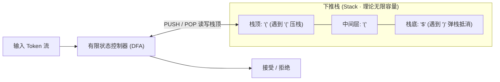
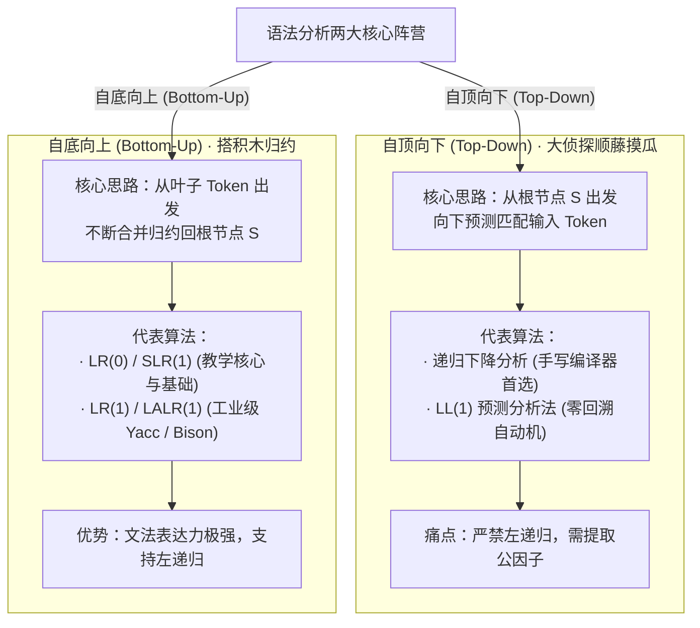

import StepVisualizer from '../../../components/interactive/StepVisualizer';
import QuizCard from '../../../components/interactive/QuizCard';

# 04. 语法分析前置篇：为什么有限状态机不够用了？

> “你可以用有限自动机走完一段路，但要记住你走过了多少道弯，必须带上一张无限的便签纸。”

在上一章中，我们凭借**有限状态机（DFA / NFA）** 在 $O(N)$ 时间内成功征服了词法分析。无论是几千行的标识符还是形态各异的浮点数字面量，DFA 都能游刃有余地切分处理。

然而，当流水线进入第二道工序——**语法分析（Syntax Analysis / Parsing）** 时，面对由 Token 构成的语句，我们是否还能继续仰仗有限状态机呢？

---

## 1. 括号匹配困境：有穷内存的物理死穴

在日常编程中，深层嵌套的括号与结构随处可见：

```c
if (((a + b) * (c - (d / e))) > 0) { ... }
```

我们把这个核心问题抽象为一个形式语言经典问题：**识别所有形如 $a^n b^n \; (n \ge 1)$ 的语言**（即 $n$ 个左括号紧接着 $n$ 个右括号，且左右数量必须严格相等）。

> **核心拷问**：在数学理论上，一台拥有有限个状态的自动机（DFA），能否识别 $L = \{ a^n b^n \mid n \ge 1 \}$？

### 答案是：绝对不可能！

为什么？关键就在于有限自动机名字里的“**有限（Finite）**”二字：
1. 假设某台 DFA 内部有且仅有 $k$ 个内部状态（比如 $k = 1000$ 个状态）。
2. 当输入串的左括号数量超过状态数（如输入了 $k + 1 = 1001$ 个连续的左括号 `((((...`）时，根据**鸽巢原理（抽屉原理 / 泵引理 Pumping Lemma）**：
   * $k + 1$ 个符号必然迫使 DFA 在有限的 $k$ 个状态中至少**两次访问同一个状态**。
   * 这意味着在读取左括号的过程中，状态机内部**必然发生了状态循环回绕（Loop）**！
3. 一旦发生循环回绕，DFA 就彻底遗忘了自己究竟转了 1 圈、10 圈还是 100 圈——**它完全丢失了“当前究竟打开了多少层括号”的记忆！**
4. 当后续右括号来临时，DFA 根本无法核验右括号的数量是否精确等于左括号的数量。

结论：**正则语言（Regular Language）与有限自动机无法描述任意深度的嵌套与对称匹配结构。**

---

## 2. 引入下推自动机（PDA）：外挂无限内存的救赎

既然有限自动机死在“状态有限、没有外置内存”上，那么解法呼之欲出：
**给有限状态机外挂一个拥有无限容量、后进先出（LIFO）的数据结构——栈（Stack）！**



这种由“有限控制器 + 一个下推栈”构成的计算模型，在自动机理论中被称为**下推自动机（Pushdown Automata, PDA）**。

### PDA 匹配平衡括号的基本法则：
1. 遇到左括号 `(`：执行 `PUSH('(')`，栈深增加 1。
2. 遇到右括号 `)`：
   * 若栈顶为 `(`，执行 `POP()`，消除一对匹配括号。
   * 若栈顶无 `(` 或栈已空（只有栈底符 `$`），立即报错（右括号过早闭合）。
3. 当输入流读取完毕时：
   * 若栈顶恰好为栈底界符 `$`，则匹配成功（**ACCEPT**）！
   * 若栈中残留有未抵消的 `(`，则报错（左括号未闭合）。

---

## 交互演练：下推自动机（PDA）栈匹配全过程

下方的动态演练演示了输入序列 `( ( ) ( ) )` 时，PDA 下推栈的逐步吞吐轨迹，并实时对比一个仅能记忆 2 层嵌套的无栈 DFA 是如何发生内存状态溢出的：

<StepVisualizer
  client:visible
  title="下推自动机 (PDA) 括号消除演练 (输入串: ( ( ) ( ) ) )"
  algorithmName="Pushdown Automata Simulation"
  steps={[
    {
      title: "步骤 0：初始就绪",
      badge: "初始栈底",
      description: "PDA 处于初始状态。下推栈预置栈底界符 '$'。输入流指针指向首个 Token '('。只具备 2 位计数状态的对照组 DFA 处于 S0 状态。",
      stateView: (
        <div className="grid grid-cols-1 md:grid-cols-2 gap-4">
          <div className="p-4 rounded-xl border border-cyan-800/60 bg-slate-950">
            <div className="text-xs font-mono text-cyan-300 font-bold mb-2">PDA 下推栈 (自底向上):</div>
            <div className="flex items-center gap-2 font-mono text-xs">
              <span className="px-3 py-1.5 rounded bg-slate-800 text-slate-300 border border-slate-700">$ (栈底)</span>
            </div>
            <div className="mt-2 text-[11px] text-slate-400 font-mono">剩余待读: ['(', '(', ')', '(', ')', ')', '$']</div>
          </div>
          <div className="p-4 rounded-xl border border-slate-800 bg-slate-950">
            <div className="text-xs font-mono text-slate-400 font-bold mb-2">无栈 DFA 状态 (最大记忆深度 k=2):</div>
            <div className="text-sm font-bold text-slate-300 font-mono">当前状态: S0 (计数 = 0)</div>
            <div className="mt-2 text-[11px] text-emerald-400">状态安全</div>
          </div>
        </div>
      )
    },
    {
      title: "步骤 1：读入第 1 个 '(' ── 压栈",
      badge: "PUSH",
      description: "读入左括号 '('。PDA 执行 PUSH('(')，栈深增至 1。对照组 DFA 计数递增，转移至状态 S1。",
      stateView: (
        <div className="grid grid-cols-1 md:grid-cols-2 gap-4">
          <div className="p-4 rounded-xl border border-cyan-800/60 bg-slate-950">
            <div className="text-xs font-mono text-cyan-300 font-bold mb-2">PDA 下推栈 (自底向上):</div>
            <div className="flex items-center gap-2 font-mono text-xs">
              <span className="px-3 py-1.5 rounded bg-slate-800 text-slate-300 border border-slate-700">$</span>
              <span className="px-3 py-1.5 rounded bg-cyan-950 text-cyan-200 border border-cyan-500 font-bold">('(')</span>
            </div>
            <div className="mt-2 text-[11px] text-slate-400 font-mono">动作: PUSH('(') ── 栈深: 1</div>
          </div>
          <div className="p-4 rounded-xl border border-slate-800 bg-slate-950">
            <div className="text-xs font-mono text-slate-400 font-bold mb-2">无栈 DFA 状态:</div>
            <div className="text-sm font-bold text-slate-300 font-mono">当前状态: S1 (计数 = 1)</div>
            <div className="mt-2 text-[11px] text-emerald-400">状态安全</div>
          </div>
        </div>
      )
    },
    {
      title: "步骤 2：读入第 2 个 '(' ── 继续压栈",
      badge: "PUSH",
      description: "读入第 2 个 '('。PDA 执行 PUSH('(')，栈深增至 2。DFA 状态转移至 S2（触及记忆容量上限！）。",
      stateView: (
        <div className="grid grid-cols-1 md:grid-cols-2 gap-4">
          <div className="p-4 rounded-xl border border-cyan-800/60 bg-slate-950">
            <div className="text-xs font-mono text-cyan-300 font-bold mb-2">PDA 下推栈 (自底向上):</div>
            <div className="flex items-center gap-2 font-mono text-xs">
              <span className="px-3 py-1.5 rounded bg-slate-800 text-slate-300 border border-slate-700">$</span>
              <span className="px-3 py-1.5 rounded bg-cyan-950 text-cyan-200 border border-cyan-700 font-mono">('(')</span>
              <span className="px-3 py-1.5 rounded bg-cyan-950 text-cyan-200 border border-cyan-500 font-bold">('(') [栈顶]</span>
            </div>
            <div className="mt-2 text-[11px] text-slate-400 font-mono">动作: PUSH('(') ── 栈深: 2</div>
          </div>
          <div className="p-4 rounded-xl border border-amber-800/60 bg-slate-950">
            <div className="text-xs font-mono text-amber-300 font-bold mb-2">无栈 DFA 状态:</div>
            <div className="text-sm font-bold text-amber-300 font-mono">当前状态: S2 (计数 = 2)</div>
            <div className="mt-2 text-[11px] text-amber-400">已达状态容量临界点！</div>
          </div>
        </div>
      )
    },
    {
      title: "步骤 3：读入第 3 个字符 ')' ── 弹栈抵消",
      badge: "POP",
      description: "读入右括号 ')'。PDA 发现栈顶为 '('，立刻执行 POP() 抵消！栈深缩减为 1。DFA 计数回退至 S1。",
      stateView: (
        <div className="grid grid-cols-1 md:grid-cols-2 gap-4">
          <div className="p-4 rounded-xl border border-cyan-800/60 bg-slate-950">
            <div className="text-xs font-mono text-cyan-300 font-bold mb-2">PDA 下推栈 (自底向上):</div>
            <div className="flex items-center gap-2 font-mono text-xs">
              <span className="px-3 py-1.5 rounded bg-slate-800 text-slate-300 border border-slate-700">$</span>
              <span className="px-3 py-1.5 rounded bg-cyan-950 text-cyan-200 border border-cyan-500 font-bold">('(') [栈顶]</span>
            </div>
            <div className="mt-2 text-[11px] text-emerald-400 font-mono">动作: POP() 抵消内层括号 ── 栈深: 1</div>
          </div>
          <div className="p-4 rounded-xl border border-slate-800 bg-slate-950">
            <div className="text-xs font-mono text-slate-400 font-bold mb-2">无栈 DFA 状态:</div>
            <div className="text-sm font-bold text-slate-300 font-mono">当前状态: S1 (计数 = 1)</div>
            <div className="mt-2 text-[11px] text-emerald-400">计数恢复</div>
          </div>
        </div>
      )
    },
    {
      title: "步骤 4：读入第 4 个字符 '(' ── 再次压栈",
      badge: "PUSH",
      description: "读入新分支的左括号 '('。PDA 执行 PUSH('(')，栈深重回 2。PDA 依靠物理栈准确区分了兄弟括号与嵌套括号。",
      stateView: (
        <div className="grid grid-cols-1 md:grid-cols-2 gap-4">
          <div className="p-4 rounded-xl border border-cyan-800/60 bg-slate-950">
            <div className="text-xs font-mono text-cyan-300 font-bold mb-2">PDA 下推栈 (自底向上):</div>
            <div className="flex items-center gap-2 font-mono text-xs">
              <span className="px-3 py-1.5 rounded bg-slate-800 text-slate-300 border border-slate-700">$</span>
              <span className="px-3 py-1.5 rounded bg-cyan-950 text-cyan-200 border border-cyan-700 font-mono">('(')</span>
              <span className="px-3 py-1.5 rounded bg-cyan-950 text-cyan-200 border border-cyan-500 font-bold">('(') [栈顶]</span>
            </div>
            <div className="mt-2 text-[11px] text-slate-400 font-mono">动作: PUSH('(') ── 栈深: 2</div>
          </div>
          <div className="p-4 rounded-xl border border-amber-800/60 bg-slate-950">
            <div className="text-xs font-mono text-amber-300 font-bold mb-2">无栈 DFA 状态:</div>
            <div className="text-sm font-bold text-amber-300 font-mono">当前状态: S2 (计数 = 2)</div>
            <div className="mt-2 text-[11px] text-amber-400">容量临界</div>
          </div>
        </div>
      )
    },
    {
      title: "步骤 5：读入第 5 个字符 ')' ── 再次弹栈",
      badge: "POP",
      description: "读入右括号 ')'。PDA 弹出栈顶的 '('，内部兄弟结构消除。栈中仅剩最外层的初始 '('。",
      stateView: (
        <div className="grid grid-cols-1 md:grid-cols-2 gap-4">
          <div className="p-4 rounded-xl border border-cyan-800/60 bg-slate-950">
            <div className="text-xs font-mono text-cyan-300 font-bold mb-2">PDA 下推栈 (自底向上):</div>
            <div className="flex items-center gap-2 font-mono text-xs">
              <span className="px-3 py-1.5 rounded bg-slate-800 text-slate-300 border border-slate-700">$</span>
              <span className="px-3 py-1.5 rounded bg-cyan-950 text-cyan-200 border border-cyan-500 font-bold">('(') [栈顶]</span>
            </div>
            <div className="mt-2 text-[11px] text-emerald-400 font-mono">动作: POP() 消除兄弟结构 ── 栈深: 1</div>
          </div>
          <div className="p-4 rounded-xl border border-slate-800 bg-slate-950">
            <div className="text-xs font-mono text-slate-400 font-bold mb-2">无栈 DFA 状态:</div>
            <div className="text-sm font-bold text-slate-300 font-mono">当前状态: S1 (计数 = 1)</div>
            <div className="mt-2 text-[11px] text-emerald-400">计数恢复</div>
          </div>
        </div>
      )
    },
    {
      title: "步骤 6：读入第 6 个字符 ')' 与界符 '$' ── 完全闭合与接受",
      badge: "ACCEPT",
      description: "读入最后的右括号 ')'，弹出最后一个 '('。输入流到达结束界符 '$'。此时 PDA 栈内仅剩底符 '$'，完美归零，判定输入串合法接收（ACCEPT）！",
      stateView: (
        <div className="grid grid-cols-1 md:grid-cols-2 gap-4">
          <div className="p-4 rounded-xl border border-emerald-500/60 bg-emerald-950/30">
            <div className="text-xs font-mono text-emerald-300 font-bold mb-2">PDA 下推栈:</div>
            <div className="flex items-center gap-2 font-mono text-xs">
              <span className="px-3 py-1.5 rounded bg-emerald-900/60 text-emerald-200 border border-emerald-500 font-bold">$ (栈底)</span>
            </div>
            <div className="mt-2 text-xs font-bold text-emerald-400">状态: ACCEPT (合法平衡括号序列！)</div>
          </div>
          <div className="p-4 rounded-xl border border-slate-800 bg-slate-950">
            <div className="text-xs font-mono text-slate-400 font-bold mb-2">无栈 DFA 状态:</div>
            <div className="text-sm font-bold text-slate-300 font-mono">当前状态: S0 (0)</div>
            <div className="mt-2 text-[11px] text-slate-500">注：若嵌套深度为 3，DFA 将彻底崩溃溢出</div>
          </div>
        </div>
      )
    }
  ]}
/>

---

## 3. 上下文无关文法（CFG）形式定义

为了严谨地用数学形式描述这种带有嵌套结构的语言，Noam Chomsky 提出了著名的形式语言层次体系（Chomsky Hierarchy）：
* **3 型语言（正规语言 / 正则表达式）** $\to$ 由有限自动机（DFA / NFA）识别。
* **2 型语言（上下文无关语言 / Context-Free Language, CFL）** $\to$ 由**下推自动机（PDA）** 识别。

### CFG 四元组定义
一个上下文无关文法 $G$ 被严格定义为一个四元组：

$$
G = (V_N, \; V_T, \; P, \; S)
$$

1. **$V_N$（非终结符集合，Non-terminals）**：能够继续向下展开推导的抽象语法概念，通常用大写字母表示（如 $E$ 表示表达式，$T$ 表示项，$F$ 表示因子）。
2. **$V_T$（终结符集合，Terminals）**：词法分析器输出的不可再分的真实 Token，对应程序中的具体单词或标点符号（如 `id`, `+`, `*`, `(`, `)`）。注意：$V_N \cap V_T = \emptyset$。
3. **$P$（产生式规则集合，Productions）**：形如 $A \to \alpha$ 的代换规则，其中左部 $A \in V_N$，右部 $\alpha \in (V_N \cup V_T)^*$。上下文无关的本质在于：**只要看到左边的 $A$，无论它处于什么上下文环境中，都可以合法替换为右边的 $\alpha$**。
4. **$S$（开始符号，Start Symbol）**：文法的根节点抽象概念，$S \in V_N$。

### 括号匹配语言的 CFG 定义：
$$
S \to ( S ) \mid S S \mid \epsilon
$$
看！仅用一行极其优雅的产生式，就完美涵盖了任意深度的嵌套括号、任意长度的兄弟括号以及空串！这是正则表达式无论如何也写不出来的。

---

## 4. 推导过程与语法树的二义性

### 推导（Derivation）
从文法开始符号 $S$ 出发，每次挑选一个非终结符用其产生式右部替换，最终全部替换为终结符的过程称为**推导**：
* **最左推导（Leftmost Derivation）**：在推导的每一步中，总是**严格挑选最左边的非终结符**进行替换（自顶向下分析的基础）。
* **最右推导（Rightmost Derivation / 规范推导）**：在每一步中，总是**严格挑选最右边的非终结符**进行替换（自底向上分析的逆过程）。

### 文法二义性（Ambiguity）
如果一个文法对于同一个句子，能够构建出**两棵结构不同的语法树**（或者存在两个不同的最左推导），则称该文法是**二义性文法**！

例如经典二义性算术文法：
$$
E \to E + E \mid E * E \mid \mathbf{id}
$$
对于句子 $\mathbf{id} + \mathbf{id} * \mathbf{id}$：
* 语法树 A：把加法作为根节点，乘法作为子树 $\implies$ 先算乘法后算加法。
* 语法树 B：把乘法作为根节点，加法作为子树 $\implies$ 先算加法后算乘法。

计算机代码必须具备确定无疑的唯一语义，因此编译器前端必须通过**显式划分优先级与结合性**对二义性文法进行改写消除。

---

## 5. 语法分析两大阵营总览

掌握了 CFG 之后，我们该如何把扁平的 Token 流构建为一棵唯一的抽象语法树（AST）？在编译技术史上形成了两大主流学派：



---

## 概念巩固自测

<QuizCard
  client:visible
  category="形式文法核心自测"
  question="关于正规语言（Regular Language）与上下文无关语言（Context-Free Language, CFL）的本质区别，下列叙述正确的是？"
  options={[
    "正规语言能识别任意深度的对称嵌套结构（如 a^n b^n），但无法识别包含分支选择结构的语言。",
    "有限自动机（DFA）由于缺乏可动态扩展的外置后进先出存储（栈），根据泵引理在面对任意深度的嵌套匹配时必然发生状态回绕从而丢失计数，而下推自动机（PDA）通过引入无限下推栈克服了这一缺陷。",
    "任何上下文无关文法（CFG）都可以直接用简单的正则表达式（Regex）等价表达，两者在表达能力上是完全等价的。",
    "二义性文法是指一个文法中非终结符的个数超过了终结符的个数，导致无法建立唯一的符号表映射。"
  ]}
  answer={1}
  explanation="选项 B 正确：有限自动机的物理内存上限由状态数 k 锁死，无法存储任意大的正整数 n；而下推自动机（PDA）引入了后进先出的栈结构，能够通过入栈和出栈精确匹配嵌套深度。选项 A 错误，正规语言绝对无法识别 a^n b^n；选项 C 错误，CFG 的表达能力严格大于正则表达式（Chomsky 2 型包含 3 型）；选项 D 错误，二义性文法的定义是同一个句子存在两棵不同的语法分析树。"
/>

---

## 总结与下一步

在本章中，我们建立了深刻的形式语言直觉：
1. **有限内存极限**：有限自动机无法完成任意深度的括号匹配。
2. **下推自动机与 CFG**：通过外挂后进先出栈，我们迈入了**上下文无关文法（CFG）** 的广阔天地。
3. **推导与二义性**：语法树展示结合性与优先级，二义性必须被严密消除。

在下一章中，我们将深入第一大流派——**自顶向下分析（Top-Down）**，直面它的两大死敌：“**左递归导致的无限爆栈**”与“**选择分支的回溯陷阱**”，亲手推导优雅的 **LL(1) 分析器与预测分析表**！
