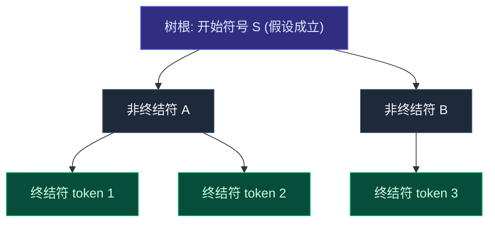
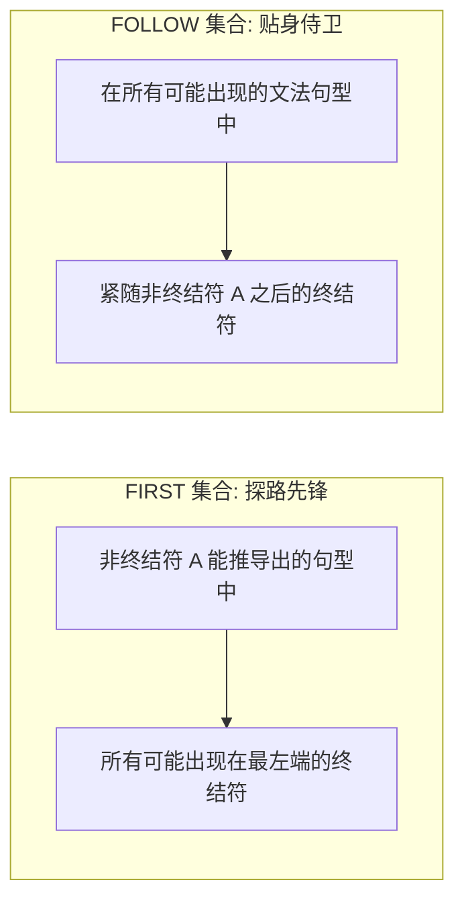

import StepVisualizer from '../../../components/interactive/StepVisualizer';
import QuizCard from '../../../components/interactive/QuizCard';

## 1. 大侦探的破案之旅：自顶向下核心直觉

在词法分析阶段，我们把源代码字符流切分成了一串扁平的 **Token 序列**。但是，计算机程序具有严格的层次化树状结构（例如表达式优先级、代码嵌套块）。**语法分析（Syntax Analysis / Parsing）** 的任务，正是把一维的 Token 串还原成一棵二维的**语法分析树（Parse Tree）**。

如何还原这棵树？编译原理有两大阵营：
1. **自顶向下分析（Top-Down Parsing）**：从文法的**开始符号 $S$（树根）** 出发，自上而下不断推导、猜想、展开，试图精确匹配输入的每个 Token。
2. **自底向上分析（Bottom-Up Parsing）**：从输入的各个叶子 Token 出发，自下而上不断归约合并，最终汇聚于树根 $S$。

自顶向下分析就像一位**顺藤摸瓜的大侦探**：心中先有一个全局假设（“这里应该是一个函数定义”），然后根据文法规则层层剥茧（“函数定义由返回类型、函数名、参数列表、复合语句构成”），一步步与现实中的证据（Token 流）对照验证。



---

## 2. 递归下降分析：最纯粹的手写语法分析器

如果我们让程序员用最自然的直觉手写一个语法分析器，最直接的方法就是**递归下降分析（Recursive Descent Parsing）**：
* 为文法中的**每一个非终结符**编写一个函数（如 `void E()`、`void T()`、`void F()`）。
* 函数内部遇到**终结符**，调用 `match(token)` 检查并吃掉一个 Token；
* 遇到**非终结符**，直接递归调用该非终结符对应的函数。

```c
// 伪代码：解析加法表达式 E -> T + E | T
void E() {
    T();                // 递归解析第一个项 T
    if (lookahead == '+') {
        match('+');     // 匹配加号并消费
        E();            // 递归解析右侧的 E
    }
}

void T() {
    F();
    if (lookahead == '*') {
        match('*');
        T();
    }
}
```

递归下降的代码逻辑与文法规则几乎一一映射，极其清晰优雅。然而，这种朴素的翻译方式隐藏着一个**致命陷阱**。

---

## 3. 致命陷阱：左递归与无限爆栈

### 3.1 什么是直接左递归？

考察经典的左结合算术加法文法：
$$E \to E + T \mid T$$

如果我们按照递归下降的直觉写出函数：
```c
void E() {
    E();        // 刚进函数第一行：直接递归调用 E()！
    match('+');
    T();
}
```

**惨剧发生了**：
1. 主程序调用 `E()`；
2. 进入 `E()`，尚未读取任何输入 Token，第一行就调用 `E()`；
3. 第二个 `E()` 又立刻调用第三个 `E()`……
4. 计算机操作系统的调用栈深度瞬间被耗尽，发生著名的 **Stack Overflow（栈溢出崩溃）**！

这就是**左递归（Left Recursion）** 的死结：产生式右部的第一个符号就是左部自身，导致分析器无法先“吃进”任何终结符来推动输入指针前进。

### 3.2 消除直接左递归算法

我们必须对文法做数学上的“等价手术”，把**左递归转换为右递归**。

#### 定理与推导：
设关于非终结符 $A$ 的直接左递归产生式为：
$$A \to A \alpha_1 \mid A \alpha_2 \mid \dots \mid A \alpha_m \mid \beta_1 \mid \beta_2 \mid \dots \mid \beta_n$$
其中每个 $\beta_i$ 均不以 $A$ 开头。

观察由该文法生成的串，其结构必定是：某个 $\beta$ 后面跟随任意个（包括 0 个）$\alpha$ 序列：
$$\beta (\alpha_1 \mid \alpha_2 \mid \dots \mid \alpha_m)^*$$

因此，我们可以引入一个全新的非终结符 $A'$，改写产生式为：
$$A \to \beta_1 A' \mid \beta_2 A' \mid \dots \mid \beta_n A'$$
$$A' \to \alpha_1 A' \mid \alpha_2 A' \mid \dots \mid \alpha_m A' \mid \epsilon$$

> **直觉本质**：
> 改写后，进入 `A()` 必须首先调用 $\beta$ 对应函数，**稳稳吃掉至少一个真实 Token**；随后再由 $A'$ 决定是否继续吃后续的 $\alpha$，如果后面没有符号，则经由 $\epsilon$ 优雅返回！

#### 经典加法文法消除实例：
原产生式：
$$E \to E + T \mid T$$
* 此处 $\alpha = + T$，$\beta = T$。
* 消除左递归后得到：
$$E \to T E'$$
$$E' \to + T E' \mid \epsilon$$

---

## 4. 间接左递归的消除（考研与竞赛高频大题）

有时左递归不是显式出现在单条产生式中，而是隐藏在多个产生式构成的闭环环路中（如 $A \Rightarrow B \alpha \Rightarrow A \beta \alpha$），这被称为**间接左递归**。

### 消除间接左递归的标准算法：
1. **排序**：将文法中所有的非终结符按任意固定顺序编号为 $A_1, A_2, \dots, A_n$。
2. **两重循环消解**：
   ```text
   for i = 1 to n:
       for j = 1 to i - 1:
           将所有形如 Ai -> Aj γ 的产生式中的 Aj，
           用 Aj 的所有已有产生式右部替换展开
       消除关于 Ai 的所有直接左递归
   ```
3. **剪枝**：化简文法，删除不可达的无用产生式。

---

## 5. 提取左公因子：消除前瞻歧义

除了左递归，另一个导致自顶向下分析失败的问题是**公共前缀**。例如：
$$S \to \mathbf{if} \; E \; \mathbf{then} \; S \; \mathbf{else} \; S \mid \mathbf{if} \; E \; \mathbf{then} \; S$$

当分析器看到输入单词 $\mathbf{if}$ 时，由于两条分支都以 $\mathbf{if}$ 开头，它根本无法决定该走哪条路，除非进行昂贵的回溯。

**提取左公因子（Left Factoring）** 的做法如下：
若 $A \to \alpha \beta_1 \mid \alpha \beta_2$，引入新符号 $A'$：
$$A \to \alpha A'$$
$$A' \to \beta_1 \mid \beta_2$$

分析器只要先匹配公共前缀 $\alpha$，吃完之后再看下一个 Token 决定进入 $A'$ 的哪一个分支。

---

## 6. LL(1) 预测分析与核心集合：FIRST 与 FOLLOW

消除左递归并提取左公因子后，文法就具备了构建 **LL(1) 预测分析器**的基石：
* **L**：从左向右扫描输入（Left-to-right scan）
* **L**：构造最左推导（Leftmost derivation）
* **1**：**每次仅向前偷看 1 个输入 Token（Lookahead 1）**，即可 100% 毫无犹豫地挑出正确的产生式，做到**零回溯**！

LL(1) 分析器的核心灵魂是两个数学集合：$\text{FIRST}$ 集合与 $\text{FOLLOW}$ 集合。



### 6.1 FIRST 集合计算准则

对文法中任意符号 $X$：
1. 若 $X$ 是**终结符**，则 $\text{FIRST}(X) = \{ X \}$。
2. 若有产生式 $X \to \epsilon$，则 $\epsilon \in \text{FIRST}(X)$。
3. 若 $X$ 是**非终结符**且有产生式 $X \to Y_1 Y_2 \dots Y_k$：
   * 将 $\text{FIRST}(Y_1) \setminus \{ \epsilon \}$ 加入 $\text{FIRST}(X)$；
   * 若 $Y_1 \Rightarrow^* \epsilon$，再把 $\text{FIRST}(Y_2) \setminus \{ \epsilon \}$ 加入，依此类推；
   * 只有当所有 $Y_1, \dots, Y_k$ 都能推导出 $\epsilon$ 时，才将 $\epsilon$ 加入 $\text{FIRST}(X)$。

### 6.2 FOLLOW 集合计算准则（仅针对非终结符）

对非终结符 $A$：
1. 若 $A$ 是**开始符号 $S$**，将输入串结束标志 `$`（或 `#`）加入 $\text{FOLLOW}(S)$。
2. 若存在产生式 $A \to \alpha B \beta$：
   * 将 $\text{FIRST}(\beta) \setminus \{ \epsilon \}$ 加入 $\text{FOLLOW}(B)$。
3. 若存在产生式 $A \to \alpha B$，或者 $A \to \alpha B \beta$ 且 $\beta \Rightarrow^* \epsilon$：
   * 将 $\text{FOLLOW}(A)$ 中的**全部元素追加加入** $\text{FOLLOW}(B)$（父随子传，末尾传递律）。

---

## 7. 经典算术表达式文法的 FIRST / FOLLOW 推导

给定消除左递归后的标准算术表达式文法：
1. $E \to T E'$
2. $E' \to + T E' \mid \epsilon$
3. $T \to F T'$
4. $T' \to * F T' \mid \epsilon$
5. $F \to ( E ) \mid \mathbf{id}$

### FIRST / FOLLOW 严格推导结果表：

| 非终结符 | 中文语义 | 对应产生式 | $\text{FIRST}$ 集合 | $\text{FOLLOW}$ 集合 | 核心推导逻辑 |
| :---: | :---: | :--- | :---: | :---: | :--- |
| **$E$** | 表达式 | $E \to T E'$ | `(`, `id` | `)`, `$` | 开始符号含 `$`；$F \to ( E )$ 带来 `)` |
| **$E'$** | 加法余项 | $E' \to + T E' \mid \epsilon$ | `+`, `ε` | `)`, `$` | 末尾继承 $\text{FOLLOW}(E)$ |
| **$T$** | 项 | $T \to F T'$ | `(`, `id` | `+`, `)`, `$` | $E \to T E'$ 带来 $\text{FIRST}(E') \setminus \{\epsilon\} = \{+\}$，又 $E' \Rightarrow \epsilon$ 继承 $\text{FOLLOW}(E')$ |
| **$T'$** | 乘法余项 | $T' \to * F T' \mid \epsilon$ | `*`, `ε` | `+`, `)`, `$` | 末尾继承 $\text{FOLLOW}(T)$ |
| **$F$** | 因子 | $F \to ( E ) \mid \mathbf{id}$ | `(`, `id` | `*`, `+`, `)`, `$` | $T \to F T'$ 带来 $\text{FIRST}(T') \setminus \{\epsilon\} = \{*\}$，又 $T' \Rightarrow \epsilon$ 继承 $\text{FOLLOW}(T')$ |

---

## 8. LL(1) 预测分析表的构造

### 填表算法：
对于文法中的每条产生式 $A \to \alpha$：
1. 对每个终结符 $a \in \text{FIRST}(\alpha)$，将 $A \to \alpha$ 填入分析表单元格 $M[A, a]$；
2. 若 $\epsilon \in \text{FIRST}(\alpha)$，则对每个终结符 $b \in \text{FOLLOW}(A)$（包括结束符 `$`），将 $A \to \alpha$ 填入 $M[A, b]$。

根据上述规则，得到完整的 LL(1) 预测分析表：

| 非终结符 | $\mathbf{id}$ | $+$ | $*$ | $($ | $)$ | `$` |
| :---: | :---: | :---: | :---: | :---: | :---: | :---: |
| **$E$** | $E \to T E'$ | | | $E \to T E'$ | | |
| **$E'$** | | $E' \to + T E'$ | | | $E' \to \epsilon$ | $E' \to \epsilon$ |
| **$T$** | $T \to F T'$ | | | $T \to F T'$ | | |
| **$T'$** | | $T' \to \epsilon$ | $T' \to * F T'$ | | $T' \to \epsilon$ | $T' \to \epsilon$ |
| **$F$** | $F \to \mathbf{id}$ | | | $F \to ( E )$ | | |

> **LL(1) 文法的充要条件**：
> 构造出的预测分析表 $M$，其**每一个格子内至多包含一条产生式**。如果有任何一个格子包含两条或更多产生式，说明文法存在分支冲突，绝不是 LL(1) 文法！

---

## 9. 交互实验：输入串 `id + id * id $` 的 17 步分析栈推演

以下交互式步进器展示了预测分析器在面对经典表达式 `id + id * id $` 时的每一步执行状态。
分析器维护一个**符号分析栈**（栈底为 `$`，栈顶在右）和**剩余输入流**。

export const ll1Steps = [
  {
    title: "步骤 1：查 M[E, id]：用 E → T E' 展开",
    badge: "展开 EXPAND",
    description: "栈顶为非终结符 E，面对当前输入符号 id。查预测分析表 M[E, id]，得到产生式 E → T E'。将 E 弹出，并将其右部符号逆序压栈（先压 E'，再压 T）。",
    code: "栈状态: [ $, E ]\n输入串: id + id * id $\n动作: 查 M[E, id] 展开为 T E'"
  },
  {
    title: "步骤 2：查 M[T, id]：用 T → F T' 展开",
    badge: "展开 EXPAND",
    description: "栈顶为非终结符 T，当前输入为 id。查表 M[T, id]，执行产生式 T → F T'，弹出 T，将 T' 和 F 逆序压栈。",
    code: "栈状态: [ $, E', T ]\n输入串: id + id * id $\n动作: 查 M[T, id] 展开为 F T'"
  },
  {
    title: "步骤 3：查 M[F, id]：用 F → id 展开",
    badge: "展开 EXPAND",
    description: "栈顶为非终结符 F，当前输入为 id。查表 M[F, id]，执行产生式 F → id，弹出 F，将终结符 id 压入栈顶。",
    code: "栈状态: [ $, E', T', F ]\n输入串: id + id * id $\n动作: 查 M[F, id] 展开为 id"
  },
  {
    title: "步骤 4：匹配终结符 id，弹出栈顶，指针前移",
    badge: "匹配 MATCH",
    description: "栈顶终结符 id 与当前输入符号 id 完全吻合！匹配成功，弹出栈顶 id，输入指针右移一位至下一个符号 '+'。",
    code: "栈状态: [ $, E', T', id ]  <-- 匹配成功！\n输入串: id + id * id $\n动作: 弹出栈顶 id，输入流消费 id"
  },
  {
    title: "步骤 5：查 M[T', +]：用 T' → ε（弹出 T'）",
    badge: "空产生式 ε",
    description: "栈顶为 T'，当前输入为 '+'。查表 M[T', +] 得 T' → ε。因为 ε 代表空串，直接将 T' 弹出栈，不消耗当前输入的加号！",
    code: "栈状态: [ $, E', T' ]\n输入串: + id * id $\n动作: 查 M[T', +] 规约空产生式 T' → ε"
  },
  {
    title: "步骤 6：查 M[E', +]：用 E' → + T E' 展开",
    badge: "展开 EXPAND",
    description: "栈顶为 E'，当前输入为 '+'。查表 M[E', +] 得到产生式 E' → + T E'。弹出 E'，逆序压入 E', T, '+'。",
    code: "栈状态: [ $, E' ]\n输入串: + id * id $\n动作: 查 M[E', +] 展开为 + T E'"
  },
  {
    title: "步骤 7：匹配终结符 +，弹出栈顶，指针前移",
    badge: "匹配 MATCH",
    description: "栈顶终结符 '+' 与当前输入符号 '+' 吻合！弹出栈顶 '+'，输入指针右移至第二个 id。",
    code: "栈状态: [ $, E', T, + ]  <-- 匹配成功！\n输入串: + id * id $\n动作: 弹出栈顶 +，输入流消费 +"
  },
  {
    title: "步骤 8：查 M[T, id]：用 T → F T' 展开",
    badge: "展开 EXPAND",
    description: "栈顶为 T，当前输入为 id。查表 M[T, id]，执行产生式 T → F T'，弹出 T，压入 T' 和 F。",
    code: "栈状态: [ $, E', T ]\n输入串: id * id $\n动作: 查 M[T, id] 展开为 F T'"
  },
  {
    title: "步骤 9：查 M[F, id]：用 F → id 展开",
    badge: "展开 EXPAND",
    description: "栈顶为 F，面对第二个 id。查表 M[F, id]，展开为 F → id。",
    code: "栈状态: [ $, E', T', F ]\n输入串: id * id $\n动作: 查 M[F, id] 展开为 id"
  },
  {
    title: "步骤 10：匹配终结符 id，弹出栈顶，指针前移",
    badge: "匹配 MATCH",
    description: "栈顶 id 与输入流第二个 id 匹配成功！弹出 id，输入指针前移至乘号 '*'。",
    code: "栈状态: [ $, E', T', id ]  <-- 匹配成功！\n输入串: id * id $\n动作: 弹出栈顶 id，输入流消费 id"
  },
  {
    title: "步骤 11：查 M[T', *]：用 T' → * F T' 展开",
    badge: "展开 EXPAND",
    description: "栈顶为 T'，当前输入为 '*'。查表 M[T', *]，执行产生式 T' → * F T'。弹出 T'，逆序压入 T', F, '*'。",
    code: "栈状态: [ $, E', T' ]\n输入串: * id $\n动作: 查 M[T', *] 展开为 * F T'"
  },
  {
    title: "步骤 12：匹配终结符 *，弹出栈顶，指针前移",
    badge: "匹配 MATCH",
    description: "栈顶乘号 '*' 与输入符号 '*' 吻合！弹出 '*'，输入指针右移至第三个 id。",
    code: "栈状态: [ $, E', T', F, * ]  <-- 匹配成功！\n输入串: * id $\n动作: 弹出栈顶 *，输入流消费 *"
  },
  {
    title: "步骤 13：查 M[F, id]：用 F → id 展开",
    badge: "展开 EXPAND",
    description: "栈顶为 F，面对第三个 id。查表 M[F, id]，执行产生式 F → id，将 F 替换为 id。",
    code: "栈状态: [ $, E', T', F ]\n输入串: id $\n动作: 查 M[F, id] 展开为 id"
  },
  {
    title: "步骤 14：匹配终结符 id，弹出栈顶，指针前移",
    badge: "匹配 MATCH",
    description: "栈顶 id 匹配第三个操作数 id，弹出栈顶，输入指针到达句子终结符 '$'。",
    code: "栈状态: [ $, E', T', id ]  <-- 匹配成功！\n输入串: id $\n动作: 弹出栈顶 id，输入流消费 id"
  },
  {
    title: "步骤 15：查 M[T', $]：用 T' → ε（弹出 T'）",
    badge: "空产生式 ε",
    description: "栈顶为 T'，当前面对输入末尾 '$'。查表 M[T', $] 得 T' → ε。弹出 T'。",
    code: "栈状态: [ $, E', T' ]\n输入串: $\n动作: 查 M[T', $] 规约空产生式 T' → ε"
  },
  {
    title: "步骤 16：查 M[E', $]：用 E' → ε（弹出 E'）",
    badge: "空产生式 ε",
    description: "栈顶为 E'，面对输入末尾 '$'。查表 M[E', $] 得 E' → ε。弹出 E'。",
    code: "栈状态: [ $, E' ]\n输入串: $\n动作: 查 M[E', $] 规约空产生式 E' → ε"
  },
  {
    title: "步骤 17：栈底与输入界符重合，分析成功 ACCEPT！",
    badge: "成功 ACCEPT",
    description: "分析栈内仅剩界符 '$'，输入流也刚好消耗至结尾 '$'。自顶向下 LL(1) 预测分析完全成功接受（ACCEPT）！",
    code: "栈状态: [ $ ]\n输入串: $\n结果: 分析成功 ACCEPT！"
  }
];

<StepVisualizer client:visible steps={ll1Steps} title="输入串 id + id * id $ 的 17 步预测分析栈推演" algorithmName="LL(1) 预测分析步进器" />

---

## 10. 核心考点与概念自测

<QuizCard
  client:visible
  category="LL(1) 填表算法核心法则"
  question="在构造 LL(1) 预测分析表时，如果非终结符 A 存在产生式 A → ε，该产生式应该被填入分析表 M[A, a] 的哪些列中？"
  options={[
    {
      text: "填入所有 a ∈ FOLLOW(A) 的列中（包括输入界符 $）。",
      isCorrect: true,
      explanation: "正确！当 A 推导为空串 ε 时，A 会消失在句型中，此时紧随 A 之后的终结符（即 FOLLOW(A) 中的符号）将直接露出来与输入匹配。"
    },
    {
      text: "填入所有 a ∈ FIRST(A) 的列中。",
      isCorrect: false,
      explanation: "错误。FIRST(A) 包含的是 A 直接能推导出的非空终结符开头。产生式 A → ε 本身没有非空前导终结符。"
    },
    {
      text: "填入所有终结符的列中（整行全填）。",
      isCorrect: false,
      explanation: "错误。如果整行全填，分析表将发生大面积冲突，直接破坏 LL(1) 文法性质。"
    },
    {
      text: "不填入任何列，遇到空产生式直接忽略。",
      isCorrect: false,
      explanation: "错误。若不填入，遇到合法后续字符时分析器将误报语法错误（Syntax Error）。"
    }
  ]}
/>

<QuizCard
  client:visible
  category="左递归本质与树形变换"
  question="在消除文法直接左递归 A → Aα | β 时，引入新符号改写为 A → βA', A' → αA' | ε。这在本质上将什么语法结构转换为了什么？"
  options={[
    {
      text: "将原本的左结合树结构改写为右结合循环结构，确保在递归前必须先匹配消费一个真实的终结符（β）。",
      isCorrect: true,
      explanation: "正确！原本 A → Aα 导致语法树无限向左下倾斜，递归下降直接爆栈。改写后先强制执行非左递归项 β 消耗真实输入，再进入 A' 的右递归展开。"
    },
    {
      text: "将上下文无关文法降级为了正则文法（3型文法）。",
      isCorrect: false,
      explanation: "错误。文法仍然是上下文无关文法，表达能力未降级。"
    },
    {
      text: "将终结符转换为了非终结符，增加了文法的歧义性。",
      isCorrect: false,
      explanation: "错误。改写后的文法与原文法等价，且消除了直接歧义。"
    }
  ]}
/>

<QuizCard
  client:visible
  category="LL(1) 冲突判定"
  question="若构造出的预测分析表中某个单元格 M[A, a] 同时存在两条产生式 A → α 和 A → β，这说明了什么？"
  options={[
    {
      text: "该文法不是 LL(1) 文法，说明面对前瞻符号 a 时分析器产生分支歧义，无法仅凭 1 个向前看符号确定展开动作。",
      isCorrect: true,
      explanation: "正确！LL(1) 文法的充要条件是分析表每一个单元格至多一条产生式。单元格存在冲突说明发生了预测分支重叠。"
    },
    {
      text: "说明该文法必定包含二义性，无法用任何 LR 算法解析。",
      isCorrect: false,
      explanation: "错误。非 LL(1) 的文法完全可能是无二义性的，并且很可能可以被更强大的 LR(1) 或 LALR(1) 分析器解析。"
    },
    {
      text: "说明词法分析器输出的 Token 格式有误。",
      isCorrect: false,
      explanation: "错误。分析表构造纯粹取决于文法定义本身，与具体的 Token 输入流无关。"
    }
  ]}
/>
