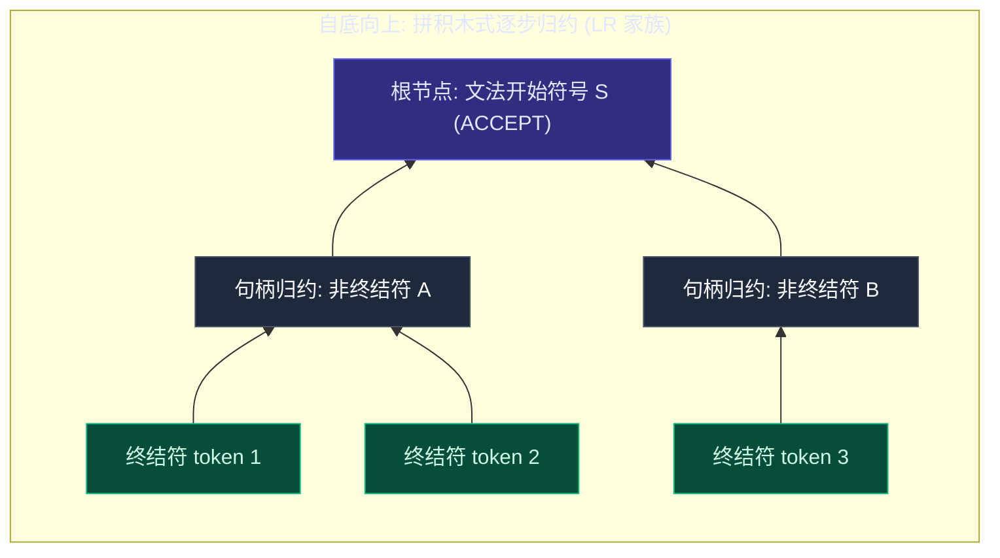
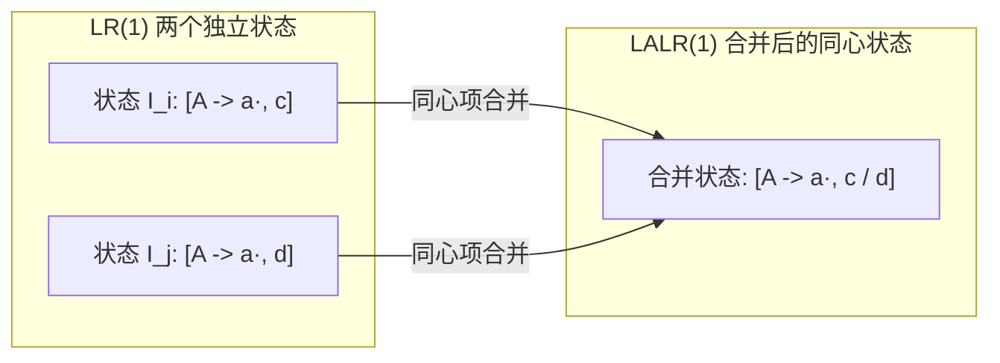

import GraphStepVisualizer from '../../../components/interactive/GraphStepVisualizer';
import StepVisualizer from '../../../components/interactive/StepVisualizer';
import QuizCard from '../../../components/interactive/QuizCard';

## 1. 工业界的王牌选择：自底向上分析哲学

在上一章中，我们学习了自顶向下的 LL(1) 分析法。虽然 LL(1) 逻辑直观，但它在工业界却面临着严苛的局限：
1. **不能包含任何左递归**（必须手动或自动改写文法，破坏了语法的自然结构）；
2. **不能含有公共前缀**（强制提取左公因子）；
3. **表达能力受限**：许多通用的程序设计语言语法根本无法用 LL(1) 表达。

因此，现实工业界中的绝大多数经典语法分析生成器（如 **GNU Bison、Yacc、Tree-sitter**）普遍采用更为强大稳健的技术——**自底向上分析（Bottom-Up Parsing）**，其中最著名的集大成者便是 **LR 分析法家族**。



---

## 2. 核心机制：移进（Shift）与归约（Reduce）

LR 分析器由一个**有限状态自动机（DFA）**、一个**状态栈**、一个**符号栈**以及一张预先计算好的 **LR 分析表** 组成。

分析器在每一个时刻只做两件事之一：
1. **移进（Shift, $s$）**：
   * 原材料尚不齐全，无法拼凑出一条产生式；
   * 分析器从输入流中读取下一个 Token，压入符号栈，同时将 DFA 转移到的新状态压入状态栈，输入指针前移。
2. **归约（Reduce, $r$）**：
   * 符号栈顶的若干符号刚好完整匹配了某条产生式 $A \to \beta$ 的右部（该符号串被称为当前句型的**句柄 Handle**）；
   * 分析器将栈顶长度为 $|\beta|$ 的符号和状态弹出，把非终结符 $A$ 压回符号栈，并查 **GOTO 表** 将新状态压入状态栈。

### 核心概念：句柄与活前缀
* **句柄（Handle）**：在某个右句型中，与某条产生式右部完全匹配、且将其替换为产生式左部非终结符能代表最右推导逆过程的**子串**。
* **活前缀（Viable Prefix）**：右句型的一个前缀，它不包含句柄右侧的任何符号。只要分析栈中的符号串始终保持为活前缀，分析器就能保证后续绝不会陷入死胡同。

---

## 3. 经典博弈：悬空 Else（Dangling Else）与移进-归约冲突

在几乎所有现代命令式语言（C、C++、Java、Rust）中，条件分支都存在一个著名的二义性困境：**悬空 Else 问题**。

考察如下嵌套代码：
```c
if (condition1)
    if (condition2) 
        do_work();
else 
    do_other();
```

当 LR 分析器将内层的 `if (condition2) do_work();` 读入栈顶，此时输入流迎面走来关键字 **`else`**。分析器面临两种截然不同的抉择：

| 抉择动作 | 物理行为 | 语义归属 |
| :---: | :--- | :--- |
| **移进（Shift）** | 暂停对当前句型的收网，把 `else` 强行吃进栈中 | **将 `else` 绑定到内层最近的 `if (condition2)`** |
| **归约（Reduce）** | 立刻把栈顶归约为一条完整的 `if-statement` | **内层提前闭合，`else` 留给外层 `if (condition1)`** |

这就是典型的**移进-归约冲突（Shift-Reduce Conflict）**！

> **工业界破局准则：移进优先（Shift Over Reduce）**
> 
> 面对悬空 Else，Bison / Yacc 等工具默认采用**移进优先**策略。这一策略不需修改文法，恰好完美契合了程序设计语言规范中“`else` 总是与前面最近的未配对 `if` 相结合”的直觉语义！

---

## 4. LR 四大家族阶梯演进史

为了在不同复杂度的文法上消除冲突，编译器科学家发展出了梯次递进的 LR 四大家族：

| 算法 | 展望长度 | 核心判断机制 | 状态数规模 | 优缺点与应用场景 |
| :--- | :---: | :--- | :---: | :--- |
| **LR(0)** | 0 | 仅凭 DFA 活前缀状态机，遇到归约项目立即盲目归约 | 基础基准 | **最弱**。极易出现移进-归约和归约-归约冲突，工业界无法单独使用。 |
| **SLR(1)** | 1 | 简单 LR：仅当输入符号 $a \in \text{FOLLOW}(A)$ 时才允许归约 | 相同于 LR(0) | **轻量高效**。消除了部分冲突，但由于 $\text{FOLLOW}$ 是全局上下文，精度有限。 |
| **LR(1)** | 1 | 规范 LR：每个项目自带精确的上下文展望符 $[A \to \alpha \cdot \beta, \; a]$ | 极大（可能上万） | **能力最强**。文法覆盖面最广，但状态数爆炸，内存与构建耗时巨大。 |
| **LALR(1)** | 1 | 展望 LR：将 LR(1) 中核心产生式相同的**同心项状态合并** | 精简回 LR(0) 级别 | **工业界性价比之王**！状态数少一个数量级，能力逼近 LR(1)，是 Bison/Yacc 的底座。 |

---

## 5. SLR(1) 冲突消解实战手把手推导

我们选用《编译原理》期末与考研高频大题中的经典拓广文法 $G'[S]$：
* (0) $S' \to S$
* (1) $S \to a A c$
* (2) $S \to b A d$
* (3) $A \to b$

### 步骤 1：构造 LR(0) 项目集与闭包
* **初态 $I_0$**：
  * 初项：$[S' \to \cdot S]$
  * 圆点后是非终结符 $S$，引入 $S$ 的全部产生式：$[S \to \cdot a A c]$ 与 $[S \to \cdot b A d]$。
  * $I_0 = \{ [S' \to \cdot S], \; [S \to \cdot a A c], \; [S \to \cdot b A d] \}$
* **计算转移 $\text{GOTO}(I_0, b) = I_3$**：
  * 由 $[S \to \cdot b A d]$ 吃进 $b$，得到 $[S \to b \cdot A d]$；圆点后是 $A$，求闭包引入 $[A \to \cdot b]$；
  * **致命关注**：文法中还有产生式 $A \to b$！在面对输入 $b$ 时，它直接完成了识别，生成项目 $[A \to b \cdot]$！
  * **$I_3 = \{ [S \to b \cdot A d], \; [A \to \cdot b], \; [A \to b \cdot] \}$**

### 步骤 2：LR(0) 冲突爆发
观察状态 $I_3$：
* 项目 $[S \to b \cdot A d]$ 和 $[A \to \cdot b]$：面对输入 $b$ 想要**移进（Shift）**；
* 项目 $[A \to b \cdot]$：圆点到达末尾，面对任何输入都想要**按产生式 (3) 归约（Reduce）**！
* 在不向前看符号的情况下，分析器陷入瘫痪：发生严重的 **移进-归约冲突**！该文法**绝不是 LR(0) 文法**！

### 步骤 3：SLR(1) 巧妙化解
SLR(1) 规定：**只有当下一步输入的 Token 属于待归约符号 $A$ 的 $\text{FOLLOW}(A)$ 集合时，才执行归约！**

1. **计算 $\text{FOLLOW}(A)$**：
   * 观察产生式 (1) $S \to a A c \implies c \in \text{FOLLOW}(A)$
   * 观察产生式 (2) $S \to b A d \implies d \in \text{FOLLOW}(A)$
   * 因此：$\text{FOLLOW}(A) = \{ c, \; d \}$
2. **比较移进符号集与归约展望集**：
   * $I_3$ 中允许移进的终结符为 $\{ b \}$；
   * $I_3$ 中允许归约的终结符为 $\text{FOLLOW}(A) = \{ c, d \}$；
   * 两者求交集：
     $$\{ b \} \cap \{ c, d \} = \emptyset$$
   * **交集为空集！**
3. **裁决结论**：
   * 如果下一个 Token 是 **`b`**，毫无疑问选择**移进**；
   * 如果下一个 Token 是 **`c` 或 `d`**，毫无疑问选择**归约 $A \to b$**；
   * 如果是其他符号，直接报错！
   * 冲突被 SLR(1) 完美化解，该文法是合法的 **SLR(1) 文法**！

---

## 6. LALR(1) 合并同心项与经典冲突定理

将 LR(1) 浓缩为 LALR(1) 时，核心思想是将**产生式部分完全相同、仅展望符不同**的状态（称为**同心项**）合并为一个状态。



> **经典考研与学术命题：合并同心项会不会带来新冲突？**
> 
> * **结论 1：绝不可能产生新的“移进-归约”冲突！**
>   * **严格证明**：移进动作仅取决于产生式右部圆点后面的终结符（例如 $A \to \alpha \cdot a \beta$ 中的 $a$）。由于同心项的产生式核心完全相同，被合并的状态之间关于终结符的移进走向在合并前就是一模一样的。合并只扩充了归约项的展望符集合，绝不会凭空创造出新的移进分支。
> * **结论 2：可能会产生新的“归约-归约”冲突！**
>   * **严格证明**：假设在状态 $I_1$ 中有 $[A \to \alpha \cdot, a]$，在状态 $I_2$ 中有 $[B \to \beta \cdot, b]$。在 LR(1) 中由于两者处于不同上下文分支，展望符 $a \neq b$，绝不冲突。但若 $I_1$ 与 $I_2$ 核心相同被强行合并，新状态同时容纳了对 $A$ 和 $B$ 的归约。如果某种更广阔的上下文中展望符发生交集，分析器将无法判断该按 $A$ 还是按 $B$ 归约，从而诞生全新的**归约-归约冲突**！

---

## 7. 交互实验：LR 项目集自动机与状态转移

下方步进图展示了典型算术表达式文法的 LR 项目集规范族自动机。点击下一步，观察从初态 $I_0$ 开始通过各个终结符与非终结符展开状态转移的完整全景。

export const lrGraph = {
  nodes: [
    { id: 'I0', label: 'I0: 初态\nS\' -> ·E\nE -> ·E+T\nE -> ·T' },
    { id: 'I1', label: 'I1: 接受态\nS\' -> E·\nE -> E·+T' },
    { id: 'I2', label: 'I2: E -> T·\nT -> T·*F' },
    { id: 'I3', label: 'I3: T -> F·' },
    { id: 'I4', label: 'I4: F -> (·E)' },
    { id: 'I5', label: 'I5: F -> id·' },
    { id: 'I6', label: 'I6: E -> E+·T\nT -> ·T*F\nT -> ·F' },
    { id: 'I7', label: 'I7: T -> T*·F\nF -> ·(E)\nF -> ·id' },
    { id: 'I8', label: 'I8: F -> (E·)\nE -> E·+T' },
    { id: 'I9', label: 'I9: E -> E+T·\nT -> T·*F' },
    { id: 'I10', label: 'I10: T -> T*F·' }
  ],
  edges: [
    { id: 'e0_1', source: 'I0', target: 'I1', label: 'E' },
    { id: 'e0_2', source: 'I0', target: 'I2', label: 'T' },
    { id: 'e0_3', source: 'I0', target: 'I3', label: 'F' },
    { id: 'e0_4', source: 'I0', target: 'I4', label: '(' },
    { id: 'e0_5', source: 'I0', target: 'I5', label: 'id' },
    { id: 'e1_6', source: 'I1', target: 'I6', label: '+' },
    { id: 'e2_7', source: 'I2', target: 'I7', label: '*' },
    { id: 'e6_9', source: 'I6', target: 'I9', label: 'T' },
    { id: 'e7_10', source: 'I7', target: 'I10', label: 'F' },
    { id: 'e9_7', source: 'I9', target: 'I7', label: '*' }
  ]
};

export const lrGraphSteps = [
  {
    title: "第一阶段：初始闭包 I0",
    description: "引入拓广文法开始项 S' -> ·E。圆点后为非终结符 E，求闭包引入 E 的所有产生式，圆点均在最左端。",
    badge: "初态 CLOSURE",
    activeNodes: ['I0'],
    activeEdges: []
  },
  {
    title: "第二阶段：主干语法单元识别 (I1, I2, I3, I5)",
    description: "分别经由非终结符 E、T、F 以及终结符 id 转移。I1 包含接受项目 S' -> E·；I5 识别单个标识符，准备按 F -> id 归约。",
    badge: "移进识别 SHIFT",
    activeNodes: ['I1', 'I2', 'I3', 'I5'],
    activeEdges: ['e0_1', 'e0_2', 'e0_3', 'e0_5']
  },
  {
    title: "第三阶段：算符结合与乘除优先级 (I6, I7, I9, I10)",
    description: "遇到加号进入 I6，遇到乘号进入 I7。状态 I9 (E -> E+T·) 面对乘号时转移至 I7 移进乘法，完美体现乘法优先于加法结合！",
    badge: "优先级分流 GOTO",
    activeNodes: ['I6', 'I7', 'I9', 'I10'],
    activeEdges: ['e1_6', 'e2_7', 'e6_9', 'e7_10', 'e9_7']
  }
];

<GraphStepVisualizer
  client:visible
  initialGraph={lrGraph}
  layoutName="dagre"
  steps={lrGraphSteps}
  title="LR 项目集自动机与状态转移推演"
  algorithmName="LR(0)/SLR(1) DFA 步进器"
/>

---

## 8. 交互实验：LR 双栈（状态栈 + 符号栈）14 步执行模拟

输入串为：`id + id * id $`。
分析器同步维护两个物理栈：
* **状态栈**：记录 DFA 走过的状态序列（初态为 0）；
* **符号栈**：记录已压入的终结符与非终结符（初态为 `$`）。

export const lrDualStackSteps = [
  {
    title: "步骤 1：ACTION[0, id] = s5 (移进 Shift 5)",
    badge: "移进 SHIFT",
    description: "初始状态 0，面对输入 Token 'id'。查分析表执行移进动作 s5：将输入 'id' 压入符号栈，状态 5 压入状态栈，输入指针前移一位。",
    code: "状态栈: [ 0, 5 ]\n符号栈: [ $, id ]\n剩余输入: + id * id $\n动作: 移进 id，状态压入 5"
  },
  {
    title: "步骤 2：ACTION[5, +] = r6 (按 F → id 归约)",
    badge: "归约 REDUCE",
    description: "状态 5 面对加号 '+'。产生式 (6) F → id 长度为 1，弹出状态栈 1 个状态 (5) 和符号栈 1 个符号 ('id')。栈顶暴露为 0。查 GOTO 表：GOTO[0, F] = 3，将 F 压入符号栈，状态 3 压入状态栈！",
    code: "状态栈: [ 0, 3 ]\n符号栈: [ $, F ]\n剩余输入: + id * id $\n动作: 归约 F → id，GOTO(0, F) = 3"
  },
  {
    title: "步骤 3：ACTION[3, +] = r4 (按 T → F 归约)",
    badge: "归约 REDUCE",
    description: "状态 3 面对 '+'。产生式 (4) T → F 长度为 1，弹出状态 3 与符号 F。暴露栈顶状态 0。查 GOTO[0, T] = 2，压入符号 T 和状态 2。",
    code: "状态栈: [ 0, 2 ]\n符号栈: [ $, T ]\n剩余输入: + id * id $\n动作: 归约 T → F，GOTO(0, T) = 2"
  },
  {
    title: "步骤 4：ACTION[2, +] = r2 (按 E → T 归约)",
    badge: "归约 REDUCE",
    description: "状态 2 面对 '+'。按产生式 (2) E → T 归约，弹出状态 2 和符号 T。栈顶为 0。查 GOTO[0, E] = 1，压入符号 E 和状态 1。",
    code: "状态栈: [ 0, 1 ]\n符号栈: [ $, E ]\n剩余输入: + id * id $\n动作: 归约 E → T，GOTO(0, E) = 1"
  },
  {
    title: "步骤 5：ACTION[1, +] = s6 (移进 Shift 6)",
    badge: "移进 SHIFT",
    description: "状态 1 面对加号 '+'。执行移进动作 s6：将 '+' 压入符号栈，状态 6 压入状态栈，输入指针前移一位。",
    code: "状态栈: [ 0, 1, 6 ]\n符号栈: [ $, E, + ]\n剩余输入: id * id $\n动作: 移进 +，状态压入 6"
  },
  {
    title: "步骤 6：ACTION[6, id] = s5 (移进 Shift 5)",
    badge: "移进 SHIFT",
    description: "状态 6 面对第二个 'id'。执行移进 s5：将 'id' 压入符号栈，状态 5 压入状态栈，输入指针前移至乘号 '*'。",
    code: "状态栈: [ 0, 1, 6, 5 ]\n符号栈: [ $, E, +, id ]\n剩余输入: * id $\n动作: 移进 id，状态压入 5"
  },
  {
    title: "步骤 7：ACTION[5, *] = r6 (按 F → id 归约)",
    badge: "归约 REDUCE",
    description: "状态 5 面对乘号 '*'。按产生式 (6) F → id 归约，弹出状态 5 和符号 'id'。栈顶恢复为状态 6。查 GOTO[6, F] = 3，压入 F 和状态 3。",
    code: "状态栈: [ 0, 1, 6, 3 ]\n符号栈: [ $, E, +, F ]\n剩余输入: * id $\n动作: 归约 F → id，GOTO(6, F) = 3"
  },
  {
    title: "步骤 8：ACTION[3, *] = r4 (按 T → F 归约)",
    badge: "归约 REDUCE",
    description: "状态 3 面对 '*'。按产生式 (4) T → F 归约，弹出状态 3 和符号 F。栈顶为状态 6。查 GOTO[6, T] = 9，压入 T 和状态 9。",
    code: "状态栈: [ 0, 1, 6, 9 ]\n符号栈: [ $, E, +, T ]\n剩余输入: * id $\n动作: 归约 T → F，GOTO(6, T) = 9"
  },
  {
    title: "步骤 9：ACTION[9, *] = s7 (移进 Shift 7，乘法优先级胜出！)",
    badge: "关键移进 SHIFT",
    description: "🌟 核心高光机制！面对乘号 '*'，分析器没有将已就绪的 'E + T' 提前归约为 E，而是选择移进 s7！这展现了算符优先级的精髓——乘法具有更高的结合力，必须先与右侧结合！压入 '*' 和状态 7。",
    code: "状态栈: [ 0, 1, 6, 9, 7 ]\n符号栈: [ $, E, +, T, * ]\n剩余输入: id $\n动作: 乘法优先级胜出，移进 *，压入状态 7"
  },
  {
    title: "步骤 10：ACTION[7, id] = s5 (移进 Shift 5)",
    badge: "移进 SHIFT",
    description: "状态 7 面对第三个 'id'。执行移进 s5：压入 'id' 与状态 5，输入指针到达句子终结符 '$'。",
    code: "状态栈: [ 0, 1, 6, 9, 7, 5 ]\n符号栈: [ $, E, +, T, *, id ]\n剩余输入: $\n动作: 移进 id，压入状态 5"
  },
  {
    title: "步骤 11：ACTION[5, $] = r6 (按 F → id 归约)",
    badge: "归约 REDUCE",
    description: "状态 5 面对输入结束符 '$'。按 F → id 归约，弹出 5 和 'id'。栈顶回到状态 7。查 GOTO[7, F] = 10，压入 F 和状态 10。",
    code: "状态栈: [ 0, 1, 6, 9, 7, 10 ]\n符号栈: [ $, E, +, T, *, F ]\n剩余输入: $\n动作: 归约 F → id，GOTO(7, F) = 10"
  },
  {
    title: "步骤 12：ACTION[10, $] = r3 (按 T → T * F 句柄归约！)",
    badge: "句柄归约 REDUCE",
    description: "🎯 乘法句柄归约！栈顶三元组 'T * F' 构成句柄！弹出 3 个状态 (10, 7, 9) 和 3 个符号 (F, *, T)。栈顶回到状态 6。查 GOTO[6, T] = 9，压入 T 和状态 9！乘法比加法先一步完成求值收网！",
    code: "状态栈: [ 0, 1, 6, 9 ]\n符号栈: [ $, E, +, T ]\n剩余输入: $\n动作: 乘法句柄归约 T → T * F，压入状态 9"
  },
  {
    title: "步骤 13：ACTION[9, $] = r1 (按 E → E + T 全局句柄归约！)",
    badge: "句柄归约 REDUCE",
    description: "🎯 加法整体句柄归约！栈顶三元组 'E + T' 构成当前句柄！弹出 3 个状态 (9, 6, 1) 和 3 个符号 (T, +, E)。栈顶回到初始状态 0。查 GOTO[0, E] = 1，压入 E 和状态 1！",
    code: "状态栈: [ 0, 1 ]\n符号栈: [ $, E ]\n剩余输入: $\n动作: 全局加法归约 E → E + T，回到状态 1"
  },
  {
    title: "步骤 14：ACTION[1, $] = acc (分析成功 ACCEPT！)",
    badge: "成功 ACCEPT",
    description: "符号栈中仅剩文法开始符号 E，输入流到达末尾 '$'。查表命中 acc，整个表达式自底向上归约圆满成功！",
    code: "状态栈: [ 0, 1 ]\n符号栈: [ $, E ]\n剩余输入: $\n动作: ACCEPT！自底向上 LR 分析完全成功！"
  }
];

<StepVisualizer
  client:visible
  steps={lrDualStackSteps}
  title="LR 分析器面对 id + id * id $ 的双栈执行全轨迹"
  algorithmName="LR 双栈步进器"
/>

---

## 9. 核心考点与概念自测

<QuizCard
  client:visible
  category="SLR(1) 冲突消解机制"
  question="SLR(1) 分析器在某个项目集状态中面临归约项目 A → α· 时，根据什么条件决定是否执行归约？"
  options={[
    {
      text: "仅当当前下一个输入符号 a 属于 FOLLOW(A) 时，才执行归约动作。",
      isCorrect: true,
      explanation: "正确！SLR(1) 的思想是在归约时借用非终结符 A 的全局 FOLLOW 集进行 1 位向前看过滤，从而消解非 FOLLOW 集符号的移进-归约冲突。"
    },
    {
      text: "仅当当前下一个输入符号 a 属于 FIRST(α) 时，才执行归约动作。",
      isCorrect: false,
      explanation: "错误。α 已经在栈内完全匹配，后续符号属于句柄之后可能出现的符号，应查看 FOLLOW(A)。"
    },
    {
      text: "无需任何条件，只要圆点在末尾就强制执行归约。",
      isCorrect: false,
      explanation: "错误。那是 LR(0) 的盲目归约行为，极易发生移进-归约冲突。"
    }
  ]}
/>

<QuizCard
  client:visible
  category="LALR(1) 合并同心项定理"
  question="把一个原本无冲突的规范 LR(1) 分析表合并同心项得到 LALR(1) 分析表时，理论上绝对不可能产生什么新的冲突？"
  options={[
    {
      text: "绝不可能产生新的“移进-归约”冲突。",
      isCorrect: true,
      explanation: "正确！移进动作仅由产生式右侧圆点后的终结符决定，同心项的核心产生式完全一致，移进目标在合并前就完全相同，绝不会凭空多出移进分支。"
    },
    {
      text: "绝不可能产生新的“归约-归约”冲突。",
      isCorrect: false,
      explanation: "错误。不同上下文下的归约项合并后，展望符集合取并集，可能导致同一输入符号被多个产生式归约捕获，产生归约-归约冲突！"
    },
    {
      text: "绝不会产生任何冲突，LALR(1) 表达能力与 LR(1) 绝对等价。",
      isCorrect: false,
      explanation: "错误。LALR(1) 的表达能力严格介于 SLR(1) 与 LR(1) 之间，可能因合并同心项诱发归约-归约冲突。"
    }
  ]}
/>

<QuizCard
  client:visible
  category="悬空 Else 冲突化解"
  question="在语法分析生成器（如 Bison/Yacc）中，当遇到著名的悬空 else 导致的移进-归约冲突时，默认采用什么策略，对应什么语义？"
  options={[
    {
      text: "采用“移进优先”策略，将 else 绑定到最近的未配对 if 上。",
      isCorrect: true,
      explanation: "正确！移进优先使分析器继续将 else 压入内层 if 的子树中，符合几乎所有现代编程语言的设计规范。"
    },
    {
      text: "采用“归约优先”策略，将 else 强制绑定到最外层 if 上。",
      isCorrect: false,
      explanation: "错误。归约优先会导致内层提前闭合，使 else 意外绑定到外层，违背了就近配对原则。"
    },
    {
      text: "直接报错停止编译，要求程序员必须加花括号才能编译通过。",
      isCorrect: false,
      explanation: "错误。Bison 会报出一个 warning，但默认按移进优先成功生成分析表。"
    }
  ]}
/>
