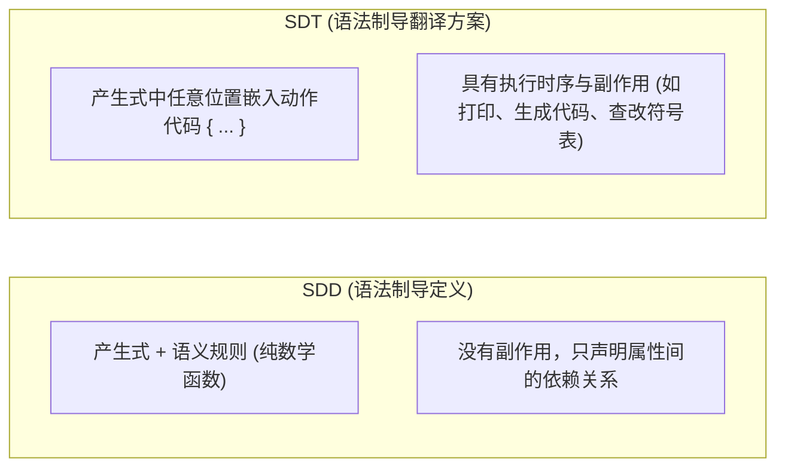
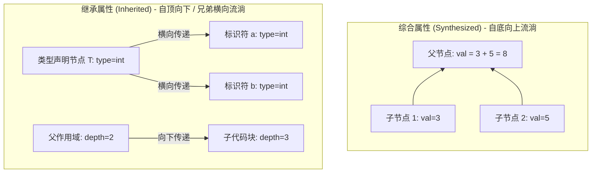

import AstVisualizer from '../../../components/interactive/AstVisualizer';
import QuizCard from '../../../components/interactive/QuizCard';

## 1. 结构与灵魂：为什么仅有语法分析还不够？

在完成词法分析与语法分析之后，编译器已经构建出了一棵能够验证结构合规性的语法分析树。然而，**语法合法绝对不等于语义正确**。

考察下面这几行 C 语言代码：
```c
int a = 10;
float b = 3.14;
int c = a + "hello"; // 语法完全匹配 E -> E + E，但在类型层面毫无意义！
foo(1, 2, 3);        // 语法上是函数调用，但 foo 是否声明过？参数个数对不对？
```

这正是**语义分析（Semantic Analysis）** 出场的时刻。如果说语法分析器搭建了程序的“骨架”，那么语义分析则负责注入“血肉与灵魂”：
* **类型检查（Type Checking）**：操作符与操作数类型是否兼容？是否需要隐式类型转换？
* **上下文一致性检查（Context Sensitivity）**：变量是否先声明后使用？变量是否重复定义？
* **控制流合法性**：`break` / `continue` 是否处于循环体之内？函数是否有正确的 `return` 返回值？
* **作用域管理与符号表绑定**：将每个标识符的名字绑定到特定的作用域符号表条目。

实现这一切的核心工程方法论，正是**语法制导翻译（Syntax-Directed Translation, SDT）**。

---

## 2. SDD 与 SDT：声明式 vs 过程式

在编译原理中，实现语义翻译有两大形式化表达工具：**SDD** 与 **SDT**。



| 维度 | 语法制导定义（SDD, Syntax-Directed Definition） | 语法制导翻译方案（SDT, Syntax-Directed Translation Scheme） |
| :--- | :--- | :--- |
| **本质风格** | **声明式（Declarative）** | **过程式（Procedural）** |
| **附加内容** | 在产生式后附加抽象的**语义规则（Semantic Rules）** | 在产生式右部的任意位置嵌入**语义动作 `{ action }`** |
| **执行时机** | 不规定计算先后次序，由属性依赖图的拓扑排序决定 | 严格按照自左向右遍历或归约的物理时序执行动作 |
| **副作用** | 纯函数计算属性值，通常无副作用 | 允许副作用（如往输出流发射四元式、修改符号表） |

---

## 3. 属性的两大流派：综合属性 vs 继承属性

在语法制导翻译中，语法树的每一个节点都可以挂载若干个**属性（Attributes）** （如数值 `val`、类型 `type`、内存地址 `addr`、代码串 `code` 等）。根据属性值的流动方向，划分为两大核心门派：



### 3.1 综合属性（Synthesized Attributes）
* **定义**：节点 $N$ 上的属性值**完全由其子节点（Children）的属性值或其本身的词法值（Lexical Values）计算得出**。
* **物理直觉**：自底向上的数据汇聚。
* **经典应用**：算术表达式求值。叶子节点从词法分析器拿到常量数字，父节点汇聚子节点的数值完成加乘运算。

### 3.2 继承属性（Inherited Attributes）
* **定义**：节点 $N$ 上的属性值**由其父节点（Parent）和/或左侧兄弟节点（Left Siblings）的属性值计算得出**。
* **物理直觉**：自顶向下传递环境信息，或从左到右共享类型上下文。
* **经典应用**：编程语言的变量类型声明：
  $$D \to T \; L, \quad L \to L_1, \; \mathbf{id} \mid \mathbf{id}$$
  当扫描到 `int a, b, c;` 时，关键字 `int` 确定了类型 $T.type = \mathbf{integer}$，随后通过**继承属性**横向广播给变量列表 $L$ 中的每一个标识符！

---

## 4. 文法分类：S-属性文法 vs L-属性文法

根据文法所允许的属性类型和依赖规则，划分为两大经典文法类别：

| 特性指标 | S-属性文法（Synthesized Attributed） | L-属性文法（Left-Inherited Attributed） |
| :--- | :--- | :--- |
| **属性要求** | **只包含综合属性**（严禁任何继承属性） | 既包含综合属性，也允许**受限的继承属性** |
| **继承依赖方向** | 无继承属性 | **只能依赖父节点或其左侧兄弟节点的属性** |
| **最佳搭档分析器** | **自底向上分析（LR 分析器）** | **自顶向下分析（LL / 递归下降分析器）** |
| **求值时序** | 语法树的**后序遍历（Post-order）**，或者 LR 分析器每次执行句柄归约时顺手计算 | 语法树的**从左向右深度优先先序遍历（DFS Pre-order）** |
| **工程实现难度** | **极简**。在 LR 分析器的符号栈旁加一个并行的属性栈即可 | 需要小心设计属性传递或重写文法 |

> **关键考点警示：为什么 L-属性文法严禁依赖右侧兄弟？**
> 
> 如果产生式中某符号的属性依赖于其右侧的兄弟节点，在单趟（Single-Pass）从左到右扫描的编译器中，右侧符号根本尚未被读取和解析！这种向前依赖会导致无法在语法分析的同时完成翻译，必须先构建出完整的语法树再进行二次遍历，破坏了流水线高效性。

---

## 5. 属性依赖图与拓扑排序

对于复杂的 SDD，如何确定每个属性值的求解顺序？

### 5.1 构造属性依赖图（Dependency Graph）
1. 为语法分析树上的**每一个节点的每一个属性实例**建立一个图顶点；
2. 如果属性 $X.a$ 的计算规则依赖于属性 $Y.b$ 的值，则在图中画一条有向边：
   $$Y.b \longrightarrow X.a$$
   （含义：$Y.b$ 是先行前提，$X.a$ 是后续结果）。

### 5.2 拓扑排序计算
* 如果构造出的属性依赖图是**有向无环图（DAG）**，则该有向图必定存在**拓扑排序（Topological Sort）**。拓扑排序的任意合法序列即为一个安全正确的属性计算次序。
* 如果依赖图中**存在环路（Cycle）**，说明文法中出现了逻辑循环依赖（例如 $A$ 依赖 $B$，$B$ 反过来又依赖 $A$），该 SDD 是非法的，无法通过有限步求值！

---

## 6. 实战推演：表达式 `3 * 5 + 4` 的带注释语法分析树

考虑经典包含语义规则的算术表达式 SDD：

| 产生式 | 语义规则（综合属性计算） |
| :--- | :--- |
| (1) $E \to E_1 + T$ | $E.val = E_1.val + T.val$ |
| (2) $E \to T$ | $E.val = T.val$ |
| (3) $T \to T_1 * F$ | $T.val = T_1.val \times F.val$ |
| (4) $T \to F$ | $T.val = F.val$ |
| (5) $F \to \mathbf{digit}$ | $F.val = \mathbf{digit}.lexval$ |

对输入表达式 `3 * 5 + 4` 进行自底向上语法制导求值：
1. 叶子节点获取词法值：$3, 5, 4$；
2. 规约 $F \to \mathbf{digit}(3) \implies F.val = 3$；
3. 规约 $T \to F \implies T.val = 3$；
4. 规约 $F \to \mathbf{digit}(5) \implies F.val = 5$；
5. 规约乘法 $T \to T_1 * F \implies T.val = 3 \times 5 = 15$；
6. 规约 $E \to T \implies E.val = 15$；
7. 规约右侧 $F \to \mathbf{digit}(4) \implies F.val = 4, \; T.val = 4$；
8. 根节点规约 $E \to E_1 + T \implies E.val = 15 + 4 = 19$！

---

## 7. 交互实验：带注释语法分析树（Annotated Parse Tree）

展开下方的交互式语法树，观察属性值如何在树节点中层层向上传递与聚合。

export const annotatedTreeData = {
  id: "root-e",
  name: "E (表达式根节点)",
  type: "expr",
  value: "val = 19",
  children: [
    {
      id: "left-e",
      name: "E (左加数项)",
      type: "expr",
      value: "val = 15",
      children: [
        {
          id: "mul-t",
          name: "T (乘法项)",
          type: "expr",
          value: "val = 15",
          children: [
            {
              id: "t-child1",
              name: "T (被乘数)",
              type: "expr",
              value: "val = 3",
              children: [
                {
                  id: "f-child1",
                  name: "F (因子)",
                  type: "expr",
                  value: "val = 3",
                  children: [
                    {
                      id: "digit-3",
                      name: "digit: '3'",
                      type: "literal",
                      value: "lexval = 3"
                    }
                  ]
                }
              ]
            },
            {
              id: "op-mul",
              name: "* (乘号)",
              type: "binop",
              value: "*"
            },
            {
              id: "f-child2",
              name: "F (乘数)",
              type: "expr",
              value: "val = 5",
              children: [
                {
                  id: "digit-5",
                  name: "digit: '5'",
                  type: "literal",
                  value: "lexval = 5"
                }
              ]
            }
          ]
        }
      ]
    },
    {
      id: "op-plus",
      name: "+ (加号)",
      type: "binop",
      value: "+"
    },
    {
      id: "right-t",
      name: "T (右加数项)",
      type: "expr",
      value: "val = 4",
      children: [
        {
          id: "f-child3",
          name: "F (因子)",
          type: "expr",
          value: "val = 4",
          children: [
            {
              id: "digit-4",
              name: "digit: '4'",
              type: "literal",
              value: "lexval = 4"
            }
          ]
        }
      ]
    }
  ]
};

<AstVisualizer
  client:visible
  treeData={annotatedTreeData}
  title="表达式 3 * 5 + 4 的带注释语法分析树 (Annotated Parse Tree)"
/>

---

## 8. 核心考点与概念自测

<QuizCard
  client:visible
  category="S-属性 vs L-属性分类"
  question="关于 S-属性文法和 L-属性文法的关系与特性，下列哪一项说法是完全正确的？"
  options={[
    {
      text: "S-属性文法必定是 L-属性文法，因为只包含综合属性的文法天然满足 L-属性文法的依赖约束。",
      isCorrect: true,
      explanation: "正确！L-属性文法允许综合属性，也允许受限的继承属性。如果一个文法只有综合属性（即 S-属性文法），它自然属于 L-属性文法的真子集。"
    },
    {
      text: "L-属性文法必定是 S-属性文法，两者是完全等价的文法类别。",
      isCorrect: false,
      explanation: "错误。L-属性文法可以包含继承属性，而 S-属性文法严禁任何继承属性。"
    },
    {
      text: "S-属性文法只能用于自顶向下分析，不能与 LR 分析器协同工作。",
      isCorrect: false,
      explanation: "错误。S-属性文法恰恰是自底向上 LR 分析器的最佳搭档，在每次产生式归约时顺便弹出子节点属性计算父节点属性即可。"
    }
  ]}
/>

<QuizCard
  client:visible
  category="L-属性文法依赖限制法则"
  question="在产生式 A → X1 X2 ... Xn 中，为什么符号 Xj 的继承属性绝对不能依赖其右侧兄弟符号 Xk (k > j) 的属性？"
  options={[
    {
      text: "因为在标准的自左向右深度优先扫描中，右侧符号 Xk 尚未被访问求值，逆向依赖将破坏单趟（Single-Pass）边扫描边翻译的能力。",
      isCorrect: true,
      explanation: "正确！从左至右单趟扫描是高效编译器的生命线。如果依赖右侧，就必须引入昂贵的回溯或两趟完整树重构。"
    },
    {
      text: "因为依赖右侧符号会导致词法分析器发生回溯爆栈。",
      isCorrect: false,
      explanation: "错误。词法分析早在此之前就已经完成，这是语义分析阶段的求值拓扑约束。"
    },
    {
      text: "因为上下文无关文法数学上严禁右侧符号出现任何属性。",
      isCorrect: false,
      explanation: "错误。右侧符号完全可以拥有属性，只是不能向左逆流传递给较早的兄弟节点。"
    }
  ]}
/>

<QuizCard
  client:visible
  category="属性依赖图与无环性"
  question="在为带有属性的语法树构建属性依赖图时，如果在依赖图中检测到了有向环路（Directed Cycle），这代表什么？"
  options={[
    {
      text: "说明该语义定义中存在循环依赖，无法通过拓扑排序找到有限步求值序列，文法设计存在死锁缺陷。",
      isCorrect: true,
      explanation: "正确！拓扑排序要求图必须是有向无环图（DAG）。出现有向环意味着若干属性互为因果前提，无法求解。"
    },
    {
      text: "说明程序代码中一定包含 while 或 for 死循环。",
      isCorrect: false,
      explanation: "错误。属性依赖图反映的是编译期属性之间的求值关系，与被编译源码运行期的控制流循环没有直接因果对应关系。"
    },
    {
      text: "说明需要使用 BFS 代替 DFS 才能完成属性求解。",
      isCorrect: false,
      explanation: "错误。只要图中存在有向环，无论是 BFS 还是 DFS 都无法给出拓扑排序。"
    }
  ]}
/>
