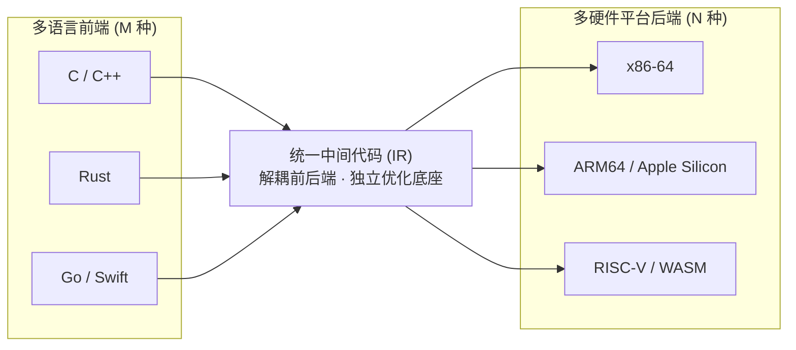
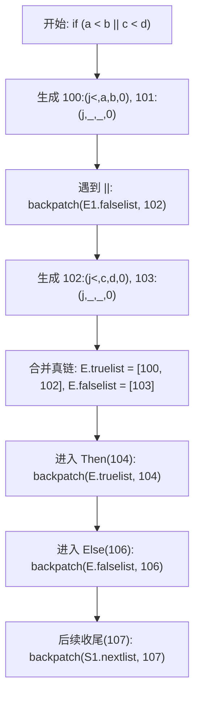

import GraphStepVisualizer from '../../../components/interactive/GraphStepVisualizer';
import StepVisualizer from '../../../components/interactive/StepVisualizer';
import QuizCard from '../../../components/interactive/QuizCard';

## 1. 跨越平台的桥梁：为什么需要中间代码（IR）？

在编译器的宏伟流水线中，**中间代码（Intermediate Representation, IR）** 扮演着承前启后的枢纽角色。

假设我们需要让 $M$ 种前端源语言（如 C、Rust、Go、Python）在 $N$ 种物理目标机器（如 x86-64、ARM64、RISC-V、WebAssembly）上运行：
* **若没有统一的 IR**：我们需要为每种语言对每种芯片分别编写专门的编译器，工程复杂度高达 $M \times N$！
* **引入统一的 IR（如 LLVM IR）后**：前端只管把各自的语法翻译为统一的 IR，后端只管将 IR 翻译为具体的机器码，复杂度骤降为 $M + N$！



不仅如此，绝大多数现代编译器的核心优化（如死代码消除、循环不变式外提、公共子表达式消除）都在 IR 层面进行，这使得优化算法与特定 CPU 架构彻底解耦。

---

## 2. 经典三地址码与四元式结构

工业界最通用、最底层的中间代码形态是**三地址码（Three-Address Code, TAC）**。之所以叫“三地址”，是因为每条指令至多引用三个内存地址或临时变量。

在考研与编译系统设计中，三地址码的标准形式通常是**四元式（Quadruple）**：
$$(op, \; arg1, \; arg2, \; result)$$

* $op$：操作符（如算术 `+`、`-`、关系判断 `j<`、无条件跳转 `j`、赋值 `=` 等）；
* $arg1, arg2$：两个源操作数（若是单目运算符或无条件跳转，部分操作数可为空 `_`）；
* $result$：运算目的地址或跳转的目标行号。

例如计算复杂表达式 `a = b * -c + b * -c` 的四元式序列：
```text
(1) (@,  c,  _,  t1)     // @ 代表单目取负：t1 = -c
(2) (*,  b,  t1, t2)     // t2 = b * t1
(3) (@,  c,  _,  t3)     // t3 = -c
(4) (*,  b,  t3, t4)     // t4 = b * t3
(5) (+,  t2, t4, a)      // a = t2 + t4
```

> **四元式 vs 三元式（Triple）**：
> 三元式不显式为结果分配临时变量名字，而是用指令的行号引用前序结果（如 `(*, b, (1))`）。但三元式在代码优化阶段极其脆弱——一旦调换或删除了某行指令，所有后续引用的行号都必须全局联动刷新！而四元式显式引入了 $t_1, t_2$ 等名字，指令位置的调换完全不会破坏数据依赖。

---

## 3. 布尔表达式的双重人格：数值计算 vs 控制流跳转

在程序语言中，布尔表达式（Boolean Expression）扮演着截然不同的双重角色：
1. **纯数值求值（Value Computation）**：
   * 例如 `bool flag = (x > 0);`，需要真实计算出一个 `0` 或 `1` 存入内存变量。
2. **控制流跳转（Control Flow Branching）**：
   * 例如 `if (a < b || c < d) S1 else S2;`。此时计算机根本不需要真正算出一个 0 或 1，而是需要根据条件的真假，直接**操控 CPU 指令指针寄存器（PC）跳转到不同的代码行**！

现代编译器普遍对布尔控制流采用**短路求值（Short-Circuit Evaluation）**：
* 面对 $E_1 \parallel E_2$：一旦 $E_1$ 为真，整个表达式必定为真，立即跳入 Then 分支，**完全跳过对 $E_2$ 的求值**！
* 面对 $E_1 \;\&\&\; E_2$：一旦 $E_1$ 为假，整个表达式必定为假，立即跳入 Else 分支，**完全跳过对 $E_2$ 的求值**！

---

## 4. 单遍扫描的终极矛盾与拉链回填（Backpatching）

在设计单遍扫描（Single-Pass）编译器时，我们面临一个棘手的“先有鸡还是先有蛋”的矛盾：

```text
100: (j<, a, b, ???)    // a < b 为真，跳到 then 分支。可是 then 分支在第几行？
101: (j,  _, _, ???)    // a < b 为假，该跳去哪里？
... 许多行之后才生成 then 分支的具体指令 ...
```

当编译器翻译到第 100 行时，**Then 分支和 Else 分支的代码根本还没有被生成**！编译器不可能预知它们未来的目标物理行号。

### 破局利器：拉链与回填（Backpatching）
编译器不进行昂贵的多遍全文回退，而是使用链表将所有“目标未知”的跳转指令串联起来：
1. **`makelist(i)`**：创建只包含指令行号 $i$ 的新链表。
2. **`merge(p1, p2)`**：合并两条等待回填的链表 $p_1$ 与 $p_2$。
3. **`backpatch(p, target)`**：顺着链表 $p$ 遍历所有挂起的四元式，将它们的跳转目标一次性刷写为确定地址 `target`！

---

## 5. 经典实战手把手推导：`if (a < b || c < d) x = 1; else x = 2;`

假定第一条四元式从物理地址 `100` 开始编号。我们一步一步演练回填全过程：



### 逐步推导演练明细：

1. **翻译条件子项 $a < b$**：
   * 生成 `100: (j<, a, b, 0)` $\implies$ `E1.truelist = [100]`
   * 生成 `101: (j, _, _, 0)` $\implies$ `E1.falselist = [101]`
2. **处理逻辑或 `||`**：
   * 逻辑或短路特性：$a < b$ 为真则整体为真；$a < b$ 为假才需要测试 $c < d$。
   * 下一条指令地址为 `nextquad = 102`。
   * **执行回填**：`backpatch(E1.falselist, 102)`！四元式 `101` 的目标被修改为 `102`。
3. **翻译条件子项 $c < d$**：
   * 生成 `102: (j<, c, d, 0)` $\implies$ `E2.truelist = [102]`
   * 生成 `103: (j, _, _, 0)` $\implies$ `E2.falselist = [103]`
4. **合并整体布尔表达式 $E$ 的真假链**：
   * **真链合并**：$E_1$ 为真或 $E_2$ 为真均能到达 Then 分支：
     `E.truelist = merge(E1.truelist, E2.truelist) = [100, 102]`
   * **假链**：只有两个条件全假才进入 Else 分支：
     `E.falselist = E2.falselist = [103]`
5. **翻译 Then 分支 `x = 1`**：
   * 此时进入 Then 分支起点，当前行号为 `104`。
   * **执行回填真链**：`backpatch(E.truelist, 104)`！四元式 `100` 和 `102` 的跳转目标一次性全部被刷写为 `104`！
   * 生成赋值四元式：`104: (=, 1, _, x)`
   * Then 分支执行完必须跳过 Else 分支：生成无条件跳转 `105: (j, _, _, 0)`，记为 `S1.nextlist = [105]`。
6. **翻译 Else 分支 `x = 2`**：
   * 此时进入 Else 分支起点，当前行号为 `106`。
   * **执行回填假链**：`backpatch(E.falselist, 106)`！四元式 `103` 的跳转目标被填入 `106`！
   * 生成赋值四元式：`106: (=, 2, _, x)`
7. **控制流汇合跳出**：
   * if-else 完整语句结束，后续代码起始行号为 `107`。
   * **执行回填跳出链**：`backpatch(S1.nextlist, 107)`！四元式 `105` 填入 `107`。

最终得到的完整四元式序列如下：
```text
100: (j<, a, b, 104)     // a < b 为真，短路直接跳入 then 分支 (104)
101: (j,  _, _, 102)     // a < b 为假，流入评估第二条件 c < d (102)
102: (j<, c, d, 104)     // c < d 为真，跳入 then 分支 (104)
103: (j,  _, _, 106)     // c < d 为假，两条件皆假，跳入 else 分支 (106)
104: (=,  1, _, x)       // then 分支：x = 1
105: (j,  _, _, 107)     // then 执行完毕，无条件跳过 else 分支 (107)
106: (=,  2, _, x)       // else 分支：x = 2
107: ...                 // if-else 结构汇合出口
```

---

## 6. 交互实验：拉链回填单步演算步进器

通过下方的交互式步进器，观察四元式表格如何从最初包含未知占位符 `0`，随着语义分析推进被逐步精准刷写回填。

export const backpatchSteps = [
  {
    title: "步骤 1：翻译条件 a < b",
    badge: "生成未定四元式",
    description: "为 a < b 生成条件转移四元式 100 和无条件转移 101。由于此时跳转目标未知，目标地址暂填为 0，分别建立单元素真链 [100] 与假链 [101]。",
    code: "四元式清单：\n100: (j<, a, b, 0)  <-- E1.truelist = [100]\n101: (j,  _, _, 0)  <-- E1.falselist = [101]\n\n活跃跳转链：\nE1.truelist = [100]\nE1.falselist = [101]"
  },
  {
    title: "步骤 2：遇到逻辑或 '||'，回填假链",
    badge: "回填 BACKPATCH",
    description: "逻辑或具有短路特性：左侧 a < b 为假时才需要进入下一条件 c < d 进行求值。当前 c < d 的起始地址为 102，执行 backpatch(E1.falselist, 102)！",
    code: "四元式清单：\n100: (j<, a, b, 0)\n101: (j,  _, _, 102)  <-- 回填完毕！指向第二条件 102\n\n活跃跳转链：\nE1.truelist = [100] (仍在等待 Then 分支地址)\nE1.falselist = [] (已清空)"
  },
  {
    title: "步骤 3：翻译条件 c < d",
    badge: "生成未定四元式",
    description: "为 c < d 生成四元式 102 与 103，建立 E2 的真链 [102] 与假链 [103]。",
    code: "四元式清单：\n100: (j<, a, b, 0)\n101: (j,  _, _, 102)\n102: (j<, c, d, 0)  <-- E2.truelist = [102]\n103: (j,  _, _, 0)  <-- E2.falselist = [103]\n\n活跃跳转链：\nE1.truelist = [100]\nE2.truelist = [102]\nE2.falselist = [103]"
  },
  {
    title: "步骤 4：合并整体布尔表达式真假链",
    badge: "合并 MERGE",
    description: "合并得到整体表达式 E 的真链与假链：E.truelist = merge([100], [102]) = [100, 102]；E.falselist = [103]。",
    code: "合并结果：\nE.truelist  = [100, 102] (两条件任一为真均可跳入 Then)\nE.falselist = [103]      (两条件全假才跳入 Else)"
  },
  {
    title: "步骤 5：翻译 Then 分支 x = 1 并回填真链",
    badge: "回填真链 + 赋值",
    description: "来到 Then 分支起点 104。执行 backpatch(E.truelist, 104)，四元式 100 和 102 的目标被统一刷写为 104！生成赋值四元式 104，以及跳过 Else 的跳转 105。",
    code: "四元式清单：\n100: (j<, a, b, 104)  <-- 回填为 104！\n101: (j,  _, _, 102)\n102: (j<, c, d, 104)  <-- 回填为 104！\n103: (j,  _, _, 0)\n104: (=,  1, _, x)    <-- Then 分支执行体\n105: (j,  _, _, 0)    <-- S1.nextlist = [105]\n\n活跃跳转链：\nE.falselist = [103]\nS1.nextlist = [105]"
  },
  {
    title: "步骤 6：翻译 Else 分支 x = 2 并回填假链",
    badge: "回填假链 + 赋值",
    description: "来到 Else 分支起点 106。执行 backpatch(E.falselist, 106)，四元式 103 的目标被刷写为 106！生成赋值四元式 106。",
    code: "四元式清单：\n100: (j<, a, b, 104)\n101: (j,  _, _, 102)\n102: (j<, c, d, 104)\n103: (j,  _, _, 106)  <-- 回填为 106！\n104: (=,  1, _, x)\n105: (j,  _, _, 0)\n106: (=,  2, _, x)    <-- Else 分支执行体\n\n活跃跳转链：\nS1.nextlist = [105]"
  },
  {
    title: "步骤 7：控制流结束，回填跳出链",
    badge: "全部回填完毕",
    description: "整个 if-else 语句结束，后续代码行号为 107。执行 backpatch(S1.nextlist, 107)，四元式 105 目标被填入 107。所有挂起的跳转链全部清空，中间代码生成圆满成功！",
    code: "最终四元式代码序列：\n100: (j<, a, b, 104)\n101: (j,  _, _, 102)\n102: (j<, c, d, 104)\n103: (j,  _, _, 106)\n104: (=,  1, _, x)\n105: (j,  _, _, 107)  <-- 回填为 107！\n106: (=,  2, _, x)\n107: ... (后续程序)"
  }
];

<StepVisualizer
  client:visible
  steps={backpatchSteps}
  title="拉链回填（Backpatching）四元式生成全演练"
  algorithmName="四元式回填步进器"
/>

---

## 7. 基本块划分与控制流图（CFG）

生成三地址码后，编译器需要将线性的指令序列重新组织为带有方向的有向图——**控制流图（Control Flow Graph, CFG）**。

### 7.1 基本块（Basic Block）划分原则
基本块是满足如下性质的最大指令连续序列：
1. **单入口（Single Entry）**：只能从第一条指令进入，中途绝不能跳入；
2. **单出口（Single Exit）**：只能从最后一条指令跳出，中途绝不能跳出。

**寻找基本块入口（首指令 Leader）的三大铁律**：
* 程序的**第一条指令**是 Leader；
* 任何**条件或无条件跳转指令的目标指令**是 Leader；
* 紧跟在**任何跳转指令之后的下一条指令**是 Leader。

### 7.2 交互实验：控制流图（CFG）拓扑结构

下方的交互式 CFG 图展示了上述四元式序列的基本块划分结果及分支转移走向。

export const cfgGraph = {
  nodes: [
    { id: 'B1', label: '基本块 B1 (行 100-101)\n100: (j<, a, b, 104)\n101: (j, _, _, 102)' },
    { id: 'B2', label: '基本块 B2 (行 102-103)\n102: (j<, c, d, 104)\n103: (j, _, _, 106)' },
    { id: 'B_then', label: '基本块 B_then (行 104-105)\n104: (=, 1, _, x)\n105: (j, _, _, 107)' },
    { id: 'B_else', label: '基本块 B_else (行 106)\n106: (=, 2, _, x)' },
    { id: 'B_exit', label: '基本块 B_exit (行 107+)\n107: 汇合出口' }
  ],
  edges: [
    { id: 'e1_then', source: 'B1', target: 'B_then', label: '真 a < b (短路直跳)' },
    { id: 'e1_2', source: 'B1', target: 'B2', label: '假 a >= b (流入)' },
    { id: 'e2_then', source: 'B2', target: 'B_then', label: '真 c < d' },
    { id: 'e2_else', source: 'B2', target: 'B_else', label: '假 c >= d' },
    { id: 'e_then_exit', source: 'B_then', target: 'B_exit', label: '无条件跳转 107' },
    { id: 'e_else_exit', source: 'B_else', target: 'B_exit', label: '顺序流入 107' }
  ]
};

export const cfgSteps = [
  {
    title: "阶段 1：首条件块 B1 激活",
    description: "程序执行从入口基本块 B1 开始，评估条件 a < b。",
    badge: "首入口 LEADER",
    activeNodes: ['B1'],
    activeEdges: []
  },
  {
    title: "阶段 2：B1 分流走向",
    description: "若 a < b 为真，短路直跳 B_then；若为假，控制流顺序流入第二条件块 B2。",
    badge: "短路分流 BRANCH",
    activeNodes: ['B1', 'B2', 'B_then'],
    activeEdges: ['e1_then', 'e1_2']
  },
  {
    title: "阶段 3：B2 分流走向",
    description: "在 B2 中测试 c < d。若为真跳入 B_then，若为假跳入 B_else。",
    badge: "条件裁决 BRANCH",
    activeNodes: ['B2', 'B_then', 'B_else'],
    activeEdges: ['e2_then', 'e2_else']
  },
  {
    title: "阶段 4：执行汇合至出口 B_exit",
    description: "B_then 执行完后跳转至 107；B_else 顺序落入 107。控制流在 B_exit 完美收官重新汇聚。",
    badge: "出口收敛 JOIN",
    activeNodes: ['B_then', 'B_else', 'B_exit'],
    activeEdges: ['e_then_exit', 'e_else_exit']
  }
];

<GraphStepVisualizer
  client:visible
  initialGraph={cfgGraph}
  layoutName="dagre"
  steps={cfgSteps}
  title="基本块控制流图（CFG）与分支执行轨迹"
  algorithmName="CFG 控制流步进器"
/>

---

## 8. 核心考点与概念自测

<QuizCard
  client:visible
  category="短路求值与拉链逻辑"
  question="在翻译布尔表达式 if (A || B) S1; else S2; 时，遇到逻辑或 '||' 操作符，应该对 A 的哪条链进行回填？"
  options={[
    {
      text: "应该对 A 的 falselist 进行回填，回填目标为 B 的起始四元式地址。",
      isCorrect: true,
      explanation: "正确！逻辑或规则为：若 A 为真则直接短路成立；只有当 A 为假时，才需要进一步去测试 B。因此必须把 A 的假链导向 B 的入口！"
    },
    {
      text: "应该对 A 的 truelist 进行回填，回填目标为 B 的起始四元式地址。",
      isCorrect: false,
      explanation: "错误。若 A 为真，整个表达式已经成立，应直接跳转至 S1，绝不应该跳到 B。"
    },
    {
      text: "应该将 A 的 truelist 和 falselist 同时回填到 B 的起始地址。",
      isCorrect: false,
      explanation: "错误。若真假都跳去 B，短路优化便不复存在，且会导致控制流逻辑错乱。"
    }
  ]}
/>

<QuizCard
  client:visible
  category="四元式与中间表示优势"
  question="在编译优化（如公用子表达式消除、循环不变代码外提）中，为什么工程上更偏好四元式而非三元式？"
  options={[
    {
      text: "四元式显式为计算结果分配了临时变量名字（如 t1, t2），指令位置调换或删除时，不会破坏其他指令对结果的引用。",
      isCorrect: true,
      explanation: "正确！三元式用指令序号作为操作数，一旦调整顺序必须全局修正所有行号指针，而四元式通过名字解除了对行号物理位置的强耦合。"
    },
    {
      text: "四元式占用的内存空间严格比三元式少一半。",
      isCorrect: false,
      explanation: "错误。四元式多了一个字段存储 result 名字，其内存开销反而略多于三元式。"
    },
    {
      text: "三元式无法表达任何条件跳转指令。",
      isCorrect: false,
      explanation: "错误。三元式同样可以表达跳转指令。"
    }
  ]}
/>

<QuizCard
  client:visible
  category="基本块划分准则"
  question="关于控制流图（CFG）中基本块（Basic Block）首指令（Leader）的判定，下列哪一条是错误的？"
  options={[
    {
      text: "任何函数调用指令（call / invoke）之后的下一条指令必定是 Leader。",
      isCorrect: true,
      explanation: "正确（本题选错误项）。普通的函数调用在没有异常抛出时仍属于顺序执行流，不会打断基本块，因此其后续指令不是 Leader。"
    },
    {
      text: "程序或子程序的第一条可执行指令必定是 Leader。",
      isCorrect: false,
      explanation: "这是正确的划分法则，第一条指令是天然的入口 Leader。"
    },
    {
      text: "任何条件或无条件跳转指令的目标转移指令必定是 Leader。",
      isCorrect: false,
      explanation: "这是正确的划分法则，作为跳转目标的分支入口必定是新基本块的起点。"
    },
    {
      text: "紧跟在任何条件或无条件跳转指令之后的下一条指令必定是 Leader。",
      isCorrect: false,
      explanation: "这是正确的划分法则，前序指令跳出后，下一行是潜在的汇聚入口。"
    }
  ]}
/>
