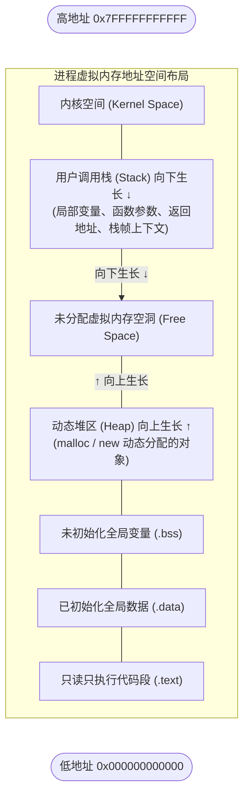
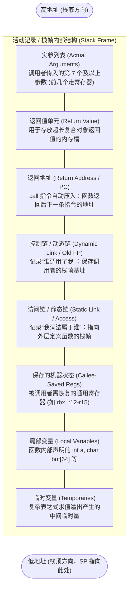
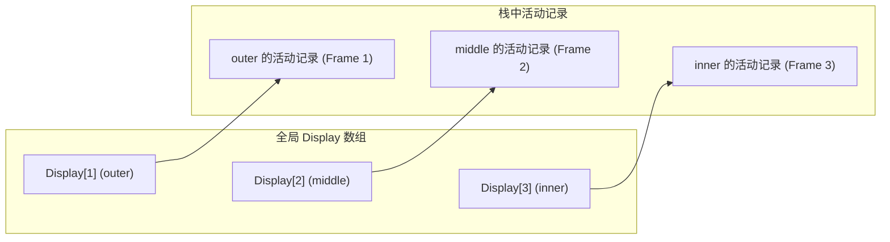

import StepVisualizer from '../../../components/interactive/StepVisualizer';
import QuizCard from '../../../components/interactive/QuizCard';

# 09. 运行时存储组织：程序在内存中如何呼吸？

> “源代码是静止的乐谱，而运行时存储则是乐队演奏时翻飞的空气与共鸣的琴弦。”

在前面的章节中，我们完成了从字符流到抽象语法树、再到三地址中间代码（IR）的编译期分析。然而，无论 IR 多么工整，计算机硬件无法直接执行抽象的“变量名”和“函数调用”。程序真正跑起来时，代码中的局部变量存放在物理内存的何处？函数递归调用时如何做到成百上千次自我嵌套而变量互不打架？

本章将带你深入操作系统的物理内存模型，解剖**活动记录（Stack Frame / 栈帧）** 的五脏六腑，厘清**动态链（控制链）** 与**静态链（访问链）** 的本质差异，并领略硬件级加速利器 **Display 表** 的精巧设计。

---

## 1. 现代进程物理内存全景布局

当操作系统（OS）为编译好的可执行文件创建进程时，会为其分配一段连续的虚拟内存地址空间（在 64 位系统通常是 $2^{48}$ 或 $2^{57}$ 字节）。这段空间被精心划分为四大核心职能区域：



### 为什么栈向下长，堆向上长？
这是一个极其优雅的 **“双向奔赴”对流设计**：
* 堆区的大小取决于运行期的动态业务需求（`malloc` / `new`），无法在编译期预测上限；
* 栈区的大小取决于运行期的函数调用嵌套深度，同样随调用动态伸缩；
* 让栈从最高地址向下生长，堆从最低数据段向上生长，中间保留一片巨大的未分配虚拟内存槽。只要两者不迎面相撞，就无需为堆或栈预先划定死板的刚性边界，实现了**内存利用率的最大化**。当二者指针重叠相遇时，便触发著名的 **Stack Overflow（栈溢出）** 或 **OOM（Out of Memory）**。

---

## 2. 活动记录（Stack Frame）解剖全景

每当一个函数被调用时，运行时系统就在调用栈顶为其划分一段专有连续内存单元，称为**活动记录（Activation Record，常称 Stack Frame / 栈帧）**。当该函数执行结束 `return` 时，该栈帧被立即弹出并释放。

一个工业级标准的栈帧，自高地址向低地址依次容纳如下 7 大关键组件：



### 深度辨析：动态链 vs 静态链（考场核心辨析）

初学者极其容易混淆这两个链表指针，务必深刻理解其物理本质：

| 对比维度 | 控制链 / 动态链 (Dynamic Link) | 访问链 / 静态链 (Static Link) |
| :--- | :--- | :--- |
| **指向的目标** | 指向**直接调用者（Caller）** 的栈帧基地址 | 指向在**语法源代码中定义该函数的词法外层**栈帧基地址 |
| **决定时机** | **运行时动态决定**（取决于此时由谁调入） | **编译期词法作用域决定**（由函数定义位置决定） |
| **核心职责** | 函数执行完毕 `return` 时，恢复调用者的栈帧基址，让执行流程精准回退 | 在允许函数嵌套定义的语言中，跨层读取外层函数的非局部变量 |
| **C 语言有吗？** | **必须有**（每个函数调用都依赖其恢复现场） | **通常没有**（C 不支持标准局部函数嵌套定义；闭包语言如 Python/Rust/Go 有） |

---

## 3. 调用约定与栈帧指针演进

在物理 CPU 层面，硬件只提供了寄存器和指令。为了让不同的函数、甚至不同语言编译出的目标文件能够互相调用，业界制定了严格的**调用约定（Calling Convention）** （如 x86-64 System V ABI、RISC-V Calling Convention）。

### 核心寄存器协作
* **栈指针寄存器（SP, Stack Pointer）**：
  * x86-64 中的 `%rsp`，RISC-V 中的 `sp` (`x2`)。
  * 永远精确指向当前活动记录的最底端（最低地址）。
* **帧指针 / 基址指针（FP / BP, Frame / Base Pointer）**：
  * x86-64 中的 `%rbp`，RISC-V 中的 `s0 / fp` (`x8`)。
  * 固定指向当前活动记录的基准锚点。在整个函数执行期间，即使 SP 因为局部表达式压栈而频繁上下抖动，FP 始终纹丝不动。所有局部变量通过相对于 FP 的固定负偏移访问（如 `-8(%rbp)`），所有参数通过正偏移访问（如 `16(%rbp)`）。

### 函数调用的四幕戏：Prologue 与 Epilogue

```asm
; --- 第一幕：调用者在发起调用前 (Caller Setup) ---
movq %rdi, %rdi           ; 传参：前 6 个参数装入 rdi, rsi, rdx, rcx, r8, r9
call func                 ; 压入下一条指令的地址 (PC)，并跳转到 func 入口

; --- 第二幕：被调用者序言 (Callee Prologue) ---
func:
    pushq %rbp            ; 1. 保护旧 FP：将调用者的 rbp 压入栈（建立动态链！）
    movq  %rsp, %rbp      ; 2. 锚定新 FP：让 rbp 指向当前自己的栈底
    subq  $32, %rsp       ; 3. 开辟局部空间：rsp 向下挪 32 字节分配局部变量

; --- 第三幕：函数主体计算 (Function Body) ---
    movl  %edi, -4(%rbp)  ; 访问局部变量和参数
    ...

; --- 第四幕：被调用者尾声 (Callee Epilogue) ---
    movq  %rbp, %rsp      ; 1. 释放局部变量空间：让 rsp 瞬移归位到 rbp
    popq  %rbp            ; 2. 恢复调用者 FP：弹出调用者的旧 rbp
    ret                   ; 3. 弹出返回地址到 PC，平稳交还控制权！
```

---

## 4. 嵌套作用域寻址与 Display 表优化

在 Pascal、Python、JavaScript 或 GCC C 扩展等支持嵌套定义函数的语言中：
```python
def outer():
    x = 42
    def middle():
        def inner():
            print(x) # inner 必须能访问 outer 的局部变量 x！
        inner()
    middle()
```

### 1. 静态链跳步查找的痛点
如果仅靠静态链（Static Link），当 `inner()` 要读取 `outer()` 的变量 `x` 时，它必须沿着栈帧中的静态链指针往外逆序追溯：
$$\text{inner} \xrightarrow{\text{Static Link}} \text{middle} \xrightarrow{\text{Static Link}} \text{outer}$$
若词法嵌套深度差为 $k$，每次读取一个外层变量都需要执行 $k$ 次内存间接寻址指令，时间复杂度为 $O(k)$！在深层嵌套算法或闭包高频循环中，这将产生巨大的访存开销。

### 2. Display 表：$O(1)$ 硬件级高速索引
为了消除遍历链表的延迟，现代编译器引入了 **Display 表**：
* 维护一个全局小数组 `Display[0..d]`，其中索引 $d$ 代表词法嵌套深度；
* `Display[k]` **永远直接指向当前最外层嵌套深度为 $k$ 的活跃函数的栈帧基址**！



当 `inner`（深度 3）需要访问 `outer`（深度 1）的局部变量 `x` 时，编译器只需生成如下一条机器指令：
$$\text{MOV} \quad R_{\text{temp}}, \; \text{Display}[1]; \quad \text{MOV} \quad R_{\text{val}}, \; \text{offset}(R_{\text{temp}})$$
耗时直接从 $O(k)$ 骤降为 **$O(1)$ 单步直达**！

---

## 5. 交互式推演：递归阶乘 `fact(3)` 栈帧分配与退栈全流程

下面通过交互式状态机，完整演示经典递归函数 `fact(n)` 从调用到回归的栈帧生灭过程：
```c
int fact(int n) {
    if (n <= 1) return 1;
    return n * fact(n - 1);
}
```

export const stackSteps = [
  {
    title: "1. main 函数调用 fact(3)",
    description: "调用者 main 将参数 n=3 压栈（或写入寄存器），执行 call 指令压入返回地址。进入 fact 序言，建立 fact(3) 栈帧，FP 指向该帧基址，动态链记录 main 的 FP。",
    badge: "深度 1",
    render: (
      <div className="flex flex-col gap-2 font-mono text-xs w-full max-w-md mx-auto">
        <div className="p-2.5 bg-slate-800/80 border border-slate-700 rounded-lg text-slate-400">
          [main 栈帧] FP_main = 0x7FFF00 (已挂起)
        </div>
        <div className="p-3 bg-cyan-950/80 border-2 border-cyan-500 rounded-lg text-cyan-200 shadow-lg shadow-cyan-950/50">
          <div className="font-bold text-cyan-400 flex justify-between">
            <span>[fact(3) 活动记录] &lt;-- 当前 FP (0x7FFE80)</span>
            <span className="text-[10px] bg-cyan-500/20 px-1.5 py-0.5 rounded text-cyan-300">ACTIVE</span>
          </div>
          <div className="mt-1.5 space-y-1 text-slate-300">
            <div>• 参数 n = 3</div>
            <div>• 动态链 (Old FP) -&gt; 0x7FFF00 (main)</div>
            <div>• 返回地址 -&gt; main:PC_after_call</div>
            <div>• 局部状态: 等待 fact(2) 返回</div>
          </div>
        </div>
        <div className="text-right text-[11px] text-cyan-400 font-mono">SP = 0x7FFE60 (栈顶)</div>
      </div>
    )
  },
  {
    title: "2. fact(3) 递归调用 fact(2)",
    description: "fact(3) 发现 n > 1，计算 n-1=2 并发起递归调用。栈顶向下延伸，分配第二层栈帧 fact(2)，动态链指向上一层 fact(3) 的基地址 0x7FFE80。",
    badge: "深度 2",
    render: (
      <div className="flex flex-col gap-2 font-mono text-xs w-full max-w-md mx-auto">
        <div className="p-2 bg-slate-800/60 border border-slate-700/60 rounded text-slate-500 text-[11px]">
          [main 栈帧] 0x7FFF00
        </div>
        <div className="p-2.5 bg-slate-900 border border-slate-700 rounded text-slate-400">
          [fact(3) 栈帧] 0x7FFE80 | 等待: 3 * fact(2)
        </div>
        <div className="p-3 bg-cyan-950/80 border-2 border-cyan-500 rounded-lg text-cyan-200 shadow-lg">
          <div className="font-bold text-cyan-400 flex justify-between">
            <span>[fact(2) 活动记录] &lt;-- 当前 FP (0x7FFE00)</span>
            <span className="text-[10px] bg-cyan-500/20 px-1.5 py-0.5 rounded text-cyan-300">ACTIVE</span>
          </div>
          <div className="mt-1.5 space-y-1 text-slate-300">
            <div>• 参数 n = 2</div>
            <div>• 动态链 (Old FP) -&gt; 0x7FFE80 (fact(3))</div>
            <div>• 返回地址 -&gt; fact(3):PC_after_call</div>
            <div>• 局部状态: 等待 fact(1) 返回</div>
          </div>
        </div>
        <div className="text-right text-[11px] text-cyan-400 font-mono">SP = 0x7FFDE0 (栈顶)</div>
      </div>
    )
  },
  {
    title: "3. fact(2) 递归调用 fact(1) —— 触底 Base Case",
    description: "递归抵达基准边界！fact(1) 栈帧被压入栈顶。由于 n=1 <= 1，该函数直接返回 1，不再向下派生新的栈帧。调用栈达到最大深度 3。",
    badge: "深度 3 (触底)",
    render: (
      <div className="flex flex-col gap-1.5 font-mono text-xs w-full max-w-md mx-auto">
        <div className="p-1.5 bg-slate-900 border border-slate-800 rounded text-slate-600 text-[10px]">
          [main 栈帧] 0x7FFF00
        </div>
        <div className="p-1.5 bg-slate-900 border border-slate-800 rounded text-slate-500 text-[11px]">
          [fact(3) 栈帧] 0x7FFE80
        </div>
        <div className="p-2 bg-slate-900 border border-slate-700 rounded text-slate-400">
          [fact(2) 栈帧] 0x7FFE00 | 等待: 2 * fact(1)
        </div>
        <div className="p-3 bg-emerald-950/80 border-2 border-emerald-500 rounded-lg text-emerald-200 shadow-lg">
          <div className="font-bold text-emerald-400 flex justify-between">
            <span>[fact(1) 活动记录] &lt;-- 当前 FP (0x7FFD80)</span>
            <span className="text-[10px] bg-emerald-500/20 px-1.5 py-0.5 rounded text-emerald-300">BASE CASE</span>
          </div>
          <div className="mt-1.5 space-y-0.5 text-slate-300 text-[11px]">
            <div>• 参数 n = 1 (满足 n &lt;= 1)</div>
            <div>• 准备写入返回值: 1</div>
            <div>• 准备触发 Epilogue 弹栈并顺动态链归还现场</div>
          </div>
        </div>
        <div className="text-right text-[11px] text-emerald-400 font-mono">SP = 0x7FFD60 (峰值栈深)</div>
      </div>
    )
  },
  {
    title: "4. fact(1) 返回 1 并释放栈帧",
    description: "fact(1) 将 1 写入返回值寄存器 (%rax / a0)，执行 pop %rbp 顺着动态链将 FP 恢复为 0x7FFE00，ret 弹出返回地址。栈顶 SP 回缩，fact(1) 栈帧彻底消亡！",
    badge: "回溯出栈",
    render: (
      <div className="flex flex-col gap-2 font-mono text-xs w-full max-w-md mx-auto">
        <div className="p-2 bg-slate-800/60 border border-slate-700/60 rounded text-slate-500 text-[11px]">
          [main 栈帧] 0x7FFF00
        </div>
        <div className="p-2.5 bg-slate-900 border border-slate-700 rounded text-slate-400">
          [fact(3) 栈帧] 0x7FFE80
        </div>
        <div className="p-3 bg-cyan-950/80 border-2 border-cyan-500 rounded-lg text-cyan-200 shadow-lg">
          <div className="font-bold text-cyan-400 flex justify-between">
            <span>[fact(2) 恢复执行] &lt;-- FP 恢复为 0x7FFE00</span>
            <span className="text-[10px] bg-cyan-500/20 px-1.5 py-0.5 rounded text-cyan-300">ACTIVE</span>
          </div>
          <div className="mt-1.5 space-y-1 text-slate-300">
            <div>• 收到子调用返回值: 1</div>
            <div>• 计算乘积: 2 * 1 = 2</div>
            <div>• 准备返回给上一层 fact(3)</div>
          </div>
        </div>
        <div className="p-2 border border-dashed border-rose-500/40 bg-rose-950/20 rounded text-rose-400/80 text-[11px] text-center">
          [fact(1) 栈帧已被释放销毁] SP 回缩至 0x7FFDE0
        </div>
      </div>
    )
  },
  {
    title: "5. fact(2) 返回 2 并释放栈帧",
    description: "fact(2) 计算完毕将 2 写入 %rax，执行尾声指令恢复 fact(3) 的 FP 基址 0x7FFE80。fact(2) 栈帧出栈，SP 继续回缩。",
    badge: "回溯出栈",
    render: (
      <div className="flex flex-col gap-2 font-mono text-xs w-full max-w-md mx-auto">
        <div className="p-2 bg-slate-800/60 border border-slate-700/60 rounded text-slate-500 text-[11px]">
          [main 栈帧] 0x7FFF00
        </div>
        <div className="p-3 bg-cyan-950/80 border-2 border-cyan-500 rounded-lg text-cyan-200 shadow-lg">
          <div className="font-bold text-cyan-400 flex justify-between">
            <span>[fact(3) 恢复执行] &lt;-- FP 恢复为 0x7FFE80</span>
            <span className="text-[10px] bg-cyan-500/20 px-1.5 py-0.5 rounded text-cyan-300">ACTIVE</span>
          </div>
          <div className="mt-1.5 space-y-1 text-slate-300">
            <div>• 收到子调用返回值: 2</div>
            <div>• 计算最终结果: 3 * 2 = 6</div>
            <div>• 准备将 6 返回给 main 函数</div>
          </div>
        </div>
        <div className="p-2 border border-dashed border-rose-500/40 bg-rose-950/20 rounded text-rose-400/80 text-[11px] text-center">
          [fact(2) 栈帧已被释放销毁] SP 回缩至 0x7FFE60
        </div>
      </div>
    )
  },
  {
    title: "6. fact(3) 返回 6，main 恢复现场",
    description: "最终结果 6 存入返回值寄存器，fact(3) 尾声指令完成最后一次 FP 回溯，恢复为 main 的基准栈指针。整个递归链栈帧全数安全回收，内存干干净净！",
    badge: "执行收敛",
    render: (
      <div className="flex flex-col gap-2 font-mono text-xs w-full max-w-md mx-auto">
        <div className="p-3 bg-emerald-950/80 border-2 border-emerald-500 rounded-lg text-emerald-200 shadow-lg">
          <div className="font-bold text-emerald-400 flex justify-between">
            <span>[main 函数恢复运行] &lt;-- FP 归位 0x7FFF00</span>
            <span className="text-[10px] bg-emerald-500/20 px-1.5 py-0.5 rounded text-emerald-300">COMPLETE</span>
          </div>
          <div className="mt-1.5 space-y-1 text-slate-300">
            <div>• 接收递归最终结果: 6</div>
            <div>• 所有子栈帧已完美销毁，零内存泄漏</div>
            <div>• 程序继续执行后续业务逻辑</div>
          </div>
        </div>
      </div>
    )
  }
];

<StepVisualizer
  client:visible
  title="递归阶乘 fact(3) 栈帧分配与回退微观全过程"
  algorithmName="调用栈状态机"
  steps={stackSteps}
/>

---

## 6. 核心难点自测与巩固

<QuizCard
  client:visible
  category="运行时存储"
  question="关于活动记录中的动态链（Dynamic Link / Control Link）与静态链（Static Link / Access Link），下列说法正确的是："
  options={[
    "动态链记录函数被谁动态调入，用于返回时恢复现场；静态链指向词法外层作用域，用于跨层访问非局部变量。",
    "动态链只在编译期确定，静态链在每次运行时动态改变。",
    "C 语言因为支持高级闭包，因此每个函数必须强制生成静态链。",
    "静态链和动态链本质是完全一样的指针，只是编译器为了冗余容错存了两份。"
  ]}
  answer={0}
  explanation="正确！动态链反映的是运行期的调用历史（调用栈），函数返回时必须沿着动态链恢复调用者的 FP；而静态链反映的是源代码中的词法嵌套层级，用于访问外层函数的局部变量。C 语言不允许标准函数嵌套定义，因此常规编译不需要静态链！"
/>

<QuizCard
  client:visible
  category="作用域寻址优化"
  question="在支持多层函数嵌套定义的语言中，Display 表相较于传统静态链的最大优势是什么？"
  options={[
    "Display 表用全局数组记录各层最新栈帧基址，将跨 k 层访问外层变量的时间复杂度从 O(k) 优化至 O(1)。",
    "Display 表能够自动回收堆内存中未引用的垃圾对象。",
    "Display 表彻底取消了函数调用栈，所有变量直接存储在高速寄存器中。",
    "Display 表用于在操作系统崩溃时自动截屏保存当前窗口画面。"
  ]}
  answer={0}
  explanation="正确！若仅靠静态链，跨 k 层需要连续解引用 k 次指针，耗时 O(k)；而 Display 表是一个以嵌套深度为下标的全局数组，Display[d] 直接记录嵌套深度为 d 的最新栈帧基址，访问任意层外层变量只需一条数组寻址指令即可直达！"
/>
