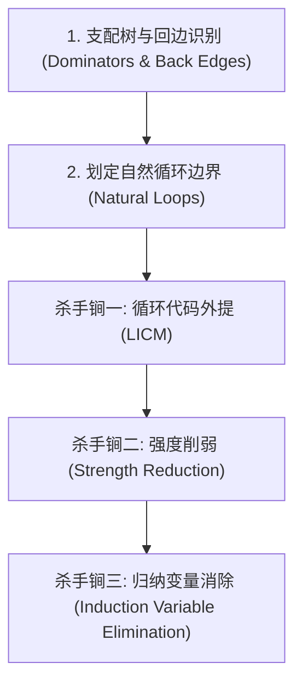

import GraphStepVisualizer from '../../../components/interactive/GraphStepVisualizer';
import QuizCard from '../../../components/interactive/QuizCard';

# 11. 机器无关优化：化繁为简的艺术

> “优化的最高境界不是把冗余的指令执行得更快，而是让冗余的计算根本不曾发生。”

编译器前端生成的中间代码（三地址码 / 四元式）通常包含了大量机械翻译带来的冗余：重复计算的子表达式、多余的临时变量拷贝、以及深陷循环内部却从不改变的不变量计算。

**机器无关优化（Machine-Independent Optimization）** 位于编译器的中端（Middle-End）。它不依赖任何具体的 CPU 指令集架构，完全在三地址码或控制流图的数学抽象层级，运用代数等价与控制流拓扑分析，对程序结构进行大刀阔斧的“瘦身抽脂”。

---

## 1. 局部优化王牌：基本块 DAG 四步构造法

在单个基本块内部，由于不存在任何条件分支与跳入，指令执行具有绝对的确定性。编译器运用**有向无环图（DAG, Directed Acyclic Graph）**，可以**一次遍历同时完成**四大优化：
1. **局部公共子表达式消除（Local CSE）**
2. **常量折叠（Constant Folding）与代数化简**
3. **复制传播与无用赋值消除（Dead Code Elimination）**
4. **变量跨语句依赖精准追踪**

### DAG 节点与标签定义
* **叶子节点**：代表进入基本块时的**初始值**，标记为 $X_0$；
* **内部节点**：代表一个**算术/逻辑运算符**（如 $+$, $-$, $*$, $/$）；
* **变量标签列表**：挂在每个节点右侧的变量名清单，记录当前有哪些变量保存了该节点的计算结果。

### 核心构造四步黄金法则

1. **初值建叶**：
   当变量 $B$ 第一次作为赋值语句的右值被读取时，在图中建立标记为 $B_0$ 的叶子节点，并在其上附加临时标签 $B$。
2. **算符与公共子表达式检测**：
   对于三地址码 $A = B \; op \; C$：
   * 找到 $B$ 与 $C$ 当前绑定的 DAG 节点 $n_B$ 和 $n_C$；
   * 检查 DAG 中**是否已经存在**一个标签为 $op$ 且左右孩子恰为 $n_B$ 和 $n_C$ 的内部节点：
     * **若已存在**：说明该运算此前已被完全相同的值计算过！直接将变量 $A$ 挂载到该已有节点上（**公共子表达式消除成功！**）；
     * **若不存在**：新建一个内部节点标为 $op$，左右指针分别指向 $n_B$ 与 $n_C$，并将 $A$ 挂在该节点上。
3. **变量重定值与“撕下旧标签”铁律（考场必考易错点！）**：
   如果变量 $A$ 原本已经挂在某个旧节点上（例如此前的某次赋值），此时 $A$ 被赋予了全新的结果，**必须将变量名 $A$ 从旧节点上彻底撕下，贴到新节点上！**（因为旧值已被覆写，后续引用 $A$ 必须读取最新计算结果）。
4. **逆向代码重构与死代码剪枝**：
   DAG 构建完毕后，根据出口处的**活跃变量集合**，从根节点向叶子节点拓扑逆序发射新的三地址码。**没有任何出口活跃变量绑定的孤立中间节点直接被剪枝消除！**

---

## 2. 交互式推演：基本块 DAG 构造与代码重构实战

给定某基本块生成的 6 条原始三地址码序列：
```text
(1) T1 = A + B
(2) T2 = A + B
(3) T3 = T1 * T2
(4) A = C + D
(5) T4 = C + D
(6) E = T3 + T4
```
已知该基本块出口处，**仅有变量 $A$ 和 $E$ 是活跃的**。

export const dagGraph = {
  nodes: [
    { id: 'A0', label: '叶子: A_0' },
    { id: 'B0', label: '叶子: B_0' },
    { id: 'N3', label: '(+) 节点3\n[T1, T2]' },
    { id: 'N4', label: '(*) 节点4\n[T3]' },
    { id: 'C0', label: '叶子: C_0' },
    { id: 'D0', label: '叶子: D_0' },
    { id: 'N7', label: '(+) 节点7\n[A, T4]' },
    { id: 'N8', label: '(+) 节点8\n[E]' }
  ],
  edges: [
    { id: 'e1', source: 'N3', target: 'A0' },
    { id: 'e2', source: 'N3', target: 'B0' },
    { id: 'e3', source: 'N4', target: 'N3' },
    { id: 'e4', source: 'N7', target: 'C0' },
    { id: 'e5', source: 'N7', target: 'D0' },
    { id: 'e6', source: 'N8', target: 'N4' },
    { id: 'e7', source: 'N8', target: 'N7' }
  ]
};

export const dagSteps = [
  {
    title: "1. 语句 (1) T1 = A + B",
    description: "初次读取 A 和 B，创建叶子节点 A_0 和 B_0。创建内部加法节点 N3，左右孩子指向 A_0 和 B_0，将变量标签 T1 附加到 N3。",
    badge: "语句 (1)",
    activeNodes: ['A0', 'B0', 'N3'],
    activeEdges: ['e1', 'e2'],
    nodeColorMap: { N3: '#06b6d4', A0: '#3b82f6', B0: '#3b82f6' }
  },
  {
    title: "2. 语句 (2) T2 = A + B —— 触发公共子表达式消除！",
    description: "寻找操作数 A 与 B，分别对应 A_0 和 B_0。查询 DAG 发现已存在 (+) 且孩子为 A_0 和 B_0 的节点 N3！直接将 T2 挂载到 N3，省去一次冗余加法！",
    badge: "语句 (2): 消除 CSE",
    activeNodes: ['N3'],
    activeEdges: ['e1', 'e2'],
    nodeColorMap: { N3: '#10b981' }
  },
  {
    title: "3. 语句 (3) T3 = T1 * T2",
    description: "T1 和 T2 均指向节点 N3。创建乘法内部节点 N4，左右孩子均指向 N3（即 N3 * N3）。将标签 T3 挂载到 N4。",
    badge: "语句 (3)",
    activeNodes: ['N3', 'N4'],
    activeEdges: ['e3'],
    nodeColorMap: { N3: '#06b6d4', N4: '#06b6d4' }
  },
  {
    title: "4. 语句 (4) A = C + D —— 核心：撕下旧标签！",
    description: "创建叶子节点 C_0 和 D_0，创建内部加法节点 N7。注意：变量 A 原本代表 A_0，此时被重新定值，必须将 A 从旧节点撕下，改挂到 N7 上！",
    badge: "语句 (4): 撕下标签",
    activeNodes: ['C0', 'D0', 'N7'],
    activeEdges: ['e4', 'e5'],
    nodeColorMap: { N7: '#f59e0b', C0: '#3b82f6', D0: '#3b82f6' }
  },
  {
    title: "5. 语句 (5) T4 = C + D —— 再次触发公共子表达式消除！",
    description: "计算 C + D 时发现节点 N7 恰好就是 C_0 + D_0！直接将变量 T4 挂载到已有节点 N7 上，无需生成新算符节点！",
    badge: "语句 (5): 消除 CSE",
    activeNodes: ['N7'],
    activeEdges: ['e4', 'e5'],
    nodeColorMap: { N7: '#10b981' }
  },
  {
    title: "6. 语句 (6) E = T3 + T4 —— 构筑根节点",
    description: "T3 对应 N4，T4 对应 N7。创建顶层加法节点 N8，孩子指向 N4 与 N7，将最终出口变量 E 挂载在 N8 上。DAG 完整拓扑搭建完成！",
    badge: "语句 (6)",
    activeNodes: ['N4', 'N7', 'N8'],
    activeEdges: ['e6', 'e7'],
    nodeColorMap: { N8: '#a855f7', N4: '#06b6d4', N7: '#10b981' }
  },
  {
    title: "7. 逆向重构代码：从 6 条指令压榨至 4 条！",
    description: "出口活跃变量仅为 A 和 E。节点 N3 计算 A+B，生成 T1=A+B；节点 N4 生成 T3=T1*T1；节点 N7 直接为 A 计算 A=C+D（T4 彻底消亡）；节点 N8 计算 E=T3+A！",
    badge: "重构优化完成",
    activeNodes: ['N3', 'N4', 'N7', 'N8'],
    activeEdges: ['e1', 'e2', 'e3', 'e4', 'e5', 'e6', 'e7'],
    nodeColorMap: { N3: '#06b6d4', N4: '#06b6d4', N7: '#06b6d4', N8: '#06b6d4' }
  }
];

<GraphStepVisualizer
  client:visible
  title="基本块 DAG 四步法构建与变量重写全过程"
  algorithmName="DAG 局部优化算法"
  initialGraph={dagGraph}
  layoutName="dagre"
  steps={dagSteps}
/>

### 优化前后三地址码震撼对比

```text
原始未优化代码 (6 条指令):          优化重构后极简代码 (4 条指令):
(1) T1 = A + B                    (1) T1 = A + B
(2) T2 = A + B                    (2) T3 = T1 * T1    // 识别出 T2 == T1，直接自乘！
(3) T3 = T1 * T2                  (3) A = C + D       // 算一次直接存入出口变量 A
(4) A = C + D                     (4) E = T3 + A      // 直接复用 A 代替 T4 参与加法！
(5) T4 = C + D
(6) E = T3 + T4                   // 成果：消除了 2 次冗余加法，消除了 T2 和 T4 两个临时变量！
```

---

## 3. 循环优化三大杀手锏

程序运行时 90% 的 CPU 时间都耗费在不足 10% 的内层循环代码中（著名的 90/10 准则）。因此，**循环优化（Loop Optimization）** 是优化器带来最大性能红利的发动机。



### 杀手锏一：循环代码外提（Loop-Invariant Code Motion, LICM）
* **循环不变量识别**：在循环体内，若赋值语句 $x = y + z$ 中操作数 $y$ 与 $z$ 的所有到达定值都在循环体外，或者它们本身是不变常数，则 $x$ 的值在循环每次迭代中都恒定不变！
* **外提操作**：在循环入口头部之前插入一个**前置首节点（Preheader）**，将该计算语句一次性提升至 Preheader 执行。若循环执行 $1000$ 次，原本 $1000$ 次重复计算瞬间缩减为仅需 $1$ 次！

### 杀手锏二：强度削弱（Strength Reduction）
* **核心思路**：将高开销的复杂运算（如物理乘法、除法指令耗费数十个时钟周期）替换为低开销的轻量运算（如物理加法或移位指令仅需 1 个时钟周期）。
* **典型场景（二维数组寻址）**：
  ```c
  for (int i = 0; i < N; i++) {
      // 每次迭代都要算一次乘法偏移: offset = i * 4
      a[i] = 0; 
  }
  ```
  变量 $i$ 是基本归纳变量，每次自增 $1$。则 $t = i * 4$ 构成同族归纳变量，每次迭代线性增加 $4$。编译器将其强度削弱为累加：
  ```c
  int t = 0; // 提升到循环外
  for (int i = 0; i < N; i++) {
      *(a + t) = 0;
      t = t + 4; // 乘法被彻底降解为极速加法！
  }
  ```

### 杀手锏三：归纳变量消除（Induction Variable Elimination）
在完成强度削弱后，原先的循环变量 $i$ 除了用来判断循环是否结束 `i < N` 之外，如果不再被任何其他有效逻辑使用，编译器可以直接将其彻底销毁！将循环终止条件改写为：
$$\text{while } (t < 4 \times N)$$
原循环计数器 $i$ 彻底从代码中蒸发，又腾出了一个宝贵的物理寄存器！

---

## 4. 核心难点自测与巩固

<QuizCard
  client:visible
  category="DAG 局部优化"
  question="在基本块 DAG 局部优化中，对语句 A = B + C 构建节点时，若变量 A 原本已作为标签挂载在某个旧节点上，编译器必须执行的操作是："
  options={[
    "将变量标签 A 从旧节点彻底撕下，附加到计算 B + C 的新节点上。",
    "保留旧节点上的 A 不动，新节点只能挂载临时变量 T。",
    "将旧节点与新节点强制合并为一个超级节点。",
    "直接报编译语法错误，禁止在基本块内对同一变量二次赋值。"
  ]}
  answer={0}
  explanation="正确！这是变量重写时的“撕下标签”原则。A 被赋予新值后，其旧值已被物理覆写；后续指令若再引用 A，必须读取最新计算结果，因此必须从旧节点撕下贴至新节点；旧节点若无其他活跃变量引用，将在代码重构时作为死代码被安全剪枝！"
/>

<QuizCard
  client:visible
  category="循环优化"
  question="在强度削弱（Strength Reduction）优化中，编译器通常将内层循环中的哪种高开销运算替换为低开销运算？"
  options={[
    "将随归纳变量线性递增的乘法运算替换为步长累加的加法运算。",
    "将浮点数运算替换为字符串拼接运算。",
    "将所有的 if-else 条件判断替换为无条件死循环。",
    "将函数调用强制替换为操作系统系统调用中断。"
  ]}
  answer={0}
  explanation="正确！强度削弱最经典的场景就是数组寻址：循环内对于形如 i * 4 的寻址偏移，将其转换为初值为 0、每次迭代执行 t = t + 4 的累加操作，将昂贵的乘法指令替换为单周期的轻量加法指令！"
/>
