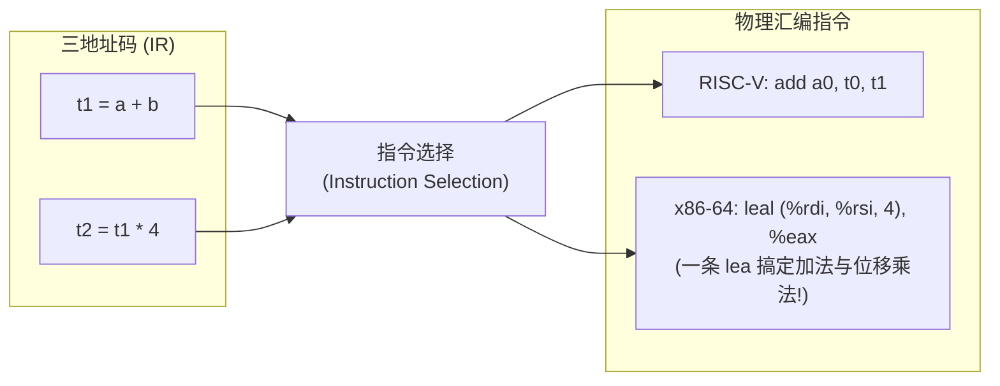
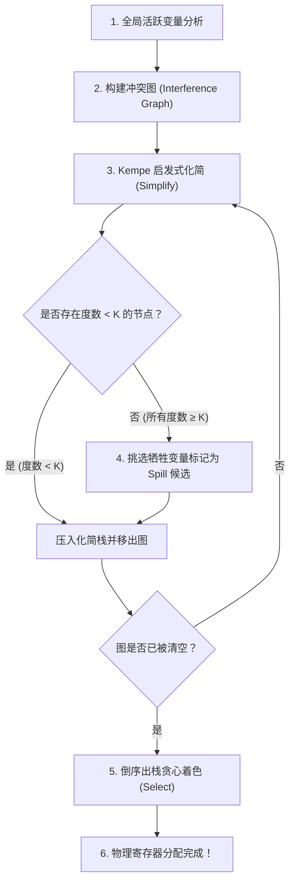

import GraphStepVisualizer from '../../../components/interactive/GraphStepVisualizer';
import QuizCard from '../../../components/interactive/QuizCard';

# 12. 目标代码生成与寄存器分配：终章落地为安

> “行百里者半九十。前面所有的词法、语法、语义与优化，最终都必须在物理硬件的硅晶芯片上踩下坚实的脚印。”

编译器流水线的最后一关，是**目标代码生成（Target Code Generation）与寄存器分配（Register Allocation）**。在这个阶段，编译器从中端纯粹抽象的数学世界（无限虚拟寄存器、理想三地址码），正式跨入充满物理约束的硬件现实世界：
* 物理 CPU（如 x86-64、RISC-V、ARM64）只有极其有限的通用寄存器（如 16 个或 32 个）；
* 不同的硬件指令有严格的寻址方式与操作数限制；
* 内存读写比寄存器读写慢两个数量级（约 100 倍延迟），如何将数百个程序变量塞进区区几个物理寄存器，决定了程序最终运行性能的生死线！

---

## 1. 目标机物理架构与指令选择

目标代码生成的第一项任务，是将三地址码映射为目标机器的具体汇编指令。

### 树覆盖（Tree Rewriting）与最大贪心覆盖（Maximal Munch）
现代编译器（如 LLVM、GCC）通常将中间表达式表示为树状结构，目标指令集被描述为一组带有代价（Cost）的树瓦片（Tiles）：
1. **最大贪心覆盖（Maximal Munch）**：从树的根节点开始，寻找能够覆盖当前最大子树的单条机器指令瓦片；
2. **动态规划最优覆盖（DP Tiling / BURS 算法）**：自底向上计算覆盖每个节点所需指令序列的最小代价值，从而在多条可用汇编指令中挑出运行周期最短的最优组合。

---

## 2. 基本块内的简单寄存器分配（启发式算法）

在局限于单个基本块时，编译器维护两张动态跟踪表，指导寄存器的分配与换出：
* **`RVALUE[R]`**：记录当前物理寄存器 $R$ 中存放着哪些程序变量的值；
* **`AVALUE[A]`**：记录程序变量 $A$ 当前的值存放在哪个物理寄存器或内存栈单元中。

### `getreg()` 函数的分配策略
当遇到三地址码 $x = y + z$ 需要为计算结果 $x$ 寻找一个物理寄存器时：
1. **就地复用**：如果 $y$ 当前已经存在某个寄存器 $R_y$ 中，且此后该基本块内**再也不会用到 $y$**，则直接将 $R_y$ 腾出来分配给 $x$！
2. **空闲优先**：挑选一个当前未被任何活跃变量占用的空闲寄存器；
3. **启发式溢出（Spill）**：若所有寄存器均已占满，挑选一个**未来最晚才会被使用（或不再使用）** 的寄存器 $R_v$，将其当前内容发射一条 `STORE` 指令写回内存栈帧，腾出空间给 $x$ 使用。

---

## 3. 全局寄存器分配：Chaitin-Briggs 图着色算法

在现代工业级编译器中，函数级别的全局寄存器分配采用图论中的 **K-着色问题（K-Coloring Problem）**。该方案由 Gregory Chaitin 于 1981 年提出，并由 Preston Briggs 于 1989 年引入“乐观着色”完善，是编译原理皇冠上的璀璨明珠。

### 核心阶段详解

1. **构建冲突图（Interference Graph）**：
   * 图中的每个节点代表一个虚拟变量（生命周期区间）；
   * 若变量 $u$ 与变量 $v$ 在程序的**某处同时处于活跃状态（Live）**，说明它们绝不能共用同一个物理寄存器，在它们之间连一条**无向冲突边**。
2. **Kempe 启发式化简（Kempe's Heuristic）**：
   * 假定目标机有 $K$ 个可用物理寄存器；
   * 寻找图中**度数（邻居数）$< K$** 的节点 $v$；
   * **数学直觉保障**：因为 $v$ 的邻居总数最多只有 $K-1$ 个，即使这些邻居各占一种互不相同的颜色，总共也只占用了 $K-1$ 种颜色，**至少还能剩下 1 种颜色留给 $v$**！因此 $v$ 必定能成功着色！
   * 将 $v$ 从图中临时移出，并推入化简栈中。
3. **溢出处理（Spill）**：
   * 若在某一时刻，图中所有剩余节点的度数都 $\ge K$，化简无法继续；
   * 采用代价函数（如 $\text{Cost}(v) = \text{引用频次} / \text{度数}$），挑选一个代价最低的变量标记为 **Spill 候选者**，暂时从图中剔除并压栈，使其邻居节点的度数下降，化简得以继续推进。
4. **倒序出栈着色（Select）**：
   * 依次从栈顶弹出节点，重新加回图中，为其分配一个与其已着色邻居**互不冲突**的可用物理寄存器颜色编号。

---

## 4. 交互式推演：Chaitin-Briggs 4-着色算法与图化简全过程

假定目标机器拥有 **$K = 4$ 个物理通用寄存器**（颜色分配为：$R_1$ 蓝绿色、$R_2$ 翡翠绿、$R_3$ 青蓝色、$R_4$ 琥珀黄）。
程序经过活跃变量分析后，得到 6 个虚拟变量 $\{v_1, v_2, v_3, v_4, v_5, v_6\}$ 构成的无向冲突图。

export const coloringGraph = {
  nodes: [
    { id: 'v1', label: 'v1 (deg: 3)' },
    { id: 'v2', label: 'v2 (deg: 3)' },
    { id: 'v3', label: 'v3 (deg: 4)' },
    { id: 'v4', label: 'v4 (deg: 3)' },
    { id: 'v5', label: 'v5 (deg: 3)' },
    { id: 'v6', label: 'v6 (deg: 2)' }
  ],
  edges: [
    { id: 'e12', source: 'v1', target: 'v2' },
    { id: 'e13', source: 'v1', target: 'v3' },
    { id: 'e16', source: 'v1', target: 'v6' },
    { id: 'e23', source: 'v2', target: 'v3' },
    { id: 'e24', source: 'v2', target: 'v4' },
    { id: 'e34', source: 'v3', target: 'v4' },
    { id: 'e35', source: 'v3', target: 'v5' },
    { id: 'e45', source: 'v4', target: 'v5' },
    { id: 'e56', source: 'v5', target: 'v6' }
  ]
};

export const coloringSteps = [
  {
    title: "1. 初始冲突图：计算各节点度数 (K = 4)",
    description: "当前可用寄存器 K=4。统计节点度数：v3 度数为 4 (≥ K)，其余 v1(3), v2(3), v4(3), v5(3), v6(2) 的度数均 < 4。寻找度数 < K 的节点开始化简。",
    badge: "初始冲突图",
    activeNodes: ['v1', 'v2', 'v3', 'v4', 'v5', 'v6'],
    activeEdges: ['e12', 'e13', 'e16', 'e23', 'e24', 'e34', 'e35', 'e45', 'e56'],
    nodeColorMap: { v1: '#64748b', v2: '#64748b', v3: '#f43f5e', v4: '#64748b', v5: '#64748b', v6: '#10b981' }
  },
  {
    title: "2. Kempe 化简第 1 步：移除 v6 (度数 2 < 4)",
    description: "v6 度数仅为 2 < 4，必定安全！将其从图中剥离并压入化简栈 Stack = [v6]。邻居 v1 和 v5 的度数随即从 3 降为 2！",
    badge: "压栈: v6",
    activeNodes: ['v6'],
    activeEdges: ['e16', 'e56'],
    nodeColorMap: { v6: '#06b6d4', v1: '#3b82f6', v5: '#3b82f6' }
  },
  {
    title: "3. Kempe 化简第 2 步：移除 v5 (度数 2 < 4)",
    description: "v5 此时度数为 2 < 4，安全压栈 Stack = [v6, v5]。移除 v5 导致关键高冲突节点 v3 的度数从 4 骤降为 3 (< K)！阻塞警报彻底解除！",
    badge: "压栈: v5",
    activeNodes: ['v5'],
    activeEdges: ['e35', 'e45'],
    nodeColorMap: { v5: '#06b6d4', v3: '#10b981', v4: '#3b82f6' }
  },
  {
    title: "4. Kempe 化简第 3 步：依次移除 v4, v3, v2, v1",
    description: "此时所有剩余节点的度数均已小于 4！依次将 v4, v3, v2, v1 压入栈。化简栈完整序列为 [v6, v5, v4, v3, v2, v1]，冲突图彻底被清空！",
    badge: "图已清空",
    activeNodes: ['v1', 'v2', 'v3', 'v4'],
    activeEdges: [],
    nodeColorMap: { v1: '#06b6d4', v2: '#06b6d4', v3: '#06b6d4', v4: '#06b6d4' }
  },
  {
    title: "5. Select 着色阶段：依次弹栈分配寄存器",
    description: "倒序出栈：弹出 v1 分配 R1(蓝)，弹出 v2 分配 R2(绿)，弹出 v3 分配 R3(黄)，弹出 v4 分配 R4(红)。四门寄存器恰好各司其职，互不冲突！",
    badge: "分配 R1~R4",
    activeNodes: ['v1', 'v2', 'v3', 'v4'],
    activeEdges: ['e12', 'e13', 'e23', 'e24', 'e34'],
    nodeColorMap: { v1: '#3b82f6', v2: '#10b981', v3: '#f59e0b', v4: '#ef4444' }
  },
  {
    title: "6. 恢复剩余节点 v5 与 v6：完美 4-着色收官！",
    description: "弹出 v5：邻居为 v3(黄) 和 v4(红)，复用空闲颜色 R1(蓝)；弹出 v6：邻居为 v1(蓝) 和 v5(蓝)，分配 R2(绿)。全图 6 个变量全部常驻物理寄存器，零内存溢出！",
    badge: "着色大获全胜",
    activeNodes: ['v1', 'v2', 'v3', 'v4', 'v5', 'v6'],
    activeEdges: ['e12', 'e13', 'e16', 'e23', 'e24', 'e34', 'e35', 'e45', 'e56'],
    nodeColorMap: { v1: '#3b82f6', v2: '#10b981', v3: '#f59e0b', v4: '#ef4444', v5: '#3b82f6', v6: '#10b981' }
  }
];

<GraphStepVisualizer
  client:visible
  title="Chaitin-Briggs 图着色全局寄存器分配 (力导向力场布局)"
  algorithmName="Chaitin-Briggs 4-着色算法"
  initialGraph={coloringGraph}
  layoutName="cose"
  steps={coloringSteps}
/>

---

## 5. 核心难点自测与巩固

<QuizCard
  client:visible
  category="图着色寄存器分配"
  question="在 Chaitin-Briggs 图着色算法中，Kempe 简化规则之所以能够安全地将度数 < K 的节点移出图并压栈，其根本数学保证是："
  options={[
    "该节点的邻居总数严格少于 K 个，无论周围邻居将来如何着色，最多占掉 K-1 种颜色，必定至少剩下 1 种可用颜色留给它。",
    "该节点所代表的变量已经被编译器证明为永远为常数 0。",
    "该节点与其他所有节点在物理内存中共享同一块高速缓存行。",
    "度数小于 K 的节点不需要分配任何寄存器，直接在编译期被当场删除。"
  ]}
  answer={0}
  explanation="正确！这是 Kempe 简化规则的核心数学定理：对于任何可用颜色数为 K 的图，若节点度数 deg(v) < K，它的邻居数量上限定死了是 K-1；因此无论邻居最终被染成何种颜色，都绝对不可能耗尽 K 种颜色，该节点出栈时必定能够合法染上颜色！"
/>

<QuizCard
  client:visible
  category="寄存器溢出 (Spill)"
  question="当冲突图中所有剩余节点的度数均 ≥ K 时，Kempe 化简受阻，编译器应当采取什么策略破局？"
  options={[
    "基于启发式代价函数（如引用频次 ÷ 度数）挑选一个代价最低的变量标记为 Spill 候选者剥离出图，从而降低邻居度数解除阻塞。",
    "直接停止编译，要求程序员修改源代码缩减局部变量数量。",
    "向操作系统发出内核请求，动态将 CPU 的物理通用寄存器扩展至 64 个。",
    "将所有的冲突边强制删除，让多个活跃变量共享同一寄存器。"
  ]}
  answer={0}
  explanation="正确！当所有度数均 ≥ K 时，出现潜在溢出。编译器必须挑选一个引用最不频繁或度数最高的牺牲品变量（Spill Candidate）将其暂离出图；牺牲该节点后，与其相连的邻居节点的度数立即减 1，从而重新激发出度数 < K 的安全节点，化简流程得以继续运转！"
/>
