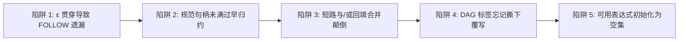

import QuizCard from '../../../components/interactive/QuizCard';

# 13. 期末终极冲刺：核心试题实战大演练

> “所有伟大的工程奇迹，最终都沉淀为考场上笔下生风的笃定与从容。”

欢迎来到《编译原理》生动交互实验室的**期末终极冲刺站**！本章汇聚了编译原理核心课程考试与专业课初试中**出题频率最高、失分率最惨烈、综合性最强**的 12 道经典核心考题。

每道题目均配备了即时交互判分与深度底层解析。请沉下心来，独立推演作答，检验你在整个编译流水线全工序的真正内功！

---

## 1. 全程流水线核心试题实战演练（12 题全景覆盖）

### 模块一：词法分析与有限自动机

<QuizCard
  client:visible
  category="词法分析 (Lexical)"
  question="正规式 (a | b)* a b 转换并最小化后的 DFA 最少包含几个状态（不含死状态）？"
  options={[
    "3 个状态（初态兼前缀态 S0、已读 a 态 S1、匹配 ab 终态 S2）",
    "2 个状态",
    "4 个状态",
    "5 个状态"
  ]}
  answer={0}
  explanation="正确！利用子集构造法转换得到 4 个状态子集（A, B, C, D），随后用 Hopcroft 划分算法最小化化简时，发现初态 A 与循环态 C 在输入 a/b 下的后继完全一致，可等价合并为单个状态 AC，因此最小化 DFA 恰好只需 3 个状态即可完全等价识别！"
/>

### 模块二：文法理论与形式语言层次

<QuizCard
  client:visible
  category="语法分析基础 (Grammar)"
  question="为什么有限自动机（DFA / NFA）无法识别像 L = { aⁿ bⁿ | n ≥ 1 } 这类语言，必须引入下推自动机（PDA）与上下文无关文法（CFG）？"
  options={[
    "有限自动机仅有有限个状态寄存，缺少外部无限记忆栈机制，无法记录任意深度 n 的符号计数与对称匹配。",
    "因为正规式语法不支持“或”逻辑运算。",
    "因为词法分析器的扫描缓冲区长度受限，不能读入超过 256 字符的代码。",
    "因为上下文无关文法只允许自底向上分析，有限自动机只能自顶向下。"
  ]}
  answer={0}
  explanation="正确！根据泵引理（Pumping Lemma），DFA 只能识别正规语言，其状态数是有限常数；而 aⁿ bⁿ 要求 a 的个数与 b 严格相等，当 n 无限增长时，必须借助具有无限深度的后进先出栈（下推自动机）来追踪计数匹配！"
/>

### 模块三：自顶向下语法分析 LL(1)

<QuizCard
  client:visible
  category="自顶向下语法分析 (LL(1))"
  question="文法 G 为 LL(1) 文法的充要条件是：对于每个非终结符 A 的任意两个不同产生式 A → α | β："
  options={[
    "FIRST(α) ∩ FIRST(β) = ∅；且若 β ⇒* ε，则 FIRST(α) ∩ FOLLOW(A) = ∅。",
    "FIRST(α) 与 FIRST(β) 必须完全相等。",
    "FOLLOW(A) ∩ FIRST(A) 必须为空集。",
    "文法中不得包含任何左递归与右递归产生式。"
  ]}
  answer={0}
  explanation="正确！这是 LL(1) 文法无二义、无回溯预测分析的核心判定定理：候选式首符号集不能相交；若其中一个候选式可能推导出空串 ε，则另一个候选式的 FIRST 集不能与 A 的后继符号集 FOLLOW(A) 冲突，否则在面临后继符号时预测分析表会出现多重入口冲突！"
/>

### 模块四：自底向上语法分析 LR 家族

<QuizCard
  client:visible
  category="自底向上语法分析 (SLR(1))"
  question="在 LR 分析中，当某项目集中同时包含移进项目 A → α · a β 和归约项目 B → γ · 时，SLR(1) 分析法是如何消解“移进-归约冲突”的？"
  options={[
    "检查当前输入符号 a 与 FOLLOW(B) 集：若 {a} ∩ FOLLOW(B) = ∅，面临 a 时移进，面临 FOLLOW(B) 中的符号时归约。",
    "强制默认移进优先，抛弃所有归约项。",
    "让分析栈弹出符号，回溯到前一个项目集重新决定。",
    "直接将该项目集分裂为两个独立的 DFA 状态。"
  ]}
  answer={0}
  explanation="正确！SLR(1) 核心正是借助上下文的 FOLLOW(B) 集合作为简易前瞻！只有当下一个输入符号真实属于 B 的合法后继 FOLLOW(B) 时，归约操作才是合法的；若移进符号 a 不在 FOLLOW(B) 中，两者集合互斥，冲突瞬间化解！"
/>

<QuizCard
  client:visible
  category="LR 进阶对比 (LALR(1))"
  question="关于 LALR(1) 分析法合并 LR(1) 同心项（同心项目集）的性质，下列陈述唯一正确的是："
  options={[
    "合并同心项绝不会引入新的“移进-归约”冲突，但可能引入潜在的“归约-归约”冲突。",
    "合并同心项既可能引入移进-归约冲突，也可能引入归约-归约冲突。",
    "合并同心项会导致分析表的状态数膨胀为原先的平方倍。",
    "合并同心项后就退化成了 SLR(1) 文法。"
  ]}
  answer={0}
  explanation="正确！经典考研核心考点！同心项的核心产生式与圆点位置完全相同，仅搜索符不同。移进动作只由产生式右部圆点后的终结符决定，因此合并绝不改变移进动作，故绝不会引入移进-归约冲突；但如果两个不同产生式在合并后各自的向前看符号发生了交集重叠，就会产生新的归约-归约冲突！"
/>

### 模块五：语义分析与语法制导翻译 SDT

<QuizCard
  client:visible
  category="语义分析与属性文法 (SDT)"
  question="关于 S-属性文法与 L-属性文法的本质异同，下列陈述正确的是："
  options={[
    "S-属性文法仅包含综合属性，天然契合自底向上 LR 分析在归约时同步求值；L-属性文法允许继承属性但依赖必须自左向右，契合自顶向下深度优先遍历。",
    "S-属性文法只允许继承属性，不允许综合属性。",
    "L-属性文法的依赖图中可以允许包含双向有向依赖环。",
    "任何 L-属性文法都绝对无法在自底向上 LR 分析器中实现。"
  ]}
  answer={0}
  explanation="正确！S 代表 Synthesized（综合），S-属性文法的所有属性值完全由子节点向上计算，LR 分析器归约产生式时，右部子节点的值已经在语义栈顶，归约时直接计算出左部属性，极其自然；而 L-属性允许从父节点或左侧兄弟节点继承，依赖图拓扑无环，适合自顶向下深度遍历求值。"
/>

### 模块六：中间代码生成与控制流回填

<QuizCard
  client:visible
  category="中间代码与控制流 (IR)"
  question="在布尔表达式与控制流语句翻译中，编译器采用“拉链与回填 (Backpatching)”技术的最核心动机是："
  options={[
    "单遍扫描生成四元式时，前向跳转的目标地址尚未确定；通过将跳转同一目标的四元式串成链表，在目标语句生成时一键批量回填，避免二次遍历。",
    "为了将所有的递归函数调用强制优化为循环迭代。",
    "消除控制流图中的所有自然循环与回边。",
    "把四元式直接翻译成硬件物理机器码。"
  ]}
  answer={0}
  explanation="正确！在工程实现中，单遍线性扫描极其高效。遇到 if / while 条件跳转时，真分支或假分支的具体行号还不知道，编译器先生成形如 (j>, a, b, 0) 的未完成四元式，将未填地址串联成链表；等后续目标指令生成后，通过 backpatch 一键精准补齐！"
/>

### 模块七：运行时存储组织

<QuizCard
  client:visible
  category="运行时存储管理 (Runtime)"
  question="在支持过程嵌套定义和静态作用域的语言（如 Pascal / 嵌套闭包）中，Display 表的主要作用是："
  options={[
    "用一个数组记录当前活跃的各静态外层过程活动记录的基址指针，使访问非局部静态变量的时间复杂度由遍历静态链的 O(k) 优化为 O(1)。",
    "显示当前函数调用栈的 GUI 界面并提供断点调试。",
    "作为动态链（Dynamic Link）的替代品，用于被调用函数返回时恢复调用者的栈顶。",
    "专门用于存储全部全局变量的散列表。"
  ]}
  answer={0}
  explanation="正确！静态链（Static Link）需要沿着链表一步步回溯指针，嵌套 k 层时耗时 O(k)；而 Display 表如同一个快速索引数组，Display[i] 直接指向静态嵌套深度为 i 的过程栈帧基址，访问嵌套外层变量只需一条数组间接寻址指令 O(1)！"
/>

### 模块八：代码优化与基本块 DAG

<QuizCard
  client:visible
  category="代码优化 (Optimization)"
  question="在基本块 DAG 局部优化算法中，处理赋值语句 A = B + C 时，若变量 A 原本已挂载在某个旧节点上，正确的操作是："
  options={[
    "将变量标签 A 从旧节点撕下，附加到计算 B + C 的新节点上（旧节点仅保留其初值或其它别名标签）。",
    "抛出变量重定义编译错误并拒绝生成优化代码。",
    "将旧节点与新节点强制合并为一个超级节点。",
    "保持旧节点上的 A 不动，新节点只能挂载临时变量 T。"
  ]}
  answer={0}
  explanation="正确！这是 DAG 构建中的“变量重写与标签撕下”原则。变量 A 被赋予新值后，其旧定值已被物理覆盖，后续代码引用 A 必须读取最新计算结果，因此必须从旧节点撕下贴至新节点；旧节点若没有其它活跃变量标签，且后续无人使用，将最终作为死代码被消除！"
/>

<QuizCard
  client:visible
  category="循环优化与支配树 (Dominators)"
  question="在控制流图中，判断一条有向边 m → d 为“回边 (Back Edge)”并从而识别自然循环的充要条件是："
  options={[
    "目标节点 d 支配源节点 m（即从流图入口到达 m 的所有路径都必须经过 d，d dom m）。",
    "源节点 m 支配目标节点 d。",
    "节点 m 和节点 d 必须处于同一个基本块内部。",
    "该边跨越了至少 10 条三地址指令。"
  ]}
  answer={0}
  explanation="正确！支配（Dominate）表示避无可避：若 d 支配 m（d dom m），说明任何到达 m 的控制流之前都已经经过了 d；此时若又存在一条从 m 跳回 d 的边 m → d，就必然构成了从循环末尾返回循环头部的回边！"
/>

### 模块九：全局数据流分析

<QuizCard
  client:visible
  category="数据流分析 (Data Flow)"
  question="关于三大经典数据流分析的组合，下列对应关系完全正确的是："
  options={[
    "到达定值：前向 + 并集；活跃变量：后向 + 并集；可用表达式：前向 + 交集。",
    "到达定值：后向 + 并集；活跃变量：前向 + 交集；可用表达式：后向 + 交集。",
    "三者方向全部为前向分析，算子全部为交集。",
    "到达定值：前向 + 交集；可用表达式：后向 + 并集。"
  ]}
  answer={0}
  explanation="完全正确！到达定值顺流而下（前向，只要有一条路径到达就可能到达，并集）；活跃变量逆流而上（后向，只要未来某条路径还会用就活着，并集）；可用表达式顺流而下（前向，必须所有到达路径都计算过且未被杀死才可用，交集）。"
/>

### 模块十：目标代码生成与寄存器分配

<QuizCard
  client:visible
  category="目标代码生成 (CodeGen)"
  question="在 Chaitin-Briggs 图着色寄存器分配中，若物理可用寄存器数为 K，当所有剩余节点的度数均 ≥ K 时，Kempe 化简受阻，编译器必须执行的操作是："
  options={[
    "采用启发式代价函数（如引用频次 ÷ 度数）挑选一个节点作为 Spill 候选者剥离出图，从而使邻居度数下降，解除 Kempe 阻塞继续化简。",
    "直接向操作系统申请更多物理寄存器。",
    "立即终止编译并报告语法错误。",
    "将所有节点随机分配到物理寄存器中，忽略冲突。"
  ]}
  answer={0}
  explanation="正确！这是 Chaitin-Briggs 突破 NP-完全图着色瓶颈的伟大工程启发式：度数全大于等于 K 意味着必然存在寄存器冲突与潜在溢出风险；牺牲一个引用最不频繁或度数最高的变量（Spill），将其移入内存栈，其余邻居的度数随即降低，化简栈得以重新运转！"
/>

---

## 2. 考场 5 大致命陷阱深度剖析

### 陷阱 1：FIRST 集中包含 $\epsilon$ 时，FOLLOW 集的漏加与透传截断
* **致命现象**：产生式 $A \to B C D$。若 $B \Rightarrow^* \epsilon$，很多同学只把 $\text{FIRST}(B) \setminus \{\epsilon\}$ 加入 $\text{FIRST}(A)$，忘记了 $C$ 的首符也可以作为 $A$ 的首符！
* **铁律防线**：若产生式右部前 $k$ 个符号均能推导出 $\epsilon$，则第 $k+1$ 个符号的 FIRST 必须顺延加入！若所有符号均能推导为 $\epsilon$，则 $\epsilon \in \text{FIRST}(A)$，且在计算 FOLLOW 时，外层父节点的 FOLLOW 会直接“穿透穿透”给末尾可空的非终结符！

### 陷阱 2：LR 分析中“规范句柄”出现前过早归约
* **致命现象**：看到分析栈顶出现了产生式右部的某个子部分，就迫不及待地执行归约动作。
* **铁律防线**：归约必须且只能在**最左素短语（句柄 Handle）完整无缺地出现在栈顶**时发生！移进与归约的取舍必须严格遵照 LR DFA 状态转换表，切忌靠主观肉眼臆断！

### 陷阱 3：拉链回填中短路“与”和短路“或”的链表合并方向混淆
* **致命现象**：将 `E1 && E2` 与 `E1 || E2` 的真假链回填与合并逻辑弄反。
* **铁律防线**：
  * 对于 `E1 && E2`：左侧为真才需要看右侧，因此**回填 $E_1$ 的真链到 $E_2$ 的入口**！整体假链是两者的并集：`merge(E1.falselist, E2.falselist)`！
  * 对于 `E1 || E2`：左侧为假才需要看右侧，因此**回填 $E_1$ 的假链到 $E_2$ 的入口**！整体真链是两者的并集：`merge(E1.truelist, E2.truelist)`！

### 陷阱 4：DAG 构建时变量重定值忘记从旧节点“撕下”标签
* **致命现象**：基本块内连续两句 `A = B + C; A = D + E;`，在构建第二个加法节点时，只给新节点贴上 `A`，没有把旧节点上的 `A` 抹去。
* **铁律防线**：变量名代表的是最新的值绑定。赋值语句一旦对变量重新定值，**必须毫不留情地把该变量名从旧节点上撕下**！否则后续如果有语句使用 `A`，就会错误地引用到旧节点。

### 陷阱 5：可用表达式与活跃变量的“交并集”与“方向”记反
* **致命现象**：可用表达式（Available Expressions）算成了并集；活跃变量（Live Variables）初始值设成了全集。
* **铁律防线**：
  * **可用表达式（AE）**：前向 + 交集 $\bigcap$ + 非入口块初始为全集 $U$（必须所有路径都算过才安全）；
  * **活跃变量（LV）**：后向 + 并集 $\bigcup$ + 初始全为空集 $\emptyset$（只要未来任一分支还用就算活）。

---

## 3. 期末通关终极速记清单

### 《编译原理》期末通关速记口诀卡

| 章节主题 | 期末通关核心口诀 |
| :--- | :--- |
| **1. 词法分析** | 正规式 -> Thompson NFA -> 子集构造法 DFA -> Hopcroft 划分 |
| **2. 语法 LL(1)** | 消直接左递归 + 提公因子 + FIRST 互斥 + (可空时 FIRST/FOLLOW 互斥) |
| **3. 语法 LR 阶梯** | LR(0) 项目 -> SLR(1) 用 FOLLOW 消解 -> LR(1) 搜素符 -> LALR(1) 合同心项 |
| **4. 语义计算** | S-属性全综合、归约同步算；L-属性依赖自左向右、拓扑深度搜 |
| **5. 中间代码** | 短路与填真链合假链；短路或填假链合真链；单遍扫描拉链回填 |
| **6. 运行存储** | 动态链记调用者回退；静态链寻词法外层；Display 表 O(1) 寻址 |
| **7. 代码优化** | 首指令三准则划基本块；DAG 撕标签消公共；循环外提+强度削弱+归纳消除 |
| **8. 数据流三剑客** | RD 前向并；LV 后向并；AE 前向交且初值全集 U |
| **9. 代码生成** | RVALUE 寄存器装谁；AVALUE 变量放哪；Chaitin 图着色 deg < K 必安全 |
