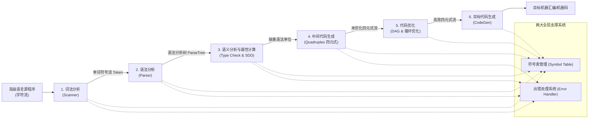
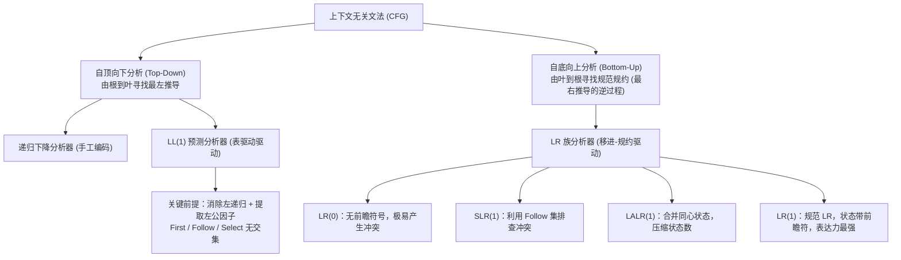

## 导读：如何宏观把握一门编译器课程？

很多初学者觉得《编译原理》公式繁杂、自动机状态爆炸、各种分析表头晕目眩。但只要跳出细枝末节，从**一趟源程序变迁之旅**的视角审视，整门课程的逻辑线索极其清晰自然：



编译器本质上是一个**大规模降维与保真映射器**：将人类易于理解、高度抽象的高级语言文本，在保证语义等价的前提下，一步步脱去语法糖，显式化控制流与内存访问，最终翻译为计算机硬件可直接执行的物理指令序列。

---

## 第一站：词法分析（第 4 ~ 8 讲）——从字符流到单词序列

### 1. 核心任务与产出
- **输入**：无结构的连续字符流（包含空格、制表符、回车与注释）。
- **输出**：结构化的**单词符号（Token）**，通常以二元组表示：`(种别码, 属性值)`。
  - 关键字（保留字）：如 `if`、`while`、`int`（一词一码或统一关键字码）。
  - 标识符：变量名、函数名，属性值为其在符号表中的指针或字面名。
  - 常数：整型、浮点型、字符常数，属性值为其数值。
  - 运算符：`+`、`-`、`*`、`/`、`<=` 等。
  - 界符：`;`、`,`、`(`、`)`、`{`、`}` 等。

### 2. 形式化三剑客：正规式、NFA 与 DFA
词法规则是 3 型文法（正规文法），其核心等价理论构成了编译前端的第一块基石：
1. **正规式（RE）**：人类用来声明词法规则的形式化文本（如标识符定义为 `letter (letter | digit)*`）。
2. **不确定有限自动机（NFA）**：计算机依据正规式生成的过渡形态。通过 **Thompson 结构归纳算法**，为空字 $\epsilon$、连接、选择、星闭包构造状态机单元并拼接。特点是包含 $\epsilon$-转移，同一输入可能转移到多个后继状态。
3. **确定有限自动机（DFA）**：计算机能高效线性执行的状态机。通过**子集构造法（$\epsilon$-闭包与 move 转移）**将 NFA 确定化。
4. **DFA 最小化（Hopcroft 算法）**：将 DFA 的状态集按“终态”与“非终态”初步切分，再根据对字母表各字符的后继跳转是否落在同一等价类中进行**逐步等价划分**，合并多余状态，得到状态数最简的判定器。

### 3. 工程自动化：LEX 工具
无需手写庞大的 `switch-case`。在 LEX 源文件（`.l`）中定义正规表达式与动作代码，LEX 编译器会自动完成“RE $\to$ NFA $\to$ DFA $\to$ 最小化”全过程，直接吐出高效的 C 语言词法扫描函数 `yylex()`。

---

## 第二站：语法分析（第 9 ~ 15 讲）——从线性序列到结构树

语法分析器依据 2 型文法（上下文无关文法 CFG），判断单词流是否符合语言的语法结构，并构建推导骨架。全书将语法分析划分为两大阵营：**自顶向下** 与 **自底向上**。



### 1. 核心理论准备：推导、规约、句柄与二义性
- **最左推导 / 最右推导（规范推导）**：每步总是替换最左（或最右）的非终结符。
- **短语、直接短语、句柄（Handle）**：
  - 语法树中，某一子树的所有叶子自左至右排列构成的符号串是句型的一个**短语**；
  - 若该子树高度仅为 2（即直接由产生式 $A \to \beta$ 一步生成），则 $\beta$ 是**直接短语（简单短语）**；
  - 句型中最左边的那个直接短语，就是当前必须立即规约的**句柄（Handle）**！
- **二义性**：若一个文法存在某个句子拥有两棵不同的语法分析树，则该文法为二义文法。二义性不可算法判定，但可通过改写文法或引入优先级/结合性规则消除。

### 2. 自顶向下：LL(1) 分析
- **两大拦路虎**：
  1. **左递归（$A \to A\alpha$）**：会导致自顶向下解析陷入死循环，必须改写为等价的右递归文法；
  2. **回溯隐患**：若产生式右部候选式具有相同的公共前缀，解析器无法预知选哪条，必须**提取左公因子**。
- **LL(1) 三步法**：
  1. 求每个非终结符与符号串的 **First 集合**（首终结符集）；
  2. 求每个非终结符的 **Follow 集合**（后跟终结符集，绝不含 $\epsilon$）；
  3. 构造预测分析表 $M[A, a]$。若所有单元格均至多包含一条产生式，则文法是严格的 LL(1) 文法。

### 3. 自底向上：LR(k) 现代语法分析族
LR 分析法采用“移进-规约（Shift-Reduce）”机制，借助**状态栈**与**符号栈**，根据分析表 `Action`（动作：移进 $s$、规约 $r$、接受 $acc$、报错）与 `Goto`（状态转移）驱动。
- **LR(0)**：仅由产生式加圆点构成项目（如 $A \to \alpha \cdot \beta$）。通过 `CLOSURE` 闭包与 `GO` 转移构造 LR(0) 项目集规范族 DFA。若状态中同时存在移进与规约项目，即爆发移进-规约冲突；存在多个规约项目，即爆发规约-规约冲突。
- **SLR(1)**：若状态存在冲突，不看全部终结符，只看要规约产生式左部非终结符的 **Follow 集**。若 Follow 集与移进字符完全互斥，则冲突化解。
- **LR(1)**：项目形式为 $[A \to \alpha \cdot \beta, a]$，显式携带**后看前瞻符（Lookahead）** $a$。表达能力最强，但状态数极大。
- **LALR(1)**：将 LR(1) 中核心产生式相同、仅前瞻符号不同的“同心状态”进行合并。状态数骤降至与 LR(0) 相同，且**绝不产生新的移进-规约冲突**（但极少数情况下可能引入规约-规约冲突）。Yacc / Bison 采用的正是 LALR(1)。

---

## 第三站：语义分析与属性文法（第 16 ~ 17 讲）——给骨架注入灵魂

语法树只知道“句式合不合法”，不知道“逻辑对不对”。类型检查、变量声明前引用、函数参数个数匹配等工作属于**语义分析**范畴。

### 1. 属性文法（SDD）
在 CFG 产生式上附加**语义属性**和**语义规则**：
- **综合属性（Synthesized）**：节点属性由其子节点（产生式右部）的属性值计算而来，自底向上传递（如表达式的值 $E.val = E_1.val + T.val$）。
- **继承属性（Inherited）**：节点属性由其父节点或左侧兄弟节点的属性值计算而来，自顶向下或横向传递（如变量类型由声明头向下传递 $L.in = T.type$）。

### 2. S-属性文法 vs L-属性文法
- **S-属性文法**：文法中**只包含综合属性**。其属性求值可以与自底向上 LR 语法分析完美契合，在规约的同时直接在语义栈上完成属性合并。
- **L-属性文法**：属性依赖图绝不出现向左的回环。每个节点的继承属性只依赖于其父节点或位于它左边的兄弟节点。可与自顶向下递归下降分析器无缝结合，在边解析时边传参求值。

---

## 第四站：中间代码生成与控制流翻译（第 18 ~ 22 讲）——机器无关的代码蓝图

编译器极少直接从 AST 吐出汇编，而是先翻译为**中间代码（IR）**。这实现了**前端与后端的彻底解耦**：$M$ 种源语言与 $N$ 种目标机只需 $M + N$ 个转换模块，而非 $M \times N$。

### 1. 四元式中间语言
本课程采用经典四元式：`(op, arg1, arg2, result)`。
例如 `a = b + c * d` 翻译为：
```text
(*, c, d, T1)
(+, b, T1, T2)
(:=, T2, _, a)
```

### 2. 布尔表达式的两大翻译视角
- **数值计算法**：若布尔值作为变量赋值（如 `bool flag = (a < b);`），翻译为真分支写 1、假分支写 0 的赋值四元式。
- **控制流跳转法**：若作为 `if` / `while` 的条件，绝不计算具体数值，而是直接翻译为**条件转移四元式**（如 `(j<, a, b, true_label)`），配合**短路求值**（Short-Circuit Evaluation）避免冗余执行。

### 3. 核心机制：拉链回填（Backpatching）
高级语言翻译是**单遍顺序扫描**的。在遇到条件判断时，跳转的目标地址往往尚未生成（例如 `if (a < b)` 成立时要跳到 `then` 块首地址，但此时 `then` 块的第一条四元式还没产生！）：
- **悬空跳转**：先生成跳转指令，目标地址留空（如 `(j<, a, b, 0)`）；
- **拉链成链**：将所有跳转到同一目标但未定地址的四元式序号串联成链（`truelist`、`falselist`、`nextlist`）；
- **动态回填**：一旦目标语句的实际行号产生，调用 `backpatch(list, target_quad)`，沿链条将正确的行号逐一填入！

---

## 第五站：运行时存储空间管理与参数传递（第 23 ~ 24 讲）——程序执行的内存沙盒

程序在执行时，操作系统分配的内存空间划分为四大区域：代码区、静态全局数据区、**栈区（Stack）** 与 **堆区（Heap）**。

### 1. 活动记录（栈帧 Stack Frame）
每当一个函数或过程被调用，系统就在调用栈上压入一个**活动记录（Activation Record）**：
- **局部变量区**、**临时变量区**；
- **状态保护区**：保存调用前的 PC、通用寄存器等；
- **动态链（控制链 Dynamic Link）**：指向**调用者（Caller）**的活动记录基地址，用于函数返回时销毁栈帧并恢复调用者栈顶；
- **静态链（访问链 Static Link）**：指向**语法外层定义者**的活动记录基地址，用于在嵌套函数中穿透访问外层词法作用域的局部变量！

### 2. 参数传递四大模式对比
| 参数传递方式 | 求值时机 | 传给被调者的内容 | 被调者修改形参是否影响实参 |
| :--- | :--- | :--- | :--- |
| **传值 (Pass by Value)** | 调用前求值一次 | 实参数值的副本 | **不影响**（各自独立存储） |
| **传地址/引用 (Pass by Reference)** | 调用前计算实参地址 | 实参变量的内存地址指针 | **立即且永久影响**（同一块内存） |
| **传结果/值-结果 (Pass by Value-Result)** | 进函数传值，退函数回写 | 进函数拷贝实参值；退函数将形参写回实参 | **在函数返回的瞬间统一生效** |
| **传名 (Pass by Name)** | **每次形参被使用时动态求值** | 实参表达式的代码块（Thunk 闭包文本替换）| 取决于具体引用环境（产生复杂的后期副作用） |

---

## 第六站：代码优化（第 25 ~ 27 讲）——榨干程序的每一分性能

优化的三原则：**等价原则**（决不能改变运行语义）、**有效原则**（必须真正提升运行速度或缩减体积）、**合算原则**（编译开销不能大于运行收益）。

### 1. 局部优化与基本块 DAG
- **基本块（Basic Block）**：单入口、单出口的顺序执行指令流。通过首语句、跳转目标、跳转后紧邻语句三条规则判定 **Leader 入口语句**。
- **DAG 节点图优化**：
  - 将基本块构造为有向无环图（DAG），每个叶子是标识符/常数，内部节点是运算符；
  - **消除公共子表达式**：若某运算符的子节点与已有节点完全一致，直接复用已有节点，杜绝重复运算；
  - **常数折叠**：若内部节点的所有子节点均为已知常数，编译期直接算出常数值；
  - **消除无用代码（死代码）**：重构代码时，未被后续引用的赋值指令直接丢弃。

### 2. 循环优化三部曲
90% 的程序运行时间消耗在 10% 的循环代码上：
1. **代码外提（Loop-Invariant Code Motion）**：将循环体内与循环变量无关的不变计算提取到循环入口前（Preheader）只算一次；
2. **强度削弱（Strength Reduction）**：将循环内部的高开销运算替换为低开销运算（例如将数组下标索引中的乘法 `j * 4` 替换为累加 `t = t + 4`）；
3. **消除归纳变量**：基本归纳变量 $i$ 与派生归纳变量 $j$ 步调一致时，改用派生变量控制循环终止，直接淘汰基本归纳变量。

---

## 第七站：目标代码生成（第 28 讲）——走向物理现实

将四元式转化为目标处理器的汇编指令序列。核心瓶颈在于：**寄存器是极度宝贵但容量有限的物理硬件**。

### 1. 寄存器与地址描述表
- **`RVALUE[R]`（寄存器描述表）**：记录当前物理寄存器 $R$ 中存放着哪些变量的值；
- **`AVALUE[A]`（地址描述表）**：记录变量 $A$ 当前的值存放在哪里（如在内存某个单元、或在寄存器 $R_1$ 中）。

### 2. 待命信息与释放/换出策略
- **待命信息（Next Use）与活性（Liveness）**：分析基本块内该变量在后续指令中是否还会被读取；
- 若寄存器用尽，选择一个**在未来最晚被引用（或不再被引用）**的寄存器换出（Spill）。若其在内存中的拷贝已失效，则必须先生成一条 `STORE` 指令将寄存器值写回内存，再行分配。

---

## 八、全书复习路线与关键产物一览表

| 阶段 | 对应讲数 | 理论工具 | 关键算法 / 核心推导 | 最终产物 |
| :---: | :---: | :---: | :---: | :---: |
| **词法分析** | 第 4 ~ 8 讲 | 3 型正则文法、有限自动机 | Thompson 构造法、子集构造法、Hopcroft 最小化 | 词法扫描器、Token 流 |
| **语法分析 (LL)** | 第 9, 12, 13 讲 | 2 型上下文无关文法 | 消除左递归、提取左因子、First/Follow 计算、预测分析表构造 | 递归下降函数、LL(1) 分析表 |
| **语法分析 (LR)** | 第 10, 11, 14, 15 讲 | 移进-规约栈机 | 项目集规范族 CLOSURE / GO、Follow 过滤、同心状态合并 | LR(0)/SLR(1)/LR(1)/LALR(1) 分析表 |
| **语义分析** | 第 16, 17 讲 | 属性文法 (SDD / SDT) | 依赖图拓扑排序、S-属性规约计算、L-属性遍历 | 带有属性的语法树、符号表类型项 |
| **中间代码** | 第 18 ~ 22 讲 | 线性三地址表示 | 布尔短路翻译、`makelist`/`merge`/`backpatch` 拉链回填 | 结构化四元式序列 |
| **存储管理** | 第 23, 24 讲 | 运行时系统、体系结构模型 | 活动记录规划、静态链与动态链寻址、参数传递求值 | 运行时栈帧布局规范 |
| **代码优化** | 第 25 ~ 27 讲 | 控制流图 (CFG)、DAG | 基本块 Leader 划分、DAG 局部优化、循环不变外提与强度削弱 | 优化后的紧凑四元式流 |
| **代码生成** | 第 28 讲 | 目标机汇编指令系统 | `getreg` 算法、`RVALUE`/`AVALUE` 动态跟踪维护 | 物理汇编指令程序 |
