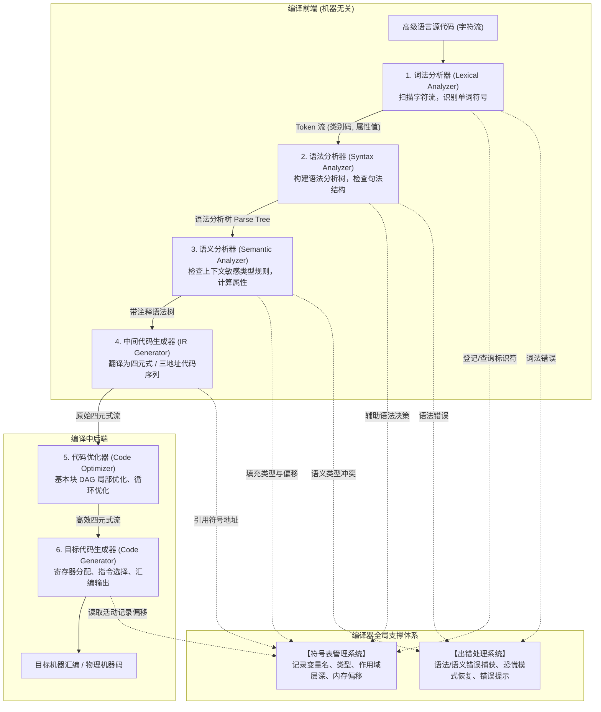
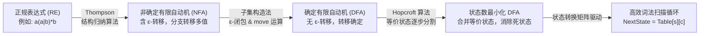
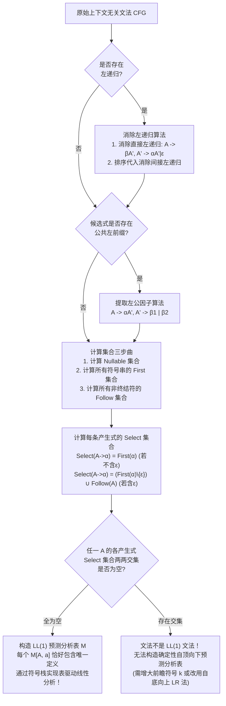
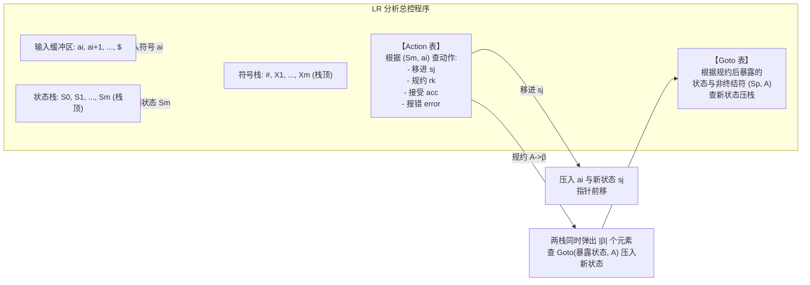
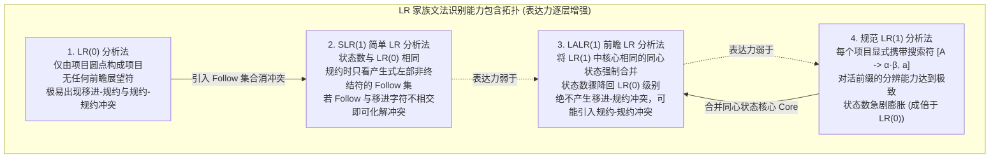
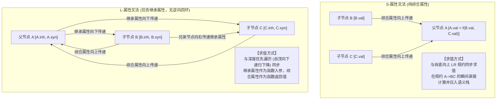
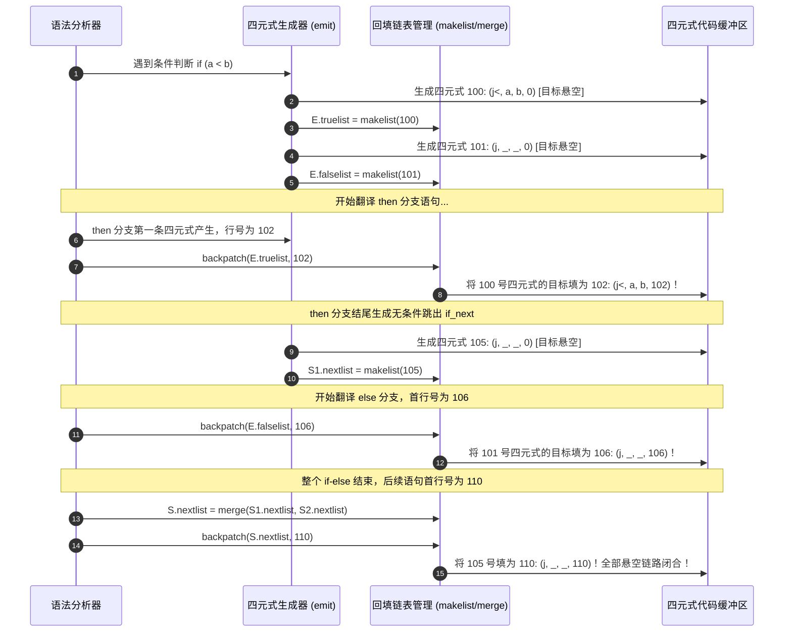
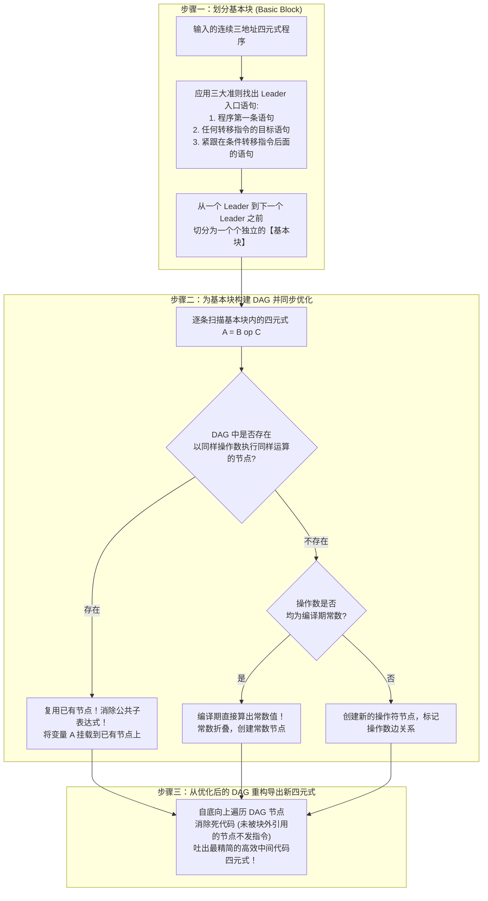
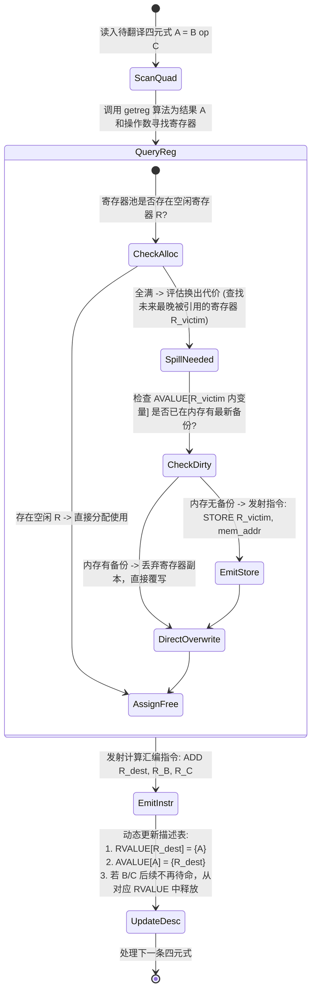

## 图 1：经典编译系统八大阶段协同架构

编译过程由前至后经历六大转换阶段，并由两大支撑系统全程协同贯穿：

---

## 图 2：词法分析自动机转换全生命周期

从人类可读的词法规范，到计算机硬件能够以 $O(1)$ 时间单步判定的最小 DFA 的完整推导闭环：

---

## 图 3：自顶向下语法分析决策流与 LL(1) 条件

自顶向下推导必须彻底排除左递归与回溯隐患，才能构建出无冲突的预测分析表：

---

## 图 4：自底向上 LR 语法分析硬件执行模型

自底向上 LR 分析器依靠两个栈（状态栈与符号栈）及两张核心驱动表（Action 表与 Goto 表）协同运转：

---

## 图 5：自底向上 LR 家族四代演进与覆盖能力拓扑

LR 系列根据“如何解决移进-规约与规约-规约冲突”呈现出清晰的技术代际演进：

---

## 图 6：属性文法（SDD）求值依赖与遍历机制

综合属性与继承属性在语法树中的不同流向，决定了其匹配的遍历求值模式：

---

## 图 7：布尔控制流语句的拉链回填（Backpatching）流程

解决高级语言单遍扫描编译时，前向转移目标尚未产生的“悬空回填”技术：

---

## 图 8：活动记录（栈帧）多层嵌套与静态链/动态链寻址穿透

展示嵌套过程调用下，动态链（调用关系）与静态链（词法作用域外层）的本质分野：

```mermaid
flowchart TD
    subgraph StackFrame["函数 P 的活动记录 (栈帧结构)"]
        direction TB
        F_Local["局部变量与临时工作区"]
        F_State["机器状态保护区 (保存返回 PC、通用寄存器)"]
        F_DL["动态链 (Dynamic Link / 控制链)<br>指向当前函数的【直接调用者】的栈帧基地址"]
        F_SL["静态链 (Static Link / 访问链)<br>指向当前函数的【语法外层定义者】的栈帧基地址"]
        F_Param["形参传递区与过程调用返回值"]
    end

    subgraph DynamicLink_Trace["运行时返回恢复轨迹 (Dynamic Link)"]
        DL_A["Main 栈帧"]
        DL_B["Func_foo 栈帧"]
        DL_C["Func_bar 栈帧"]

        DL_C -->|动态链恢复返回| DL_B
        DL_B -->|动态链恢复返回| DL_A
        Note_DL["沿动态链回溯：<br>可完全还原当前时刻的函数调用调用栈轨迹 (Call Stack Trace)"]
    end

    subgraph StaticLink_Trace["外层变量寻址穿透轨迹 (Static Link)"]
        SL_Main["Main (定义全局变量 x, 层深=1)"] 
        SL_Outer["Outer_Proc (层深=2)"]
        SL_Inner["Inner_Proc (层深=3, 试图读取 x)"]

        SL_Inner -->|静态链跨越 1 层| SL_Outer
        SL_Outer -->|静态链跨越 1 层| SL_Main
        Note_SL["沿静态链溯源：<br>跨越 (3 - 1 = 2) 条静态链指针，精准定位外层全局变量 x 的内存物理地址！"]
    end
```

---

## 图 9：基本块划分（Leader）与 DAG 局部优化全流程

基本块局部优化将看似冗余的顺序指令，重塑为无环有向图并实现四大优化合一：

---

## 图 10：目标代码生成与寄存器描述表（RVALUE / AVALUE）状态机

简单代码生成器在物理寄存器容量有限的前提下，如何动态维护寄存器分配与写回内存决策：

