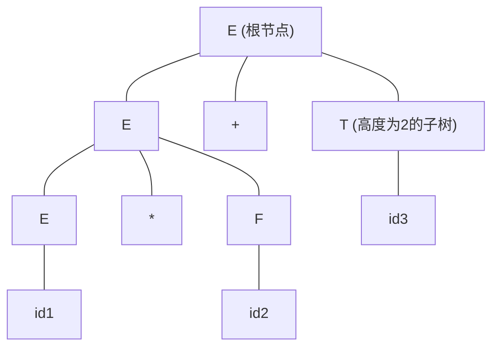

import { Aside } from '@astrojs/starlight/components';

## 辨析一：短语、直接短语与句柄的几何与语法树秒杀法

### 1. 典型易错表象
面对一个长句型，很多同学试图死记代数推导公式（$S \Rightarrow^* \alpha A \delta \dots$），在长串符号中肉眼硬猜短语，往往遗漏中间嵌套短语，或将非连续符号拼凑为短语，导致**句柄找错，自底向上语法分析第一步全盘皆输**。

### 2. 深入机理剖析
在上下文无关文法中，短语、直接短语和句柄与**语法分析树（Parse Tree）的几何拓扑**有着绝对的一一对应关系：
- **子树（Subtree）**：语法树中以任意节点为根，并包含该节点下全部后代节点的完整树枝部分。
- **短语（Phrase）**：**任意一棵子树**的所有叶子节点自左至右连成的边缘符号串。语法树有多少个非叶子节点，至多就可能派生出多少个短语！
- **直接短语（Simple Phrase）**：**高度为 2 的极小子树**（即该子树只包含根节点及其直接子节点，由一条产生式 $A \to \beta$ 一步推导产生）的所有叶子串。
- **句柄（Handle）**：在当前句型的语法树中，**位置处于最左侧的那个直接短语**。句柄是规范句型中当前必须立即执行规范规约的唯一对象。



### 3. 标准判定口诀与答题规范
针对句型 `id1 * id2 + id3`：
1. **第一步（画出语法树）**：根据文法严格画出该句型的语法分析树。
2. **第二步（圈出所有子树找短语）**：
   - 以节点 $T$ 为根的子树，叶子为 `id3` $\implies$ `id3` 是短语；
   - 以节点 $E1$ 为根的子树，叶子为 `id1 * id2` $\implies$ `id1 * id2` 是短语；
   - 以整棵树 $E$ 为根的子树，叶子为 `id1 * id2 + id3` $\implies$ 句型自身也是短语；
   - 包含 `id1`、`id2` 的最小子树叶子 $\implies$ `id1`、`id2` 亦为短语。
3. **第三步（找高度为 2 的子树找直接短语）**：
   - 树中高度为 2 的节点为 $T \to id3$、$E2 \to id1$、$F \to id2$。
   - 故直接短语为：`id1`、`id2`、`id3`。
4. **第四步（最左直接短语锁定句柄）**：
   - 处于句型最左端的直接短语是 `id1`，因此**本句型的句柄为 `id1`**！

---

## 辨析二：直接左递归 vs 间接左递归的消除算法死角

### 1. 典型易错表象
只掌握了直接左递归的公式（$A \to A\alpha \mid \beta \implies A \to \beta A', A' \to \alpha A' \mid \epsilon$），遇到含有环路依赖的间接左递归（如 $S \to A a \mid b, A \to S c \mid d$）束手无策，或者代入后漏掉产生式右部的空字 $\epsilon$。

### 2. 深入机理剖析
间接左递归是指推导经过 2 步及以上才出现自身在首位：$S \Rightarrow A a \Rightarrow S c a$。消除间接左递归的核心思想是：**通过对非终结符规定固定序号，强制代入单向流动，将其降解为直接左递归后再消除**。

### 3. 标准算法执行全步骤
文法：
$$S \to A a \mid b$$
$$A \to S c \mid d$$

1. **第一步：非终结符人为排序**：
   设定全序关系：$S = A_1, A = A_2$（即序号 $1 < 2$）。
2. **第二步：双重循环单向代入（强制 $i > j$）**：
   - 当 $i=1$（考察 $S$）：$S \to A a \mid b$，右部首符号为 $A$（序号 2 > 1），无左递归，保持不变；
   - 当 $i=2$（考察 $A$）：右部出现产生式 $A \to S c$，首符号 $S$ 的序号为 1（满足 $j < i$）。
   - **执行代入**：将 $S$ 的所有产生式（$A a \mid b$）代入 $A \to S c$ 中，得到：
     $$A \to (A a \mid b) c \mid d \implies A \to A a c \mid b c \mid d$$
3. **第三步：消除直接左递归**：
   此时非终结符 $A$ 的右部首符号出现了自身 $A$，已成功暴露出直接左递归！
   其中 $\alpha = ac$，$\beta = bc \mid d$。应用直接左递归消除公式：
   $$A \to b c A' \mid d A'$$
   $$A' \to a c A' \mid \epsilon$$
4. **第四步：写出最终等价文法**：
   $$S \to A a \mid b$$
   $$A \to b c A' \mid d A'$$
   $$A' \to a c A' \mid \epsilon$$
   文法中再无任何直接或间接左递归，自顶向下解析器绝不再陷入死循环！

---

## 辨析三：First 集合与 Follow 集合中 $\epsilon$ 的传染性与继承边界

### 1. 典型易错表象
- 误将 $\epsilon$ 计算进某个非终结符的 $\text{Follow}$ 集合中；
- 在求 $\text{First}(X_1 X_2 X_3)$ 时，若 $X_1$ 能推出 $\epsilon$，忘记继续向后求 $X_2$ 的 First，造成首终结符缺失；
- 在求 $\text{Follow}(B)$ 时，若产生式为 $A \to \alpha B \beta$ 且 $\beta \Rightarrow^* \epsilon$，漏将 $\text{Follow}(A)$ 并入 $\text{Follow}(B)$。

### 2. 深入机理剖析
1. **$\text{First}(\alpha)$ 的本质**：从 $\alpha$ 能推导出的**第一个终结符**。若串中前 $k-1$ 个符号全都能推导出空字（全部是 Nullable），则第 $k$ 个符号的 First 才能透传过来！
2. **$\text{Follow}(A)$ 的本质**：在句型中能**紧跟在 $A$ 身后**的终结符。

<Aside type="danger">

**$\text{Follow}$ 集合的铁律**：$\text{Follow}$ 集合是“等待输入流的后跟字符”，**绝对不可能包含空字 $\epsilon$**！

</Aside>


### 3. 计算法则黄金定理
1. **$\text{First}(X_1 X_2 \dots X_n)$ 连锁方程**：
   $$\text{First}(X_1 X_2 \dots X_n) = (\text{First}(X_1) \setminus \{\epsilon\}) \cup \dots$$
   当且仅当 $X_1, X_2, \dots, X_n$ **每一个都能推导出 $\epsilon$ 时**，$\epsilon$ 才能正式进入 $\text{First}(X_1 \dots X_n)$。
2. **$\text{Follow}(B)$ 两大来源**：
   - **紧随其后法则**：对于产生式 $A \to \alpha B \beta$，$\text{First}(\beta)$ 中所有非 $\epsilon$ 符号均属于 $\text{Follow}(B)$；
   - **末尾透传法则**：若产生式为 $A \to \alpha B$，或者 $A \to \alpha B \beta$ 且 $\beta \Rightarrow^* \epsilon$（$\beta$ 自身可空），则 $B$ 后面实际上直接面对着紧跟在 $A$ 身后的符号，因此 **$\text{Follow}(A)$ 的全部内容无条件并入 $\text{Follow}(B)$**！

---

## 辨析四：LR(0) 与 SLR(1) 冲突分析：为什么 SLR(1) 仍不够强？

### 1. 典型易错表象
认为只要求出非终结符的 Follow 集合，所有的移进-规约冲突都能被 SLR(1) 完美解决。

### 2. 深入机理剖析
LR(0) 状态中若包含：
$$I = \{ A \to \alpha \cdot, \quad B \to \beta \cdot a \gamma \}$$
- **LR(0) 视角**：无法决定面对字符 $a$ 时是移进还是规约，触发 **移进-规约冲突**。
- **SLR(1) 视角**：它假定规约 $A \to \alpha$ 时，下一个输入符号必须属于 $\text{Follow}(A)$。因此：
  - 若输入字符 $a \notin \text{Follow}(A)$，则 $a$ 出现时**唯一能做的是移进**，冲突化解！
  - **SLR(1) 的致命死穴**：$\text{Follow}(A)$ 是全局句型分析的结果，包含了 $A$ 在**所有可能上下文中**的后跟字符。但在当前这个特定的活前缀状态下，$A$ 后面可能根本不允许跟字符 $a$！若碰巧 $a \in \text{Follow}(A)$，SLR(1) 分析表在 $(I, a)$ 单元格仍会同时出现移进与规约，**SLR(1) 宣告失效**！

### 3. 经典反例解析
经典文法：
$$S \to L = R \mid R$$
$$L \to * R \mid id$$
$$R \to L$$
在包含项目集规范族的初态移进 $L$ 后，进入状态：
$$I_2 = \{ S \to L \cdot = R, \quad R \to L \cdot \}$$
- 在 $I_2$ 中，存在移进符号 `=`；
- 计算 $\text{Follow}(R)$：由 $S \to L = R$，因为 $R \to L$，所以 `=` 属于 $\text{Follow}(L)$；由产生式 $S \to R$，$\text{Follow}(S)=\{\char36 \} \subseteq \text{Follow}(R)$，且因 $S \to L = R$ 亦使 `=` 属于 $\text{Follow}(R)$！
- 面对输入字符 `=`：SLR(1) 既想移进 `=`，又因为 $= \ \in \text{Follow}(R)$ 想按 $R \to L$ 规约，**SLR(1) 发生冲突**！
- 唯有引入精确携带局部搜索符的 **LR(1)**，指明在此状态下 $R$ 的后看符号只能是 `$`，绝不能是 `=`，才能彻底消除歧义。

---

## 辨析五：LR(1) 到 LALR(1) 合并同心集的核心定理

### 1. 典型易错表象
误以为同心状态合并可能会产生移进-规约冲突，或者合并后不会产生任何语法冲突。

### 2. 深入机理剖析
设状态 $I_1$ 与 $I_2$ 具有完全相同的产生式核心（Core）：
- **关于移进-规约冲突**：
  移进动作是由圆点后紧跟的终结符决定的（如 $A \to \alpha \cdot a \beta$）。由于 $I_1$ 与 $I_2$ 同心，它们的移进项与移进字符 $a$ **完全一模一样**。如果合并前 $I_1$ 和 $I_2$ 都不存在移进与自身规约项的冲突，合并前瞻符后，移进字符并没有增加，因此**绝不可能凭空创造出新的移进-规约冲突**！
- **关于规约-规约冲突**：
  若状态中存在两个不同非终结符的规约项：
  $$I_1 = \{ A \to \gamma \cdot, [a]; \quad B \to \delta \cdot, [b] \}$$
  $$I_2 = \{ A \to \gamma \cdot, [b]; \quad B \to \delta \cdot, [a] \}$$
  在 $I_1$ 中，面对 $a$ 规约 $A$，面对 $b$ 规约 $B$（无冲突）；在 $I_2$ 中，面对 $b$ 规约 $A$，面对 $a$ 规约 $B$（无冲突）。
  但是，一旦合并为 LALR(1) 状态 $I_{12}$，前瞻符号取并集：
  $$I_{12} = \{ A \to \gamma \cdot, [a / b]; \quad B \to \delta \cdot, [a / b] \}$$
  面对输入符号 $a$（以及 $b$），解析器既可以规约 $A$，又可以规约 $B$，**致命的规约-规约冲突（Reduce-Reduce Conflict）由此诞生**！

---

## 辨析六：S-属性文法 vs L-属性文法的本质边界

### 1. 典型易错表象
将 S-属性文法与 L-属性文法看作互斥的对立概念，或者不清楚何时选用自底向上还是自顶向下。

### 2. 核心对比矩阵
| 比较维度 | S-属性文法 (S-SDD) | L-属性文法 (L-SDD) |
| :--- | :--- | :--- |
| **属性类型限制** | **仅允许综合属性**（Synthesized）。 | **允许综合属性与继承属性**。 |
| **继承属性依赖规则** | 无继承属性。 | 每个符号的继承属性**只能依赖于其父节点的继承属性或其左侧兄弟符号的任何属性**。 |
| **依赖图特征** | 所有箭头只能从叶子指向父节点，绝无横向或向下箭头。 | 箭头可以向下或自左向右横向流动，**绝无从右向左的逆流箭头**。 |
| **语法分析器契合度** | **天然契合自底向上 LR 分析**：规约的瞬间，右部子节点属性均已计算好，直接在语义栈顶完成合成。 | **天然契合自顶向下递归下降分析**：继承属性通过函数参数向下传递，综合属性通过返回值向上传递。 |
| **包含关系** | $S\text{-属性文法} \subset L\text{-属性文法}$（S-属性是 L-属性的无继承属性特例）。 |

---

## 辨析七：布尔表达式翻译的两大路线：数值计算 vs 控制流跳转

### 1. 核心应用场景分野
很多初学者混淆布尔表达式的四元式生成：
- **何时使用“数值计算法”**？
  当布尔表达式作为右值参与数值运算或变量赋值时，例如：
  `flag = a < b;` 或 `res = (x > y) + 5;`
  此时必须为该表达式分配一个整型临时变量 $T$，并在控制流中显式赋值为 0 或 1：
  ```text
  100: (j<, a, b, 103)
  101: (:=, 0, _, T)
  102: (j, _, _, 104)
  103: (:=, 1, _, T)
  104: ...
  ```
- **何时使用“控制流跳转法（短路回填法）”**？
  当布尔表达式作为控制流语句（`if`、`while`）的判定条件时，例如：
  `if (a < b && c > d) ...`
  此时**绝不需要计算出 0 或 1 存入内存**，而是直接维护两个四元式待填链表：
  - `truelist`：条件为真时要跳转的目标四元式集合；
  - `falselist`：条件为假时要跳转的目标四元式集合。
  结合短路求值，若 `a < b` 为假，直接并入 `falselist` 跳出，绝不执行对 `c > d` 的求值！

---

## 辨析八：静态链（访问链）与动态链（控制链）寻址差异

### 1. 典型易错表象
在多层函数调用栈图中，分不清当前栈帧中的静态链和动态链究竟指向哪一个活动记录。

### 2. 深入机理剖析
```text
全局作用域: Main (层深 1)
  定义过程 P (层深 2)
    定义过程 Q (层深 3)
      调用过程 P (递归/外层调用)
```
- **动态链（Dynamic Link / 控制链）**：
  - **唯一依据**：**谁在运行时实际调用了我**？
  - 若 `Main` 调 `P`，`P` 调 `Q`，`Q` 调 `P`：
    则新 `P` 的动态链必指向 `Q`，`Q` 的动态链指向老 `P`，老 `P` 的动态链指向 `Main`。用于函数返回时恢复调用者栈顶。
- **静态链（Static Link / 访问链）**：
  - **唯一依据**：**谁在语法文本上包裹定义了我**？
  - 无论 `P` 是被 `Main` 调用的，还是被嵌套极深的 `Q` 调用的，由于过程 `P` 是在 `Main` 内部语法中直接声明定义的，**新 `P` 的静态链必须永远指向 `Main` 的活动记录**！

### 3. 外层非局部变量的寻址公式
设当前活动过程词法层深为 $n_p$，试图访问的外层变量定义于词法层深 $n_v$（必有 $n_v \le n_p$）：
$$\text{需要跨越的静态链步数} = n_p - n_v$$
- 若 $n_p = n_v$：步数为 0，说明是当前函数内部的局部变量，直接通过当前栈帧指针 `FP + 偏移` 访问；
- 若 $n_p - n_v = 1$：顺着当前栈帧的静态链跳转 1 步，在父函数栈帧中读取；
- 若 $n_p - n_v = k$：连续沿静态链解引用 $k$ 次，直达定义该变量的作用域栈帧。

---

## 辨析九：参数传递四大机制对实参的副作用时序对比

程序执行代码：
```pascal
program Test;
var x: integer;
procedure swap(a, b: integer);
begin
    x := x + 1;
    a := a + 10;
end;
begin
    x := 5;
    swap(x, x);
end.
```
针对不同的参数传递机制，分析执行后 `x` 的最终值：

1. **传值 (Pass by Value)**：
   - 进函数前：实参 $x=5$ 拷贝给临时形参 $a=5, b=5$；
   - 函数体内：`x := 5 + 1 = 6`；`a := 5 + 10 = 15`（修改形参副本）；
   - 函数退出：形参丢弃。**最终 $x = 6$**。
2. **传地址 / 传引用 (Pass by Reference)**：
   - 进函数前：$a$ 与 $b$ 均成为全局变量 $x$ 的内存别名（同指一块物理地址）；
   - 函数体内：
     - 执行 `x := x + 1` 后，$x$ 变为 6（同时 $a$ 和 $b$ 的值也变为 6）；
     - 执行 `a := a + 10` 后，$x$ 变为 $6 + 10 = 16$；
   - 函数退出：**最终 $x = 16$**。
3. **传结果 / 值-结果 (Pass by Value-Result)**：
   - 进函数前：形参 $a=5, b=5$；
   - 函数体内：`x := 6`；`a := 15`；$b$ 仍为 5；
   - 函数退出瞬间回写：若回写顺序为自左向右，先回写 $a \implies x=15$，再回写 $b \implies x=5$；**最终 $x = 5$**（被 $b$ 的旧值覆盖！）。
4. **传名 (Pass by Name)**：
   - 文本替换模型：在每次引用 $a$ 的地方动态计算 $x$；
   - 执行 `x := x + 1` 后 $x=6$；执行 `x := x + 10` 后 $x=16$；**最终 $x = 16$**。

---

## 辨析十：基本块 Leader 判定三准则与循环优化归纳变量

### 1. 基本块划分 Leader 入口语句识别死穴
对于一段四元式序列，必须严格遵循以下三条标准准则确定入口语句（Leader）：
1. **程序的第一条四元式** 是 Leader；
2. **任何转移四元式（条件转移或无条件转移）所转向的目标四元式** 是 Leader；
3. **紧跟在条件转移四元式后面的那条四元式** 是 Leader。
<Aside type="caution">

紧跟在**无条件转移**语句（如 `goto L`）后面的语句，只有当它是某个跳转的目标时才是 Leader；若不是目标且前面是无条件转移，则它是**不可达的死代码**！

</Aside>

### 2. 基本归纳变量 vs 派生归纳变量
在自然循环中：
- **基本归纳变量（Primary Induction Variable）**：循环内只有唯一的自增/自减赋值语句，形式为：
  $$i := i \pm c \quad (c \text{ 为常数})$$
- **派生归纳变量（Derived Induction Variable）**：在循环内每次定值时，都是基本归纳变量的线性函数：
  $$j := c_1 \times i + c_2$$
- **强度削弱（Strength Reduction）实施细节**：
  1. 在循环入口前（Preheader）引入临时变量 $T := c_1 \times i_0 + c_2$；
  2. 在循环内将高开销的乘法 $j := c_1 \times i + c_2$ 替换为直接使用 $j := T$；
  3. 在基本归纳变量 $i := i \pm c$ 发生改变的地方，同步追加轻量加法：$T := T \pm (c_1 \times c)$。
  成功将循环内每次迭代耗费昂贵硬件时钟周期的乘法指令降级为单周期加法！
