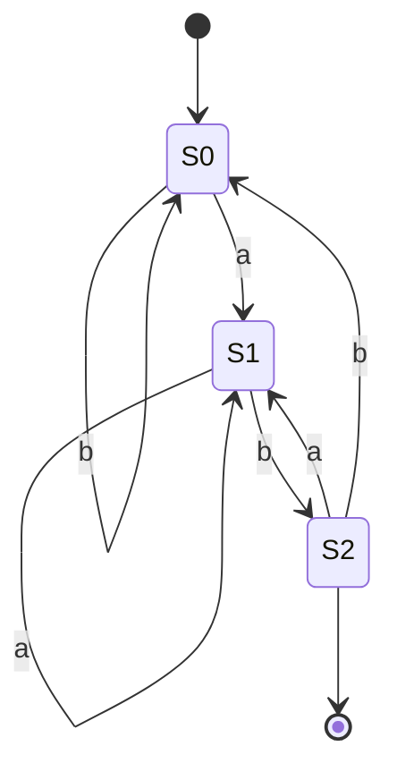
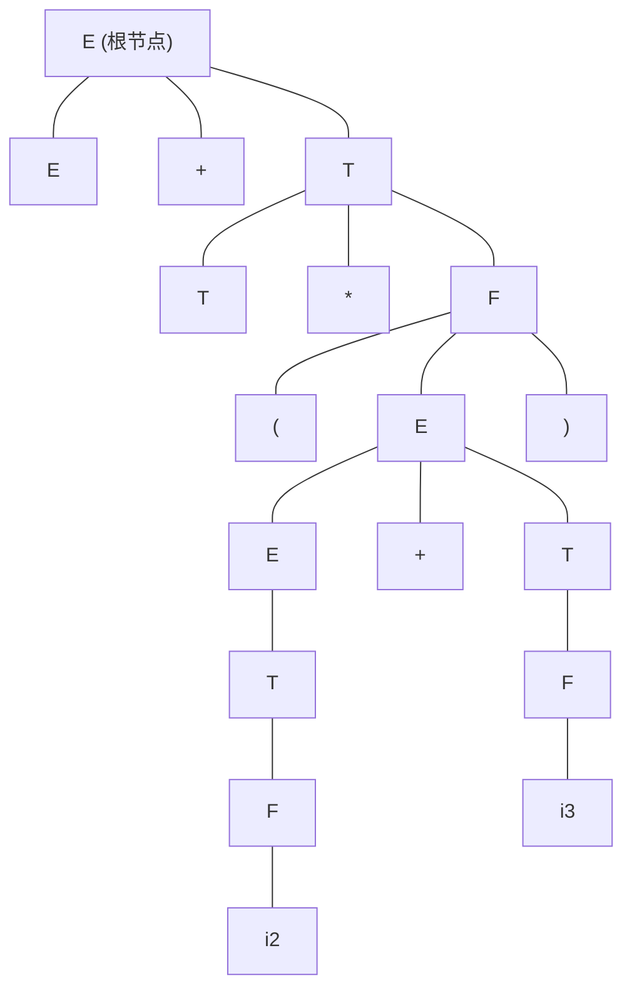
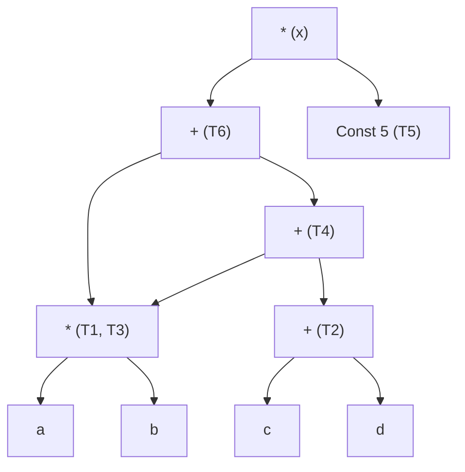

import { Aside } from '@astrojs/starlight/components';

## 题目一：正规式到最小化 DFA 全流程推导

### 1. 前置知识与知识图谱

| 前置知识名称 | 配套交互章节 | 核心掌握目标 |
| :--- | :--- | :--- |
| **正规式与 Thompson 算法** | [03. 词法分析](/compiler/03-lexical/) | 掌握正规式三种基础运算到 NFA 子单元的拼接方法 |
| **子集构造法 (确定化)** | [03. 词法分析](/compiler/03-lexical/) | 熟练计算 $\epsilon\text{-closure}$ 与 $\text{move}$ 状态转移 |
| **Hopcroft 状态分割最小化** | [03. 词法分析](/compiler/03-lexical/) | 掌握终态与非终态初始切分及后继等价性逐步划分 |

### 2. 原始完整题目
> 已知正规式 $r = (a \mid b)^* a b$：
> 1. 利用 Thompson 结构归纳法构造与其等价的非确定有限自动机（NFA）；
> 2. 应用子集构造法（Subset Construction）将该 NFA 转换为确定有限自动机（DFA），并给出状态转换矩阵；
> 3. 使用 Hopcroft 算法对所生成的 DFA 进行状态数最小化，画出最终最小 DFA 状态转换图。

### 3. 核心答案速查
- **DFA 状态数**：共 3 个状态（不含死状态）。
- **最小化 DFA**：状态数无法再压缩，最小 DFA 即为 3 个状态：初态兼中间态 $S_0$、中间态 $S_1$、接受终态 $S_2$。
- **状态转移函数**：
  - $\delta(S_0, a) = S_1, \quad \delta(S_0, b) = S_0$
  - $\delta(S_1, a) = S_1, \quad \delta(S_1, b) = S_2$
  - $\delta(S_2, a) = S_1, \quad \delta(S_2, b) = S_0$

### 4. 详细推导与解题步骤

#### 第一步：Thompson 算法构造 NFA
按正规式优先级分步嵌套：
1. **子表达式 $(a \mid b)$**：
   引入初态 1，经 $\epsilon$ 弧分别指向状态 2（输入 $a$ 到 3）和状态 4（输入 $b$ 到 5），状态 3 和 5 各自经 $\epsilon$ 弧汇聚至状态 6。
2. **星闭包 $(a \mid b)^*$**：
   引入初态 0 和出口 7。增加 $0 \xrightarrow{\epsilon} 1$，$6 \xrightarrow{\epsilon} 7$；增加绕过闭包的跨越弧 $0 \xrightarrow{\epsilon} 7$；增加内部循环回边 $6 \xrightarrow{\epsilon} 1$。
3. **连接 $a$ 与 $b$**：
   从状态 7 经输入字符 $a$ 到状态 8，再经输入字符 $b$ 到终态 9。
- **NFA 状态集**：$\{0, 1, 2, 3, 4, 5, 6, 7, 8, 9\}$，唯一初态为 0，接受状态为 9。

#### 第二步：子集构造法确定化为 DFA
定义初态子集：$S_0 = \epsilon\text{-closure}(0) = \{0, 1, 2, 4, 7\}$。
分别计算各子集在接收字符 $a$ 和 $b$ 时的后继集合：
1. **$S_0$ 的转移**：
   - $\text{move}(S_0, a) = \{3\}$，$\epsilon\text{-closure}(\{3\}) = \{1, 2, 3, 4, 6, 7, 8\} \implies$ 记为新状态 **$S_1$**；
   - $\text{move}(S_0, b) = \{5\}$，$\epsilon\text{-closure}(\{5\}) = \{1, 2, 4, 5, 6, 7\} \implies$ 记为状态 **$S_0$**（与初态等价）；
2. **$S_1$ 的转移**：
   - $\text{move}(S_1, a) = \{3\}$，$\epsilon\text{-closure}(\{3\}) = S_1$；
   - $\text{move}(S_1, b) = \{5, 9\}$，$\epsilon\text{-closure}(\{5, 9\}) = \{1, 2, 4, 5, 6, 7, 9\} \implies$ 记为新状态 **$S_2$**（包含接受状态 9，为终态）；
3. **$S_2$ 的转移**：
   - $\text{move}(S_2, a) = \{3\} \implies S_1$；
   - $\text{move}(S_2, b) = \{5\} \implies S_0$。

**DFA 状态转换矩阵表**：

| DFA 状态 | 对应 NFA 状态集合 | 输入 $a$ | 输入 $b$ | 是否为终态 |
| :---: | :--- | :---: | :---: | :---: |
| **$S_0$ (初态)** | $\{0, 1, 2, 4, 7\}$ | $S_1$ | $S_0$ | 否 |
| **$S_1$** | $\{1, 2, 3, 4, 6, 7, 8\}$ | $S_1$ | $S_2$ | 否 |
| **$S_2$ (终态)** | $\{1, 2, 4, 5, 6, 7, 9\}$ | $S_1$ | $S_0$ | **是** |

#### 第三步：Hopcroft 状态分割最小化
1. **初始划分**：
   根据是否为接受状态，将状态集划分为两组：
   $$P_0 = \{ \{S_2\}, \ \{S_0, S_1\} \}$$
2. **考察非终态子集 $\{S_0, S_1\}$**：
   - 在输入 $a$ 下：$S_0 \xrightarrow{a} S_1 \in \{S_0, S_1\}$，$S_1 \xrightarrow{a} S_1 \in \{S_0, S_1\}$（落在同一组）；
   - 在输入 $b$ 下：$S_0 \xrightarrow{b} S_0 \in \{S_0, S_1\}$，而 **$S_1 \xrightarrow{b} S_2 \in \{S_2\}$**！
   - 两者在输入 $b$ 时的后继落入不同的子集组中，**产生不等价分割**！
   - 子集 $\{S_0, S_1\}$ 必须切分为 $\{S_0\}$ 与 $\{S_1\}$。
3. **新划分**：
   $$P_1 = \{ \{S_2\}, \ \{S_1\}, \ \{S_0\} \}$$
   所有子集均已为单元素集合，无法再行分割。
4. **结论**：该 DFA 已经是状态数最简的最小化 DFA。



---

## 题目二：文法句型分析——短语、直接短语与句柄识别

### 1. 前置知识与知识图谱

| 前置知识名称 | 配套交互章节 | 核心掌握目标 |
| :--- | :--- | :--- |
| **上下文无关文法与推导** | [04. 语法分析前置篇](/compiler/04-grammar-intro/) | 掌握根据产生式自顶向下构建语法分析树的方法 |
| **短语、直接短语与句柄** | [06. 自底向上分析](/compiler/06-bottom-up/) | 牢记语法树子树与短语的几何对应准则 |

### 2. 原始完整题目
> 给定文法 $G[E]$：
> $$E \to E + T \mid T$$
> $$T \to T * F \mid F$$
> $$F \to ( E ) \mid i$$
> 证明句子 $i_1 * (i_2 + i_3)$ 是该文法的一个合法句子，并求出在句型 $E + T * (i_2 + i_3)$ 中：
> 1. 画出该句型的语法分析树；
> 2. 指出该句型相对于文法的所有短语；
> 3. 指出该句型的所有直接短语（简单短语）；
> 4. 给出该句型的句柄（Handle）。

### 3. 核心答案速查
- **短语**：
  - `i2`
  - `i3`
  - `i2 + i3`
  - `(i2 + i3)`
  - `T * (i2 + i3)`
  - `E + T * (i2 + i3)`（句型自身）
- **直接短语**：`i2`、`i3`
- **句柄**：`i2`（最左直接短语）

### 4. 详细推导与解题步骤

#### 第一步：画出句型的语法分析树
从开始符号 $E$ 出发推导句型 $E + T * (i_2 + i_3)$：
1. $E \Rightarrow E + T$
2. $\Rightarrow E + T * F$
3. $\Rightarrow E + T * (E)$
4. $\Rightarrow E + T * (E + T)$
5. $\Rightarrow E + T * (T + T)$
6. $\Rightarrow E + T * (F + T) \Rightarrow E + T * (i_2 + T) \Rightarrow E + T * (i_2 + F) \Rightarrow E + T * (i_2 + i_3)$



#### 第二步：逐一识别短语（每棵子树对应一个短语）
- 以 $F2$ 为根的子树，产生边缘串 **`i2`**；
- 以 $F3$ 为根的子树，产生边缘串 **`i3`**；
- 以 $E3$ 为根的子树，产生边缘串 **`i2`**（与 $F2$ 相同）；
- 以 $T3$ 为根的子树，产生边缘串 **`i3`**（与 $F3$ 相同）；
- 以 $E2$ 为根的子树，包含节点 $E3, P2, T3$，产生边缘串 **`i2 + i3`**；
- 以 $F1$ 为根的子树，包含 $LP, E2, RP$，产生边缘串 **`(i2 + i3)`**；
- 以 $T1$ 为根的子树，包含 $T2, M1, F1$，产生边缘串 **`T * (i2 + i3)`**；
- 以根节点 $E0$ 为根的整棵树，产生边缘串 **`E + T * (i2 + i3)`**。

#### 第三步：识别直接短语（高度为 2 的极小子树）
寻找由一条产生式一步直接推导出叶子节点的极小子树：
- $F_2 \to i_2$（由产生式 $F \to i$ 一步推导，树高为 2）$\implies$ **`i2`** 是直接短语；
- $F_3 \to i_3$（由产生式 $F \to i$ 一步推导，树高为 2）$\implies$ **`i3`** 是直接短语。
<Aside type="note">

注意：为什么 `E` 不是直接短语？因为根节点 $E_0$ 的子节点为 $E_1, +, T_1$，对应产生式是 $E \to E + T$。$E_1$ 只是产生式右部的一个叶子符号，并不存在孤立产生式单独推导叶子 `E`，故 `E` 不是直接短语！

</Aside>

#### 第四步：确定句柄
句柄定义为**最左侧的直接短语**。
在两个直接短语（`i2`、`i3`）中，处于整个句型最左侧的是 `i2`。
因此，**该句型的句柄为 `i2`**。

---

## 题目三：LL(1) 语法分析——消除左递归、First/Follow 集合与预测表

### 1. 前置知识与知识图谱

| 前置知识名称 | 配套交互章节 | 核心掌握目标 |
| :--- | :--- | :--- |
| **消除直接左递归** | [05. 自顶向下分析](/compiler/05-top-down/) | 熟练将 $A \to A\alpha \mid \beta$ 改写为等价右递归 |
| **First / Follow 集合计算** | [05. 自顶向下分析](/compiler/05-top-down/) | 掌握 $\epsilon$ 的传导条件及 Follow 集合传递准则 |
| **预测分析表与 LL(1) 判定** | [05. 自顶向下分析](/compiler/05-top-down/) | 根据 Select 集合填表，验证无多重定义冲突 |

### 2. 原始完整题目
> 给定算术表达式文法 $G[E]$：
> $$E \to E + T \mid T$$
> $$T \to T * F \mid F$$
> $$F \to ( E ) \mid id$$
> 1. 消除该文法的所有左递归，写出改写后的等价文法 $G'[E]$；
> 2. 计算改写后文法中所有非终结符的 $\text{First}$ 与 $\text{Follow}$ 集合；
> 3. 构建 LL(1) 预测分析表 $M$，并判断该文法是否为严格的 LL(1) 文法；
> 4. 给出使用该预测分析表对输入串 `id + id * id` 的单步符号栈推进分析过程。

### 3. 核心答案速查
- **改写后文法**：
  $$E \to T E', \quad E' \to + T E' \mid \epsilon$$
  $$T \to F T', \quad T' \to * F T' \mid \epsilon$$
  $$F \to ( E ) \mid id$$
- **集合计算结果**：
  - $\text{First}(E) = \text{First}(T) = \text{First}(F) = \{ (, \ id \}$
  - $\text{First}(E') = \{ +, \ \epsilon \}, \quad \text{First}(T') = \{ *, \ \epsilon \}$
  - $\text{Follow}(E) = \text{Follow}(E') = \{ ), \ \char36  \}$
  - $\text{Follow}(T) = \text{Follow}(T') = \{ +, \ ), \ \char36  \}$
  - $\text{Follow}(F) = \{ *, \ +, \ ), \ \char36  \}$
- **LL(1) 判定**：分析表 $M$ 中**无任何多重定义单元格**，是严格的 LL(1) 文法。

### 4. 详细推导与解题步骤

#### 第一步：消除左递归
应用标准消除直接左递归公式：
- 对 $E \to E + T \mid T$：$\alpha = + T, \beta = T \implies E \to T E', \ E' \to + T E' \mid \epsilon$；
- 对 $T \to T * F \mid F$：$\alpha = * F, \beta = F \implies T \to F T', \ T' \to * F T' \mid \epsilon$；
- $F \to ( E ) \mid id$ 无左递归，保持原样。

#### 第二步：计算 First 与 Follow 集合
1. **First 集合计算**：
   - $F$ 的右部首终结符为 `(` 与 `id` $\implies \text{First}(F) = \{ (, id \}$；
   - $T \to F T'$，因为 $F$ 不可推出 $\epsilon$，所以 $\text{First}(T) = \text{First}(F) = \{ (, id \}$；
   - $E \to T E'$，同理 $\text{First}(E) = \text{First}(T) = \{ (, id \}$；
   - $E' \to + T E' \mid \epsilon \implies \text{First}(E') = \{ +, \epsilon \}$；
   - $T' \to * F T' \mid \epsilon \implies \text{First}(T') = \{ *, \epsilon \}$。
2. **Follow 集合计算**：
   - $E$ 为开始符号，置 $\char36  \in \text{Follow}(E)$；由 $F \to ( E )$，得 $) \in \text{Follow}(E)$。故 $\text{Follow}(E) = \{ ), \char36  \}$；
   - 由 $E \to T E'$，$E'$ 处于末尾 $\implies \text{Follow}(E') = \text{Follow}(E) = \{ ), \char36  \}$；
   - 由 $E \to T E'$，$\text{First}(E') \setminus \{\epsilon\} = \{+\}$ 加入 $\text{Follow}(T)$；又因 $E' \Rightarrow^* \epsilon$，$\text{Follow}(E)$ 并入 $\text{Follow}(T)$。故 $\text{Follow}(T) = \{ +, ), \char36  \}$；
   - 由 $T \to F T'$，同理得 $\text{Follow}(T') = \text{Follow}(T) = \{ +, ), \char36  \}$；
   - 由 $T \to F T'$，$\text{First}(T') \setminus \{\epsilon\} = \{*\}$ 加入 $\text{Follow}(F)$；因 $T' \Rightarrow^* \epsilon$，$\text{Follow}(T)$ 并入 $\text{Follow}(F)$。故 $\text{Follow}(F) = \{ *, +, ), \char36  \}$。

#### 第三步：构造 LL(1) 预测分析表 $M$

| 非终结符 | `id` | `+` | `*` | `(` | `)` | `$` |
| :---: | :---: | :---: | :---: | :---: | :---: | :---: |
| **$E$** | $E \to T E'$ | | | $E \to T E'$ | | |
| **$E'$** | | $E' \to + T E'$ | | | $E' \to \epsilon$ | $E' \to \epsilon$ |
| **$T$** | $T \to F T'$ | | | $T \to F T'$ | | |
| **$T'$** | | $T' \to \epsilon$ | $T' \to * F T'$ | | $T' \to \epsilon$ | $T' \to \epsilon$ |
| **$F$** | $F \to id$ | | | $F \to ( E )$ | | |

分析表中无任何双重入口冲突，完全满足 LL(1) 定义。

#### 第四步：单步推导栈跟踪（输入 `id + id * id $`）

| 步骤 | 符号栈内容 | 当前输入流 | 选用产生式 / 执行动作 |
| :---: | :--- | :--- | :--- |
| 1 | `$ E` | `id + id * id $` | 查 $M[E, id]$，用 $T E'$ 替换 $E$ |
| 2 | `$ E' T` | `id + id * id $` | 查 $M[T, id]$，用 $F T'$ 替换 $T$ |
| 3 | `$ E' T' F` | `id + id * id $` | 查 $M[F, id]$，用 $id$ 替换 $F$ |
| 4 | `$ E' T' id` | `id + id * id $` | **匹配终结符 `id`，出栈并指针后移** |
| 5 | `$ E' T'` | `+ id * id $` | 查 $M[T', +]$，用 $\epsilon$ 替换 $T'$（出栈） |
| 6 | `$ E'` | `+ id * id $` | 查 $M[E', +]$，用 $+ T E'$ 替换 $E'$ |
| 7 | `$ E' T +` | `+ id * id $` | **匹配终结符 `+`，出栈并指针后移** |
| 8 | `$ E' T` | `id * id $` | 查 $M[T, id]$，用 $F T'$ 替换 $T$ |
| 9 | `$ E' T' F` | `id * id $` | 查 $M[F, id]$，用 $id$ 替换 $F$ |
| 10 | `$ E' T' id` | `id * id $` | **匹配终结符 `id`，出栈并指针后移** |
| 11 | `$ E' T'` | `* id $` | 查 $M[T', *]$，用 $* F T'$ 替换 $T'$ |
| 12 | `$ E' T' F *` | `* id $` | **匹配终结符 `*`，出栈并指针后移** |
| 13 | `$ E' T' F` | `id $` | 查 $M[F, id]$，用 $id$ 替换 $F$ |
| 14 | `$ E' T' id` | `id $` | **匹配终结符 `id`，出栈并指针后移** |
| 15 | `$ E' T'` | `$` | 查 $M[T', \char36 ]$，用 $\epsilon$ 替换 $T'$ |
| 16 | `$ E'` | `$` | 查 $M[E', \char36 ]$，用 $\epsilon$ 替换 $E'$ |
| 17 | `$` | `$` | **栈底与输入结束符相遇，分析成功（Accept）！** |

---

## 题目四：LR(0) 与 SLR(1) 分析——项目集规范族与冲突判定

### 1. 前置知识与知识图谱

| 前置知识名称 | 配套交互章节 | 核心掌握目标 |
| :--- | :--- | :--- |
| **LR(0) 项目与闭包算法** | [06. 自底向上分析](/compiler/06-bottom-up/) | 掌握拓广文法、四类项目分类及 `CLOSURE/GO` 算法 |
| **SLR(1) 冲突消除机理** | [06. 自底向上分析](/compiler/06-bottom-up/) | 熟练利用 Follow 集合分离移进与规约字符 |

### 2. 原始完整题目
> 给定经典赋值文法 $G[S]$：
> $$(1) \ S \to L = R$$
> $$(2) \ S \to R$$
> $$(3) \ L \to * R$$
> $$(4) \ L \to id$$
> $$(5) \ R \to L$$
> 1. 写出拓广文法，构造完整的 LR(0) 项目集规范族（DFA 状态）；
> 2. 分析状态中是否存在移进-规约或规约-规约冲突？说明为什么该文法不是 LR(0) 文法；
> 3. 计算相关非终结符的 Follow 集合，说明为什么 SLR(1) 仍无法解决该冲突（即证明该文法不是 SLR(1)）；
> 4. 说明 LR(1) 是如何引入局部搜索符化解该冲突的。

### 3. 核心答案速查
- **LR(0) 状态数**：共 10 个状态（$I_0 \sim I_9$）。
- **LR(0) 冲突判定**：在状态 $I_2 = \{ S \to L \cdot = R, \ R \to L \cdot \}$ 中，同时存在移进项与规约项，产生严重的**移进-规约冲突**！不是 LR(0) 文法。
- **SLR(1) 判定**：$\text{Follow}(R) = \{=, \ \char36 \}$。在状态 $I_2$ 面对输入字符 `=` 时，既可移进 `=`，又因 $= \ \in \text{Follow}(R)$ 可按 $R \to L$ 规约，**SLR(1) 依然冲突，故不是 SLR(1) 文法**！
- **LR(1) 判定**：在 LR(1) 中，状态 $I_2$ 的规约项精确展望符为 $[R \to L \cdot, \ \char36 ]$，仅在输入为 `$` 时规约，面对输入 `=` 时唯一动作是移进，冲突消除！**是 LR(1) 文法**。

### 4. 详细推导与解题步骤

#### 第一步：拓广文法
引入唯一增广开始产生式：
$$(0) \ S' \to S$$

#### 第二步：构造 LR(0) 项目集规范族
- **初态 $I_0 = \text{CLOSURE}(\{ S' \to \cdot S \})$**：
  $$I_0 = \{ S' \to \cdot S, \ S \to \cdot L = R, \ S \to \cdot R, \ L \to \cdot * R, \ L \to \cdot id, \ R \to \cdot L \}$$
- **状态转移推导**：
  - $\text{GO}(I_0, S) = I_1 = \{ S' \to S \cdot \}$（接受态）
  - $\text{GO}(I_0, L) = I_2 = \{ S \to L \cdot = R, \ R \to L \cdot \}$
  - $\text{GO}(I_0, R) = I_3 = \{ S \to R \cdot \}$
  - $\text{GO}(I_0, *) = I_4 = \text{CLOSURE}(\{ L \to * \cdot R \}) = \{ L \to * \cdot R, \ R \to \cdot L, \ L \to \cdot * R, \ L \to \cdot id \}$
  - $\text{GO}(I_0, id) = I_5 = \{ L \to id \cdot \}$
- **后继状态转移**：
  - 从 $I_2$ 出发：$\text{GO}(I_2, =) = I_6 = \text{CLOSURE}(\{ S \to L = \cdot R \}) = \{ S \to L = \cdot R, \ R \to \cdot L, \ L \to \cdot * R, \ L \to \cdot id \}$
  - 从 $I_4$ 出发：$\text{GO}(I_4, R) = I_7 = \{ L \to * R \cdot \}$；$\text{GO}(I_4, L) = I_8 = \{ R \to L \cdot \}$；$\text{GO}(I_4, *) = I_4$；$\text{GO}(I_4, id) = I_5$
  - 从 $I_6$ 出发：$\text{GO}(I_6, R) = I_9 = \{ S \to L = R \cdot \}$；$\text{GO}(I_6, L) = I_8$；$\text{GO}(I_6, *) = I_4$；$\text{GO}(I_6, id) = I_5$

#### 第三步：LR(0) 与 SLR(1) 冲突分析
考察状态 **$I_2 = \{ S \to L \cdot = R, \ R \to L \cdot \}$**：
1. **LR(0) 视角**：
   - 含有移进项 $S \to L \cdot = R$（要求输入字符 `=` 时移进）；
   - 含有规约项 $R \to L \cdot$（要求无条件按产生式 5 规约）；
   - 存在致命的**移进-规约冲突（Shift-Reduce Conflict）**！故该文法不是 LR(0) 文法。
2. **SLR(1) 视角**：
   - SLR(1) 试图借助 $\text{Follow}(R)$ 消除冲突：仅当输入字符 $a \in \text{Follow}(R)$ 时才执行规约动作。
   - 计算 $\text{Follow}(R)$：
     由产生式 $S' \to S \implies \char36  \in \text{Follow}(S)$；
     由产生式 $S \to R \implies \text{Follow}(S) \subseteq \text{Follow}(R)$，故 $\char36  \in \text{Follow}(R)$；
     由产生式 $S \to L = R$，因为 $R \to L$，右句型推导可出现 $S \Rightarrow L = R \Rightarrow * R = R$，使得等号 `=` 出现在 $R$ 之后！因此 **$= \ \in \text{Follow}(R)$**！
     最终得出：$\text{Follow}(R) = \{ =, \ \char36  \}$。
   - **冲突爆发**：面对输入字符 `=` 时：
     - 移进项要求移进 `=`（进入状态 $I_6$）；
     - 因为 $= \ \in \text{Follow}(R)$，SLR(1) 规约项**同样要求按 $R \to L$ 归约**！
     - 在 SLR(1) 分析表中，单元格 $(I_2, =)$ 同时拥有 `s6` 和 `r5`，**SLR(1) 冲突依然存在，因此不是 SLR(1) 文法！**

#### 第四步：LR(1) 的完美解法
LR(1) 项目将局部展望符绑定在每个具体状态项中：
- 在 $I_0$ 中，$S' \to \cdot S, [\char36 ]$；$S \to \cdot L = R, [\char36 ]$；$S \to \cdot R, [\char36 ]$；
- 推导 $R \to \cdot L$ 时，其展望符为产生式 $S \to \cdot R$ 后跟符号，即只能是 $[\char36 ]$！
- 因此转移到状态 $I_2$ 时，两项带有的精确展望符为：
  $$I_2 = \{ [S \to L \cdot = R, \ \char36 ], \quad [R \to L \cdot, \ \char36 ] \}$$
- **判定结果**：
  - 当面临输入字符 `=` 时：只有移进项匹配，**唯一合法的动作是移进（$s_6$）**；
  - 规约项 $[R \to L \cdot, \char36 ]$ 的展望符只有 `$`，**在输入为 `=` 时绝不触发规约**！
  - 冲突彻底消除！证明该文法是无冲突的 **LR(1) 文法**。

---

## 题目五：布尔表达式与控制流语句的四元式拉链回填推导

### 1. 前置知识与知识图谱

| 前置知识名称 | 配套交互章节 | 核心掌握目标 |
| :--- | :--- | :--- |
| **布尔表达式短路求值** | [08. 中间代码生成与控制流翻译](/compiler/08-control-flow/) | 掌握 `truelist` 与 `falselist` 的串接规律 |
| **拉链回填 Backpatching** | [08. 中间代码生成与控制流翻译](/compiler/08-control-flow/) | 掌握 `makelist`, `merge`, `backpatch` 的三步回填闭环 |

### 2. 原始完整题目
> 给出高级语言程序段：
> ```c
> if (a < b || c < d && e < f)
>     x = y + z;
> else
>     x = y - z;
> ```
> 假定四元式代码从标号 100 开始存储。请给出：
> 1. 布尔表达式中每个关系子项产生的转移四元式；
> 2. 短路与（`&&`）和短路或（`||`）计算过程中的 `truelist` 与 `falselist` 链表合并；
> 3. 最终生成的完整四元式序列，并标明回填前后的地址更新过程。

### 3. 核心答案速查
- **生成的四元式总条数**：9 条（行号 100 ~ 108）。
- **最终完整四元式序列**：
  ```text
  100: (j<, a, b, 104)     ; a < b 为真直接短路跳往 then
  101: (j, _, _, 102)      ; a < b 为假跳往求值 c < d
  102: (j<, c, d, 103)     ; c < d 为真继续考察 e < f
  103: (j, _, _, 106)      ; c < d 为假直接短路跳往 else
  104: (+, y, z, T1)       ; then 块开始
  105: (:=, T1, _, x)
  106: (j, _, _, 109)      ; then 块结束，跳出 if-else
  107: (-, y, z, T2)       ; else 块开始
  108: (:=, T2, _, x)
  109: ...                 ; 汇聚后续代码
  ```

### 4. 详细推导与解题步骤

#### 第一步：短路子表达式翻译
1. **子表达式 $E_1: a < b$**：
   - 生成 100: `(j<, a, b, 0)` $\implies E_1.truelist = \{100\}$；
   - 生成 101: `(j, _, _, 0)` $\implies E_1.falselist = \{101\}$。
2. **逻辑或 `||` 规则**：
   $E \to E_1 \mid\mid M \ E_2$。$E_1$ 为假时必须跳转到 $M$ 处求值 $E_2$。
   此时 $M.quad = 102$。
   调用 `backpatch(E_1.falselist, 102)`，将 101 号四元式的目标填为 102：
   `101: (j, _, _, 102)`。
3. **子表达式 $E_2: c < d \ \&\&\ N \ e < f$**：
   - 翻译 $c < d$：
     - 生成 102: `(j<, c, d, 0)` $\implies truelist = \{102\}$；
     - 生成 103: `(j, _, _, 0)` $\implies falselist = \{103\}$。
   - 短路与 `&&`：$c < d$ 为真时才去求值 $e < f$，其首行号为 $N.quad = 104$。
     等等！若 `a < b` 为真，则整体为真，直奔 `then`！
     故 $c < d$ 为真时继续判断 $e < f$，此时 $e < f$ 占用 104 与 105：
     - 104: `(j<, e, f, 0)` $\implies \{104\}$；
     - 105: `(j, _, _, 0)` $\implies \{105\}$。
     将 102 的真出口回填为 104：`backpatch({102}, 104)`。
   - 对于 $E_2 = c < d \ \&\&\ e < f$：
     - $E_2.truelist = \{104\}$；
     - $E_2.falselist = merge(\{103\}, \{105\}) = \{103, 105\}$。

#### 第二步：回填整体真假出口
整个布尔表达式 $E$：
- $E.truelist = merge(E_1.truelist, E_2.truelist) = merge(\{100\}, \{104\}) = \{100, 104\}$；
- $E.falselist = E_2.falselist = \{103, 105\}$。

开始翻译 `then` 分支（首地址为 106）：
- `backpatch(E.truelist, 106)` $\implies$ 将 100 和 104 均填入 106！
- 生成 `then` 块：
  - 106: `(+, y, z, T1)`
  - 107: `(:=, T1, _, x)`
- then 块结尾生成逃逸跳转：108: `(j, _, _, 0)`，记入 $nextlist = \{108\}$。

开始翻译 `else` 分支（首地址为 109）：
- `backpatch(E.falselist, 109)` $\implies$ 将 103 和 105 均填入 109！
- 生成 `else` 块：
  - 109: `(-, y, z, T2)`
  - 110: `(:=, T2, _, x)`

后续汇聚点为 111：
- `backpatch(nextlist, 111)` $\implies$ 将 108 填入 111。
至此所有悬空转移链全部闭合，控制流无缝串接。

---

## 题目六：基本块划分与 DAG 局部优化全流程推导

### 1. 前置知识与知识图谱

| 前置知识名称 | 配套交互章节 | 核心掌握目标 |
| :--- | :--- | :--- |
| **基本块划分 Leader 三准则** | [11. 机器无关优化](/compiler/11-optimization/) | 掌握首语句、转移目标与跳转后紧跟语句判定法 |
| **DAG 构造与局部优化** | [11. 机器无关优化](/compiler/11-optimization/) | 掌握消除公共子表达式、常数折叠及死代码消除 |

### 2. 原始完整题目
> 某程序的基本块包含如下三地址四元式代码序列：
> ```text
> (1) T1 = a * b
> (2) T2 = c + d
> (3) T3 = a * b
> (4) T4 = T1 + T2
> (5) T5 = 2 + 3
> (6) T6 = T3 + T4
> (7) x  = T6 * T5
> ```
> 假定离开该基本块时，只有变量 `x` 是活跃的（被块外后续代码引用），临时变量 $T_1 \sim T_6$ 均不再活跃：
> 1. 画出该基本块构造出的最终有向无环图（DAG）；
> 2. 标明在 DAG 构造过程中发生的公共子表达式消除与常数折叠优化点；
> 3. 根据优化后的 DAG 图，写出重新生成的等价最简四元式代码序列。

### 3. 核心答案速查
- **优化点**：
  - 第 (3) 式 `T3 = a * b` 与第 (1) 式公共，消除重复计算，将 $T_3$ 直接挂载到节点 $T_1$ 上；
  - 第 (5) 式 `T5 = 2 + 3` 发生常数折叠，编译期直接折叠为常数 `5`；
  - 临时变量 $T_1 \sim T_6$ 均为死变量，代码重构时完全消除了多余运算。
- **重构后四元式条数**：由 7 条缩减为 4 条。
  ```text
  (1) T1 = a * b
  (2) T2 = c + d
  (3) T6 = T1 + (T1 + T2)  ; 即 2*T1 + T2
  (4) x  = T6 * 5
  ```

### 4. 详细推导与解题步骤

#### 第一步：逐条构造 DAG 节点
1. **语句 (1) `T1 = a * b`**：
   - 创建叶节点 $n_a(a_0)$ 与 $n_b(b_0)$；
   - 创建内部操作符节点 $n_1(*)$，左孩子 $n_a$，右孩子 $n_b$；
   - 将变量 $T_1$ 挂载在 $n_1$ 上。
2. **语句 (2) `T2 = c + d`**：
   - 创建叶节点 $n_c(c_0)$ 与 $n_d(d_0)$；
   - 创建内部操作符节点 $n_2(+)$，左孩子 $n_c$，右孩子 $n_d$；
   - 将变量 $T_2$ 挂载在 $n_2$ 上。
3. **语句 (3) `T3 = a * b`**：
   - 检查 DAG：已存在操作数为 $n_a$ 和 $n_b$ 且运算符为 $*$ 的节点 $n_1$！
   - **公共子表达式消除生效**：不新建节点，直接将 $T_3$ 附加挂载到现有节点 $n_1$ 上！此时 $n_1$ 的标签为 $\{T_1, T_3\}$。
4. **语句 (4) `T4 = T1 + T2`**：
   - $T_1$ 对应节点 $n_1$，$T_2$ 对应节点 $n_2$；
   - 创建内部节点 $n_3(+)$，左孩子 $n_1$，右孩子 $n_2$；
   - 将变量 $T_4$ 挂载在 $n_3$ 上。
5. **语句 (5) `T5 = 2 + 3`**：
   - 两个操作数均为常数，**常数折叠生效**：$2 + 3 = 5$；
   - 直接创建常数叶节点 $n_5(5)$，将变量 $T_5$ 挂载在其上。
6. **语句 (6) `T6 = T3 + T4`**：
   - $T_3$ 属于节点 $n_1$，$T_4$ 属于节点 $n_3$；
   - 创建内部节点 $n_4(+)$，左孩子 $n_1$，右孩子 $n_3$；
   - 将变量 $T_6$ 挂载在 $n_4$ 上。
7. **语句 (7) `x = T6 * T5`**：
   - $T_6$ 为节点 $n_4$，$T_5$ 为常数节点 $n_5(5)$；
   - 创建内部节点 $n_6(*)$，左孩子 $n_4$，右孩子 $n_5$；
   - 将目标活跃变量 $x$ 挂载在 $n_6$ 上。



#### 第二步：从 DAG 重构四元式（消除死代码）
因块出口只有 $x$ 活跃，未被引用的中间别名无需独立发射赋值：
1. 计算节点 $n_1$：`T1 = a * b`
2. 计算节点 $n_2$：`T2 = c + d`
3. 计算节点 $n_3$：`T4 = T1 + T2`
4. 计算节点 $n_4$：`T6 = T1 + T4`
5. 计算根节点 $n_6$ 并赋给活跃出口变量 $x$：`x = T6 * 5`
指令总数显著精简，彻底消除了冗余计算。
