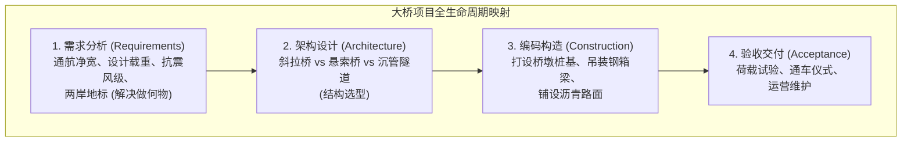
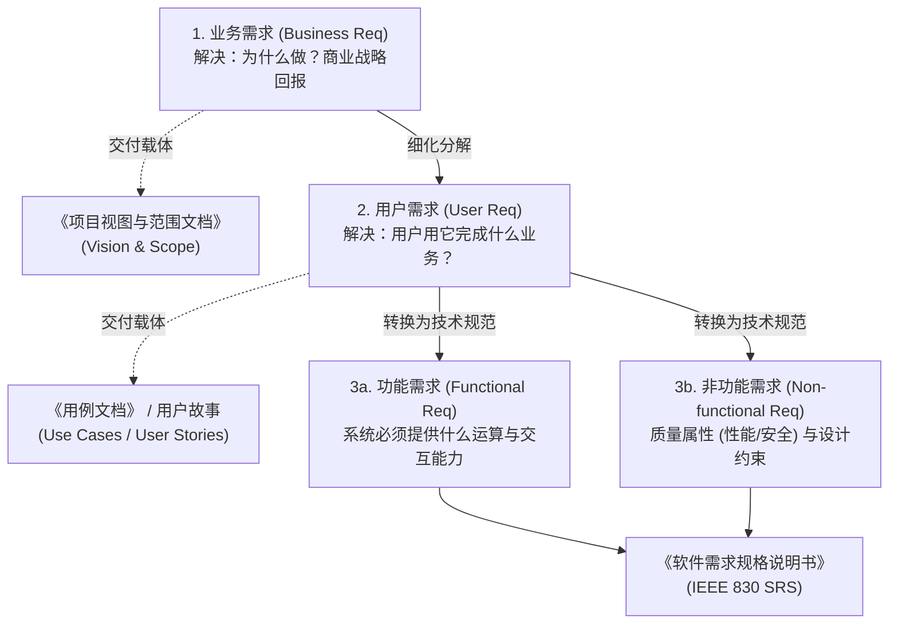
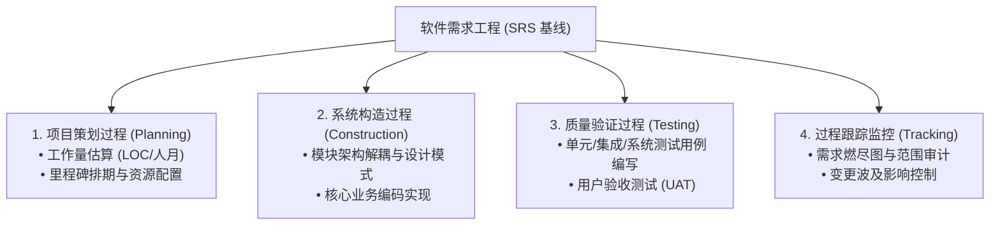

import StepVisualizer from '../../../components/interactive/StepVisualizer';
import QuizCard from '../../../components/interactive/QuizCard';

> “无论把事情做得多么完美，如果做的是错误的事情，那就是彻底的失败。” —— 彼得·德鲁克

平时学习编程，大家最容易沉迷于“如何写出更精巧的代码、如何用更复杂的算法将时间复杂度降到最低”。然而在真实软件产业界，无数耗资数千万、历时数年的软件项目在上线后却迅速沦为“数字废墟”。

统计数据触目惊心：**在失败的软件项目中，超过 50% 的缺陷直接根源于需求阶段的模糊、遗漏、矛盾或错误理解。**

---

## 1. 跨海大桥比喻：为什么需求决定系统生死？

如果把软件系统开发比作建造一座跨海大桥：

如果在桩基施工甚至大桥合龙之后，出资方突然宣布：“我们原本规划的是一条**能跑 350km/h 高铁的客运专线铁路桥**，而不是现在的双向六车道公路桥！”

此时，无论施工工艺多么严丝合缝、钢材标号多么顶尖，整座大桥都面临推倒重来的毁灭性结局。

**软件需求（Requirements）正是整个系统的源头，它定义了系统的终极意图和业务目的。需求的好坏直接关系到软件项目的生死存亡！**

---

## 2. 核心概念与理论推导

### 2.1 软件需求的 IEEE 权威定义

根据电气与电子工程师协会（IEEE 610.12 标准），软件需求（Software Requirement）包含三层严格内涵：

1. **用户视角**：用户解决问题或达到目标所需的**条件或权能（Capability）**；
2. **系统视角**：系统或系统部件要满足合同、标准、规范或其他正式规定文档所规定的**条件或权能**；
3. **文档视角**：反映上述第 1、2 条所述条件或权能的**文档说明**。

> **工程本质直觉**：软件需求是开发团队将现实世界中用户混乱、口语化的业务诉求，通过结构化梳理转换为计算机能够精确实现的规范说明，使其与用户的终极期望完全相符。

---

### 2.2 软件需求的三个抽象层次与交付文档映射

在真实工程实践中，必须将需求切分为由粗到细、由宏观战略到微观实现的**三个不同层次**，每一层次对应特定的工程交付物：

#### 层次对比解析表

| 层次类别 | 核心回答的问题 | 关注核心与抽象层级 | 存储载体文档 | 典型实例表述 |
| :--- | :--- | :--- | :--- | :--- |
| **业务需求** (Business) | 组织为何资助该项目？商业收益是什么？ | 最高层抽象，界定系统投资回报与宏观范围 | 《项目视图与范围文档》(Vision & Scope) | “将跨国集装箱清关耗时降低 40%，首年节省运营成本 300 万元” |
| **用户需求** (User) | 哪类用户使用软件完成什么业务任务？ | 中层抽象，站在最终用户操作视角 | 《用例文档》(Use Cases) / 用户故事 | “仓库管理员通过手持终端扫描条码完成批量入库上架” |
| **功能需求** (Functional) | 开发者必须编码实现的具体系统行为？ | 最底层抽象，面向开发与测试的逻辑规范 | 《软件需求规格说明书》(SRS) 第3章 | “当扫描条码无法解析时，系统应发出蜂鸣警报并在屏幕提示人工输入13位SKU” |
| **非功能需求** (Non-functional) | 系统在何种品质下运行？受何约束？ | 包含系统质量属性（性能、安全、可靠性等）与设计约束 | 《软件需求规格说明书》(SRS) | “在 2000 并发请求下，扫码识别响应时间不得超过 500ms；仅支持国产麒麟OS” |

---

### 2.3 优秀需求的特质检验矩阵

#### 1. 单条需求的 7 大黄金特质
无论是业务需求、用户需求还是功能需求，一条合格的需求必须满足：
1. **完整性 (Completeness)**：不遗漏任何输入分支、异常分支与边界条件；
2. **正确性 (Correctness)**：真实反映客户业务现实，无事实与逻辑错误；
3. **可行性 (Feasibility)**：在既定工期、预算、现有技术能力与物理环境下能够被实现；
4. **必要性 (Necessity)**：每条需求都直接支撑某项业务目标或法规合规要求；
5. **有优先次序 (Prioritized)**：标注实现的重要紧迫度，指导迭代排产与资源取舍；
6. **无歧义 (Unambiguous)**：具有唯一确定性语义，不同工程师阅读后理解绝对一致；
7. **可验证性 (Verifiability)**：能够通过测试用例、自动化脚本、同行审查或实机演示进行客观是非判定。

#### 2. 整体需求规格说明集（SRS）的 4 大综合特质
当数百条单项需求汇编成整体文档时，还必须额外满足：
- **完整性 (Completeness)**：涵盖整个产品范围，无重大能力缺失；
- **一致性 (Consistency)**：各条款之间绝不互相打架冲突（例如 A 条款写“支持任意手机号注册”，B 条款写“仅支持大陆 11 位手机号”）；
- **可修改性 (Modifiability)**：文档具备良好组织结构（目录清晰、编号唯一），便于局部增删改；
- **可跟踪性 (Traceability)**：每项需求均标有唯一持久标识符，支持向前追溯业务来源、向后追溯设计代码与测试用例。

---

## 3. 交互式推演：IBM 缺陷放大与修复成本指数定律

如果在需求阶段遗漏了一个关键判断规则，随着工程向下游推移，修复该缺陷的代价会如何变化？

根据 IBM 公司对数千个大型软件项目的里程碑级实证统计：**在需求阶段检查并修复一个缺陷的成本为基准 1；如果在运维投产阶段才被发现，修复成本将急剧暴增至 200 倍！**

export const defectEscalationSteps = [
  {
    title: "阶段 1：需求分析阶段 (Requirement Phase)",
    badge: "Cost Multiplier = 1x",
    description: "在需求调研或 SRS 评审会议上，分析员与客户发现规则遗漏（例如：'退款申请未限制支付渠道有效性'）。此时修复该问题，只需主笔分析员在 SRS 文档中增加一段文字描述，耗时 5 分钟，成本几乎可以忽略不计。",
    code: "[SRS Review Log]\nFINDING: Missing validation for refund channel expiry.\nACTION: Add Clause 3.2.4.1 - 'System shall verify refund gateway status before payout.'\nCOST: 1 Person-Hour (~$50)",
    stateView: (
      

        

          
相对修复成本

          
1 × (基准)

        

        

          
受波及范围

          
仅 SRS 文本草案

        

        

          
修正动作

          
文档文字微调

        

        

          
预估平均损失

          
约 $50 美元

        

      

    )
  },
  {
    title: "阶段 2：架构设计阶段 (Design Phase)",
    badge: "Cost Multiplier = 5x",
    description: "如果需求阶段未发现，进入概要设计与详细设计后，架构师依据残缺需求设计了数据模型与微服务接口。此时修正需要重新绘制时序图、修改数据库 ER 模式并调整 API 接口定义。",
    code: "[Architecture RFC #142]\nCHANGES REQUIRED:\n- Alter Table `refund_record` ADD COLUMN `channel_token` VARCHAR(64);\n- Update PaymentGateway Microservice Protobuf definitions\nCOST: 5 Person-Hours (~$250)",
    stateView: (
      

        

          
相对修复成本

          
5 ×

        

        

          
受波及范围

          
类图/ER图/API契约

        

        

          
修正动作

          
架构图与Schema重构

        

        

          
预估平均损失

          
约 $250 美元

        

      

    )
  },
  {
    title: "阶段 3：编码实现阶段 (Coding Phase)",
    badge: "Cost Multiplier = 10x",
    description: "程序员已根据原设计编写了数千行业务代码、单元测试与持久层映射。此时发现缺陷，必须重构核心业务类、重写 SQL 迁移脚本，并重新跑通所有单元测试。",
    code: "[Git Commit Diff: Fix missing refund check]\n- 14 files changed, +380 insertions, -120 deletions\n- DB migration script v1.42__refund_patch.sql added\n- Unit test coverage regression check triggered\nCOST: 10~15 Person-Hours (~$500)",
    stateView: (
      

        

          
相对修复成本

          
10 ×

        

        

          
受波及范围

          
业务代码与单元测试

        

        

          
修正动作

          
代码重构与DB变更

        

        

          
预估平均损失

          
约 $500 美元

        

      

    )
  },
  {
    title: "阶段 4：系统测试阶段 (Testing Phase)",
    badge: "Cost Multiplier = 20~50x",
    description: "系统进入集成测试或验收测试。测试团队提交致命 Bug 单，导致全流程受阻。开发人员需要定位复现、重编译打包、全量回归测试，严重打乱项目发版节奏。",
    code: "[JIRA-8901 Severity: Blocker]\nDefect: Payment gateway returns 400 when account expired.\nStatus: Rejected by QA -> Dev -> QA Full Regression Test Cycle.\nBlocker: Release candidate RC3 cancelled.\nCOST: 30~50 Person-Hours (~$2,000)",
    stateView: (
      

        

          
相对修复成本

          
20 ~ 50 ×

        

        

          
受波及范围

          
整包重编/回归测试集

        

        

          
修正动作

          
缺陷定位+发版延期

        

        

          
预估平均损失

          
约 $2,000 美元

        

      

    )
  },
  {
    title: "阶段 5：生产运维阶段 (Operation & Maintenance)",
    badge: "Cost Multiplier = 200x",
    description: "系统已全量上线。线上发生严重资金挂账或订单卡死！需要紧急停机维护、洗数据补偿客户、紧急打补丁上线，甚至面临监管部门罚款与商誉暴跌。",
    code: "[P0 Incident War-Room Alert]\n- Incident: 14,000 transactions failed silently during weekend peak.\n- Immediate Actions: Hotfix v1.42.1 deployment, dirty data repair script.\n- Business Impact: $180,000 customer refund compensation + brand damage.\nTOTAL COST: > $10,000+",
    stateView: (
      

        

          
相对修复成本

          
200 × (致命)

        

        

          
受波及范围

          
线上真实数据与商誉

        

        

          
修正动作

          
P0应急+脏数据清洗

        

        

          
预估平均损失

          
&gt; $10,000+ 美元

        

      

    )
  }
];

<StepVisualizer
  client:visible
  steps={defectEscalationSteps}
  title="IBM 缺陷放大与修复成本指数级飙升模拟器"
  algorithmName="IBM Defect Escalation Model"
/>

---

## 4. 需求与其他软件工程过程的齿轮咬合

需求分析不是孤立的技术孤岛，它是驱动后续全部工程活动的**核心齿轮**：

1. **项目策划过程（Planning）**：需求范围是功能点估算、代码规模测算与项目工期的直接输入，没有明确需求，进度表就是空中楼阁；
2. **系统构造过程（Construction）**：架构设计与模块代码必须能够直接正向追溯到 SRS 的功能条款，防止“过度设计”或“功能遗漏”；
3. **系统测试过程（Testing）**：测试用例直接依据 SRS 中的输入、行为与期望输出来设计，需求就是验收的唯一法律基准；
4. **项目跟踪与控制（Tracking）**：通过统计已验证的需求特性占比，客观透明地反映真实开发进度。

---

## 5. 随堂巩固自测

<QuizCard
  client:visible
  question="软件需求通常分为三个层次，即业务需求、用户需求和（ ）"
  options={[
    "硬件需求",
    "功能需求（或软件需求）",
    "界面需求",
    "数据库需求"
  ]}
  answer={1}
  explanation="【答案解析】根据软件需求工程经典体系，需求分为三大层次：最高层代表商业目标的业务需求（Business Requirements）、中层代表业务操作的用户需求（User Requirements）、底层代表技术实现的软件/功能需求（Functional Requirements）。"
/>

<QuizCard
  client:visible
  question="IBM 公司的统计结果表明，在需求阶段检查与修复一个错误所需的费用只有编码阶段的（ ）"
  options={[
    "1/5",
    "1/10",
    "1/20",
    "1/40"
  ]}
  answer={1}
  explanation="【答案解析】在 IBM 缺陷成本阶梯中，需求阶段修复成本为 1，设计阶段为 5，编码阶段为 10，测试阶段为 20~50，运维阶段为 200。因此需求阶段的花费是编码阶段的 1/10（即 1 ÷ 10 = 0.1）。"
/>
