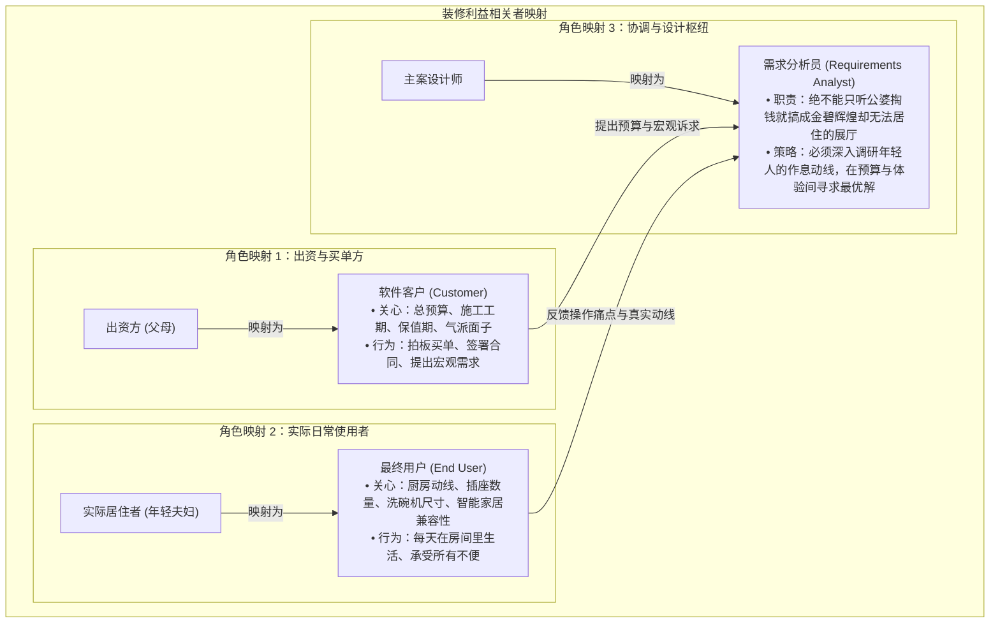
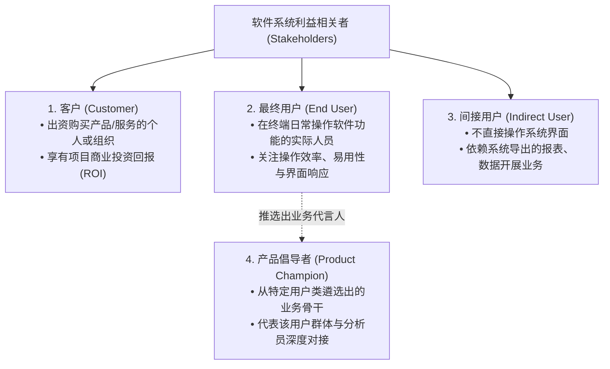
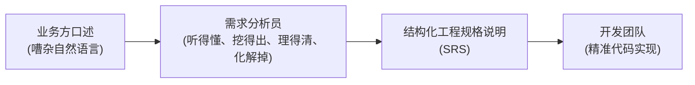

import StepVisualizer from '../../../components/interactive/StepVisualizer';
import QuizCard from '../../../components/interactive/QuizCard';

> “客户并不知道自己想要什么，直到你把做出来的东西摆在他们面前；而即使摆在面前，他们也常常会说：‘这正是我要的，但不是我想要的’。” —— 软件工程经典谚语

软件项目开发过程中最令人绝望的场景之一，是系统历经半年挑灯夜战交付后，业务部门却愤怒地拒绝使用，或者吐槽：“操作复杂十倍，根本不是人用的！”

为什么会产生这种悲剧？问题的核心在于：**在真实商业世界中，“出资购买软件的客户”和“每天坐在电脑前操作软件的最终用户”往往根本不是同一帮人！**

---

## 1. 婚房装修比喻：出资方与居住者的永恒博弈

如果把软件定制开发比作装修一套婚房：

如果在整个设计装修过程中，设计师只跟掏钱的父母开会，对年轻人的生活习惯一无所知，最终装出的房子必然是：**出资方满意了，居住者却痛不欲生。**

---

## 2. 利益相关者分类图谱

在软件需求工程中，必须对用户及利益相关者进行精准画像与分层：

### 破局核心角色：产品倡导者 (Product Champion)
面对成百上千名诉求各异的最终用户，需求分析员不可能逐一开会访谈。此时必须设立**产品倡导者（Product Champion）**：
- **定位**：该类用户群体的“超级业务代言人”；
- **核心职能**：
  1. 收集、归纳本业务领域的共性诉求与高频痛点；
  2. 协调化解本部门内部细微的意见分歧，形成统一输出；
  3. 参与 SRS 评审与交互原型体验，代表用户签字确认；
- **遴选标准**：必须懂业务、在部门内享有高公信力、被管理层充分授权，且**每周能保障至少 15%~20% 的时间参与需求活动**。

---

## 3. 契约精神立基石：Karl Wiegers 10+10 权利与义务全景

甲乙双方健康协作的前提，是清晰界定权利与责任边界。软件工程大师 Karl Wiegers 总结了著名的 **10 大客户权利** 与 **10 大客户义务** （客户即甲方与业务代表）。

### 表 2-1：客户的 10 项需求权利 (Customer Rights)
| 编号 | 客户法定权利条目 | 核心内涵与工程价值 |
| :---: | :--- | :--- |
| **权利 1** | **要求分析员使用客户的语言交流** | 交流必须以客户业务领域为中心，严禁分析员滥用技术术语（如“分布式锁、外键约束”），分析员负责编制词汇表统一语义。 |
| **权利 2** | **要求分析员了解客户业务和目标** | 分析员需深入业务一线理解工作流与痛点，帮助开发团队构建真正解决问题的技术方案。 |
| **权利 3** | **要求编写软件需求规格说明** | 分析员负责将口头诉求整理为结构化、规范化的 SRS 文档，作为双方正式契约。 |
| **权利 4** | **听取对需求工作成果的解释说明** | 客户有权要求分析员通俗讲解需求图表（DFD、用例图等），借助图表审查排除隐性漏洞。 |
| **权利 5** | **得到分析员和开发人员的专业尊重** | 技术团队必须尊重客户的想法与投入的时间，保持职业化的倾听与沟通态度。 |
| **权利 6** | **听取对需求及实现的备选方案** | 分析员应主动提出优化业务流程的建设性方案，发掘客户未曾想到的增值能力。 |
| **权利 7** | **要求实现易用、人性化的特性** | 充分重视界面可用性与操作效率，使系统顺手、直观、容错率高。 |
| **权利 8** | **为实现重用而对需求做出调整** | 分析员告知现有成熟组件库，客户可适度微调细节以复用组件，成倍压缩研发周期与成本。 |
| **权利 9** | **获得对变更成本及影响的真实评估** | 客户提出变更时，开发团队必须据实提供对工期、预算、技术风险的客观影响评估报告。 |
| **权利 10** | **获得满足功能和质量要求的系统** | 系统交付时必须百分之百满足双方事先评审并达成共识的 SRS 功能与质量指标。 |

---

### 表 2-2：客户的 10 项需求义务 (Customer Obligations)
| 编号 | 客户法定责任义务 | 核心内涵与工程价值 |
| :---: | :--- | :--- |
| **义务 1** | **为分析人员讲解业务并定义术语** | 客户有责任介绍业务背景、管理规范与行业惯例，帮助分析员快速跨越领域认知障碍。 |
| **义务 2** | **花时间提供并阐明需求，保持耐心** | 客户必须投入必要时间参与调研，理解需求渐进明细的迭代本质，不能当“甩手掌柜”。 |
| **义务 3** | **对系统需求的描述必须具体准确** | 拒绝“差不多就行”的模糊口头表述，必须尽量详尽给出判定条件与输入输出规范。 |
| **义务 4** | **需要时，及时对需求做出拍板决定** | 出现业务分歧或方案选择时，业务负责人必须果断拍板，防范因决策拖延造成团队停工。 |
| **义务 5** | **尊重开发人员对成本和可行性的评估** | 某些设想技术风险极高或性价比极低，客户应理性接受开发团队给出的客观成本与否定评估。 |
| **义务 6** | **协作设置符合实际的需求优先级** | 客户在需求优先级评定中起主导作用，结合技术团队给出的成本与风险，合理安排分期上线。 |
| **义务 7** | **认真审阅需求文档，评估原型** | 客户审查是保证需求正确的唯一法律途径，客户必须认真体验交互原型并给出真实反馈。 |
| **义务 8** | **发现需要变更时及时与团队沟通** | 变更提出越晚成本越高；客户一旦发现业务规则或政策变动，应第一时间通报分析团队。 |
| **义务 9** | **按照受控流程正规提出变更申请** | 严禁越过正式流程私下指示程序员改代码；必须提交变更请求（CR）走影响分析与审定。 |
| **义务 10** | **尊重分析员采用的工程方法与过程** | 客户应配合分析员采用的用例建模、场景推演、状态分析等专业方法，支持规范工程活动。 |

---

## 4. 交互式推演：权利义务协同互动工作流

export const contractSteps = [
  {
    title: "第一步：语言对齐与业务破冰",
    badge: "权利 1 & 2 vs 义务 1",
    description: "需求调研启动。客户行使【权利 1: 要求分析员用业务语言交流】，分析员下沉到一线科室调研；同时客户履行【义务 1: 讲解业务并定义业务术语】，共同编制《统一业务术语字典》，消除语义鸿沟。",
    code: "// 业务术语对照字典统一\nClinical_Alert -> '危急值警报' (非技术术语: AsyncEventDispatcher)\nDrug_Compatibility -> '配伍禁忌校验' (非技术术语: RuleEngineFilter)\nResult: 双方在同一语境下展开有效沟通",
    stateView: (
      

        

          
客户权利生效

          
业务语言主导权

        

        

          
客户义务履约

          
业务场景深度传授

        

        

          
工程协同成果

          
领域统一词汇表达成

        

      

    )
  },
  {
    title: "第二步：需求规格固化与原型体验",
    badge: "权利 3 & 4 vs 义务 2 & 7",
    description: "分析员将业务整理为正式 SRS 文档与可点击原型，行使【客户权利 3: 编写SRS】与【权利 4: 讲解图表】；客户严格履约【义务 2: 投入充足时间】并【义务 7: 认真审阅文档、评估原型】，排查暗含的逻辑漏洞。",
    code: "[Formal Inspection Meeting]\nReview Artifact: SRS v0.9 & Figma Clickable Prototype\nProduct Champion Feedback: '处方录入缺少头孢类联动校验'\nAction: 缺陷记录在册，SRS 在基线发布前完成闭环修复",
    stateView: (
      

        

          
客户权利生效

          
获得规范SRS与图表解答

        

        

          
客户义务履约

          
全程参与原型走查

        

        

          
工程协同成果

          
需求缺陷在基线前消除

        

      

    )
  },
  {
    title: "第三步：成本评估与可行性尊重",
    badge: "权利 9 vs 义务 5",
    description: "客户提出希望通过 AI 自动分析全院病历并实时生成科研论文。客户行使【权利 9: 获得成本与风险真实评估】；开发团队评估后反馈：算力成本超预算 400%，算法准确率目前不足 60%。客户理性行使【义务 5: 尊重开发方对成本和可行性的评估】，放弃不切实际的镀金需求。",
    code: "[Feasibility Study #08]\nProposal: Real-time Generative AI Clinical Paper Auto-writer\nTech Feasibility: High Risk (Accuracy ~58%, GPU server: +$120,000/yr)\nCustomer Decision: Rejected based on professional dev feedback",
    stateView: (
      

        

          
客户权利生效

          
获取客观技术成本分析

        

        

          
客户义务履约

          
尊重技术团队客观约束

        

        

          
工程协同成果

          
规避致命预算陷阱

        

      

    )
  },
  {
    title: "第四步：分级排产与果断决策",
    badge: "权利 8 vs 义务 4 & 6",
    description: "面对上百条功能清单，开发团队提出可复用现成的开源认证与单点登录（SSO）模块（行使【权利 8: 为重用调整需求】）；客户业务负责人【义务 4: 及时拍板裁决】并【义务 6: 协作划分优先级】，确定一期核心上线特性与二期候选特性。",
    code: "[Release 1.0 Milestone Baseline]\nPriority High (Must have): 门诊挂号、电子处方、医保结算 (70% 工时)\nPriority Low (Nice to have): 满意度问卷、院内知识库 (延至 2.0)",
    stateView: (
      

        

          
客户权利生效

          
架构复用节省巨额工期

        

        

          
客户义务履约

          
果断决断，分级排期

        

        

          
工程协同成果

          
形成首发最小可行版本

        

      

    )
  },
  {
    title: "第五步：受控变更与高品质交付",
    badge: "权利 10 vs 义务 8 & 9",
    description: "开发后期外部医保政策调整，客户第一时间通知团队（【义务 8: 及时沟通变更】）并提交正式 CR 单走 CCB 审批（【义务 9: 按受控流程变更】）。最终系统按期上线，完全满足质量契约，客户行使【权利 10: 获得满足功能和质量要求的系统】！",
    code: "[CR-029: National Healthcare Interface v3 Upgrade]\nStatus: Approved by CCB (Schedule impact: +3 days, Budget: Included in buffer)\nDelivery Sign-off: 100% Acceptance criteria met.",
    stateView: (
      

        

          
客户权利生效

          
收获可信赖的高品质软件

        

        

          
客户义务履约

          
恪守正规变更控制流程

        

        

          
工程协同成果

          
项目平稳上线零违约交付

        

      

    )
  }
];

<StepVisualizer
  client:visible
  steps={contractSteps}
  title="客户权利与义务 10+10 互动沙盘"
  algorithmName="Wiegers Customer Contract Walkthrough"
/>

---

## 5. 需求分析员的四大核心能力

需求分析员绝不是简单的“传话筒”或“打字员”，而是团队里的**跨界同声传译官**：

1. **倾听与访谈挖掘能力**：不带预设立场，听懂言外之意，引导用户梳理潜意识逻辑；
2. **抽象建模与结构化表达能力**：将零散的口头业务转换为 DFD、用例、状态机与无歧义 SRS；
3. **组织协同与冲突调解能力**：在多个相互矛盾的部门诉求之间寻求商业与技术平衡点；
4. **技术可行性洞察能力**：理解系统架构与实现代价，避免承诺“技术上无法兑现的空中楼阁”。

---

## 6. 随堂巩固自测

<QuizCard
  client:visible
  question="掏钱购买软件产品的用户被称为（ ）"
  options={[
    "客户 (Customer)",
    "最终用户 (End User)",
    "需求分析员 (Analyst)",
    "系统操作员 (Operator)"
  ]}
  answer={0}
  explanation="【答案解析】掏钱购买软件产品或定制服务、享有项目直接投资回报的个人或机构称为“客户（Customer）”；每天坐在电脑前实际使用该软件操作各项业务功能的人员则称为“最终用户（End User）”。"
/>

<QuizCard
  client:visible
  question="下列哪一项不属于客户的权利（ ）"
  options={[
    "要求需求分析员使用客户的语言进行交流",
    "要求需求分析员了解客户的业务和目标",
    "为实现软件重用而对需求做出调整",
    "对需求成本和可行性进行评估"
  ]}
  answer={3}
  explanation="【答案解析】“对需求成本和可行性进行评估”属于开发团队（需求分析员/技术工程师）的专业职责与权力，客户不具备评估技术可行性的专业能力。客户拥有的是“要求开发团队对成本和可行性做出真实评估”的权利！"
/>
