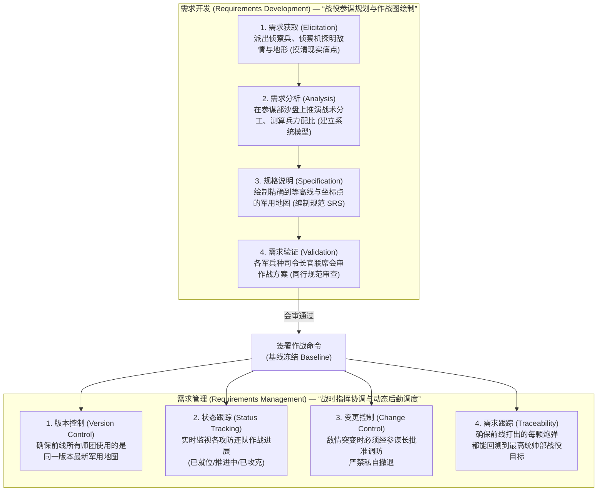
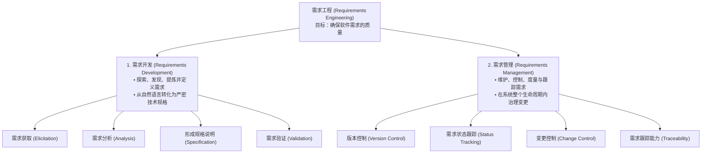
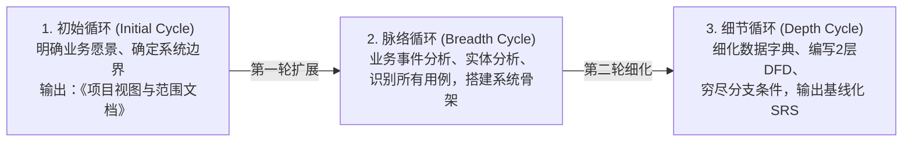

import CytoscapeCanvas from '../../../components/interactive/CytoscapeCanvas';
import QuizCard from '../../../components/interactive/QuizCard';

> “计划如果没有执行机制，就只是一纸空文；执行如果没有计划导航，就是盲人摸象。” —— 软件工程管理公理

在软件工程中，许多团队要么陷入“只重开发不重管理”的泥潭：前期大家天马行空地收集需求，进入编码期后，客户随时一个电话打过来，程序员私下就改了代码，导致项目在无休止的混乱变更中彻底失控；

要么走向“只重管理不重开发”的极端：会议不断、流程表格满天飞，但写出来的需求空洞干瘪、漏洞百出，最终交付了一个符合所有管理规章却极难使用的残次品。

**高质量的软件工程，必须由“需求开发”与“需求管理”两大轮轨共同支撑，二者紧密协同、缺一不可。**

---

## 1. 现代化立体战役比喻：参谋规划与战时调度

如果把研发一款现代化复杂软件比作组织一场多军兵种立体战役：

---

## 2. 核心架构：需求工程的双轮驱动全景

需求工程（Requirements Engineering, RE）被严格划分为两大互为表里、紧密咬合的组成部分：

> **易错核心辨析**：
> - **软件工程**是确保**整个软件开发质量**的学科；
> - **需求工程**是专门确保**软件需求质量**的学科分支。

---

## 3. 需求开发的三次迭代螺旋循环

需求绝不是“一次性收集完毕”的静态文档，而是遵循**三次螺旋式上升循环（Three Cycles of Requirements Development）** 逐步细化推演出来的：

1. **初始循环（Initial Cycle）**：
   - **发生阶段**：项目立项与初期探索阶段；
   - **核心任务**：明确项目的核心商业目标与战略意图，界定项目的高层边界（哪些做，哪些坚决不做），完成子系统粗粒度划分；
   - **输出成果**：《项目视图与范围文档》（Vision & Scope Document）。
2. **脉络循环（Breadth Cycle）**：
   - **发生阶段**：细化阶段的**第一次迭代**；
   - **核心任务**：重在**广度（Breadth）而非深度**。对所有主要业务事件进行流程分析与业务实体分析，识别出系统所有的参与者（Actors）与用例（Use Cases），绘制系统关联图（Context Diagram）与顶层 DFD；
   - **输出成果**：系统用例全景清单、0层/1层数据流图、核心业务实体草案。
3. **细节循环（Depth Cycle）**：
   - **发生阶段**：细化阶段的**第二次迭代**；
   - **核心任务**：深入**细节（Depth）**，进一步明确每个处理对象的具体规则。细化数据字典、编写底层 2 层 DFD、状态机、穷尽异常分支与非功能质量属性；
   - **输出成果**：经过各方正式评审、可直接指导编码与测试的正式《软件需求规格说明书》（SRS）。

---

## 4. 需求开发 4 大活动核心剖析表

| 阶段活动 | 核心工程任务 | 输入制品 | 核心输出制品 | 工业界主流技术与方法 |
| :--- | :--- | :--- | :--- | :--- |
| **需求获取 (Elicitation)** | 探明业务现状、用户痛点与期望诉求 | 商业目标、组织规范、行业法规 | 用户访谈纪要、现场观察手记、用户故事清单 | 面对面深入访谈、焦点小组工作坊 (JAD)、基于场景推演、问卷调查 |
| **需求分析 (Analysis)** | 将碎片化口述提炼为逻辑严谨的系统模型，化解冲突 | 原始需求记录、业务规则条目 | 系统关联图、DFD 数据流图、UML 用例图、决策表/树 | 结构化分析法、面向对象分析法、边界界定、优先级定级 |
| **规格说明 (Specification)** | 采用标准化、规范化的工程语言全面阐述系统行为与约束 | 分析图表、数据结构、质量要求 | 软件需求规格说明书 (SRS)、数据字典 (DD) | IEEE 830 标准规范模板、敏捷 Epics/Stories 文档化 |
| **需求验证 (Validation)** | 确认文档是否真实、完整、准确反映了客户与业务需求 | SRS 初稿、用例草案、验证清单 | 正式审查缺陷清单、基线签字确认书 | 规范同行评审 (Inspection)、桌面走查、可运行原型体验 |

---

## 5. 交互式拓扑实验室：需求工程双轮驱动与基线枢纽

需求工程两大分支如何有机联通？以下由 Cytoscape.js 渲染的双轮拓扑图清晰展现了各活动的流转依赖关系。

export const dualCycleElements = {
  nodes: [
    { id: 'rd', label: '一、需求开发 (RD)', type: 'process', bgColor: '#0284c7', textColor: '#ffffff' },
    { id: 'elicit', label: '1. 需求获取\n(Elicitation)', type: 'process' },
    { id: 'analysis', label: '2. 需求分析\n(Analysis)', type: 'process' },
    { id: 'spec', label: '3. 规格说明\n(Specification)', type: 'process' },
    { id: 'valid', label: '4. 需求验证\n(Validation)', type: 'process' },
    { id: 'baseline', label: '受控需求基线\n(Baseline 枢纽)', type: 'datastore', bgColor: '#16a34a', textColor: '#ffffff' },
    { id: 'rm', label: '二、需求管理 (RM)', type: 'process', bgColor: '#9333ea', textColor: '#ffffff' },
    { id: 'version', label: '1. 版本控制\n(Version)', type: 'process' },
    { id: 'status', label: '2. 状态跟踪\n(Status)', type: 'process' },
    { id: 'change', label: '3. 变更控制\n(Change CCB)', type: 'process' },
    { id: 'trace', label: '4. 需求跟踪\n(Traceability)', type: 'process' },
  ],
  edges: [
    { id: 'e1', source: 'rd', target: 'elicit', label: '启动调研' },
    { id: 'e2', source: 'elicit', target: 'analysis', label: '原始诉求' },
    { id: 'e3', source: 'analysis', target: 'spec', label: '分析模型' },
    { id: 'e4', source: 'spec', target: 'valid', label: 'SRS初稿' },
    { id: 'e5', source: 'valid', target: 'baseline', label: '评审签署冻结' },
    { id: 'e6', source: 'baseline', target: 'rm', label: '纳入基准管理' },
    { id: 'e7', source: 'rm', target: 'version', label: '赋予唯一版本号' },
    { id: 'e8', source: 'rm', target: 'status', label: '跟踪生命周期' },
    { id: 'e9', source: 'rm', target: 'change', label: '变更影响审定' },
    { id: 'e10', source: 'change', target: 'baseline', label: 'CCB批准重打基线' },
    { id: 'e11', source: 'rm', target: 'trace', label: 'RTM双向追溯' },
    { id: 'e12', source: 'trace', target: 'change', label: '波及范围分析' },
  ]
};

<CytoscapeCanvas
  client:visible
  elements={dualCycleElements}
  layoutName="dagre"
  height="450px"
/>

---

## 6. 需求管理 4 大机制协同关系

一旦 SRS 跨过需求验证阶段，便形成了**受控需求基线（Baseline）**。需求管理 4 大机制随之全面启动：

1. **版本控制（Version Control）**：为每一版需求文档与每条需求项赋予全局唯一、语义化的版本标识（如 SRS v1.0, REQ-PAY-042 v1.2），确保跨部门团队不会基于旧版本开工；
2. **状态跟踪（Status Tracking）**：监控每项需求在生命周期中的即时演变状态（`已建议 Proposed` $\to$ `已批准 Approved` $\to$ `已实现 Implemented` $\to$ `已验证 Verified`），支撑量化进度管控；
3. **变更控制（Change Control）**：设立**变更控制委员会（CCB）**，所有新增、删除或修改需求的诉求必须正式提交变更请求（CR），经过 13 项影响分析评估后由 CCB 裁决；
4. **需求跟踪能力（Requirements Traceability）**：建立**需求跟踪矩阵（RTM）**，维护从商业目标到 SRS，再到架构设计、源代码、自动化测试用例的双向可追溯链条。

---

## 7. 随堂巩固自测

<QuizCard
  client:visible
  question="软件工程是确保软件开发质量的，需求工程是确保软件（ ）"
  options={[
    "需求范围",
    "需求质量",
    "开发过程",
    "测试覆盖"
  ]}
  answer={1}
  explanation="【答案解析】软件工程涵盖整个软件研发生命周期，保障整个软件开发的质量；而需求工程作为其前置关键分支，核心使命是确保软件“需求质量（Requirements Quality）”，防止劣质需求污染后续下游所有工序。"
/>

<QuizCard
  client:visible
  question="在需求工程过程中，处于细化阶段的第一次迭代，通过对每个业务事件进行流程分析、业务实体分析，并标识出所有用例的循环过程为（ ）"
  options={[
    "初始循环",
    "脉络循环",
    "细节循环",
    "最终循环"
  ]}
  answer={1}
  explanation="【答案解析】需求开发三次循环中：初始循环（Initial Cycle）明确目标愿景与宏观范围；脉络循环（Breadth Cycle）处于细化阶段第一次迭代，对业务事件进行流程与实体分析并标识出所有用例；细节循环（Depth Cycle）处于细化阶段第二次迭代，深入明确处理对象与字段规则。"
/>
