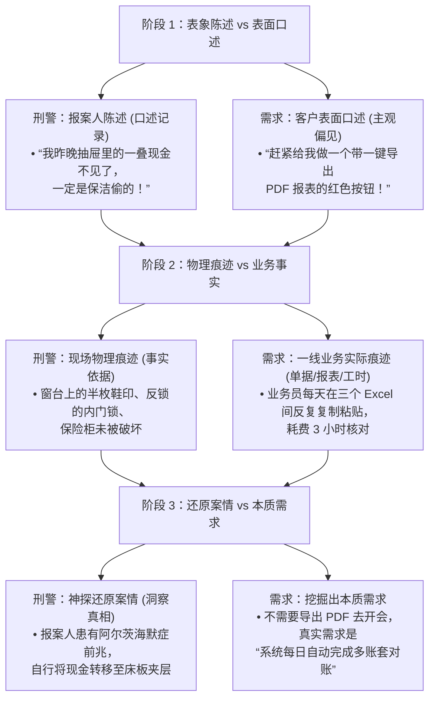
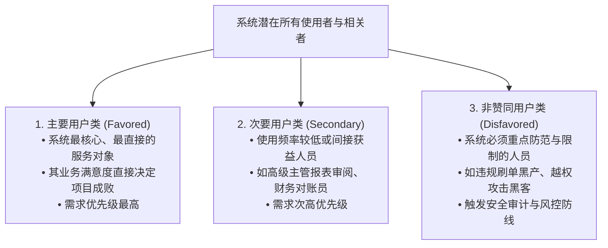

import StepVisualizer from '../../../components/interactive/StepVisualizer';
import QuizCard from '../../../components/interactive/QuizCard';

> “用户经常告诉你他们需要一匹更快的马，但他们真正需要的是更快地到达目的地。” —— 亨利·福特

许多刚刚接触软件开发的新手工程师常常误以为：需求获取（Elicitation）就是拿着笔和本子坐在会议室里，像打字员一样把客户说的话一字不漏地“听写录音”下来。

然而，软件工程实践会无情地击碎这种天真幻想：**用户经常搞不清自己的真实痛点、习惯性用自以为是的“解决方案”代替“真实需求”，或者隐瞒了大量“嘴上没说但习以为常”的隐性操作习惯。**

需求获取不是“录音打字”，而是一场深度的**现场破案侦查**。

---

## 1. 刑警破案比喻：穿透迷雾，挖掘潜意识真需求

如果把需求获取比作刑警在犯罪现场勘查破案：

优秀的需求分析员绝不仅仅记录“客户说了什么”，而是亲临一线作业环境，观察业务流转，运用引导式提问和情境推演，挖出那些**连用户自己都未曾清晰意识到的核心业务诉求**。

---

## 2. 用户类（User Classes）划分策略

在面对成百上千名系统潜在利益相关者时，绝对不能将所有人混为一谈。业界通用的用户类划分策略将系统受众划分为三类：

- **主要用户类（Favored）**：如网约车平台的乘客与司机、电商平台的买家。系统界面与核心流程必须向其极致倾斜；
- **次要用户类（Secondary）**：如平台客服人员、运营管理人员。关注后台配置便捷性与统计报表；
- **非赞同用户类（Disfavored）**：如试图恶意薅羊毛的黑产账号、越权访问患者隐私的未授权人员。需求分析必须显式定义**反向安全需求与防御策略**！

---

## 3. 需求获取 5 大主流工程技术横向大对比

针对不同的业务复杂度与干系人群体，需求分析师应组合运用以下 5 种主流技术：

| 工程获取方法 | 核心操作方式 | 适用场景与独特优势 | 潜在局限与主要风险 |
| :--- | :--- | :--- | :--- |
| **面对面访谈 (Interview)** | 一对一或一对二深入交谈，围绕预设提纲展开开放式与封闭式提问 | 挖掘核心高管的战略意图、关键业务专家的隐性规则；灵活性极高 | 极耗费时间；受访者个人情绪或片面认知容易带偏全局 |
| **联合应用开发工作坊 (JAD / Workshop)** | 召集业务代表、高管、架构师与分析员，进行 1~3 天封闭式高强度研讨 | 跨部门信息孤岛严重、业务流程存在激烈争议时；能迅速促成各方妥协共识 | 组织成本高；性格强势的主管容易压制一线最终用户的真实声音 |
| **基于场景分析 (Scenario-based)** | 以时间推进的叙事故事线（Storyline），逐步推演人机互动全过程 | 业务主流程清晰但分支繁杂的交互系统；极易发现异常遗漏条件 | 难以覆盖非功能质量属性与极端底层技术约束 |
| **现场观察与岗位实习 (Observation)** | 分析员到工作现场进行旁观记录（被动观察）或亲自顶岗操作（主动体验） | 梳理“只可意会不可言传”的熟练工种（如急诊分诊、仓储打包拣选） | 工期漫长；被观察者在有人旁观时可能会改变常规工作习惯 |
| **问卷调查 (Survey / Questionnaire)** | 精心设计单选、多选与量表题，向海量潜在用户大范围分发回收 | 目标用户量极大（如百万级 C 端 App），需对功能偏好进行宏观统计 | 问题死板预设；无法针对模糊回答进一步深入追问“为什么” |

---

## 4. 交互式实验室：化学品采购场景逐步推演

以某重点高校“化学品采购与危化品管控制度”的真实业务场景为例，体验如何通过**基于场景分析（Scenario Analysis）**，从一个模糊设想逐步推演出严密的工程需求：

export const elicitationSteps = [
  {
    title: "步骤 1：识别用户类与初始业务目标",
    badge: "角色与边界界定",
    description: "调研启动。识别出主要用户类：科研实验员（Favored）；次要用户类：课题组导师、院系审批员、校保卫处专员（Secondary）；非赞同用户类：校外走私/非法买卖管制毒化品的黑产分子（Disfavored）。",
    code: "[User Class Matrix]\n- Favored: Lab Graduate Students (Submit order, manage stock)\n- Secondary: P.I. / Professors (Approval, fund deduction)\n- Safety Officer: Campus Police (Hazardous materials inspection)\n- Disfavored: Unauthorized sellers / malicious buyers",
    stateView: (
      

        

          
核心用户类

          
实验员 + 导师 + 保卫处

        

        

          
非赞同防范类

          
越权申领管制化学品

        

        

          
业务使命

          
采购便捷与安全风控平衡

        

      

    )
  },
  {
    title: "步骤 2：主成功场景推演 (Main Success Scenario)",
    badge: "Happy Path 快乐路径",
    description: "分析员与实验员推演正常顺畅的采购主流程：1. 实验员登录，输入化学品 CAS 编号检索采购目录；2. 系统展示供应商规格与价格；3. 实验员填写入库量（2 瓶），绑定课题组经费卡提交；4. 导师收到通知邮件完成审批。",
    code: "【主成功场景推演】\n1. 实验员输入 CAS# 7647-01-0 (盐酸) 检索目录；\n2. 系统展示合规供应商现货库存与化学品 MSDS 说明书；\n3. 填入数量 2 瓶 (500ml/瓶)，扣除经费卡 #NSFC-2026-A01；\n4. 导师点击移动端单点登录，一键审批通过，订单派发给供应商。",
    stateView: (
      

        

          
业务分支

          
主成功场景 (Happy Path)

        

        

          
涉及接口

          
CAS知识库 + 经费卡系统

        

        

          
产出需求

          
基础检索与审批功能 (FR-01~03)

        

      

    )
  },
  {
    title: "步骤 3：挖掘异常扩展分支 2a (管制危化品拦截)",
    badge: "Exception Branch 2a",
    description: "分析员发问：“如果学生采购的是剧毒、易制毒或易制爆管制化学品（如高锰酸钾、氰化钾）呢？”场景立即分叉：系统必须强制拦截普通审批流，强制要求上传公安机关备案许可证，且审批流自动插入‘校保卫处危险品专员’审批节点！",
    code: "【扩展分支 2a：危化品严格风控】\n2a. 所选化学品具有管制属性 (Hazard_Level >= Tier 2):\n    2a1. 系统弹窗警示，禁用普通直通审批；\n    2a2. 页面强制显示文件上传控件：'公安局剧毒易制爆购买许可证 (PDF/JPG)'；\n    2a3. 审批链自动注入：课题组长 -> 学院安全专员 -> 校保卫处直管科长。",
    stateView: (
      

        

          
触发条件

          
国家管制类危险化学品

        

        

          
系统反应

          
许可证核验 + 链式审批追加

        

        

          
产出需求

          
合规风控规则引擎 (FR-04~06)

        

      

    )
  },
  {
    title: "步骤 4：挖掘异常扩展分支 3a (经费卡透支与跨年冻结)",
    badge: "Exception Branch 3a",
    description: "分析员追问财务：“如果经费卡刚好在年末封账，或者卡内可用余额不足以支付呢？”业务代表确认：系统应实时联动科研财务系统查询可用可用额度，若透支则红字警告并锁死提交，且给出追加经费申请的超链接指引。",
    code: "【扩展分支 3a：经费校验异常】\n3a. 课题组经费卡可用余额 < 订单预估金额 OR 状态为'年终封账':\n    3a1. 提交按钮置灰禁用，以红字高亮展示差额：'当前可用余额 ¥320.00，不足以支付 ¥580.00'；\n    3a2. 提供跳转链接：'前往科研财务系统提交经费调整申请'。",
    stateView: (
      

        

          
触发条件

          
经费透支或财务封账

        

        

          
系统反应

          
防呆锁死 + 引导性救济链接

        

        

          
产出需求

          
财务联动与容错机制 (FR-07~08)

        

      

    )
  },
  {
    title: "步骤 5：成果固化为无歧义 SRS 需求条目",
    badge: "Specification Finalization",
    description: "通过主成功场景与多条扩展分支推演，原本干瘪的一句用户口述“支持化学品采购”，在两小时工作坊内顺利蜕变为 8 条具有唯一编号、可验证、无歧义的正式 SRS 功能需求与数据校验契约！",
    code: "[SRS Formal Clauses]\nREQ-CHEM-01: 系统应支持按 CAS 统一编码精准查询化学品参数。\nREQ-CHEM-04: 若检索化学品包含毒麻易爆标识，系统必须强制上传公安备案证明。\nREQ-CHEM-05: 遇管制化学品时，系统应自动追加校保卫处专员审批流并短信提醒。\nREQ-CHEM-07: 系统应在提交前与财务中间件同步核验卡内实时可用余额。",
    stateView: (
      

        

          
原始输入

          
口头设想“买化学品” (1条)

        

        

          
精炼产物

          
8 条高质量 SRS 规则

        

        

          
工程成效

          
0 歧义、100% 可测试验证

        

      

    )
  }
];

<StepVisualizer
  client:visible
  steps={elicitationSteps}
  title="化学品采购与危化品管制场景逐步推演器"
  algorithmName="Scenario-Based Elicitation Walkthrough"
/>

---

## 5. 警惕“镀金”与“把解空间当问题空间”

在需求获取实战中，分析师必须时刻警惕两大认知陷阱：

1. **防范镀金（Gold-Plating）**：
   - 开发者或用户有时会提出一些看似高大上、但实际业务极少使用且成本高昂的特性（例如：“加一个根据天气变化自动切换 3D 动态背景的功能”）；
   - **对策**：回归项目《视图与范围文档》，凡是不能直接支撑商业目标或法律合规的特性，坚决移出当期范围。
2. **区分“问题空间”与“解空间”**：
   - 用户往往直接提出“解空间”的技术方案（“给我一个导出 Excel 文件的按钮”）；
   - 分析师必须追问其背后的“问题空间”（“你导出来是需要发给财务对账，还是做柱状图分析？”）；
   - 挖掘出真正意图后，往往能提供远比用户盲目设想更优雅、更高效的系统能力（如直接在系统内提供自动对账看板，免去手工倒腾 Excel 的烦恼）。

---

## 6. 随堂巩固自测

<QuizCard
  client:visible
  question="需求开发计划的任务是确定需求开发实施步骤，给出收集需求活动的（ ）"
  options={[
    "安排和进度",
    "范围和成本",
    "人员和内容",
    "目标和范围"
  ]}
  answer={0}
  explanation="【答案解析】需求开发计划的主要任务是确定需求工程在项目中的具体实施步骤与里程碑，明确给出收集需求各项活动的“安排和进度（Schedule & Arrangement）”，确保调研工作有序推进。"
/>

<QuizCard
  client:visible
  question="下列哪一个不属于软件需求获取的典型来源（ ）"
  options={[
    "直接和间接使用软件系统的最终用户",
    "市场竞品调研报告与用户问卷调查数据",
    "已开发出的和待开发的同类软件系统技术文档",
    "开发人员提供的程序源代码实现"
  ]}
  answer={3}
  explanation="【答案解析】需求获取的典型来源包括：各类现实用户、市场调查、现有同类业务系统的业务文档与组织规章等。开发人员提供的程序代码是软件构造的下游产物，属于技术实现细节，绝不是需求的源头。"
/>
