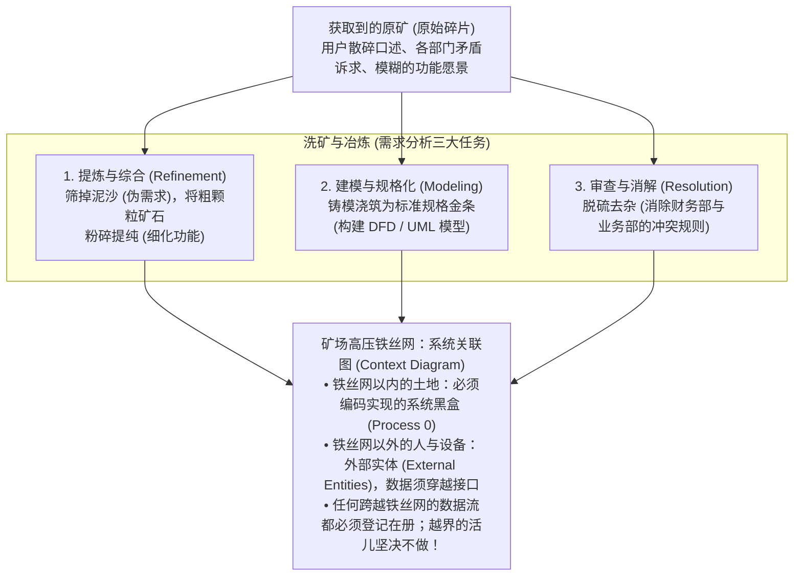
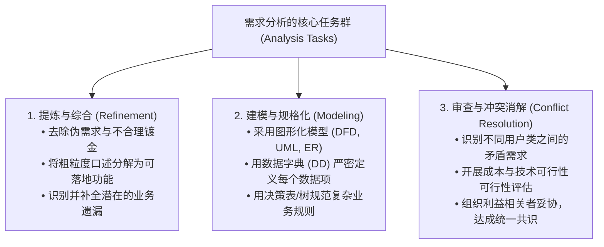

import CytoscapeCanvas from '../../../components/interactive/CytoscapeCanvas';
import QuizCard from '../../../components/interactive/QuizCard';

> “定义问题的边界，往往比解决问题本身更需要洞察力。” —— 爱因斯坦

如果说上一讲的需求获取（Elicitation）是将刚从地下开采出来的矿石拉回大本营，里面不可避免地夹杂着海量的泥沙、碎石与杂质；那么**需求分析（Analysis）就是一场极其严密的“洗矿与冶炼”工程**。

需求分析员必须在这个阶段完成脱硫脱水、去粗取精，将用户口述提炼为计算机逻辑模型。

而在整个分析工程中，最核心、最具有法律与商业防守价值的动作，就是**在待建系统的领地四周拉上一圈带电铁丝网——这就是系统关联图（Context Diagram）**！

---

## 1. 冶炼与划界比喻：明确责任田与护城河

如果把软件开发比作承包一座金矿的开采经营：

如果在项目初期没有这圈铁丝网，业务部门后续就会随意指手画脚：“既然你们做了考勤系统，顺便帮我们把园区闸机的硬件固件驱动也写了吧！”

如果没有关联图白纸黑字的边界作为屏障，开发团队就只能在无休止的免费劳动中走向项目崩溃。

---

## 2. 需求分析的三大基本任务

在需求工程理论中，需求分析绝不是“写代码前的技术设计”，其核心任务是**准确确定软件系统“必须做什么”**：

1. **提炼与综合（Refinement）**：剥离用户表达中的表象与情绪，将“我要一键导出”转换为“支持按月汇总采购单据”；
2. **建模与规格化（Modeling）**：运用工业标准的图形符号与组织规则，描绘系统的功能架构、数据流动与实体关系；
3. **审查与冲突消解（Conflict Resolution）**：当销售部要求“零首付即可发货”，而风控部要求“必须三级审批后发货”时，分析师必须推动管理层仲裁，使系统规则保持内在一致。

---

## 3. 关键模型：系统关联图 (Context Diagram) 的工程法则

### 3.1 严格定义与核心特征
- **最高抽象层**：系统关联图是**结构化分析方法中数据流图（DFD）的最高抽象层（Level-0 DFD）**；
- **唯一处理中心**：将整个待开发的目标系统抽象为**唯一的单个处理过程（Process 0）**，内部结构完全黑盒化；
- **展现接口边界**：聚焦刻画目标系统与所有外部实体（人、外设、外部第三方软件系统）之间交互的**信息流（数据流）与物质流（实物）**。

### 3.2 绘制关联图的“四大铁律”
1. **中央有且仅有一个处理圆圈（或圆角矩形）**：代表整个系统本身（命名为 `0 某某系统`），严禁在关联图展开任何子子模块或多圆圈；
2. **外部实体必须在系统边界之外**：用矩形表示，代表系统外部的人员角色、外部部门或上游/下游硬件通信系统；
3. **严禁在关联图中出现系统内部数据存储（数据库表）**：从外部世界看，系统内部的 MySQL 表或 Redis 属于黑盒封装细节，绝不是外部实体；
4. **所有数据流必须连接系统与外部实体**：外部实体之间不能在关联图中直接相连（实体间互发消息不经过本系统，本系统无需关心）。

---

## 4. 交互式实验室：图书馆管理系统关联图 (Context Diagram)

以经典“高校图书馆综合管理信息系统（LMS）”为例，构建系统边界关联图：

export const contextDiagramElements = {
  nodes: [
    { id: 'sys', label: '0 图书馆综合管理信息系统\n(Library Management System)', type: 'process', bgColor: '#0284c7', textColor: '#ffffff' },
    { id: 'reader', label: '外部实体：读者 (Reader)\n[本校师生 / 校友]', type: 'entity' },
    { id: 'librarian', label: '外部实体：图书管理员\n(Librarian)', type: 'entity' },
    { id: 'payment', label: '外部实体：校园一卡通网关\n(Payment Gateway)', type: 'entity' },
    { id: 'catalog_api', label: '外部实体：国家图书联合编目API\n(National Catalog API)', type: 'entity' },
  ],
  edges: [
    { id: 'e1', source: 'reader', target: 'sys', label: '借书/还书/续借申请' },
    { id: 'e2', source: 'sys', target: 'reader', label: '借阅回执/到期催还通知' },
    { id: 'e3', source: 'librarian', target: 'sys', label: '图书入库编目/下架报损' },
    { id: 'e4', source: 'sys', target: 'librarian', label: '馆藏盘点报表/逾期名单' },
    { id: 'e5', source: 'sys', target: 'payment', label: '滞纳金扣费指令' },
    { id: 'e6', source: 'payment', target: 'sys', label: '扣款流水与成功回执' },
    { id: 'e7', source: 'sys', target: 'catalog_api', label: 'ISBN书号元数据检索' },
    { id: 'e8', source: 'catalog_api', target: 'sys', label: 'CIP标准书目分类数据' },
  ]
};

<CytoscapeCanvas
  client:visible
  elements={contextDiagramElements}
  layoutName="cose"
  height="460px"
/>

---

## 5. 关联图三大审查要点与实战避坑

在需求评审会上，审查关联图必须核对以下三大要点：

1. **外部实体的完备性（Completeness of Entities）**：
   - 是否遗漏了关键出资方、监管机构或通信第三方？
   - *案例*：某医院电子处方系统在关联图中遗漏了“市医保结算中心前置机”，导致上线前夜无法对接医保，被迫推迟 3 个月上线。
2. **数据流的闭环性（Closed-Loop Dataflows）**：
   - 每个输入流是否都有合理的响应输出？
   - 是否存在“读者提交了借书申请，系统却没有反馈回执”的单向死流？
3. **黑洞与奇迹防范（No Blackholes or Miracles）**：
   - 外部实体提供输入，系统必须具备对应出口；严禁只有输入无输出（黑洞）或凭空产生输出（奇迹）。

---

## 6. 数据字典 (Data Dictionary, DD)：模型的语义锚点

仅仅绘制出关联图中的箭头标注（如“借书申请”）是不够严谨的。不同程序员可能会将其理解为一个包含 3 个字段的 JSON，或者 10 个字段的表单。

为了消除歧义，必须配套建立**数据字典（Data Dictionary）**：

$$
\text{借书申请} = \text{读者卡号} + \text{图书条形码} + \text{申请时间} + [\text{续借标识}]
$$

- **定义**：数据字典是用来定义目标系统中使用的所有数据元素和结构的含义、类型、数量值、精度及允许取值范围的共享数据仓库；
- **工程地位**：数据流图展现系统的“骨架”，数据字典赋予系统“血肉”，二者结合构成严密的系统逻辑模型。

---

## 7. 随堂巩固自测

<QuizCard
  client:visible
  question="需求分析的基本任务就是对已收集到的需求信息进行（ ）"
  options={[
    "提炼、分析和审查",
    "编辑、修改和添加",
    "排序、优化和删除",
    "管理、控制和验证"
  ]}
  answer={0}
  explanation="【答案解析】需求分析的基本任务是对前期收集获取到的散乱需求信息进行“提炼、分析和审查（Refinement, Analysis, and Review）”，从而建立系统的逻辑模型并消除歧义与冲突。"
/>

<QuizCard
  client:visible
  question="关联图是按结构化分析所形成，它属于下列哪一个图的最高抽象层（ ）"
  options={[
    "数据流图 (DFD)",
    "状态转换图 (STD)",
    "实体关系图 (ERD)",
    "对话图 (DD)"
  ]}
  answer={0}
  explanation="【答案解析】系统关联图（Context Diagram）是数据流图（Data Flow Diagram, DFD）的顶层图（0层DFD），代表整个系统的数据流最高抽象层，将系统视为单个加工过程，展现系统与外部实体间的信息与物质流动。"
/>
