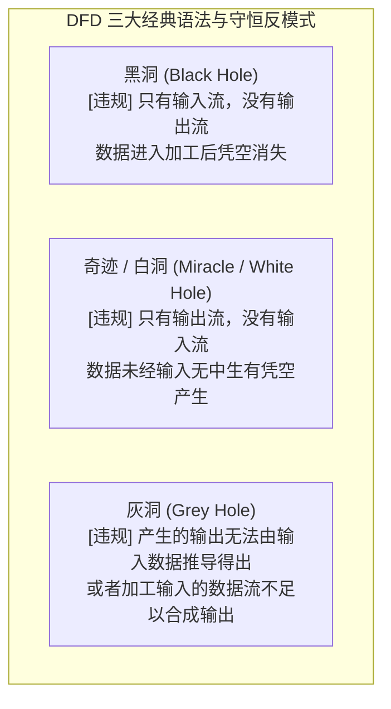

import GraphStepVisualizer from '../../../components/interactive/GraphStepVisualizer';
import StepVisualizer from '../../../components/interactive/StepVisualizer';
import QuizCard from '../../../components/interactive/QuizCard';
import { Aside } from '@astrojs/starlight/components';

> “如果用纯自然语言去描述复杂的业务规则，一千个程序员会脑补出一千种互不兼容的系统架构。需求建模就是给软件业务逻辑拍摄精准的‘X光透视图’。”

在需求工程的分析阶段，纯粹依赖自然语言撰写的文字需求往往充满了歧义性、逻辑遗漏以及边界模糊。如果产品经理写下一段话：*“当用户是金卡会员且订单满 300 元立减 50，但遇到大促日使用积分支付时，折扣按折后价计算，且特价爆款商品不参与任何满减……”*，任何工程师阅读三遍后都会头皮发麻。

**需求建模（Requirements Modeling）的核心使命，就是通过结构化、形式化或半形式化的图形符号体系，将复杂的系统行为与数据流动抽丝剥茧，穷尽所有条件分支，彻底消灭工程思维死角。**

---

## 一、需求建模两大技术流派对比

在软件工程演进史上，需求建模主要形成了两大主流流派：

| 建模维度 | 结构化分析方法 (SA - Structured Analysis) | 面向对象分析方法 (OOA - Object-Oriented Analysis) |
| :--- | :--- | :--- |
| **核心哲学** | **面向数据流**：自顶向下、功能分解、逐步求精 | **面向实体与消息**：现实世界对象封装、状态与交互 |
| **基础视角** | 系统是由一系列对数据进行变换的“加工处理”构成的 | 系统是由相互发送消息协作的“自治对象”构成的 |
| **核心图形工具** | • 数据流图 (DFD) • 实体-关系图 (ERD) • 状态转换图 (STD) • 数据字典 (DD) | • 用例图 (Use Case Diagram) • 类图 (Class Diagram) • 时序图 (Sequence Diagram) • 活动图与状态机图 |
| **适用场景** | 强数据流转、批处理管道、传统信息管理系统 (MIS) | 复杂业务交互、微服务架构、富客户端与现代企业级应用 |

<Aside type="note" title="要点说明">

**考试与工程关键辨析**：
- 实体-关系图（ERD）用于描述**静态数据结构与实体联系**，其三大核心元素为：**数据对象（实体）、属性、关系** （不含“输入/输出”）。
- 快速原型属于**获取与验证需求的工程手段**，不是面向对象的专用建模图形工具。
- 时序图（Sequence Diagram）着重表现对象之间**消息传递的时间顺序**。

</Aside>

---

## 二、数据流图 (DFD) 四大核心元素与分层分解

数据流图（Data Flow Diagram, DFD）是结构化分析的核心工具，它直观描绘了数据在系统内部的输入、变换、存储与输出全景。

### 1. DFD 的四大基本元素规范

1. **外部实体 (External Entity)**：系统边界之外的人、部门或其他外部系统，是数据的产生源（Source）或归宿（Sink）。
2. **加工/处理 (Process)**：对输入数据流执行计算、转换或校验，产出输出数据流。每个加工必须包含唯一的编号（如 `1.2`）和清晰的动宾词组（如 `验证订单`）。
3. **数据存储 (Data Store)**：系统内静态保存的数据集合（数据库表、文件、缓存等）。
4. **数据流 (Data Flow)**：带有箭头的有向线段，标明数据信息的流动方向与具体数据字典定义。

---

### 2. DFD 的分层抽象机制与父子平衡原则

对于中大型系统，不可能在一张图内画出所有细节。DFD 严格遵循**自顶向下、逐层分解**的原则：

- **0 层图（上下文关联图 / Context Diagram）**：将整个系统视为单一的“黑盒”加工，仅表现系统与所有外部实体之间的高层数据流输入与输出。
- **1 层图（顶层分解图）**：将系统黑盒拆解为 3~7 个核心子系统或主业务加工，首次引入核心数据存储。
- **2 层及底层图（加工细化图）**：针对 1 层图中复杂的加工进一步向下拆解，直到每个叶子加工的复杂度可用一段简明结构化语言（IPO 伪代码）描述为止。

<Aside type="note" title="关键原则">

**父子平衡原则 (Balance Principle)**：
子图（Level-N）的所有输入数据流与输出数据流的集合，必须与父图（Level N-1）中对应被分解加工的输入/输出数据流严格完全对应。数据不能在子图中无中生有，也不能在向下分解时凭空消失。

</Aside>

---

## 三、DFD 违规语法与三大经典反模式 (Antipatterns)

在绘制与审查 DFD 时，必须坚守**数据守恒定律**。以下三大结构性致命反模式在系统评审与专业考试中是最高频的扣分点：

### 必须杜绝的数据流动死角：
1. **外部实体直连外部实体**：$EE_1 \to EE_2$。系统对外部实体之间的直接交互完全不可知，不属于软件需求建模范畴。
2. **外部实体直连数据存储**：$EE \to DS$。数据不能在未经加工程序校验、授权或解析的情况下直接窜入数据库。
3. **数据存储直连数据存储**：$DS_1 \to DS_2$。数据库表之间不能自行传输数据，必须经过搬运或归档加工（Process）调度。

---

## 四、动态演示：DFD 分层分解与反模式侦测

下方交互画布展示了经典**图书预订系统**从 0 层关联图到 1 层精化分解的全过程。点击播放或步进，动态观察数据在外部实体、业务加工与数据存储之间的规范流转，以及系统对黑洞（Black Hole）与奇迹（Miracle）等违规模式的智能侦测与修正：

<GraphStepVisualizer
  client:visible
  title="DFD 分层分解演进与反模式（黑洞/奇迹）侦测修正确认"
  algorithmName="DFD Hierarchical Refinement & Rule Checker"
  layoutName="dagre"
  initialGraph={{
    nodes: [
      { id: 'Customer', label: '外部实体: 顾客', type: 'entity', shape: 'rectangle', bgColor: '#451a03', borderColor: '#f59e0b', textColor: '#ffffff' },
      { id: 'Publisher', label: '外部实体: 出版社', type: 'entity', shape: 'rectangle', bgColor: '#451a03', borderColor: '#f59e0b', textColor: '#ffffff' },
      { id: 'Sys0', label: '加工 0: 图书预订系统', type: 'process', shape: 'round-rectangle', bgColor: '#082f49', borderColor: '#38bdf8', textColor: '#ffffff' },
      { id: 'P1', label: '1 验证订单', type: 'process', shape: 'round-rectangle', bgColor: '#082f49', borderColor: '#38bdf8', textColor: '#ffffff' },
      { id: 'P2', label: '2 汇总订单', type: 'process', shape: 'round-rectangle', bgColor: '#082f49', borderColor: '#38bdf8', textColor: '#ffffff' },
      { id: 'D1', label: 'D1 图书目录', type: 'datastore', shape: 'barrel', bgColor: '#052e16', borderColor: '#4ade80', textColor: '#ffffff' },
      { id: 'D2', label: 'D2 合格订单库', type: 'datastore', shape: 'barrel', bgColor: '#052e16', borderColor: '#4ade80', textColor: '#ffffff' },
      { id: 'D3', label: 'D3 待发订单', type: 'datastore', shape: 'barrel', bgColor: '#052e16', borderColor: '#4ade80', textColor: '#ffffff' },
      { id: 'BlackHole', label: '加工 99: 黑洞错误', type: 'process', shape: 'round-rectangle', bgColor: '#4c0519', borderColor: '#f43f5e', textColor: '#ffffff' },
      { id: 'Miracle', label: '加工 88: 奇迹错误', type: 'process', shape: 'round-rectangle', bgColor: '#4c0519', borderColor: '#f43f5e', textColor: '#ffffff' }
    ],
    edges: [
      { id: 'e_c_s', source: 'Customer', target: 'Sys0', label: '预订申请单' },
      { id: 'e_s_p', source: 'Sys0', target: 'Publisher', label: '采购汇总单' },
      { id: 'e_c_p1', source: 'Customer', target: 'P1', label: '订单流' },
      { id: 'e_d1_p1', source: 'D1', target: 'P1', label: '核实书号库存' },
      { id: 'e_p1_d2', source: 'P1', target: 'D2', label: '合格订单' },
      { id: 'e_d2_p2', source: 'D2', target: 'P2', label: '提取订单' },
      { id: 'e_p2_pub', source: 'P2', target: 'Publisher', label: '批发出版社清单' },
      { id: 'e_p2_d3', source: 'P2', target: 'D3', label: '归档待发' },
      { id: 'e_bh', source: 'Customer', target: 'BlackHole', label: '只进不出数据流' },
      { id: 'e_mr', source: 'Miracle', target: 'Publisher', label: '无中生有数据流' }
    ]
  }}
  steps={[
    {
      title: '步骤 1: 0 层关联图 (Context Diagram)',
      description: '将图书预订系统整体视作一个加工黑盒 (加工 0)。仅展示外部顾客提交预订申请单，以及系统向外部出版社发出采购汇总单。清晰界定系统外部实体边界。',
      badge: 'Level-0 关联图',
      activeNodes: ['Customer', 'Sys0', 'Publisher'],
      activeEdges: ['e_c_s', 'e_s_p']
    },
    {
      title: '步骤 2: 1 层功能分解与数据存储引入',
      description: '将加工 0 细化分解为两个核心加工：[1 验证订单] 与 [2 汇总订单]。同时引入数据存储 [D1 图书目录] 用于校验，验证通过的存入 [D2 合格订单库]。完全遵守父子平衡。',
      badge: 'Level-1 结构分解',
      activeNodes: ['Customer', 'P1', 'D1', 'D2', 'P2', 'D3', 'Publisher'],
      activeEdges: ['e_c_p1', 'e_d1_p1', 'e_p1_d2', 'e_d2_p2', 'e_p2_pub', 'e_p2_d3']
    },
    {
      title: '步骤 3: 侦测 DFD 致命反模式（黑洞与奇迹）',
      description: '审查发现异常节点：[加工 99] 接收了输入却没有任何输出（黑洞 Black Hole）；[加工 88] 没有接收任何输入却凭空产生输出（奇迹 Miracle）。这违背了数据守恒定律！',
      badge: '语法校验报警',
      activeNodes: ['BlackHole', 'Miracle'],
      activeEdges: ['e_bh', 'e_mr']
    },
    {
      title: '步骤 4: 规范修正与守恒闭环',
      description: '彻底剥离非法的孤立加工与无源流。保证每一个加工都有明确的输入数据流、计算变换逻辑和产出数据流，全链路实现父子数据守恒闭环。',
      badge: '规范模型就绪',
      activeNodes: ['Customer', 'P1', 'D1', 'D2', 'P2', 'D3', 'Publisher'],
      activeEdges: ['e_c_p1', 'e_d1_p1', 'e_p1_d2', 'e_d2_p2', 'e_p2_pub', 'e_p2_d3']
    }
  ]}
/>

---

## 五、复杂业务逻辑判定：决策表与决策树

当业务需求中包含**大量条件组合与判断嵌套**时（例如航空公司托运行李费、电商组合满减优惠等），传统的流程图会出现大量交叉回环连线，极易漏判情况。此时必须使用**决策表 (Decision Table)** 与 **决策树 (Decision Tree)**。

### 1. 经典民航行李托运计费业务规则

某航空公司对旅客托运行李费的计算规则规定如下：
- **免费额度判定**：行李重量 $W \le 30\,\text{kg}$ 时，不论航线与舱位，一律**免费托运**；
- **超重计费标准 ($W > 30\,\text{kg}$)**：
  - **国内航线**：
    - 头等舱：残疾乘客收费 $(W-30) \times 2$ 元；正常乘客收费 $(W-30) \times 4$ 元。
    - 经济舱：残疾乘客收费 $(W-30) \times 3$ 元；正常乘客收费 $(W-30) \times 6$ 元。
  - **国际航线**：
    - 头等舱：残疾乘客收费 $(W-30) \times 4$ 元；正常乘客收费 $(W-30) \times 8$ 元。
    - 经济舱：残疾乘客收费 $(W-30) \times 6$ 元；正常乘客收费 $(W-30) \times 12$ 元。

---

### 2. 穷尽业务分支的决策表

决策表由四大象限构成：**条件桩 (Condition Stubs)**、**条件项 (Condition Entries)**、**动作桩 (Action Stubs)** 和 **动作项 (Action Entries)**。

| 条件与规则 | 规则 1 | 规则 2 | 规则 3 | 规则 4 | 规则 5 | 规则 6 | 规则 7 | 规则 8 | 规则 9 |
| :--- | :---: | :---: | :---: | :---: | :---: | :---: | :---: | :---: | :---: |
| **国内航线?** | - | T | T | T | T | F | F | F | F |
| **头等舱?** | - | T | T | F | F | T | T | F | F |
| **残疾乘客?** | - | T | F | T | F | T | F | T | F |
| **行李重量 $W \le 30\,\text{kg}$?** | **T** | F | F | F | F | F | F | F | F |
| **动作 1：免费托运** | **X** | | | | | | | | |
| **动作 2：收取 $(W-30) \times 2$ 元** | | **X** | | | | | | | |
| **动作 3：收取 $(W-30) \times 3$ 元** | | | | **X** | | | | | |
| **动作 4：收取 $(W-30) \times 4$ 元** | | | **X** | | | **X** | | | |
| **动作 5：收取 $(W-30) \times 6$ 元** | | | | | **X** | | | **X** | |
| **动作 6：收取 $(W-30) \times 8$ 元** | | | | | | | **X** | | |
| **动作 7：收取 $(W-30) \times 12$ 元** | | | | | | | | | **X** |

<Aside type="tip" title="技巧提示">

**规则合并与化简**：在规则 1 中，只要“行李重量 $W \le 30$”为真（T），无论国内还是国际、头等舱还是经济舱，全部执行免费托运。因此其他三个条件都可以记为不相关条件（`-`），由原先的 8 种分支成功合并为单条化简规则。

</Aside>

---

## 六、交互演练：行李费决策表条件向量快速匹配

利用下方交互演练器，选取不同的实际乘客乘坐场景，观察系统如何一步步评估条件桩，在决策表中定位对应规则并执行精准收费：

<StepVisualizer
  client:visible
  title="业务规则判定演练：旅客行李托运费精确求值轨迹"
  algorithmName="Decision Table Rule Evaluation"
  steps={[
    {
      title: '场景 A：国内航线 · 经济舱 · 普通乘客 · 行李 25kg',
      description: '首先判断第一核心过滤条件：行李重 W = 25kg ≤ 30kg 为真 (T)。触发规则 1（无关其他条件），直接执行动作：免费托运。',
      badge: '免收托运费',
      code: '输入向量: { 国内: T, 头等舱: F, 残疾: F, W≤30: T }\n匹配规则: Rule 1\n触发动作: 免费托运 (费用 = 0 元)'
    },
    {
      title: '场景 B：国内航线 · 经济舱 · 残疾乘客 · 行李 45kg',
      description: '行李重 45kg > 30kg (W≤30 为 F)；航线为国内 (T)；舱位为经济舱 (头等舱为 F)；残疾属性为真 (T)。精确命中规则 4。',
      badge: '规则 4 命中',
      code: '输入向量: { 国内: T, 头等舱: F, 残疾: T, W≤30: F }\n匹配规则: Rule 4\n计算公式: (45 - 30) × 3 = 15 × 3\n结算费用: 45 元'
    },
    {
      title: '场景 C：国际航线 · 头等舱 · 普通乘客 · 行李 50kg',
      description: '行李重 50kg > 30kg (F)；航线为国际 (F)；舱位为头等舱 (T)；残疾属性为假 (F)。精确命中规则 7。',
      badge: '规则 7 命中',
      code: '输入向量: { 国内: F, 头等舱: T, 残疾: F, W≤30: F }\n匹配规则: Rule 7\n计算公式: (50 - 30) × 8 = 20 × 8\n结算费用: 160 元'
    },
    {
      title: '场景 D：国际航线 · 经济舱 · 普通乘客 · 行李 40kg',
      description: '行李重 40kg > 30kg (F)；国际航线 (F)；经济舱 (F)；非残疾 (F)。命中费率最高的全额规则 9。',
      badge: '规则 9 命中',
      code: '输入向量: { 国内: F, 头等舱: F, 残疾: F, W≤30: F }\n匹配规则: Rule 9\n计算公式: (40 - 30) × 12 = 10 × 12\n结算费用: 120 元'
    }
  ]}
/>

---

## 七、随堂通关自测

<QuizCard
  client:visible
  category="第06讲 · 结构化建模核心概念"
  question="在数据流图 (DFD) 语法规则与规范审查中，下列哪一种数据流连线是完全合法且符合规范的？"
  options={[
    "外部实体 (Entity) 直接向数据存储 (Data Store) 写入原始日志记录",
    "两个数据存储 (Data Store) 之间为了实现主备同步直接建立连线",
    "外部实体 (Entity) 直接与另一个外部实体 (Entity) 进行数据传递",
    "外部实体 (Entity) 将订单数据流送入加工处理 (Process)，处理后再写入数据存储"
  ]}
  answer={3}
  explanation="正确答案是 D。DFD 中外部实体不能直接访问数据存储，不能直接连接外部实体，数据存储之间也不能直接传递数据流。所有的输入与写入都必须经由加工（Process）进行转换调度。"
/>

<QuizCard
  client:visible
  category="第06讲 · 建模工具选型与反模式"
  question="某研发团队在评审订单模块的 DFD 时，发现加工 3.2 '生成财务月结单' 没有任何输入数据流连入，却源源不断向外部财务系统输出对账报表。这种 DFD 反模式通常被称为："
  options={[
    "黑洞 (Black Hole)",
    "奇迹 / 白洞 (Miracle / White Hole)",
    "灰洞 (Grey Hole)",
    "重力陷阱 (Gravity Trap)"
  ]}
  answer={1}
  explanation="正确答案是 B。奇迹（Miracle，又称白洞）指一个加工只有输出流而没有任何输入流，违背了数据守恒原则；黑洞（Black Hole）指只有输入流没有输出流；灰洞（Grey Hole）指输出无法由输入推导得出。"
/>
