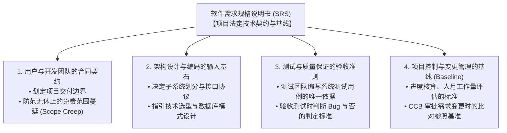
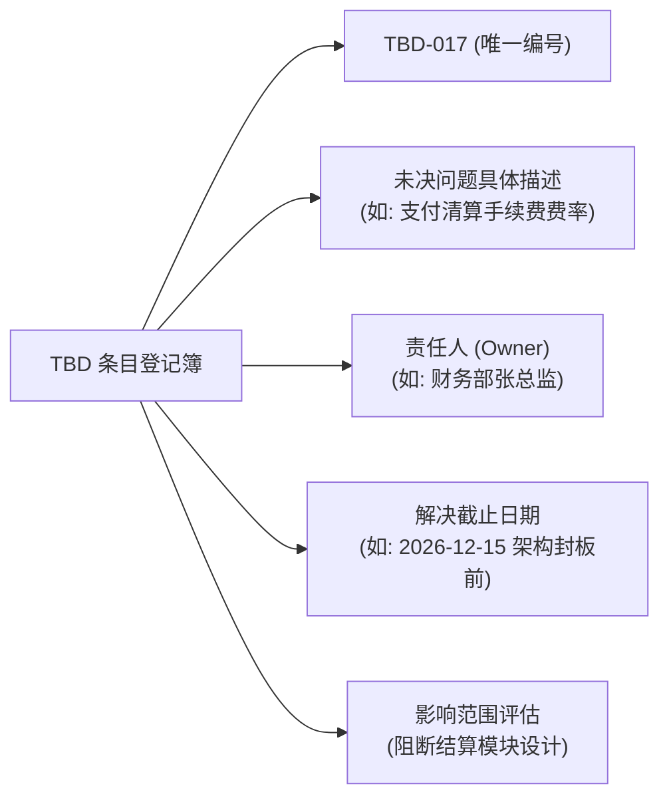

import StepVisualizer from '../../../components/interactive/StepVisualizer';
import QuizCard from '../../../components/interactive/QuizCard';
import { Aside } from '@astrojs/starlight/components';

> “口头约定是软件工程灾难的摇篮。没有落到纸面上的需求，在程序员眼里就是不存在的幻影；而含糊不清的文档，则会把一艘本该乘风破浪的远洋货轮引向触礁的暗礁区。”

在软件工程中，不管前期与客户开了多少轮融洽的座谈会、画了多少张草图，如果最终没有将其收敛沉淀为一份严谨、规范且经受双方签字确认的技术文档，所有的需求获取与分析工作都会沦为空中楼阁。

**《软件需求规格说明书》（Software Requirements Specification, SRS）正是软件开发全生命周期中法律地位最高的技术契约。** 它不仅是客户验收软件的法定准绳，更是架构师进行模块解耦、程序员编写业务逻辑、测试工程师设计系统验收用例的统一信息源。

---

## 一、SRS 在需求工程中的四大法定地位

需求文档不是一份可有可无的“形式主义报告”，它在工程协作中承担着四大不可替代的法定使命：



<Aside type="note" title="要点说明">

**开发与编写原则**：
需求文档虽然由**需求分析工程师**主笔编写，但**决不能闭门造车**。它必须由开发方与客户关键干系人联合评审、逐条推敲，最终以正式基线（Baseline）版本入库受控。

</Aside>

---

## 二、IEEE 830 标准 SRS 权威模板全景

国际电气与电子工程师协会制定的 **IEEE Std 830-1998** （以及后续演进的 ISO/IEC/IEEE 29148 标准）是全球软件界公认最权威、最经典的 SRS 组织架构模板：

```markdown
1. 引言 (Introduction)
   1.1 编写目的 (Purpose) —— 明确文档受众与创建意图
   1.2 文档约定 (Document Conventions) —— 标明字体、优先级标记规则
   1.3 预期的读者对象和阅读建议 (Intended Audience)
   1.4 项目范围 (Project Scope) —— 阐明软件产品的高层业务边界
   1.5 参考资料 (References) —— 引用的国标、行业标准与前期协议
2. 总体描述 (Overall Description)
   2.1 产品前景 (Product Perspective) —— 独立系统还是大系统的子模块
   2.2 产品特性与功能摘要 (Product Features)
   2.3 用户类及其特征 (User Classes and Characteristics)
   2.4 运行环境 (Operating Environment) —— OS、中间件、网络拓扑
   2.5 设计和实现上的约束 (Constraints) —— 法规、特定编程语言、安全协议
   2.6 假设与依赖 (Assumptions and Dependencies)
3. 系统特性 (System Features - 核心功能需求)
   3.x 系统特性 X (System Feature X)
       3.x.1 说明与优先级 (Description and Priority)
       3.x.2 激励 / 响应序列 (Stimulus / Response Sequences)
       3.x.3 功能性需求详述 (Functional Requirements)
4. 外部接口需求 (External Interface Requirements)
   4.1 用户界面 (User Interfaces) —— 屏幕规范、关键窗口流
   4.2 硬件接口 (Hardware Interfaces) —— 设备协议、串口/USB/波特率
   4.3 软件接口 (Software Interfaces) —— 第三方 API、数据库链接
   4.4 通信接口 (Communications Interfaces) —— HTTP/gRPC/报文格式
5. 其他非功能性需求 (Other Nonfunctional Requirements)
   5.1 性能需求 (Performance Requirements) —— 并发量、吞吐率、RT 阈值
   5.2 安全性需求 (Security Requirements) —— 鉴权、传输加密、越权防护
   5.3 防护性需求 (Safety Requirements) —— 灾备恢复、容灾冗余
   5.4 软件质量属性 (Quality Attributes) —— 可维护性、可测试性、可移植性
6. 其他需求 (Other Requirements)
附录 A: 术语表与缩略语 (Glossary)
附录 B: 分析模型 (Analysis Models - DFD/状态机/用例图等)
附录 C: 待确定问题的清单 (TBD List)
```

---

## 三、处理需求不完整性：TBD 待定项闭环管理

在实际复杂的工程实践中，由于外部第三方接口尚未发布、政策法规尚未落地或业务决策人在关键细节上尚未拍板，SRS 编写往往面临**信息缺失**的客观事实。

### 1. 致命错误 vs 工业规范
- **反例（致命错误）**：将不确定的内容含糊其辞一笔带过（如“后续按相关标准处理”），或者凭空捏造一个伪参数。这会导致下游开发在沙滩上建大厦，后期推倒重来的成本高达数十倍。
- **正例（工业规范）**：显式使用 **TBD（To Be Determined，待确定）** 专用工程标记，并集中录入 SRS 的**附录 C（待确定问题清单）**。

### 2. TBD 记录条目必须包含的核心元数据



<Aside type="caution" title="注意事项">

**项目里程碑硬指标**：在项目进入系统集成测试与正式发布评审之前，**SRS 中所有的 TBD 项必须全部关闭（Resolved / 销项）**。任何遗留的 TBD 项都是随时可能引爆工程进度的定时炸弹。

</Aside>

---

## 四、需求表述质量准则：良好表述 vs 糟糕表述

判断一条需求好坏的最高黄金法则是：**它是否具备可测试性（Testability）与无歧义性（Unambiguity）**。如果一条需求连测试工程师都不知道该如何编写用例去判定它是通过（Pass）还是失败（Fail），那么它就是一条劣质需求。

| 维度 | 糟糕的需求表述（模糊、主观、不可验证） | 良好的需求表述（精准、量化、可验证） |
| :--- | :--- | :--- |
| **性能指标** | “系统报表导出速度应当尽可能快，不能让用户等待太久。” | “在 500 个并发用户在线查询的峰值工况下，95% 的综合财务报表应在 2.0 秒内完成渲染导出。” |
| **易用性指标** | “系统的用户界面应当美观大方、非常友好、易于上手。” | “一名具备高中文化程度、未参加过系统培训的新仓库管理员，应能在 10 分钟内独立完成一笔入库盘点单的录入，录入错误率低于 1%。” |
| **安全性指标** | “系统应当具备银行级别的顶尖安全防护能力。” | “系统应在连续 5 次输入错误密码后锁定该账户 30 分钟；所有跨公网传输的用户凭证必须使用 TLS 1.3 协议及 AES-256 进行端到端加密。” |
| **高可用指标** | “系统应当具备极高的容错性，尽量保证不宕机。” | “核心交易网关系统的年度可用度应达到 99.99%（年度非计划停机时间累计不超过 52.6 分钟），且单次故障平均修复时间 (MTTR) 不超过 15 分钟。” |

---

## 五、交互演练：IEEE 830 标准 SRS 章节逐级合规审查

假设你是一名高级质量保证（QA）工程师或需求评审组长，正在对某医疗影像归档与传输系统（PACS）的 SRS 草稿进行逐章质量审查。跟随下方交互审查工具，体验各章节的典型缺陷诊断与合规整改过程：

<StepVisualizer
  client:visible
  title="IEEE 830 规范 SRS 章节逐级工程质量合规审查"
  algorithmName="SRS Quality Audit Inspector"
  steps={[
    {
      title: '第 1 阶段：审查《第 1 章 · 引言》与《第 2 章 · 总体描述》',
      description: '检查项目范围是否与商业构想吻合，用户类细分是否清晰。发现草案缺少对设计硬约束（如国家放射影像数据存储安全法规）的显式陈述。',
      badge: '章节 1-2 范围与约束审查',
      code: '【审计发现】: 2.5 节缺失医疗影像行业强制合规标准。\n【整改建议】: 显式补全 DICOM 3.0 通信协议兼容性约束，以及国家三级等保要求。\n【合规状态】: 已修正补全。'
    },
    {
      title: '第 2 阶段：审查《第 3 章 · 系统特性与功能需求》',
      description: '审查核心功能特性。发现某特性写有“系统智能推荐病灶区域”，缺乏触发激励与响应序列，没有定义假阳性率容差。',
      badge: '章节 3 核心功能契约审查',
      code: '【审计发现】: 功能描述过于粗糙，未给出输入、校验前置条件与异常响应。\n【整改建议】: 拆解为 3.2.1 激励/响应流，补充未识别格式影像的异常分支处理。\n【合规状态】: 补充完整刺激/响应状态序列。'
    },
    {
      title: '第 3 阶段：审查《第 4 章 · 外部接口需求》',
      description: '全面核对四类外部接口：用户界面 (UI)、硬件接口、软件接口与通信接口。审查发现硬件接口缺失 CT 机串口通讯波特率与数据帧校验规则。',
      badge: '章节 4 四维接口审查',
      code: '【审计发现】: 4.2 硬件接口仅写“通过串口连接扫描仪”。\n【整改建议】: 明确波特率 (115200 bps)、数据位 (8)、停止位 (1) 及 CRC-16 校验码规则。\n【合规状态】: 接口定义达硬件工程可实施标准。'
    },
    {
      title: '第 4 阶段：审查《第 5 章 · 非功能与质量属性需求》',
      description: '排查是否存在“速度快、界面友好”等无量化假大空词汇。强制将所有质量属性转化为可量化测试验收的技术指标。',
      badge: '章节 5 质量指标量化审查',
      code: '【审计发现】: 出现“系统检索历史影像应迅速”的主观描述。\n【整改建议】: 修正为“对于 200MB 以内的标准 DICOM 影像，局域网加载响应时间 ≤ 1.5s”。\n【合规状态】: 满足验收测试用例可编写准则。'
    },
    {
      title: '第 5 阶段：审查《附录 C · TBD 未决问题清单》',
      description: '盘点当前所有阻断性未决项。清单中有 2 项由于第三方医保结算平台 API 尚未发布标记为 TBD。确认责任人与锁定交付截止时间。',
      badge: '附录 C TBD 风险销项管控',
      code: '【TBD-001】: 医保实时划扣加密卡算法 | 责任人: 研发李工 | 截止: 2026-12-20\n【TBD-002】: 跨院会诊视频流压缩标准 | 责任人: 产品王经 | 截止: 2026-12-10\n【合规状态】: 责任人与截止时间均已在项目看板中挂牌督办。'
    }
  ]}
/>

---

## 六、随堂通关自测

<QuizCard
  client:visible
  category="第07讲 · 需求工程交付物规范"
  question="在软件需求工程生命周期中，需求开发工作最终形成并作为开发、测试与验收唯一法定技术依据的成果是："
  options={[
    "可行性分析报告 (Feasibility Study Report)",
    "软件需求规格说明书 (SRS)",
    "软件体系结构设计说明书 (SDD)",
    "项目实施进度计划表 (Project Schedule)"
  ]}
  answer={1}
  explanation="正确答案是 B。需求开发的四大活动（获取、分析、编写文档、验证）最终形成的正式法定技术成果就是《软件需求规格说明书》（SRS）。它是后续设计、编码、测试和验收的核心基线。"
/>

<div style="margin-top: 1.5rem;"></div>

<QuizCard
  client:visible
  category="第07讲 · 需求编制管理机制"
  question="在编制软件需求规格说明书 (SRS) 过程中，针对因外部客观条件受限暂时无法确定细节的需求条目，工程界公认的标准管理标记是："
  options={[
    "DFD (Data Flow Diagram)",
    "CCB (Change Control Board)",
    "TBD (To Be Determined)",
    "UML (Unified Modeling Language)"
  ]}
  answer={2}
  explanation="正确答案是 C。TBD（To Be Determined，待确定）是 SRS 中用于显式标注暂时无法确定的需求细节并集中管理的标志。必须记录编号、描述、责任人和解决截止日期，并在项目封板前清零销项。"
/>
