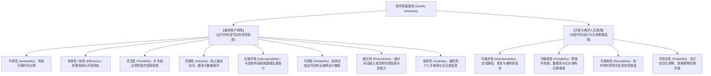
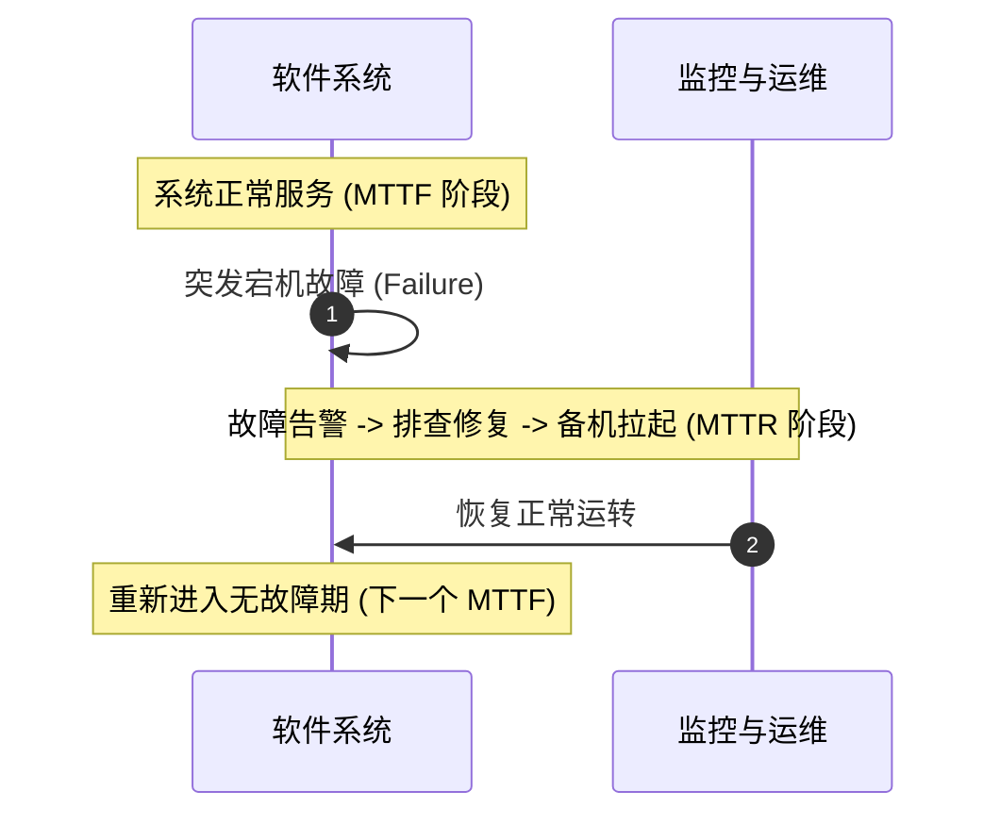

import StepVisualizer from '../../../components/interactive/StepVisualizer';
import QuizCard from '../../../components/interactive/QuizCard';
import { Aside } from '@astrojs/starlight/components';

> “制造一辆汽车，你既希望它车身轻如鸿毛、零百加速 2 秒（极致性能），又希望它拥有重型装甲、能抗火箭弹袭击（绝对安全），还希望它百公里油耗仅 2 升、售价不超过 5 万元（经济性）。任何有工程常识的工程师都会告诉你：这在物理上是不可能的。软件工程同样充满了这种‘既要、又要、还要’的天然矛盾。”

在软件工程中，初级工程师往往只关注“功能（Functionality）”——系统能否正确计算、能否下单、能否打印报表。然而，**决定一个软件系统成败、决定架构选型与硬件成本的关键，往往是非功能需求中的“质量属性（Quality Attributes）”。**

没有绝对完美的架构，只有最科学的**权衡与折中（Trade-off）**。需求工程师的核心智慧，绝不是无原则地向客户许诺所有指标全部达到最优，而是在物理规律与资源约束下做出理性的工程取舍。

---

## 一、软件质量属性的两大观察视角

软件质量属性属于非功能需求的核心子集。业界公认（基于 McCall、Boehm 以及 ISO/IEC 25010 模型）将其划分为两大观察视角：

<Aside type="note" title="关键原则">

**考试与工程关键辨析**：
1. **有效性 (Efficiency)**：用来衡量系统在利用**处理器的处理能力、磁盘空间、内存或网络通信带宽**等物理硬件资源方面的表现。
2. **质量属性绝不是功能需求的一部分**！功能需求定义的是“系统必须做什么（What）”，而质量属性定义的是“系统以何种品质运行（How well）”。两者地位平起平坐，质量属性对系统架构（Architecture）起着决定性作用。

</Aside>

---

## 二、可用性 (Availability) 与可靠性数学建模

在众多质量属性中，**可用性**是企业级分布式系统最核心的硬指标（即业界常说的“几个 9”）：

### 1. 经典数学定义公式

$$\text{Availability} = \frac{\text{MTTF}}{\text{MTTF} + \text{MTTR}} \times 100\%$$

- **MTTF (Mean Time To Failure，平均无故障时间)**：系统从正常启动到发生下一次故障的平均运行时间跨度（衡量**可靠性**）。
- **MTTR (Mean Time To Repair，平均故障修复时间)**：从系统崩溃发生，到排障、重启或主备切换恢复正常服务所耗费的平均时间。
- **MTBF (Mean Time Between Failures，平均故障间隔时间)**：$\text{MTBF} = \text{MTTF} + \text{MTTR}$。

### 2. 提升可用性的两大工程途径
由公式可知，要使可用度无限逼近 $100\%$，只有两个工程抓手：
1. **极大化 MTTF**：通过提高代码质量、严格单元测试、消除内存泄漏，让系统尽可能久地不发生故障；
2. **极小化 MTTR**：通过双机热备（Hot-standby）、Kubernetes 容器存活探针健康检查、自动故障转移（Failover）技术，将故障修复时间从小时级压缩到秒级。

---

## 三、关键模型：质量属性冲突折中矩阵 (Trade-off Matrix)

不同质量属性之间存在天然的**相互促进（正相关 `+`）** 或**相互制约冲突（负相关 `-`）**。软件工程中著名的折中矩阵如下所示：

| 质量属性 | 可用性 | 有效性 | 灵活性 | 完整性 | 互操作性 | 可维护性 | 可移植性 | 可靠性 | 可重用性 | 健壮性 | 可测试性 | 易用性 |
| :--- | :---: | :---: | :---: | :---: | :---: | :---: | :---: | :---: | :---: | :---: | :---: | :---: |
| **可用性** | | | | | | **+** | | **+** | | **+** | | |
| **有效性(效率)** | | | **-** | **-** | **-** | **-** | **-** | | **-** | | **-** | |
| **灵活性** | | **-** | | | **+** | **+** | **+** | | **+** | | | |
| **完整性(安全)** | | **-** | | | | | | **+** | | | | **-** |
| **互操作性** | | **-** | **+** | | | **+** | **+** | | **+** | | | |
| **可维护性** | **+** | **-** | **+** | | **+** | | **+** | **+** | **+** | | **+** | |
| **可移植性** | | **-** | **+** | | **+** | **+** | | | **+** | | | |
| **可靠性** | **+** | | | **+** | | **+** | | | | **+** | **+** | |
| **可重用性** | | **-** | **+** | | **+** | **+** | **+** | | | | | |
| **健壮性** | **+** | | | | | | | **+** | | | | |
| **可测试性** | | **-** | | | | **+** | | **+** | | | | |
| **易用性** | | | | **-** | | | | | | | | |

---

### 经典负相关冲突（Negative Conflicts）深度剖析

#### 冲突 1：有效性（效率/性能） vs 可维护性 & 可移植性
- **矛盾机制**：为了榨干服务器的极限计算性能，工程师往往会绕过高级语言抽象层，采用特定 CPU 指令集手写 SIMD 汇编、使用特定操作系统的异步底层 API（如 Linux epoll）。
- **折中代价**：性能提升了 $40\%$，但一旦需要将系统迁移到 ARM 芯片或 Windows 服务器上时，底层代码必须全部重写，且后续接手维护的工程师难以读懂。

#### 冲突 2：完整性（安全性） vs 易用性
- **矛盾机制**：为了确保数据完整性与防止黑客撞库，安全团队强制要求用户使用包含大小写字母、数字和特殊符号的 16 位密码，且每次登录必须输入短信验证码与 Google Authenticator 动态口令，超过 5 分钟无操作自动锁屏。
- **折中代价**：安全性提升到了银行级，但普通用户的操作摩擦力与挫败感剧增，极度损害了人机交互体验与易用性。

---

## 四、交互演练：四大典型架构质量属性权衡实战

跟随下方交互推演，深入分析工业界真实系统中 4 个最具代表性的质量属性冲突，体验架构师是如何通过精妙的技术折中化解矛盾的：

<StepVisualizer
  client:visible
  title="工业级软件架构质量属性冲突识别与工程折中推导"
  algorithmName="Architectural Trade-off Analyzer"
  steps={[
    {
      title: '场景 1：证券超低时延高频交易网关 (有效性 vs 可移植性)',
      description: '证券撮合系统要求订单穿透延迟 < 5 微秒。面临选择：采用纯 Java 跨平台方案，还是特定 Linux 内核绑核、用户态网络栈 (DPDK) 与 C++ 编写？',
      badge: '有效性压倒可移植性',
      code: '【冲突矩阵】: 有效性 (-) vs 可维护性/可移植性 (-)\n【折中决议】: 放弃 Windows/macOS 移植性，绑定 Linux x86 裸金属服务器，全链路无锁环形队列。\n【架构结论】: 核心链路牺牲可移植性，换取绝对超低时延与高并发吞吐。'
    },
    {
      title: '场景 2：跨国电商收银台结账流程 (安全性/完整性 vs 易用性)',
      description: '风控要求对每一笔交易进行多因子生物识别与人脸认证；市场部要求“一键无感免密闪付”以降低购物车放弃率。',
      badge: '分级动态防御折中',
      code: '【冲突矩阵】: 完整性/安全性 (-) vs 易用性 (-)\n【折中决议】: 引入动态风险评分引擎。对日常小额 (< 200元) 在可信设备上开启一键免密，对异地、大额交易触发 2FA 强校验。\n【架构结论】: 兼顾 90% 场景的极高易用性，守住 10% 高危交易的绝对安全性。'
    },
    {
      title: '场景 3：金融分布式账本记账引擎 (可用性 vs 硬件投入成本)',
      description: '用户要求可用性达到 99.999%（年度宕机时间 < 5 分钟），但初创团队服务器硬件采购预算仅有 30 万元。',
      badge: 'MTTR 优先于高昂冗余',
      code: '【冲突矩阵】: 可用性 (+) vs 研发与硬件成本 (-)\n【折中决议】: 放弃昂贵的三地五中心物理裸机机房；采用云原生双可用区部署 + Raft 自动选主，将 MTTR 压缩至 10 秒以内。\n【架构结论】: 依靠软件层快速自愈（极低 MTTR）达成 99.99% 可用性，规避天价硬件浪费。'
    },
    {
      title: '场景 4：多租户企业级 SaaS 数据持久层 (灵活性 vs 有效性)',
      description: '不同企业客户需要自定义个性化业务字段（要求极高灵活性）；同时全表汇总报表统计又要求毫秒级返回（要求极高有效性）。',
      badge: '读写分离与宽表索引',
      code: '【冲突矩阵】: 灵活性 (+) vs 有效性 (-)\n【折中决议】: 事务写模型使用 JSONB 动态列支持任意租户扩展字段；通过 CDC 异步管道将数据扁平化同步至 ClickHouse 宽表加速分析。\n【架构结论】: 写入链路拥抱灵活性，报表链路通过架构解耦保障查询有效性。'
    }
  ]}
/>

---

## 五、随堂通关自测

<QuizCard
  client:visible
  category="第08讲 · 质量属性概念辨析"
  question="在软件工程的质量属性评估中，用来度量系统在利用 CPU 运算能力、内存占用、物理磁盘存储空间以及网络通信带宽方面表现的属性是："
  options={[
    "互操作性 (Interoperability)",
    "灵活性 (Flexibility)",
    "有效性 / 效率 (Efficiency)",
    "可靠性 (Reliability)"
  ]}
  answer={2}
  explanation="正确答案是 C。有效性（Efficiency，又称效率或性能）专门指软件系统在完成指定任务时对物理计算资源（CPU、内存、I/O、网络带宽）的利用率与响应消耗表现。"
/>

<QuizCard
  client:visible
  category="第08讲 · 架构折中冲突矩阵"
  question="根据软件质量属性冲突矩阵 (Trade-off Matrix)，下列哪一对质量属性之间存在最典型的负相关制约（冲突）关系？"
  options={[
    "可用性 (Availability) 与 可靠性 (Reliability)",
    "可维护性 (Maintainability) 与 可测试性 (Testability)",
    "有效性 / 极致性能 (Efficiency) 与 可移植性 (Portability)",
    "健壮性 (Robustness) 与 可用性 (Availability)"
  ]}
  answer={2}
  explanation="正确答案是 C。追求极致性能（有效性）往往需要针对特定底层硬件平台深度定制甚至使用特定指令集汇编，这会严重破坏跨平台的抽象分层，导致可移植性暴跌，两者为经典负相关冲突。"
/>
