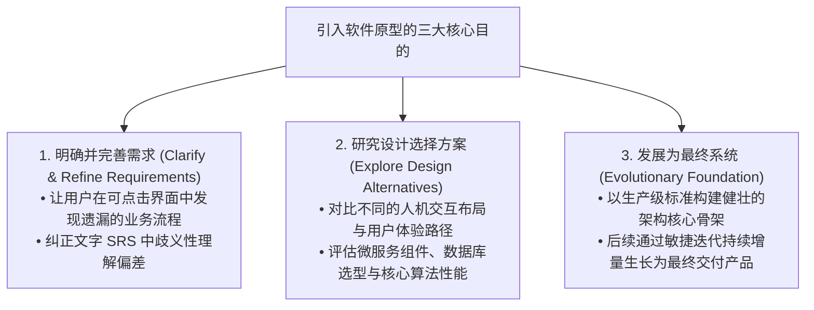
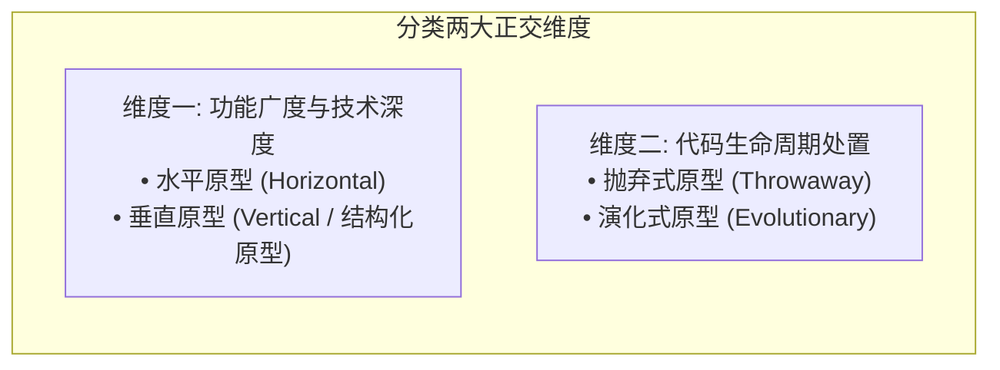
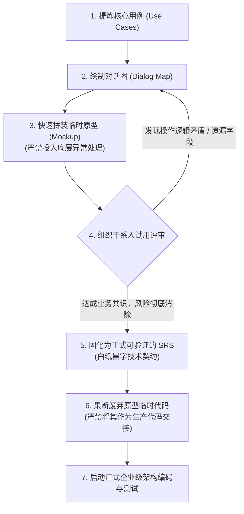

import StepVisualizer from '../../../components/interactive/StepVisualizer';
import QuizCard from '../../../components/interactive/QuizCard';
import { Aside } from '@astrojs/starlight/components';

> “当你定制一套昂贵的高级西装时，经验丰富的老裁缝绝不会拿起昂贵的顶级羊绒面料直接下剪刀。他会先用极其廉价的粗棉白坯布剪裁出一套‘样衣（Muslin Prototype）’让你试穿，在你身上用大头针收腰、别袖口、调整领型；只有当试穿完全贴合身形后，他才会胸有成竹地裁剪真正的面料。在需求工程中，原型就是那件消除不可逆风险的‘白坯布试版样衣’。”

在软件工程中，“需求不确定性”是吞噬项目预算和交付周期的头号杀手。客户往往处于“在亲眼看到运行效果之前，我也不知道我到底想要什么（IKIWISI - I'll Know It When I See It）”的认知困境中。如果团队直接按照模糊的口头描述进行数月的全栈编码，最终交付的成果大概率与客户真实期望大相径庭。

**软件原型化（Software Prototyping）的核心哲学，就是用极小的前期成本，提前引爆并消除技术架构与业务理解中的不确定性风险。**

---

## 一、软件原型的三大主要目的

在需求分析与系统设计阶段，引入软件原型主要服务于三大核心工程目标：

<Aside type="note" title="要点说明">

**重要考试原题考点**：
软件需求分析中使用原型的 3 个主要目的是：**明确并完善需求**、**研究设计选择方案** 和 **发展为最终系统** （严禁误选“表达系统所有需求”或“为系统做市场宣传”）。

</Aside>

---

## 二、原型的双维度分类体系与 2×2 四象限矩阵

软件原型并非千篇一律，业界根据**功能覆盖的深度/广度**以及**代码的生命周期处置方式**两个正交维度，构建了清晰的分类矩阵：

### 1. 水平原型 vs 垂直原型（结构化原型）
- **水平原型 (Horizontal Prototype)**：
  - **特征**：**广度大、深度浅**。类似电影制片厂的“布景墙”或“UI 门面”。
  - **实现**：它展示了用户界面的屏幕外观、菜单导航树和输入表单，但**底层不连接真实数据库，也不执行复杂的业务计算与数据持久化**。
  - **核心价值**：帮助用户理清业务操作流程，验证界面的直观性与可用性。
- **垂直原型 (Vertical Prototype / 结构化原型)**：
  - **特征**：**广度极窄、深度极深**。类似地质勘探的“钻井穿透探针”。
  - **实现**：仅挑选系统中最具技术风险的单个关键特性（如分布式实时并发锁、自研视频解压算法），**从用户界面一直穿透到数据访问层、操作系统内核甚至物理硬件接口**。
  - **核心价值**：技术概念验证（Proof of Concept, PoC），评估数据库性能、检验定时吞吐延迟瓶颈。

---

### 2. 四象限选型矩阵全景对比

| 原型象限分类 | 抛弃式原型 (Throwaway Prototype) | 演化式原型 (Evolutionary Prototype) |
| :--- | :--- | :--- |
| **水平原型 (Horizontal)** *侧重用户交互与界面* | **【象限 I：UI 临时交互样稿】** • 纸质草图或 Figma 快速点击 Mockup • 验证复杂表单流与弹窗交互 • 需求共识达成后**彻底丢弃，重新按规范编码** | **【象限 III：渐进式前端骨架】** • 依据设计规范库编写的高保真前端代码 • 首期交付高频交互核心界面 • 随着用户反馈持续增量迭代前端组件 |
| **垂直原型 (Vertical)** *侧重核心算法与架构* | **【象限 II：技术概念验证 (PoC)】** • 写临时脚本评估第三方加密卡或自研算法 • 验证高并发极限吞吐指标 • 探明技术可行性后**丢弃草稿代码，重构标准接口** | **【象限 IV：高可用核心架构基石】** • 率先搭建分布式通信框架、事务控制与缓存底座 • 每一行代码必须遵循最高单元测试与安全标准 • 作为后续所有业务模块持续生长的稳固底座 |

---

## 三、抛弃式原型生命周期闭环流程

对于大多数探索性项目，**抛弃式水平原型**是最具性价比的风险控制工具。其规范生命周期包含六大严密步骤：

<Aside type="danger" title="高危陷阱">

**抛弃式原型的一大死穴：抵制客户的“错觉陷阱”！**
当客户在会议室看到一个界面极其华丽、点击按钮能弹窗展示数据的抛弃式水平原型时，往往会产生极其危险的错觉：*“这软件看起来都已经做完了 90%，下个星期你们就能上线了吧？！”*
工程师必须清醒认识并向客户明确：**这只是没有地基、没有钢筋水泥的舞台布景**。底层的数据一致性保障、并发事务控制、权限越权拦截、异常容灾处理等占工程量 85% 以上的核心工作根本尚未展开。

</Aside>

---

## 四、建立有效原型的四大黄金工程纪律

1. **原型绝不能完全替代 SRS**：
   原型长于表达视觉布局与动态流程，但**极其拙劣于表达非功能需求（性能阈值、并发负载指标、通信加密协议规范）以及极其复杂的异常分支与安全防御规则**。原型必须与规范的 SRS 相互补充，缺一不可。
2. **在项目计划中显式包括创建原型的任务**：
   制作原型需要耗费工时。项目经理必须在甘特图与 WBS 中为其分配专有工期与资源，明确定义原型的目标范围与完成标志（退出准则）。
3. **在原型展示中使用看似真实的示例数据**：
   严禁用 `test1`、`aaa`、`111` 等无意义垃圾占位符填满界面。真实感强烈的业务数据（如真实的药品名称、患者年龄、ICD 诊断编码）能瞬间唤起用户的业务常识，帮助其发现真实边界问题。
4. **制作原型前必须书面陈述每个原型的具体用途**：
   明确本次原型到底是用来验证交互布局，还是用来检验算法耗时。防止原型开发在无休止的边角修饰中迷失方向（Scope Creep）。

---

## 五、交互演练：四象限原型工程选型导航

下方交互演练器展示了在实际项目面临不同未知风险时，工程师如何精准决策原型类型，并跟踪其工程实施路径：

<StepVisualizer
  client:visible
  title="软件需求风险消减：四象限原型选型决策与生命周期推演"
  algorithmName="Prototyping Strategy Navigator"
  steps={[
    {
      title: '场景 A：象限 I · 抛弃式水平原型 (Throwaway Horizontal)',
      description: '【项目背景】: 医院电子病历录入系统。医生抱怨原有文字需求无法看懂病程记录排版。\n【技术选型】: 使用 Figma 快速搭建 5 个核心界面的可交互跳转草案，底层使用 Mock JSON 数据。\n【生命周期】: 邀请 3 位主任医师试用 30 分钟，发现遗漏“危急值弹窗预警”流程。补充进 SRS 后果断删除 Figma 原型工程文件。',
      badge: '象限 I · 交互探明即弃',
      code: '原型类型: 抛弃式水平原型 (UI Mockup)\n关注焦点: 用户体验、界面导航流、表单字段穷尽\n代码处置: 需求写入 SRS 后彻底丢弃临时代码\n风险消除: 杜绝交互逻辑返工'
    },
    {
      title: '场景 B：象限 II · 抛弃式垂直原型 (Throwaway Vertical)',
      description: '【项目背景】: 工业物联网网关，每秒需接入 20,000 台传感器振动数据。\n【技术选型】: 编写单机 C++ 脚本测试底层 epoll 与 RingBuffer 内存池的吞吐极限与 CPU 满载率。\n【生命周期】: 验证出单节点吞吐可达 35,000 TPS，证明物理硬件可行。随后丢弃脚本，设计企业级微服务标准接口。',
      badge: '象限 II · 技术概念验证 (PoC)',
      code: '原型类型: 抛弃式垂直原型 (PoC / 结构化原型)\n关注焦点: 算法极限、网络 I/O 吞吐、硬件瓶颈\n代码处置: 探明技术可行性后弃置临时脚本\n风险消除: 规避系统架构选型倾覆'
    },
    {
      title: '场景 C：象限 III · 演化式水平原型 (Evolutionary Horizontal)',
      description: '【项目背景】: 某创新敏捷出海电商产品，商业模式快速试错。\n【技术选型】: 依据 Ant Design 工业规范库编写首批标准 React 前端组件骨架，优先上线主流程。\n【生命周期】: 每一行前端组件代码均包含严格单元测试与样式隔离，作为首发 MVP 随后续双周迭代逐步演进。',
      badge: '象限 III · 渐进式前端骨架',
      code: '原型类型: 演化式水平原型\n关注焦点: 模块化前端架构、快速交付用户价值\n代码处置: 每一行代码均达到生产交付标准\n风险消除: 降低商业模式验证门槛'
    },
    {
      title: '场景 D：象限 IV · 演化式垂直原型 (Evolutionary Vertical)',
      description: '【项目背景】: 银行新一代高可用分布式核心记账引擎。\n【技术选型】: 率先编写端到端贯穿“网关-鉴权-Raft一致性-多副本落盘”的全链路极简高标核心骨架。\n【生命周期】: 在全链路压测与故障注入无误后，后续所有 50+ 个微服务业务模块均在此坚固骨架上逐步扩展接入。',
      badge: '象限 IV · 高可用基石架构',
      code: '原型类型: 演化式垂直原型\n关注焦点: 系统底座健壮性、全链路事务穿透\n代码处置: 核心底座系统，长期生产演进基石\n风险消除: 根除大型分布式系统解体风险'
    }
  ]}
/>

---

## 六、随堂通关自测

<QuizCard
  client:visible
  category="第09讲 · 原型核心目的"
  question="在软件工程需求分析阶段，引入软件原型的 3 个主要目的是：明确并完善需求、研究设计选择方案以及："
  options={[
    "为所要开发的系统做市场宣传与招商引资",
    "完全代替《软件需求规格说明书》(SRS)",
    "发展为最终系统 (Evolutionary Foundation)",
    "向客户证明项目已经完成了绝大部分编码工作量"
  ]}
  answer={2}
  explanation="正确答案是 C。原型的三大主要目的为：明确并完善需求、研究设计选择方案、发展为最终系统。原型绝不能完全替代 SRS，更不是为了做市场宣传或虚夸工程进度。"
/>

<QuizCard
  client:visible
  category="第09讲 · 原型分类与选型"
  question="某研发团队计划重构底层数据库架构，并需要评估自研高并发缓存淘汰算法对极端时延指标的影响。根据原型分类体系，该团队最应该开发一个："
  options={[
    "水平原型 (Horizontal Prototype)",
    "抛弃式水平原型 (Throwaway UI Mockup)",
    "垂直原型 (Vertical Prototype / 结构化原型)",
    "纸质草图原型 (Paper Prototype)"
  ]}
  answer={2}
  explanation="正确答案是 C。垂直原型（又称结构化原型）穿透系统的多个层次，专门用来优化核心算法、评估所提议的系统架构或测试关键的定时与吞吐需求。"
/>
