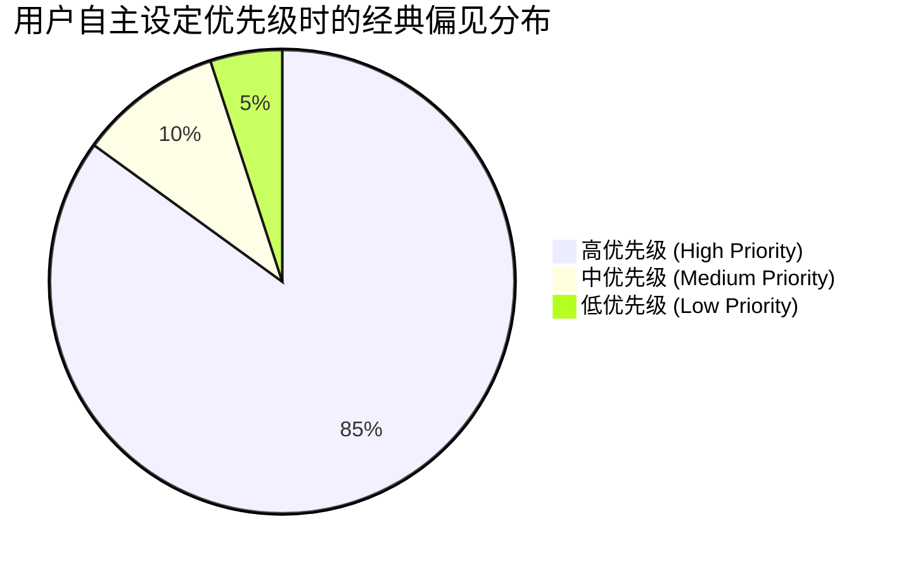
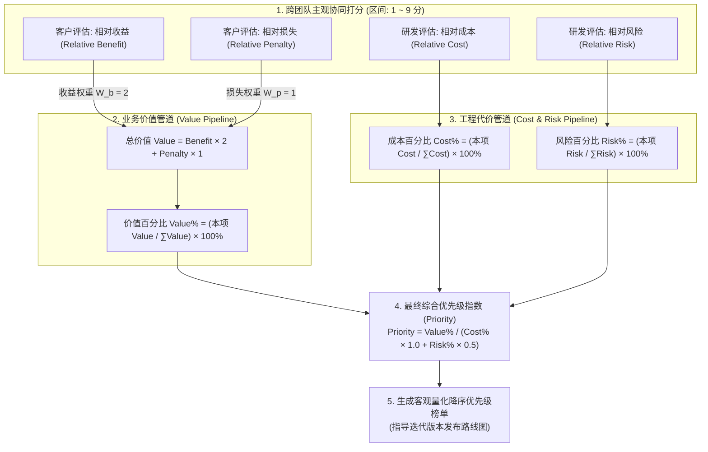

import StepVisualizer from '../../../components/interactive/StepVisualizer';
import QuizCard from '../../../components/interactive/QuizCard';
import { Aside } from '@astrojs/starlight/components';

> “如果一艘泰坦尼克号正在下沉，而救生艇的荷载名额极其有限，船长绝不能对所有乘客说‘每个人都拥有同等最高登艇优先级’。在软件工程中，时间、预算与研发人月永远是有限的硬约束。如果所有需求都被标为‘最高优先级’，那就意味着没有任何需求拥有真正的优先级。”

在真实的软件工程实践中，客户与业务干系人总是倾向于提出成百上千条诱人的功能需求。然而，**试图在一个交付版本中实现所有特性的项目，几乎无一例外走向延期交付、预算爆表甚至项目崩溃的深渊。**

项目必须学会**在约束下生存**。通过科学、客观、多方协同的优先级评定技术，团队才能合理切分迭代演进路线图，率先交付投资回报率（ROI）最高的软件核心价值。

---

## 一、为什么需要优先级？85-10-5 用户自评陷阱

软件项目必须评定优先级的根本原因在于**资源的强约束性**：
1. **控制范围蔓延**：在开发初期确立防线，防止无价值的边缘特性稀释核心资源；
2. **支撑敏捷增量交付**：先交付 MVP 核心版本抢占市场先机，后续分批次迭代演进；
3. **平衡客户期待与工程代价**：让业务方与研发方在透明的规则下协商谈判。

<Aside type="caution" title="注意事项">

**软件工程著名的“85-10-5 陷阱”**：
行业统计数据表明：如果完全由客户或业务部门**自主不受约束地设定优先级**，他们通常会将 **85%** 的需求毫无节制地设定为“高优先级”（声称“每一个功能都必不可少”），仅有约 **10%** 标为中等，只有 **5%** 愿意标为低优先级。
这种“通货膨胀”式的定级会导致优先级机制彻底失效。因此，需求工程必须引入严谨的**结构化与半定量评估技术**。

</Aside>

---

## 二、业界常见优先级评定技术全景

| 评定方法 | 评估机制 | 优势与局限性 |
| :--- | :--- | :--- |
| **入选与落选 (In or Out)** | 相关人员共同审查需求清单，进行二分决策：本版本做（In）还是不做（Out）。 | 最直观、耗时最短；但缺乏粒度细分，无法应对阶段性资源压缩。 |
| **两两比较并排序 (Pairwise)** | 对 $N$ 个需求两两逐对比较重要性，最终统计每个需求的胜出总次数进行降序排序。 | 精准度高，杜绝并列平局；但复杂度为 $O(N^2)$，需求超过 20 条时比较次数爆炸。 |
| **三层分级法 (Three-Level)** | 结合“重要性（Importance）”与“紧迫性（Urgency）”将需求划分为：高、中、低三层。 | 简单易行、易于达成共识；但容易滋生上述 85% 高优先级的泛滥膨胀。 |
| **MoSCoW 排序法** | 分为四类：**M**ust have（必须有）、**S**hould have（应该有）、**C**ould have（可以有）、**W**on't have（本次不做）。 | 敏捷开发通用，明确了放弃边界；但四类边界定义依赖主观经验。 |
| **Karl Wiegers 定量模型** | **业务价值 vs 工程代价矩阵量化法**：综合相对收益、相对损失、成本与风险四维公式精确计算。 | **工业界公认最客观科学**，兼顾商业价值与研发代价，给出唯一量化分值。 |

---

## 三、Karl Wiegers 优先级量化评估模型深度推导

软件需求工程大师 Karl Wiegers 提出的半定量优先级模型，彻底打破了由单一角色拍脑袋定级的弊端，通过**业务与研发两权分立、协同打分**构建了平衡机制。

### 1. 核心数学公式推导

#### 步骤一：计算单项特性的总价值 (Total Value)
客户主导评估**实现带来的收益（Benefit）** 与**未实现导致的惩罚损失（Penalty）**：
$$\text{Value}_i = \text{Benefit}_i \times W_{\text{benefit}} + \text{Penalty}_i \times W_{\text{penalty}}$$
*工业界标准推荐权重：收益权重 $W_{\text{benefit}} = 2$，损失权重 $W_{\text{penalty}} = 1$。*

#### 步骤二：归一化计算百分比占比 (Value%, Cost%, Risk%)
将所有候选特性的绝对打分映射为全集中的百分比分布：
$$\text{Value\%}_i = \frac{\text{Value}_i}{\sum_{k=1}^N \text{Value}_k} \times 100\%$$
$$\text{Cost\%}_i = \frac{\text{Cost}_i}{\sum_{k=1}^N \text{Cost}_k} \times 100\%,\quad \text{Risk\%}_i = \frac{\text{Risk}_i}{\sum_{k=1}^N \text{Risk}_k} \times 100\%$$

#### 步骤三：计算综合优先级指数 (Priority Score)
将业务价值百分比除以综合工程代价（成本占比与风险占比的加权和）：
$$\text{Priority}_i = \frac{\text{Value\%}_i}{\text{Cost\%}_i \times W_{\text{cost}} + \text{Risk\%}_i \times W_{\text{risk}}}$$
*工业界推荐代价权重：成本权重 $W_{\text{cost}} = 1.0$，技术风险权重 $W_{\text{risk}} = 0.5$。*

---

## 四、经典工程实战：化学品管理系统 10 项特性实测推演

下表为 Karl Wiegers 在其实际主导的化学品追踪管理系统（Chemical Tracking System）中实测的 10 项核心功能优先级推导全表：

| 序号 | 需求特性名称 (Feature) | 相对收益 (W=2) | 相对损失 (W=1) | 总价值 (Value) | 价值% (Value%) | 相对成本 (W=1) | 成本% (Cost%) | 相对风险 (W=0.5) | 风险% (Risk%) | 综合优先级 (Priority) | 最终排名 |
| :---: | :--- | :---: | :---: | :---: | :---: | :---: | :---: | :---: | :---: | :---: | :---: |
| 1 | **打印物料安全表 (MSDS)** | 2 | 4 | **8** | 5.2% | 1 | 2.4% | 1 | 3.0% | **1.22** | **1** |
| 2 | **查询供应商订单状态** | 5 | 3 | **13** | 8.4% | 2 | 5.4% | 1 | 3.0% | **1.21** | **2** |
| 3 | **生成化学品库存报表** | 7 | 7 | **21** | 13.5% | 3 | 9.1% | 3 | 9.1% | **0.89** | **3** |
| 4 | **查看化学品容器记录** | 6 | 5 | **17** | 11.0% | 3 | 8.1% | 2 | 6.1% | **0.87** | **4** |
| 5 | **搜索特定危化品供应商** | 9 | 8 | **26** | 16.8% | 3 | 8.1% | 8 | 24.2% | **0.83** | **5** |
| 6 | **维护危化品清单** | 3 | 9 | **15** | 9.1% | 3 | 8.1% | 4 | 12.1% | **0.68** | **6** |
| 7 | **修改挂起前化学品申请** | 4 | 3 | **11** | 7.1% | 4 | 8.1% | 2 | 6.1% | **0.64** | **7** |
| 8 | **生成实验室存货报表** | 6 | 2 | **14** | 9.0% | 4 | 10.8% | 3 | 9.1% | **0.59** | **8** |
| 9 | **检查培训数据库记录** | 3 | 4 | **10** | 6.5% | 9 | 10.8% | 2 | 6.1% | **0.47** | **9** |
| 10 | **导入绘制的化学分子式** | 7 | 4 | **18** | 11.6% | 37 | 24.3% | 7 | 21.2% | **0.33** | **10** |
| **--** | **合计 (Total Sum)** | **53** | **49** | **155** | **100.0%** | **69** | **100.0%** | **33** | **100.0%** | **--** | **--** |

---

### 顶级软件工程哲理洞察（颠覆常识的直觉）

<Aside type="note" title="关键原则">

**两大极具深意的对比案例**：
1. **特性 1【打印物料安全表 (MSDS)】：绝对价值低，但性价比极高，跃居全系统第 1 名（1.22）！**
   它的绝对商业价值仅为 $8$（仅占全系统 $5.2\%$），但由于技术极度成熟、成本极低（成本打分 1，风险打分 1），其综合代价分母极小：
   $$\text{Priority}_1 = \frac{5.2\%}{2.4\% \times 1.0 + 3.0\% \times 0.5} = \frac{5.2}{2.4 + 1.5} = \frac{5.2}{3.9} \approx 1.22$$
   这体现了敏捷交付中的“**低垂果实（Low-hanging Fruit）** ”策略：用极微小的投入立即解锁合规价值，必须在第 1 迭代首批交付。
2. **特性 10【导入绘制的化学分子式】：业务价值看似不错，但成本与风险惊人，直接垫底（0.33）！**
   虽然其总价值高达 $18$（占 $11.6\%$），但需要开发或采购复杂的矢量化学键识别算法引擎，研发成本高达 $37$（占全系统成本的近 $1/4$），风险高达 $7$：
   $$\text{Priority}_{10} = \frac{11.6\%}{24.3\% \times 1.0 + 21.2\% \times 0.5} = \frac{11.6}{24.3 + 10.6} = \frac{11.6}{34.9} \approx 0.33$$
   高昂的研发代价彻底冲垮了它的投资回报率。在有限资源下，该特性必须被坚决挪至后期甚至舍弃。

</Aside>

---

## 五、交互演练：Karl Wiegers 优先级模型手把手推导追踪

利用下方交互推演工具，跟踪从初始主观打分录入、价值管道汇总、代价加权，到最终输出决策排名的 5 个严密数学推导步骤：

<StepVisualizer
  client:visible
  title="Karl Wiegers 需求优先级量化评估全流程逐步推导演绎"
  algorithmName="Wiegers Semi-Quantitative Prioritization Engine"
  steps={[
    {
      title: '步骤 1：多方主观打分录入与权重初始化',
      description: '客户代表针对特性“打印物料安全表 (MSDS)”打出收益 Benefit = 2，未实现损失 Penalty = 4；研发架构团队打出开发成本 Cost = 1，技术风险 Risk = 1。预置权威权重：W_benefit = 2, W_penalty = 1, W_cost = 1.0, W_risk = 0.5。',
      badge: '打分与参数就绪',
      code: '输入打分: { Benefit: 2, Penalty: 4, Cost: 1, Risk: 1 }\n系统配置权重: { W_benefit: 2, W_penalty: 1, W_cost: 1.0, W_risk: 0.5 }\n候选特性总数: 10 项'
    },
    {
      title: '步骤 2：业务总价值计算与百分比归一化 (Value Pipeline)',
      description: '根据价值公式计算该特性总价值：Value = 2×2 + 4×1 = 8。遍历统计全系统 10 项特性的总价值之和 ∑Value = 155。得出该项特性的价值占比 Value% = 8 / 155 × 100% ≈ 5.2%。',
      badge: '价值百分比计算',
      code: '总价值公式: Value = Benefit × 2 + Penalty × 1\n计算过程: Value = 2 × 2 + 4 × 1 = 8\n全集总和: ∑Value = 155\n归一化占比: Value% = (8 / 155) × 100% = 5.2%'
    },
    {
      title: '步骤 3：研发成本与技术风险归一化 (Cost & Risk Pipeline)',
      description: '全系统 10 项特性的研发成本总和 ∑Cost = 69，技术风险总和 ∑Risk = 33。计算该特性的成本占比与风险占比：Cost% = 1 / 69 × 100% ≈ 2.4%；Risk% = 1 / 33 × 100% ≈ 3.0%。',
      badge: '代价百分比计算',
      code: '成本总和: ∑Cost = 69, 该项成本占比: Cost% = (1 / 69) × 100% = 2.4%\n风险总和: ∑Risk = 33, 该项风险占比: Risk% = (1 / 33) × 100% = 3.0%'
    },
    {
      title: '步骤 4：综合优先级指数计算公式代入',
      description: '将各百分比代入 Wiegers 综合优先级公式：Priority = Value% / (Cost% × 1.0 + Risk% × 0.5)。分母综合代价 = 2.4% + 1.5% = 3.9%。最终优先级指数 = 5.2% / 3.9% ≈ 1.22。',
      badge: 'Priority 公式求值',
      code: '分母综合代价 = Cost% × 1.0 + Risk% × 0.5 = 2.4% + (3.0% × 0.5) = 3.9%\n分子业务价值 = Value% = 5.2%\n综合得分 = 5.2% / 3.9% = 1.22'
    },
    {
      title: '步骤 5：全局降序排名与发布迭代规划',
      description: '在 10 项特性中，特性 1 以 1.22 的综合性价比荣登全系统榜首。结合团队产能，将 Priority ≥ 1.0 的特性编入 Phase 1 核心版本；0.7~1.0 编入 Phase 2；低于 0.5 的（如特性 10）移入需求储备池。',
      badge: '路线图决策落地',
      code: '【Release Phase 1】: 特性 1 (1.22), 特性 2 (1.21)\n【Release Phase 2】: 特性 3 (0.89), 特性 4 (0.87), 特性 5 (0.83)\n【Release Phase 3】: 特性 6 (0.68), 特性 7 (0.64), 特性 8 (0.59)\n【Backlog 暂缓】: 特性 9 (0.47), 特性 10 (0.33)'
    }
  ]}
/>

---

## 六、随堂通关自测

<QuizCard
  client:visible
  category="第10讲 · 优先级设定陷阱"
  question="软件工程经验统计表明，如果完全让用户或业务方自主设定需求优先级，通常会导致严重失衡。他们往往会将大约多少比例的需求设定为高优先级？"
  options={[
    "50% 设定为高优先级",
    "65% 设定为高优先级",
    "85% 设定为高优先级（中等 10%，低等 5%）",
    "95% 设定为高优先级"
  ]}
  answer={2}
  explanation="正确答案是 C。如果让用户自主设定优先级，他们通常会将约 85% 的需求设定为高优先级，约 10% 设定为中等，仅有 5% 设定为低优先级。这会导致优先级名存实亡，因此需要定量或半定量模型进行科学约束。"
/>

<QuizCard
  client:visible
  category="第10讲 · Wiegers 模型量化原理"
  question="在 Karl Wiegers 优先级定量计算模型中，相对收益 (Benefit) 与相对损失 (Penalty) 的经典推荐配置权重通常为："
  options={[
    "1 : 1",
    "2 : 1",
    "1 : 2",
    "3 : 1"
  ]}
  answer={1}
  explanation="正确答案是 B。Karl Wiegers 推荐的经典打分权重体系中，相对收益权重设为 2（正面商业驱动），相对损失权重设为 1（防范负面惩罚），成本权重设为 1.0，技术风险权重设为 0.5。"
/>
