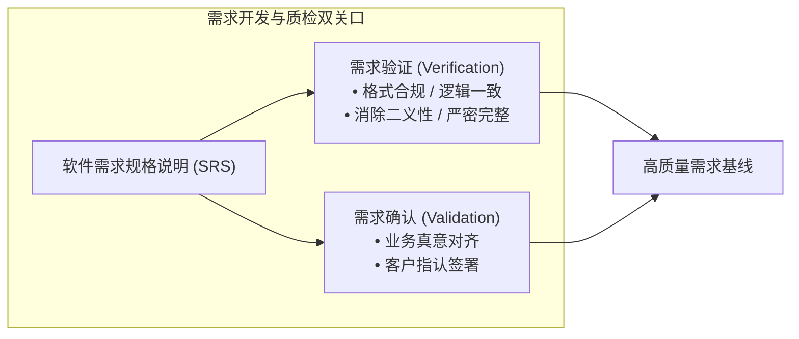

import StepVisualizer from '../../../components/interactive/StepVisualizer';
import QuizCard from '../../../components/interactive/QuizCard';

> “软件开发中最昂贵、最可怕的悲剧，不是技术攻关攻不下来，而是整个工程团队历经九死一生交付的系统，根本就不是客户想要的东西。”

在软件工程半个多世纪的演进历程中，有一幅著名的经典讽刺漫画流传至今——“**树上的秋千（Tree Swing）** ”：

- **客户最初描述的需求**：是一块木板用三根绳子拴在树枝两侧；
- **项目经理记录理解的**：是绳子直接穿透树干打结，秋千根本无法摆动；
- **系统架构师设计的**：是在树干两旁加装两根粗壮的斜向加固钢柱；
- **程序员实际编码实现的**：是秋千座板直接死死钉在地面泥土里，动弹不得；
- **商业顾问包装宣传的**：是一张铺满金箔、极其奢华的皇家天鹅绒吊椅沙发；
- **而客户真正需要的**：仅仅是一个旧汽车轮胎用一根结实的麻绳系在树枝下。

这个生动的寓言揭示了软件研发最残酷的真相：从用户业务诉求到最终代码交付，存在着极其惊人的**信息衰减漏斗**。而**需求确认（Validation）与验证（Verification）**，就是在这个灾难发生之前，拉着用户与技术专家在施工蓝图前逐行指认签名的生死质检关口。

---

## 核心概念与理论推导

### 1. 信息传递的衰减漏斗定律

软件需求在传统非受控的层层人际转述中，信息失真率往往呈现几何级数级放大：

$$I_{\text{received}} = I_{\text{original}} \times \prod_{k=1}^{n} \eta_k$$

其中 $\eta_k$ 为各阶段的信息传递保真系数（通常介于 $0.4 \sim 0.6$ 之间）：

| 传递层级 | 传递节点与载体 | 典型信息残留量 | 失真主要根源 |
| :--- | :--- | :---: | :--- |
| **第 1 层** | 用户真实的原始业务意图与潜意识诉求 | **100%** | 用户往往“知其然但表述不周” |
| **第 2 层** | 分析员捕获并记录进需求规格说明（SRS） | **约 40%** | 访谈遗漏、技术术语偏差、先入为主 |
| **第 3 层** | 架构师与系统设计人员消化并转化设计方案 | **约 16%** | 过度设计、设计偏离需求边界 |
| **第 4 层** | 程序员根据设计文档实际写出的源代码逻辑 | **仅剩 8.4%** | 理解偏差、边缘情况私自简化 |

如何打破这个残酷的衰减定律？软件工程给出了经过数十年工业界检验的**两大关键防线**：
1. **规范文档化（Documentation）**：杜绝口头协议与“群聊式需求”，将需求严格沉淀为结构化、无歧义的软件需求规格说明书（SRS）；
2. **规范同行评审（Review & Inspection）**：组织多角色在基线发布前进行批判性审查，把缺陷消灭在代码编写之前。

---

### 2. 需求确认 (Validation) vs 需求验证 (Verification)

工程实践与考研认证中最高频考查的核心概念之一，就是 **Validation** 与 **Verification** 的深刻辨析：

| 维度对比 | 需求验证 (Verification) | 需求确认 (Validation) |
| :--- | :--- | :--- |
| **哲学追问** | “**我们是否正确地构建了需求？**” (*Are we building the product right?*) | “**我们是否在构建正确的系统？**” (*Are we building the right product?*) |
| **审查重心** | 形式化规范性、文档一致性、无歧义性、可测试性 | 真实业务契合度、用户实际痛点解决度、商业可行性 |
| **执行主体** | 软件工程同行、QA 质检人员、系统架构师 | **最终用户代表、业务决策者、客户领域专家** |
| **判定标准** | 是否符合 IEEE 830 标准规范、前后章节是否自洽矛盾 | 软件建成后是否真正满足用户日常工作与业务流转 |
| **典型手段** | 规范审查（Inspection）、自动化语法检查、测试用例推导 | 业务原型试用、验收用例签署、客户代表面对面推演 |

---

### 3. 需求评审的四大层级分类

依据正式程度与组织严格度，需求评审可以分为四个梯队：

1. **同级桌面检查（Peer Deskcheck）**：作者邀请一位同事坐在自己工位旁，非正式地通读文档并提出修改意见，成本极低但容易受私人关系影响；
2. **走查（Walkthrough）**：作者组织会议，亲自向评审人员一步步讲解系统模型与业务流程，引导大家讨论并收集意见；
3. **轮查（Peer Review / Round Robin）**：文档在多个同级工程师手中流转传阅，每人独立批注标记，最后统一汇总；
4. **正式审查（Formal Inspection）**：基于 Michael Fagan 审查法建立的高规格工业级质检活动。具有严格的阶段划分、明确的角色权责定义与纪律红线，是**软件工业界缺陷检出率最高（可捕获 60%~80% 需求缺陷）** 的质量保证手段。

---

## 关键模型：正式审查（Formal Inspection）六阶段与五大角色

正式审查绝不是“大家坐下来开个茶话会”，而是一套高度自律的工业流水线流程。

### 审查会议的五大核心角色

| 角色名称 | 核心职责与分工 | 关键素养与禁忌 |
| :--- | :--- | :--- |
| **主持人 / 协调人 (Moderator)** | 评审全流程的总指挥。负责挑选审查员、排定日程、把控会场节奏、维护会议纪律 | **中立客观**；严禁偏袒作者或评审员，超时或偏题时必须果断打断 |
| **作者 (Author)** | 待审需求文档的主笔编写者。负责在会前介绍系统背景，并在会后执行返工修改 | **对事不对人**；在会上主要倾听记录，严禁为文档缺陷进行现场辩解 |
| **宣读者 (Reader)** | 审查会上的“领航员”。在会议中以适中语速逐段朗读需求条目，引导所有人注意力聚焦 | 吐字清晰、节奏稳定；严禁私自跳过看似简单的章节 |
| **记录员 (Recorder)** | 审查会议的“书记官”。使用缺陷追踪表实时、精准记录每一处被指出的问题与位置 | 严谨准确；只记录缺陷事实，不记录情绪化评论 |
| **审查员 (Inspector)** | 来自架构、编码、测试、业务支持各维度的质检专家，从各自专业角度挑刺寻错 | 批判性思维；会前必须完成充分的独立阅读预审 |

---

## 交互演练：正式需求审查六阶段生命周期

点击下方交互演练器中的步骤，沉浸式观察一次标准的 IEEE 标准 SRS 正式审查会议是如何从“规划”推进到“跟踪闭环”的：

<StepVisualizer
  client:visible
  title="正式需求审查（Formal Inspection）六阶段生命周期演练"
  algorithmName="Fagan Inspection Protocol"
  steps={[
    {
      title: "阶段 1：规划阶段 (Planning)",
      badge: "Phase 1: Planning",
      description: "主持人对作者提交的待审 SRS 进行准入检查（如排版是否规范、拼写检查是否通过）。确认符合送审门槛后，主持人确定审查小组人选（测试骨干、架构师、业务代表），确定会议日程，并将待审材料与检查单（Checklist）分发给所有成员。",
      code: "[Check-in Criteria] SRS v0.9 Document Complete: PASS\n[Role Assignment] Moderator: Alex, Reader: Brenda, Recorder: Charlie\n[Inspectors] Dev-Lead: David, QA-Lead: Fiona, Biz-Analyst: George\n[Action] Distribute SRS_v0.9.pdf + SRS_Review_Checklist.xlsx",
      stateView: (
        

          

            
当前阶段

            
1. Planning (规划)

          

          

            
准入状态

            
Entry Criteria Met

          

          

            
主要交付物

            
审查计划书 & 材料分发

          

        

      )
    },
    {
      title: "阶段 2：总体会议 (Overview)",
      badge: "Phase 2: Overview",
      description: "（可选步骤）如果待审系统业务领域极其专业或背景复杂，作者会召开时长 30~60 分钟的总体宣讲会，向全体审查员阐述系统的商业愿景、核心业务流程、特殊术语表以及本次审查的重点范围，帮助审查人员消除背景盲区。",
      code: "[Author Presentation] System Context & Business Vision\n[Core Scope] Highlighting Module 3 (Cross-border Settlement) & Module 5 (Tax Engine)\n[Glossary] Explaining 12 specialized accounting terms\n[Q&A] 15 mins brief clarification (No deep defect discussion)",
      stateView: (
        

          

            
当前阶段

            
2. Overview (总体会议)

          

          

            
主讲人

            
Author (作者)

          

          

            
核心目标

            
建立统一业务上下文

          

        

      )
    },
    {
      title: "阶段 3：会前准备 (Preparation)",
      badge: "Phase 3: Preparation",
      description: "【全流程缺陷检出之母】每位审查员在会前独立花费 2~4 小时通读文档。结合《需求缺陷检查单》，逐条审视逻辑漏洞、二义性用词、缺失的异常流和冲突约束，将发现的问题提前标注在个人审查记录表中。若会前准备不充分，会议必须延期！",
      code: "[Inspector Prep Log]\n- QA Inspector Fiona: 3.5 hrs spent, 14 suspicious items logged\n- Architect David: 2.5 hrs spent, 8 interface ambiguities logged\n- Biz Analyst George: 3.0 hrs spent, 6 business rule conflicts logged\n[Status] Total prep effort >= Standard (Avg 3.0h/person). Ready for meeting!",
      stateView: (
        

          

            
当前阶段

            
3. Preparation (独立准备)

          

          

            
独立查阅总工时

            
9.0 人时 (超基线)

          

          

            
预检出疑点数

            
28 处潜在缺陷

          

        

      )
    },
    {
      title: "阶段 4：审查会议 (Inspection Meeting)",
      badge: "Phase 4: Inspection Meeting",
      description: "由主持人宣布开会并严格执行纪律。宣读者（Reader）逐字逐句朗读需求条目，各审查员依次提出自己在准备阶段发现的问题。记录员快速在白板或系统中登记缺陷类别与等级。主持人严格坚守铁律：【只找缺陷，严禁现场讨论解决方案】！",
      code: "[Moderator] 'Reader please read Section 3.2.4.'\n[Reader] 'REQ-PAY-01: When currency exchange rate fluctuates > 5%, system triggers alert...'\n[QA Fiona] 'Defect! The time window for calculation is missing: 5% within 1 hour or 24 hours?'\n[Author] 'Understood, ambiguous spec.'\n[Moderator] 'Recorder please log Defect #15: Ambiguity. Next section please!'",
      stateView: (
        

          

            
当前阶段

            
4. Inspection Meeting (会议)

          

          

            
会议核心铁律

            
严禁现场争论解决方案

          

          

            
已确认缺陷清单

            
共确认 32 项有效缺陷

          

        

      )
    },
    {
      title: "阶段 5：返工修改 (Rework)",
      badge: "Phase 5: Rework",
      description: "会议结束后，记录员整理出带编号的《正式审查缺陷清单》（Defect List）。作者回到工位，对照清单逐条修改需求规格说明书，补充缺失分支逻辑、消除二义性辞令、重新核算数据边界，并在修改处做好版本修订标记与变更对照说明。",
      code: "[Defect List Action]\n- Defect #01 (Major): Ambiguous timeout -> Fixed: 'Set timeout = 3000ms'\n- Defect #02 (Critical): Missing refund flow -> Fixed: Added Section 3.4.8\n- Defect #15 (Major): Missing rate window -> Fixed: '5% fluctuation within rolling 60 mins'\n[Author Status] 32 / 32 Defects addressed in SRS_v1.0_draft.pdf",
      stateView: (
        

          

            
当前阶段

            
5. Rework (作者返工)

          

          

            
责任人

            
Author (作者独力承担)

          

          

            
返工消除进度

            
32 / 32 (100% 销号)

          

        

      )
    },
    {
      title: "阶段 6：跟踪闭环 (Follow-up)",
      badge: "Phase 6: Follow-up",
      description: "主持人（或指定的高级审查员）对照最初的缺陷清单，逐条核查作者返工后的新版 SRS 文档。验证每一处缺陷是否被真正修复，且修改是否引入了新的逻辑矛盾。若返工合格，主持人正式签署审查验收单，宣布该版本需求通过基线评审！",
      code: "[Moderator Final Verification]\n- Verify Defect #01 ~ #32 fixes in document: PASS\n- Side-effect check: No conflicting rules introduced: PASS\n[Sign-off] Moderator Alex approves SRS Release Candidate.\n[Action] Publish to Configuration Baseline as 'SRS-v1.0-BASE'",
      stateView: (
        

          

            
当前阶段

            
6. Follow-up (复查闭环)

          

          

            
验收结论

            
审查合格，正式放行

          

          

            
后续动作

            
冻结并发布需求基线 1.0

          

        

      )
    }
  ]}
/>

---

## 审查会议的两大高压纪律红线

在工程实训与考研分析中，常常会给出某种混乱的会议场景要求考生指出违规项。以下两条红线必须牢记：

### 红线一：只找缺陷，严禁现场讨论解决方案
- **典型翻车场景**：某审查员指出“这里没有考虑网络超时后的重发机制”。作者随即反驳“我们可以加个 Redis 延迟队列”，另一位架构师立刻插话“Redis 延迟队列在高并发下有丢失风险，不如上 Kafka”……两人在白板前激烈争论了 45 分钟，导致后续 60 页核心需求未及审查，会议草草收场。
- **规范做法**：主持人必须在争吵萌芽的 10 秒内果断敲击桌面：“记录员已登记‘缺陷 #22：缺少网络超时重发机制’。具体解决方案作者会后自行设计修改，宣读者请继续下一段！”

### 红线二：审查针对的是制品，而不是作者的人品
- 审查文档的目的是共同提升工程质量，绝对不能演化为人身攻击与部门扯皮。
- 营造安全包容的工程文化，让作者乐于暴露盲点，而不是千方百计掩盖问题。

---

## 概念巩固与自测

<QuizCard
  client:visible
  category="核心概念辨析"
  question="在软件沟通与需求确认过程中，为了有效避免信息在层级传递中严重失真，必须依靠的两大关键工程手段是："
  options={[
    "需求分析与领域建模 (Analysis & Modeling)",
    "需求文档化与同行评审 (Documentation & Review)",
    "快速原型设计与增量编码 (Prototyping & Coding)",
    "深度访谈与多轮问卷调查 (Interview & Questionnaire)"
  ]}
  answer={1}
  explanation="选项 B 正确：在沟通学与软件工程理论中，口头沟通具有极高的信息衰减率。避免失真的两大核心工程支柱正是‘文档化（将模糊想法落实为文字图表）’与‘评审（组织多方对文档进行严密核查对齐）’。选项 A 属于需求分析手段；选项 C 偏向实现与探针；选项 D 属于获取手段。"
/>

---

<QuizCard
  client:visible
  category="工程规范实战"
  question="在一次 IEEE 830 SRS 正式审查会议（Inspection Meeting）上，审查员指出‘第 4.2 节的密码重置逻辑未定义短信验证码失效时效’。此时会议的最佳推进动作应当是："
  options={[
    "主持人叫停朗读，组织架构师与作者当场在白板上设计验证码 Redis 存储架构并确定 5 分钟超时时效",
    "记录员迅速在缺陷清单中登记‘第 4.2 节缺失验证码时效定义’，主持人制止发散讨论，宣读者继续朗读下一条需求",
    "作者向评审人员解释系统默认采用业界通用的 5 分钟方案，认为文档无需赘述，建议直接跳过此项",
    "由于文档存在阻断性重大缺陷，主持人宣布立刻终止本次审查会议，所有人退场等待重新预约"
  ]}
  answer={1}
  explanation="选项 B 正确：正式审查会议的核心铁律是‘只发现并记录缺陷，严禁在会议现场发散讨论解决方案’。现场讨论不仅会严重超时、打断评审节奏，而且仓促讨论出的方案往往缺乏全局深思熟虑。正确做法是记录员登记缺陷，作者会后在返工（Rework）阶段独立思考修改，主持人把控节奏继续推进后续审查。"
/>

---

## 总结与下一步

在本讲中，我们系统学习了：
1. **信息衰减漏斗**解释了为什么“秋千悲剧”频频上演；**文档化与评审**是遏制失真的两大工程法宝；
2. **验证 (Verification)** 聚焦合规性与一致性（“是否正确地构建需求”），而 **确认 (Validation)** 聚焦用户业务本质（“是否构建了正确的系统”）；
3. **正式审查（Inspection）** 包含严格的 6 个阶段（规划、总体、准备、会议、返工、跟踪）与 5 大角色分工，恪守“只找缺陷、不争解法”的铁律。

当需求文档通过审查并由客户签字确认后，需求工程便从“开发阶段”迈入了“管理阶段”。下一讲，我们将探讨如何为需求赋予生命周期，建立**需求管理实践与状态跟踪机制**！
