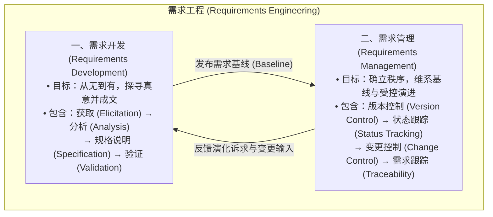

import CytoscapeCanvas from '../../../components/interactive/CytoscapeCanvas';
import QuizCard from '../../../components/interactive/QuizCard';

> “施工图纸签字画押之后，绝不是锁进保险柜就万事大吉了。需求管理是贯穿软件全生命周期的施工看板与档案中枢。”

假设你承接了一座 30 层现代化智慧大厦的弱电智能化工程：
- 弱电施工图（需求规格说明 SRS）经业主、设计院签字确认后，项目正式进入长达两年的施工期；
- 在施工过程中，业主今天想把 18 层的会议室改造成沉浸式多功能发布厅，明天又希望在地下车库加装人脸识别安防道闸；
- 弱电总工程师的指挥部桌面上，必须有一套**精密运转的看板与档案系统**：
  - 哪张图纸是 1.0 初始基线，哪张是经过双方盖章签证的 2.1 变更版（**版本控制**）；
  - 全楼 7,000 个弱电信息点位中，哪些处于“已开槽开孔”、“已布放线缆”、“已打标压接”、“已通电并完成仪器信号闭环测试”（**状态跟踪**）；
  - 凡是合同施工图之外的新增诉求，必须经过严谨的工程量复核与造价追加审批（**变更控制**）。

**需求管理（Requirements Management）就是软件工程全生命周期的“施工看板与度量中枢”。它在动态演进、充满不确定性的开发环境中，确立基线、跟踪状态、受控变更，确保软件巨轮始终行驶在可预测、可度量的航道上。**

---

## 核心概念与理论推导

### 1. 需求开发 vs 需求管理的本质分野

在许多失败的软件团队中，管理者常常把“需求工程”狭隘地等同于“写需求文档”。一旦 SRS 编写完毕，需求分析师便撤场解散，导致后期需求失控。在现代软件工程标准体系（如 CMMI、IEEE）中，需求工程被严格划分为两大互锁领域：

- **需求开发**做的是“发明与定义”的工作：找客户访谈、画用例图与 DFD、编写 SRS 规范、组织评审消灭歧义；
- **需求管理**做的是“治理与度量”的工作：给文档打版本号、记录每条需求流转到哪个生命状态、设立 CCB 审批变更、建立跟踪矩阵（RTM）防止漏做或镀金。

---

### 2. 需求管理四大核心支柱活动

依据工业界主流最佳实践，规范的需求管理依托于**四大支柱**：

| 支柱活动 | 核心工程定义与实践手段 | 解决的典型工程痛点 |
| :--- | :--- | :--- |
| **1. 版本控制 (Version Control)** | 建立需求文档与单条需求的唯一版本标识体系。遵循语义化版本命名规则，明确基线版本与草稿版本的区别；坚持“**专人统一更新**”原则 | 杜绝“张三按旧版开发，李四按新版测试”的版本分裂灾难 |
| **2. 需求状态跟踪 (Status Tracking)** | 为每一项原子需求定义明确的生命周期状态（已建议、已批准、已实现、已验证等），实时统计状态分布 | 击碎程序员口中“代码差不多写完了”的薛定谔式虚假完工进度 |
| **3. 变更控制 (Change Control)** | 成立跨职能变更控制委员会（CCB），执行 13 项全维度变更影响分析，遵循“无申请不修改”的受控流转 | 遏制无休止的需求蔓延与范围膨胀（Scope Creep） |
| **4. 需求跟踪能力 (Traceability)** | 维护需求跟踪矩阵（RTM），在业务需求、系统需求、架构设计、代码文件与测试用例之间编织双向追溯链条 | 顺向追溯防止承诺功能被遗漏，逆向回溯防止私自编写镀金代码 |

---

### 3. 需求基线（Baseline）的核心法理

- **需求基线的法定定义**：“**软件开发团队与客户各方已达成一致承诺、并将在某一特定系统版本中实现的、一组经过正式评审的功能和非功能需求集合。**”
- **工程辨析误区**：确立基线并不代表“需求被死锁、绝对不可再改”，而是代表“**从此需求进入受控变更阶段**”。基线一旦确立，任何增删改动都必须遵循正式的变更控制流程，严禁私下修改。
- **专人维护原则**：为了防范更新异常（Update Anomalies），项目必须指定唯一的需求配置管理员或首席分析师维护 SRS 主干，其他开发人员严禁私自提交修改后的文档副本。

---

## 关键模型：需求状态机（Requirements State Machine）

在需求生命周期中，一条需求并不是简单非黑即白的“完成了”或“没完成”，而是遵循严格的有限状态机（Finite State Machine）演进。

### 需求法定状态属性表

| 状态名称 (Status) | 权威工程内涵与准入标准 | 跃迁到下一状态的触发事件 |
| :--- | :--- | :--- |
| **已建议 (Proposed)** | 需求已被有权提出需求的人员（客户、业务代表、分析员）正式录入需求池 | 经过可行性与商业评估，CCB 批准并分配 Release 版本号 $\rightarrow$ **已批准**；或初审否决 $\rightarrow$ **已删除** |
| **已批准 (Approved)** | 需求已被正式纳入当前版本的需求基线，开发团队承诺在当前迭代排期实现 | 架构设计完成，开发人员完成代码编写并通过单元测试 $\rightarrow$ **已实现** |
| **已实现 (Implemented)** | 代码已编写完毕并通过单元测试、静态代码扫描与同行代码走查，且已合并入主干 | 部署到测试环境后，QA 执行系统测试与客户验收全部 Pass $\rightarrow$ **已验证**；测试失败打回 $\rightarrow$ **已批准** （返修） |
| **已验证 (Verified)** | 在集成/生产环境中通过了对应的全部验证用例测试，符合验收标准（**完工终态**） | 系统正式交付上线维护 |
| **已推迟 (Deferred)** | 经评估该需求具有商业价值，但由于当前版本工期紧张、技术预研未完，决定暂缓实现 | 下一版本规划启动时重新评估 $\rightarrow$ **已批准** |
| **已删除 (Deleted)** | 曾被建议或批准，但经 CCB 审定该功能不再具备业务价值或被更优方案取代（**废弃终态**） | 归档留痕，在需求跟踪矩阵中打上废弃注记 |

---

## 交互演练：需求生命周期有限状态机

下方画布使用 Cytoscape 严格渲染了工业级需求生命周期的状态流转有向图。点击画布中的节点与流转箭头，观察各状态之间的前向跃迁、回退返工与分支决策路径：

export const reqStateMachineElements = {
  nodes: [
    {
      id: 'proposed',
      label: '已建议\n(Proposed)',
      type: 'entity',
      bgColor: '#d97706',
      textColor: '#ffffff',
      borderColor: '#b45309',
    },
    {
      id: 'approved',
      label: '已批准\n(Approved)',
      type: 'process',
      bgColor: '#0284c7',
      textColor: '#ffffff',
      borderColor: '#0369a1',
    },
    {
      id: 'implemented',
      label: '已实现\n(Implemented)',
      type: 'process',
      bgColor: '#0d9488',
      textColor: '#ffffff',
      borderColor: '#0f766e',
    },
    {
      id: 'verified',
      label: '已验证\n(Verified)',
      isAccept: true,
      bgColor: '#16a34a',
      textColor: '#ffffff',
      borderColor: '#15803d',
    },
    {
      id: 'deferred',
      label: '已推迟\n(Deferred)',
      shape: 'round-rectangle',
      bgColor: '#64748b',
      textColor: '#ffffff',
      borderColor: '#475569',
    },
    {
      id: 'deleted',
      label: '已删除\n(Deleted)',
      shape: 'round-rectangle',
      bgColor: '#dc2626',
      textColor: '#ffffff',
      borderColor: '#b91c1c',
    },
  ],
  edges: [
    { id: 'e1', source: 'proposed', target: 'approved', label: '评审通过/纳入基线' },
    { id: 'e2', source: 'proposed', target: 'deleted', label: '初审不具可行性/否决' },
    { id: 'e3', source: 'proposed', target: 'deferred', label: '资源受限/延后评估' },
    { id: 'e4', source: 'approved', target: 'implemented', label: '编码完成/单测通过' },
    { id: 'e5', source: 'approved', target: 'deleted', label: '范围削减(CCB核准)' },
    { id: 'e6', source: 'approved', target: 'deferred', label: '排期冲突/推迟下一版' },
    { id: 'e7', source: 'implemented', target: 'verified', label: '系统与验收测试通过' },
    { id: 'e8', source: 'implemented', target: 'approved', label: '验收缺陷/退回返修' },
    { id: 'e9', source: 'deferred', target: 'approved', label: '下个里程碑重新排期' },
  ],
};

<CytoscapeCanvas
  client:visible
  elements={reqStateMachineElements}
  layoutName="dagre"
  height="420px"
/>

---

## 工程实战：警惕“薛定谔的 90% 完工”交付灾难

在软件项目汇报中，最著名的管理谎言莫过于：
> “项目进度已经完成 90% 了，剩下 10% 下周就能收尾！” —— 然后这个 90% 往往能持续整整三个月。

### 真实工程案例剖析
- 某智慧政务系统外包团队向客户周报连续汇报“已完成 90% 进度”；
- 业主聘请第三方工程监理接入需求管理系统进行审计，拉出全系统 300 条功能需求的状态属性分布：
  - **已建议 (Proposed)**：0 条；
  - **已批准 (Approved)**：20 条（占 6.7%）；
  - **已实现 (Implemented)**：250 条（占 83.3%）；
  - **已验证 (Verified)**：仅有 30 条（占 10%）！
- 监理团队一针见血指出：所谓“90% 进度”，仅仅是程序员单方面把代码敲完了（已实现），但由于测试用例与环境严重滞后，**有 83.3% 的需求处于尚未通过系统集成的“半成品存货”状态**。
- 果不其然，进入联合联调阶段后，代码中隐藏的接口冲突、事务锁超时、并发死锁等阻断级缺陷集中爆发，修复缺陷导致原代码大量推倒重构，项目直接延期 5 个月。

> **需求状态度量黄金法则**：
> 衡量软件项目真实客观进度的唯一可信指标，只能是“**已验证（Verified）需求占全部基线需求的百分比**”。任何未经测试用例验证的代码，在软件工程会计学上都只能算作随时可能爆雷的“负债”，绝不能视作完成资产！

---

## 概念巩固与自测

<QuizCard
  client:visible
  category="核心概念考查"
  question="在软件需求管理体系中，团队成员已经承诺将在某一特定系统版本中实现的一组功能需求和非功能需求的集合，被称为："
  options={[
    "需求基线 (Requirements Baseline)",
    "项目工作分解结构 (WBS)",
    "需求跟踪矩阵 (RTM)",
    "软件测试套件 (Test Suite)"
  ]}
  answer={0}
  explanation="选项 A 正确：需求基线（Baseline）是软件配置管理与需求管理的核心概念，特指经各方正式评审、达成承诺并在某一特定发布版本中予以实现的需求集合。选项 B 是项目管理中对工作任务的层级拆解；选项 C 是需求与设计、代码、测试用例之间的双向追溯表；选项 D 是测试用例的打包集合。"
/>

---

<QuizCard
  client:visible
  category="状态机流转辨析"
  question="某研发团队的后端开发人员小李完成了‘用户手机号一键登录’模块的接口编码，本地运行了单元测试并全部通过，随后通过 Git 提交合并到了 dev 开发分支。此时在敏捷需求管理看板上，该需求项的法定状态应更新为："
  options={[
    "已批准 (Approved)",
    "已实现 (Implemented)",
    "已验证 (Verified)",
    "已关闭 (Closed)"
  ]}
  answer={1}
  explanation="选项 B 正确：当需求的代码已经编写完成并通过了单元测试、代码走查并合并入开发构建时，该需求正式进入‘已实现 (Implemented)’状态。注意：此时尚未经过集成测试、系统验收测试和业务真实环境验证，绝对不能标记为‘已验证 (Verified)’。"
/>

---

## 总结与下一步

在本讲中，我们系统学习了：
1. **需求开发与需求管理的边界**：需求管理围绕“版本、状态、变更、跟踪”四大支柱建立秩序；
2. **需求基线（Baseline）** 是团队承诺与受控演进的锚点，严格坚持专人更新与语义化版本管理；
3. **需求生命周期状态机**由“已建议 $\rightarrow$ 已批准 $\rightarrow$ 已实现 $\rightarrow$ 已验证”主线以及“推迟、删除”分支构成；**已验证百分比**是度量进度的唯一客观黄金标准。

然而，在漫长的研发周期中，来自市场、客户、技术的变更请求如潮水般涌来。下一讲，我们将深入剖析**需求变更管理与 13 项影响分析量化模型**，学习如何为软件演进筑牢防洪泄洪闸门！
