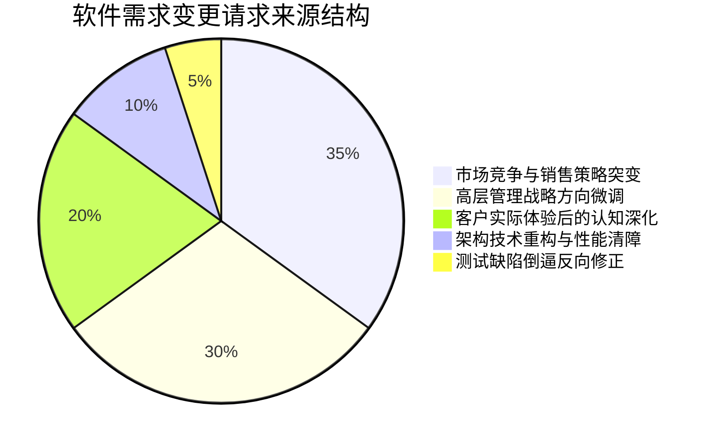
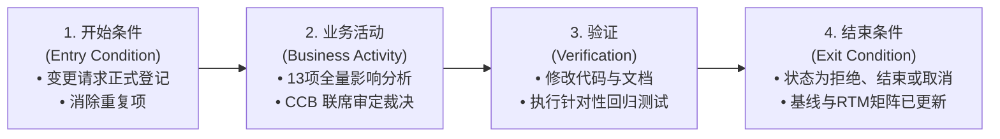

import GraphStepVisualizer from '../../../components/interactive/GraphStepVisualizer';
import QuizCard from '../../../components/interactive/QuizCard';

> “软件需求变更，就像是在一辆以时速 120 公里行驶在高速公路上的大巴车上换轮胎。”

想象一辆满载乘客的大巴车正沿着高速公路平稳飞驰：
- 窗外风景秀丽，一位乘客突然走到驾驶座旁兴奋地对司机说：“师傅，左边那座雪山风景太绝了，你现在顺便打个方向盘，拐进旁边那条没有铺柏油的土路开半小时呗！”
- 如果司机唯唯诺诺、有求必应，立刻一脚急刹猛打方向盘，大巴车必然当场在高速公路上翻车侧滑，车毁人亡；
- 一支专业运营车队有着极其森严的制度防线：
  - 乘客提出变更诉求必须登记在案；
  - 由随车安全员与领航员迅速评估油箱余量、胎压负荷、泥泞路况以及后续所有站点的准点率（**变更影响分析**）；
  - 随后由车长、调度中枢与乘客代表联席商定（**CCB 决议**）。如果该变道确实极具观光价值且安全指标达标，便协商在下一个服务区合理进站变道，并相应顺延到站时刻表。

**在现代软件工程中，变更既不可避免，也是软件进化的生命力源泉。需求变更管理绝不是野蛮粗暴地向客户说“不”，而是建立一道科学、量化、受控的闸门，让高价值演进安全流入，将破坏性的无节制蔓延拒之门外。**

---

## 核心概念与理论推导

### 1. 软件变更的五大统计源头与工程启示

业界资深需求工程统计表明，一个中大型软件项目中各类变更请求（Change Request, CR）的来源分布如下：

> **工程启示**：超过 **65%** 的需求变更直接来自外部市场激烈竞争与企业高层战略调整。单纯向一线程序员抱怨“客户想法老是变来变去”既不专业也毫无意义。唯一的破局之道，就是依靠制度化的变更控制体系，**用精确的成本账单与进度延期数据倒逼决策者慎重决策**。

---

### 2. 变更控制委员会 (CCB) 的定位与三大核心职能

- **定义**：变更控制委员会（Change Control Board, CCB）是项目各方干系人授权成立的、负责对软件需求变更进行最终技术经济评估与权威裁决的联席中枢。
- **法定组成人员**：
  - 项目经理（把握工期里程碑与总体预算）
  - 客户与最终用户代表（把握业务价值与商业优先级）
  - 需求分析负责人（把握系统功能范围与模型自洽）
  - 系统架构与开发骨干（评估技术实现可行性与架构风险）
  - 测试组负责人（评估测试用例影响与回归测试成本）
  - 软件配置管理员（CMO，负责基线版本维护与变更日志）
  *(注意：人力资源、法务、普通行政等部门非技术/业务直接相关人员，通常不属于 CCB 核心决策成员)*
- **三大核心工作职责**：
  1. **制定决策（Decision Making）**：基于影响分析报告，做出批准（Approve）、推迟（Defer）或驳回（Reject）的权威裁定；
  2. **协商约定（Negotiation & Commitment）**：与客户商定因接纳变更而必须追加的合同预算、开发资源与延期里程碑；
  3. **交流通报（Communication）**：向全体干系人通报变更决议与最新基线状态，维持全局信息透明。

---

### 3. 规范变更控制工作的四大时序步骤

标准需求变更工作必须严格由以下四个有时序的步骤闭环推进：

1. **开始条件（Entry Condition）**：收到有权人员提交的标准变更申请单，配置管理员完成形式审查并登记唯一追踪号（CR-ID）；
2. **业务活动（Business Activity）**：技术团队开展 13 项影响分析，CCB 召开联席评审会制定决策并协商资源；
3. **验证（Verification）**：若批准变更，开发人员同步修改 SRS 文档、架构图、代码与单元测试；QA 执行全面回归验证；
4. **结束条件（Exit Condition）**：**请求状态正式跃迁为“拒绝”、“取消”或“已验证关闭”**；且所有修改已安装部署到基线，需求跟踪矩阵（RTM）完成联动更新。

---

## 关键模型：变更影响分析 13 项核对清单

变更影响分析（Impact Analysis）是 CCB 决策的基石。技术评估小组必须逐条回答以下 13 项关键指标，严禁拍脑袋估算：

| 序号 | 影响分析评估核对项 | 是 / 否 | 核心风险与代价度量要点 |
| :---: | :--- | :---: | :--- |
| **1** | 基线中是否已有需求与建议的变更相冲突？ | [ ] 是 [ ] 否 | 排查现有系统逻辑与新需求是否矛盾，避免按下葫芦浮起瓢 |
| **2** | 是否有待解决的需求变更与已建议的变更相冲突？ | [ ] 是 [ ] 否 | 排查当前正在评审的其他变更单，防止两项变更相互“打架” |
| **3** | 不采纳该变更会有什么业务和技术上的后果？ | [ ] 是 [ ] 否 | 评估变更的紧迫度：是否导致合规受罚、丢单或安全漏洞 |
| **4** | 进行建议的变更会有什么样的负面效应或技术风险？ | [ ] 是 [ ] 否 | 是否破坏底层模块封装、引发内存泄漏或导致高并发争锁 |
| **5** | 建议的变更是否会不利于需求实现或其他质量属性？ | [ ] 是 [ ] 否 | 评估是否导致响应时间超时、吞吐量骤降或破坏安全性 |
| **6** | 从技术条件和员工技能角度看该变更是否切实可行？ | [ ] 是 [ ] 否 | 团队现有技术栈是否胜任，是否需要突击攻坚未知技术栈 |
| **7** | 若执行变更是否会在开发、测试环境中提出不合理要求？ | [ ] 是 [ ] 否 | 是否需要扩建分布式集群、采购昂贵的特种工业测试仪器 |
| **8** | 实现或测试该变更是否有额外的工具或授权要求？ | [ ] 是 [ ] 否 | 是否涉及采购昂贵的第三方商业中间件、API Token 或 License |
| **9** | 建议的变更如何影响任务执行顺序、依赖性与关键路径？ | [ ] 是 [ ] 否 | 使用关键路径法（CPM）精准量化导致总工期延后的绝对天数 |
| **10** | 评审变更是否要求原型法或需要最终用户提供意见？ | [ ] 是 [ ] 否 | 是否需要临时搭建抛弃式原型让客户再次介入交互推演 |
| **11** | 采纳变更要求后，浪费了多少以前曾做的工作（沉没成本）？ | [ ] 是 [ ] 否 | 统计废弃的代码行数、报废的接口文档与已消耗的人天成本 |
| **12** | 建议的变更是否导致产品单元成本或交付成本增加？ | [ ] 是 [ ] 否 | 重新核算软硬件 BOM 成本、服务器运维成本与长期维护开销 |
| **13** | 变更是否影响任何市场营销、制造、培训或用户支持计划？ | [ ] 是 [ ] 否 | 全链条协同审查：是否导致用户手册重印、销售培训材料报废 |

---

## 交互演练：变更请求（CR）全流程流转与动态决策

下方交互演算器模拟了一条编号为 `CR-2026-PAY09` 的跨国税务合规变更请求，在全流程 7 个关键阶段中的流转推进。点击步进按钮，观察节点激活、分支决策与状态信息变化：

export const crGraphData = {
  nodes: [
    { id: 'cr_submit', label: '1. 提交变更请求\n(CR Submit)', type: 'entity', bgColor: '#d97706', textColor: '#ffffff' },
    { id: 'cr_triage', label: '2. 初审与登记\n(Triage)', type: 'process', bgColor: '#0284c7', textColor: '#ffffff' },
    { id: 'cr_impact', label: '3. 13项影响分析\n(Impact Analysis)', type: 'process', bgColor: '#0d9488', textColor: '#ffffff' },
    { id: 'cr_ccb', label: '4. CCB 联席决议\n(CCB Decision)', type: 'decision', bgColor: '#7c3aed', textColor: '#ffffff' },
    { id: 'cr_approved', label: '5. 批准基线调整\n(Approved)', type: 'process', bgColor: '#16a34a', textColor: '#ffffff' },
    { id: 'cr_deferred', label: '暂缓下一版本\n(Deferred)', shape: 'round-rectangle', bgColor: '#64748b', textColor: '#ffffff' },
    { id: 'cr_rejected', label: '驳回关闭\n(Rejected)', shape: 'round-rectangle', bgColor: '#dc2626', textColor: '#ffffff' },
    { id: 'cr_impl', label: '6. 编码与回归测试\n(Impl & Test)', type: 'process', bgColor: '#0284c7', textColor: '#ffffff' },
    { id: 'cr_closed', label: '7. 闭环基线归档\n(Closed)', isAccept: true, bgColor: '#16a34a', textColor: '#ffffff' },
  ],
  edges: [
    { id: 'e1', source: 'cr_submit', target: 'cr_triage', label: '提交受理' },
    { id: 'e2', source: 'cr_triage', target: 'cr_impact', label: '去重合规' },
    { id: 'e3', source: 'cr_impact', target: 'cr_ccb', label: '提交评估表' },
    { id: 'e4', source: 'cr_ccb', target: 'cr_approved', label: '【决议】批准采纳' },
    { id: 'e5', source: 'cr_ccb', target: 'cr_deferred', label: '【决议】推迟暂缓' },
    { id: 'e6', source: 'cr_ccb', target: 'cr_rejected', label: '【决议】否决驳回' },
    { id: 'e7', source: 'cr_approved', target: 'cr_impl', label: '下发任务工单' },
    { id: 'e8', source: 'cr_impl', target: 'cr_closed', label: '验收合格/合并主干' },
  ],
};

export const crSteps = [
  {
    title: "阶段 1：干系人提交正式变更请求 (CR Submit)",
    badge: "Step 1: CR Submit",
    description: "业务部门因国家税务新规，正式向系统提交变更请求单 CR-2026-PAY09：要求在所有跨境结算订单中强制增加‘海关电子完税凭据号’校验字段。任何需求变更严禁私聊口头打招呼，必须有据可循。",
    activeNodes: ['cr_submit'],
    activeEdges: [],
    stateInfo: {
      "请求编号": "CR-2026-PAY09",
      "提出人": "财务法务部合规组",
      "变更类型": "合规性扩展需求 (Scope Expansion)",
      "紧急等级": "高 (涉及监管罚款)"
    }
  },
  {
    title: "阶段 2：配置管理员初审与排重 (Triage)",
    badge: "Step 2: Triage & Register",
    description: "软件配置管理员（CMO）接收请求，排查是否与历史已驳回的变更重复，检查表单描述是否完整。初审合格后打上状态【已登记】，指派架构师与测试主管进入影响分析环节。",
    activeNodes: ['cr_triage'],
    activeEdges: ['e1'],
    stateInfo: {
      "初审结论": "合格 (无重复历史单)",
      "评估小组": "架构师王工、测试组长李工",
      "评估时限": "限定 2 个工作日内完成填报"
    }
  },
  {
    title: "阶段 3：执行 13 项全量影响分析 (Impact Analysis)",
    badge: "Step 3: 13-Item Impact Analysis",
    description: "技术专家依据《13项变更影响分析核对表》展开全面溯源排查：利用需求跟踪矩阵定位波及代码 4 处、测试用例 9 项；测算工期需占用 12 人天，关键路径里程碑预计顺延 3 天，沉没成本为 0。",
    activeNodes: ['cr_impact'],
    activeEdges: ['e2'],
    stateInfo: {
      "基线冲突排查": "无现有冲突 (Check 1 PASS)",
      "波及源码文件": "OrderService.java, TaxEngine.cpp",
      "预估实施人天": "12 人天 (开发 8 + 测试 4)",
      "关键路径影响": "里程碑预计顺延 3 个工作日"
    }
  },
  {
    title: "阶段 4：CCB 联席审定会议决策 (CCB Deliberation)",
    badge: "Step 4: CCB Deliberation",
    description: "CCB 委员会全体成员召开联席审定会。客户代表与项目经理就‘顺延 3 天工期并追加 5 万元合规专项研发预算’达成正式签署协议。CCB 主席盖章签署决议：【批准 (Approved)】采纳该变更！",
    activeNodes: ['cr_ccb'],
    activeEdges: ['e3'],
    stateInfo: {
      "CCB 出席": "PM、客户代表、架构师、QA、CMO 全员到齐",
      "审定决议": "批准 (Approved) 纳入当前 2.1 版本",
      "合同补充协议": "已签字追加 3 天工期与资源预算"
    }
  },
  {
    title: "阶段 5：调整基线、工期与资源计划 (Baseline Update)",
    badge: "Step 5: Plan & Baseline Adjustment",
    description: "需求主笔人调出 SRS 主干文档，将完税凭据号功能写入第 4.7 节；配置管理员将需求基线标号更新为 v2.1-BASE，并在 Jira/TAPD 中拆解生成具体的开发与测试子工单。",
    activeNodes: ['cr_approved'],
    activeEdges: ['e4'],
    stateInfo: {
      "新基线标号": "SRS-v2.1-BASE",
      "工单派发": "DEV-3012, DEV-3013, TEST-902",
      "RTM 矩阵更新": "建立 CR-PAY09 与 REQ-TAX 关联链"
    }
  },
  {
    title: "阶段 6：编码修改与全套回归测试 (Impl & Test)",
    badge: "Step 6: Implementation & Testing",
    description: "开发工程师按新基线完成字段增改与接口联调；测试团队不仅对该新增字段执行了 15 条边界值用例，还针对跨境结算主流程运行了全套自动化回归测试套件，确保零缺陷溢出。",
    activeNodes: ['cr_impl'],
    activeEdges: ['e7'],
    stateInfo: {
      "代码变更量": "+210 行, -15 行 (Git Commit #a7b9f)",
      "测试覆盖": "15 条新增用例全部 PASS",
      "回归测试": "核心业务链路回归通过率 100%"
    }
  },
  {
    title: "阶段 7：验证通过，正式闭环归档 (Closed)",
    badge: "Step 7: Verification & Closed",
    description: "在验收环境完成业务复核，所有修改后的工作产品已正式合并发布至生产分支。配置管理员更新需求跟踪矩阵状态，将 CR-2026-PAY09 状态置为【已关闭 (Closed)】。变更控制圆满闭环！",
    activeNodes: ['cr_closed'],
    activeEdges: ['e8'],
    stateInfo: {
      "最终状态": "已关闭 (Closed)",
      "交付制品": "发布于 Release 2.1 正式环境",
      "归档完备性": "CR表单、影响分析报告、测试报告全量入库"
    }
  }
];

<GraphStepVisualizer
  client:visible
  initialGraph={crGraphData}
  steps={crSteps}
  layoutName="dagre"
  height="420px"
  title="CCB 变更请求处理全生命周期动态演练"
  algorithmName="Change Control Protocol"
/>

---

## 概念巩固与自测

<QuizCard
  client:visible
  category="流程时序考查"
  question="在规范的软件需求变更管理流程中，当一项变更请求（CR）被提出并通过初步受理后，项目团队接下来紧接着应该展开的工程活动是："
  options={[
    "直接组织程序员修改系统源代码以验证技术效果",
    "组织架构与需求专家开展系统性的变更影响分析 (Impact Analysis)",
    "直接由项目经理签署同意并立即修改需求基线文档",
    "向客户开具违约索赔账单以倒逼客户撤回该变更"
  ]}
  answer={1}
  explanation="选项 B 正确：变更管理有着极其严格的时序规范。变更请求提出后，紧接着必须进行的是‘评估变更影响（影响分析）’，系统性评估其对冲突、工期、成本、质量属性等 13 个维度的波及面，形成书面报告呈报给 CCB 进行审定。在 CCB 做出批准决策之前，严禁直接修改代码（选项 A）或擅自变更基线（选项 C）。"
/>

---

<QuizCard
  client:visible
  category="组织与权责辨析"
  question="变更控制委员会（CCB）是软件工程中裁决变更的核心中枢。下列关于 CCB 成员组成与核心工作职责的论述中，正确的是："
  options={[
    "CCB 是一个常设的技术编码小组，主要由一线资深程序员组成，负责直接编写业务补丁代码",
    "人力资源部门主管通常是 CCB 的核心固定成员，负责审核变更带来的员工考勤变动",
    "CCB 的核心职责是制定变更决策、协商约定因变更而调整的资源与进度、并维持各方沟通通畅",
    "只要客户代表单方面口头同意，项目经理即可绕过 CCB 独立决定重大需求变更的落地"
  ]}
  answer={2}
  explanation="选项 C 正确：课件与标准规范明确定义 CCB 的三大工作职责为‘制定决策、协商约定、交流情况’。选项 A 错误：CCB 是决策与协调机构，绝不是写代码的；选项 B 错误：人力资源部门不属于 CCB 核心技术与业务决策成员；选项 D 错误：任何重大变更都必须经 CCB 联席评估与正式审定，严禁个人私自绕过。"
/>

---

## 总结与下一步

在本讲中，我们系统学习了：
1. **变更不可避免**：超过 65% 的变更由外部市场与管理层战略驱动，制度化防线是唯一解；
2. **CCB 变更控制委员会**由 PM、客户、分析员、架构师、测试和 CMO 共同组成，行使“制定决策、协商约定、交流情况”三大职责；
3. **13 项影响分析核对清单**构成了量化评估技术风险、沉没成本与工期延期的坚实依据；
4. 变更流程遵循“开始条件 $\rightarrow$ 业务活动 $\rightarrow$ 验证 $\rightarrow$ 结束条件”的严密闭环。

然而，要快速、准确地完成 13 项影响分析，靠人脑在几万行代码中搜索无异于大海捞针。下一讲，我们将掌握需求工程的终极导航利器——**需求跟踪能力与全链路矩阵（RTM）**！
