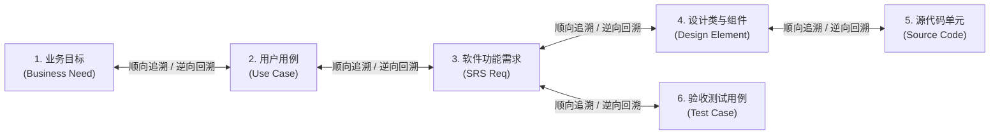

import CytoscapeCanvas from '../../../components/interactive/CytoscapeCanvas';
import QuizCard from '../../../components/interactive/QuizCard';

> “需求跟踪能力，就像是给软件工程数以万计的制品刻上激光追溯码。让每一行代码都师出有名，让每一项需求都落地有声。”

当你把一辆现代化高档汽车拆解成 30,000 个分散的零部件：
- 每一个刹车片、电子芯片和转向传感器表面，都激光雕刻着唯一的**全球溯源二维码**；
- 扫码枪扫一下某块刹车片，系统能在 0.5 秒内精准调出：它装配在哪套制动总成中、符合哪项国际安全标准、由哪个工厂车间生产、哪名质检员执行了哪套压力测试用例；
- 假若某批次合金钢材在三年后被检测出存在微量金属疲劳隐患，主机厂能在 5 分钟内精准定位并召回使用该批次部件的全部 1,200 辆汽车，而根本不需要把全系车型全部盲目停产召回。

**在现代软件工程中，需求跟踪能力（Requirements Traceability）就是软件制品的“激光防伪与追溯网”。通过维护端到端的需求跟踪矩阵（Requirements Traceability Matrix, RTM），我们在商业目标、用例文档、规格说明、架构设计、源码文件与测试用例之间编织一张无缝通信的经纬网。**

---

## 核心概念与理论推导

### 1. 需求跟踪的归属与核心价值

- **工程归属**：需求跟踪是**需求管理（Requirements Management）** 四大核心支柱活动之一（绝非需求获取或需求分析）。
- **最普遍的表示方式**：使用**需求跟踪矩阵（Requirements Traceability Matrix, RTM）**。
- **三大不可替代的工程价值**：
  1. **验证需求完整性**：帮助确认 SRS 中定义的所有功能特性都已被后续设计、编码与测试用例彻底覆盖；
  2. **精准定位变更波及面**：大幅降低维护成本与变更影响分析工时；
  3. **支撑工程资产复用与审计**：在面对适航认证（DO-178C）、医疗软件合规（FDA）、金融三级等保时，提供无可挑剔的合规审计链条。

---

### 2. 双向跟踪能力的哲学对偶性：顺向追溯 vs 逆向回溯

需求跟踪绝不是单向流水线，而是包含**顺向（前向）** 与**逆向（后向）** 两个维度的双向闭环跟踪：

#### 维度一：顺向追溯（Forward Traceability / 正向跟踪）
- **流转路径**：从源头向终端推进：业务需求 $\rightarrow$ 用户用例 $\rightarrow$ SRS 功能需求 $\rightarrow$ 设计组件 $\rightarrow$ 源代码 $\rightarrow$ 测试用例；
- **核心工程证明**：“**凡是客户承诺要求的功能，都在系统里得到了完整的实现与严密的测试覆盖，没有任何遗漏。**”
- **防范的工程风险**：防范“**漏做需求**”。

#### 维度二：逆向回溯（Backward Traceability / 反向跟踪）
- **流转路径**：从终端向源头倒查：测试用例 / 源代码文件 / 架构类 $\rightarrow$ SRS 功能需求 $\rightarrow$ 顶层业务战略目标；
- **核心工程证明**：“**当前系统里的每一行代码和每一个设计组件都是由正规需求授权产生的，师出有名。**”
- **防范的工程风险**：防范“**私自镀金（Gold Plating）** ”。程序员私自添加的炫技代码不仅消耗工时，而且往往隐藏未经验证的漏洞。

---

## 关键模型：多维需求跟踪矩阵 (RTM) 与孤立元素辨析

### 1. 工业级多维需求跟踪矩阵示例

| 用户用例 (Use Case) | 功能需求项 (SRS FR) | 架构设计类 (Class/Module) | 对应源码文件 (Code File) | 验收测试用例 (Test Cases) |
| :--- | :--- | :--- | :--- | :--- |
| **UC-01 (跨境结算订单)** | `FR-PAY-01` (汇率波动校验) | `Class CurrencyValidator` | `CurrencyValidator.java` `checkRateFluctuation()` | `TC-PAY-101` (正常区间) `TC-PAY-102` (超阈值告警) |
| **UC-01 (跨境结算订单)** | `FR-PAY-02` (外汇清算日志) | `Class SettlementLogger` | `SettlementDao.java` `insertAuditLog()` | `TC-PAY-108` (异步事务写入) |
| **UC-02 (税务合规申报)** | `FR-TAX-01` (完税凭证提取) | `Class TaxEngine` | `TaxCalculator.cpp` `buildReceiptPayload()` | `TC-TAX-201` (报文哈希验签) `TC-TAX-202` (异常退税流) |

### 2. 经典工程难题：发现孤立设计元素意味着什么？

在做逆向跟踪审计时，架构师有时会发现：**系统中存在一个孤立的设计元素（或类），在 RTM 矩阵中无法逆向回溯到任何已知的 SRS 需求条目**。

此时应该如何判定？
1. **若经核实，该设计元素实现的是一个正当合理的业务功能**：
   - **结论**：**说明需求规格说明书（SRS）在前期漏掉了一项需求！**
   - **正确做法**：必须走正规变更流程，补齐 SRS 需求描述与业务用例，并在 RTM 中建立关联。
2. **若经核实，该设计元素纯属程序员个人兴趣或未经授权的臆造功能**：
   - **结论**：属于危险的“**镀金代码**”，必须坚决下线删除，避免引入未知攻击面。

---

## 交互演练：RTM 全链路双向追溯拓扑

下方使用 Cytoscape 渲染了一个端到端的 RTM 双向追溯拓扑网。图谱清晰展示了**顺向全链路（从业务目标到测试验收）** 与**逆向变更波及链路（突发税务变更单反向穿透到代码与用例）**：

export const rtmNetworkElements = {
  nodes: [
    // 业务与用例层 (黄色/琥珀色)
    { id: 'biz_01', label: '商业目标\nBIZ-01: 跨境秒级合规结算', type: 'entity', bgColor: '#d97706', textColor: '#ffffff' },
    { id: 'uc_01', label: '用例\nUC-01: 国际订单结算', type: 'entity', bgColor: '#b45309', textColor: '#ffffff' },
    { id: 'uc_02', label: '用例\nUC-02: 自动海关报税', type: 'entity', bgColor: '#b45309', textColor: '#ffffff' },

    // 需求规格说明层 (蓝色)
    { id: 'req_pay', label: 'SRS 功能需求\nREQ-PAY-01: 实时汇率校验', type: 'process', bgColor: '#0284c7', textColor: '#ffffff' },
    { id: 'req_tax', label: 'SRS 功能需求\nREQ-TAX-02: 完税凭证生成', type: 'process', bgColor: '#0284c7', textColor: '#ffffff' },

    // 系统架构设计层 (紫色)
    { id: 'arch_pay', label: '架构类\nClass CurrencyValidator', type: 'process', bgColor: '#7c3aed', textColor: '#ffffff' },
    { id: 'arch_tax', label: '架构类\nClass TaxEngine', type: 'process', bgColor: '#7c3aed', textColor: '#ffffff' },

    // 源代码实现层 (青绿色)
    { id: 'code_pay', label: '源码文件\nCurrencyValidator.java', type: 'process', bgColor: '#0d9488', textColor: '#ffffff' },
    { id: 'code_tax', label: '源码文件\nTaxCalculator.cpp', type: 'process', bgColor: '#0d9488', textColor: '#ffffff' },

    // 测试验证层 (翠绿色 - 终态)
    { id: 'tc_pay', label: '验收用例\nTC-PAY-101: 波动测试', isAccept: true, bgColor: '#16a34a', textColor: '#ffffff' },
    { id: 'tc_tax', label: '验收用例\nTC-TAX-202: 凭证哈希', isAccept: true, bgColor: '#16a34a', textColor: '#ffffff' },

    // 突发变更请求 (红色 - 溯源触发点)
    { id: 'cr_tax', label: '突发变更单\nCR-VAT-99: 税务凭据升级', shape: 'diamond', bgColor: '#dc2626', textColor: '#ffffff' },
  ],
  edges: [
    // 顺向追溯主链路 1 (支付结算链路)
    { id: 'e1', source: 'biz_01', target: 'uc_01', label: '分解' },
    { id: 'e2', source: 'uc_01', target: 'req_pay', label: '细化规范' },
    { id: 'e3', source: 'req_pay', target: 'arch_pay', label: '指导设计' },
    { id: 'e4', source: 'arch_pay', target: 'code_pay', label: '实现代码' },
    { id: 'e5', source: 'req_pay', target: 'tc_pay', label: '验收覆盖' },

    // 顺向追溯主链路 2 (税务合规链路)
    { id: 'e6', source: 'biz_01', target: 'uc_02', label: '分解' },
    { id: 'e7', source: 'uc_02', target: 'req_tax', label: '细化规范' },
    { id: 'e8', source: 'req_tax', target: 'arch_tax', label: '指导设计' },
    { id: 'e9', source: 'arch_tax', target: 'code_tax', label: '实现代码' },
    { id: 'e10', source: 'req_tax', target: 'tc_tax', label: '验收覆盖' },

    // 逆向波及关联 (变更穿透)
    { id: 'e11', source: 'cr_tax', target: 'req_tax', label: '命中修改点' },
  ],
};

<CytoscapeCanvas
  client:visible
  elements={rtmNetworkElements}
  layoutName="dagre"
  height="420px"
/>

---

## 经典实例：变更波及面的秒级精准定位

对比以下两个研发团队在面临突发变更时的表现：

### 场景：国家财税新规要求“所有发票开具业务必须增加‘增值税电子专用发票 20 位识别码’字段”

- **无 RTM 矩阵的“游击队”**：
  - 项目经理召集架构师、老程序员开碰头会靠记忆猜：“好像结算模块有，打印模块也有，移动端导购好像也调了……大家回去全局全文搜一下代码吧。”
  - 排查了两整天，漏掉了后台定时批量开票批处理任务。上线当晚该批处理因字段缺失崩溃，导致次日清晨成千上万笔发票未能按时开具，被税务机关直接通报罚款。
- **具备完备 RTM 的“正规军”**：
  - 需求工程师打开 RTM 数据库，输入目标关键词或需求编号 `REQ-TAX-02`；
  - **在 30 秒内一键导出全量受波及制品清单**：
    - 关联用例：`UC-02 (海关报税)`；
    - 关联类：`Class TaxEngine`、`Class InvoicePrintService`；
    - 关联源文件：`TaxCalculator.cpp (L120-L185)`、`InvoiceDao.java (L45-L60)`；
    - 关联测试用例：`TC-TAX-201` 至 `TC-TAX-209`（共 9 个用例需要同步更新期望结果）。
  - **影响分析与工时测算从 3 天骤降至 15 分钟，变更遗漏率为 0！**

---

## 概念巩固与自测

<QuizCard
  client:visible
  category="核心考点辨析"
  question="在利用需求跟踪能力矩阵（RTM）进行反向回溯审计时，软件开发团队发现了一个孤立的设计元素。该元素在矩阵中找不到任何对应的需求出处，但经业务专家仔细确认，其确实代表了一项非常有价值的正当业务功能。这种情况说明了什么？"
  options={[
    "该设计元素属于违规镀金代码，必须立刻从系统中强制删除",
    "需求规格说明书（SRS）在前期需求开发中漏掉了一项正规需求",
    "系统架构设计存在过度设计，违反了单一职责原则",
    "在需求跟踪能力矩阵中无需建立架构设计元素与用户需求之间的追溯链"
  ]}
  answer={1}
  explanation="选项 B 正确：教材与考研真题经典结论：若一个孤立的设计元素无法回溯到需求，但其表明一个正当的功能，则说明‘需求规格说明书漏掉了一项需求’。开发团队应及时启动需求补遗与变更流程，将该需求正式编入 SRS 文档并补齐跟踪关系。若该功能不正当，才属于无用的镀金代码（选项 A）。"
/>

---

<QuizCard
  client:visible
  category="工程体系归属"
  question="在软件项目执行中途，一位新加入的项目指导委员会委员要求全面更新当前所有可交付成果的状态，并明确团队是如何持续跟踪每个交付物的。此时项目经理最应当调阅并呈报的核心工程文档是："
  options={[
    "工作分解结构 (WBS 字典)",
    "需求跟踪矩阵 (Requirements Traceability Matrix, RTM)",
    "团队成员职责分配矩阵 (RACI 矩阵)",
    "项目关键路径单代号网络图 (PDM)"
  ]}
  answer={1}
  explanation="选项 B 正确：需求跟踪矩阵（RTM）用于建立需求与后续交付物（设计、代码、测试用例、验收报告）之间的对应联系链，能够直观展示每个交付物来源于哪条需求、当前处于何种实现与验证状态。选项 A 偏向工作包分解；选项 C 偏向人员职责；选项 D 偏向进度工期逻辑。"
/>

---

## 总结与下一步

在本讲中，我们系统学习了：
1. **需求跟踪能力**是需求管理的关键支柱，通过 **RTM 矩阵**建立业务、需求、设计、代码与测试的双向联系链；
2. **顺向追溯（前向）** 保完整、防遗漏；**逆向回溯（反向）** 保可溯、防镀金；
3. 发现孤立正当设计元素意味着 **SRS 漏掉了需求**，必须走受控流程补遗；
4. RTM 是实施毫秒级、零遗漏变更影响分析的核心加速器。

至此，我们已经完整掌握了需求工程中“需求开发”与“需求管理”的两大篇章。下一讲，也是本课程的收官大作，我们将登顶“**建筑总营造师**”的全景视野，对整个**需求工程知识体系进行终极全景总结与期末大串讲**！
