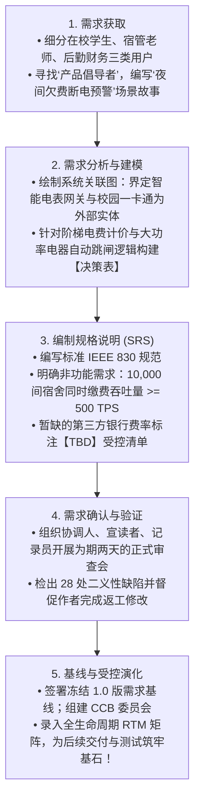

import CytoscapeCanvas from '../../../components/interactive/CytoscapeCanvas';
import QuizCard from '../../../components/interactive/QuizCard';

> “在泥瓦匠眼里，世界只有一块块砖石与砂浆；而在建筑总营造师眼里，胸中藏有山河丘壑、承重骨架与百年防洪体系。没有正确的软件需求，再敏捷的开发也只是在错误的道路上狂奔。”

历经前 14 讲的系统淬炼，我们完整走过了软件需求工程的全部宏大征程：
- 从混沌的客户交谈中抽丝剥茧（**需求获取**）；
- 在白板上勾勒关联图、数据流图与状态机（**需求分析与建模**）；
- 编制严谨、无歧义的 IEEE 830 规范（**软件需求规格说明 SRS**）；
- 组织六阶段正式审查严把质量关（**需求确认验证**）；
- 再到确立版本基线、成立 CCB 审定变更、拉起全链路双向矩阵（**需求管理实践**）。

本讲作为全课程的收官大作，我们将站在架构总营造师的宏观高度，对整个软件需求工程知识体系进行终极融会贯通与复习串讲。

---

## 核心架构：需求工程知识体系全景大图谱

软件需求工程（Requirements Engineering, RE）由**需求开发（RD）** 与**需求管理（RM）** 两大孪生支柱深度咬合而成：

export const reBokElements = {
  nodes: [
    // 根节点
    { id: 're_root', label: '软件需求工程\n(Software RE)', type: 'decision', bgColor: '#4f46e5', textColor: '#ffffff' },

    // 一级分支：开发 vs 管理
    { id: 'rd_branch', label: '一、需求开发\n(Requirements Development)', type: 'process', bgColor: '#0284c7', textColor: '#ffffff' },
    { id: 'rm_branch', label: '二、需求管理\n(Requirements Management)', type: 'process', bgColor: '#0d9488', textColor: '#ffffff' },

    // 需求开发 4 大活动
    { id: 'rd_elicit', label: '1. 需求获取\n(Elicitation)', type: 'entity', bgColor: '#0369a1', textColor: '#ffffff' },
    { id: 'rd_analyze', label: '2. 需求分析与建模\n(Analysis & Modeling)', type: 'entity', bgColor: '#0369a1', textColor: '#ffffff' },
    { id: 'rd_spec', label: '3. 编写规格说明\n(Specification)', type: 'entity', bgColor: '#0369a1', textColor: '#ffffff' },
    { id: 'rd_valid', label: '4. 需求验证与确认\n(Validation)', type: 'entity', bgColor: '#0369a1', textColor: '#ffffff' },

    // 需求管理 4 大活动
    { id: 'rm_version', label: '1. 版本控制与基线\n(Version Control)', type: 'entity', bgColor: '#0f766e', textColor: '#ffffff' },
    { id: 'rm_status', label: '2. 状态机跟踪\n(Status Tracking)', type: 'entity', bgColor: '#0f766e', textColor: '#ffffff' },
    { id: 'rm_change', label: '3. CCB 变更控制\n(Change Control)', type: 'entity', bgColor: '#0f766e', textColor: '#ffffff' },
    { id: 'rm_trace', label: '4. 双向链路跟踪\n(Traceability RTM)', type: 'entity', bgColor: '#0f766e', textColor: '#ffffff' },

    // 关键核心交付与实践技术 (叶子节点)
    { id: 'leaf_elicit', label: '访谈/场景/原型/倡导者', shape: 'round-rectangle', bgColor: '#1e293b', textColor: '#cbd5e1' },
    { id: 'leaf_analyze', label: '关联图/DFD/STD/用例/决策表', shape: 'round-rectangle', bgColor: '#1e293b', textColor: '#cbd5e1' },
    { id: 'leaf_spec', label: 'IEEE 830 SRS / 质量属性 / TBD', shape: 'round-rectangle', bgColor: '#1e293b', textColor: '#cbd5e1' },
    { id: 'leaf_valid', label: 'Fagan审查6阶段 / 五大角色纪律', shape: 'round-rectangle', bgColor: '#1e293b', textColor: '#cbd5e1' },

    { id: 'leaf_version', label: '基线冻结 / 专人维护 / 语义化版本', shape: 'round-rectangle', bgColor: '#1e293b', textColor: '#cbd5e1' },
    { id: 'leaf_status', label: '已建议→已批准→已实现→已验证', shape: 'round-rectangle', bgColor: '#1e293b', textColor: '#cbd5e1' },
    { id: 'leaf_change', label: 'CCB中枢 / 13项影响分析清单', shape: 'round-rectangle', bgColor: '#1e293b', textColor: '#cbd5e1' },
    { id: 'leaf_trace', label: '顺向防遗漏 / 逆向防镀金 / RTM', shape: 'round-rectangle', bgColor: '#1e293b', textColor: '#cbd5e1' },
  ],
  edges: [
    // 根分支
    { id: 'e_r1', source: 're_root', target: 'rd_branch', label: '探寻与定义' },
    { id: 'e_r2', source: 're_root', target: 'rm_branch', label: '治理与受控' },

    // 需求开发子链路
    { id: 'e_d1', source: 'rd_branch', target: 'rd_elicit' },
    { id: 'e_d2', source: 'rd_branch', target: 'rd_analyze' },
    { id: 'e_d3', source: 'rd_branch', target: 'rd_spec' },
    { id: 'e_d4', source: 'rd_branch', target: 'rd_valid' },

    { id: 'e_dl1', source: 'rd_elicit', target: 'leaf_elicit' },
    { id: 'e_dl2', source: 'rd_analyze', target: 'leaf_analyze' },
    { id: 'e_dl3', source: 'rd_spec', target: 'leaf_spec' },
    { id: 'e_dl4', source: 'rd_valid', target: 'leaf_valid' },

    // 需求管理子链路
    { id: 'e_m1', source: 'rm_branch', target: 'rm_version' },
    { id: 'e_m2', source: 'rm_branch', target: 'rm_status' },
    { id: 'e_m3', source: 'rm_branch', target: 'rm_change' },
    { id: 'e_m4', source: 'rm_branch', target: 'rm_trace' },

    { id: 'e_ml1', source: 'rm_version', target: 'leaf_version' },
    { id: 'e_ml2', source: 'rm_status', target: 'leaf_status' },
    { id: 'e_ml3', source: 'rm_change', target: 'leaf_change' },
    { id: 'e_ml4', source: 'rm_trace', target: 'leaf_trace' },

    // 跨阶段互锁闭环
    { id: 'e_cross1', source: 'rd_branch', target: 'rm_branch', label: '产出发布需求基线' },
  ],
};

<CytoscapeCanvas
  client:visible
  elements={reBokElements}
  layoutName="dagre"
  height="450px"
/>

---

## 课件核心纲领：软件需求分析的六大要点

在考研冲刺与高阶工程架构面试中，课件第 15 讲提炼的“**需求分析六大要点**”是出题频率极高的黄金纲领：

### 要点一：需求定义勿忽视
- **核心哲理**：“**项目目标决定项目范围，业务驱动标识系统范围。**”
- **工程避坑**：失败的项目往往一上来就扎进 UI 像素细节或底层表结构设计，忽视了对项目整体愿景与商业边界的统筹。必须始终坚持**由业务需求自顶向下推导系统功能**。

### 要点二：需求获取要科学
- **核心哲理**：需求获取绝不是拿着笔记本被动当客户的“录音笔”，而是一项主动勘测、消除认知的侦探工作。
- **生动比喻**：“**剥洋葱”而不是“切洋葱**”。
  - *切洋葱（错误）*：一刀切下去，横截面看似快速暴露，实则切断了内部的业务血脉逻辑，还把自己辣得泪流满面；
  - *剥洋葱（正确）*：一层一层由表及里，先探明外围边界（关联图），再理清主干流程（用例与活动图），最后触达核心领域业务规则（决策表）。

### 要点三：需求分析要业务
- **核心哲理**：需求分析的三大根本使命是“**分解、抽象与消除歧义**”。
- **角色定位**：需求分析的重心是**业务事件与业务术语**，绝不是数据库外键或多线程锁。分析员必须跳出程序员的技术偏见，充当业务方与技术方之间毫无语言障碍的翻译官。

### 要点四：需求建模要实用
- **核心哲理**：“**模型的唯一目的是促进人与人之间的准确理解，而非盲目炫耀复杂语法。**”
- **UML 建模选型黄金口诀**：
  - **抓“人”** （识别参与者与系统核心价值） $\rightarrow$ 选用 **用例图 (Use Case Diagram)**；
  - **抓“事”** （梳理跨部门跨系统的复杂业务流转） $\rightarrow$ 选用 **活动图 (Activity Diagram) / 泳道图**；
  - **抓“物”** （沉淀核心领域概念实体与数据关系） $\rightarrow$ 选用 **类图 (Class Diagram) / ERD**；
  - **抓“接口”** （外部软件系统与服务解耦集成） $\rightarrow$ 选用 **构件图 (Component Diagram)**；
  - **抓“环境”** （服务器物理拓扑、容器与网络约束） $\rightarrow$ 选用 **部署图 (Deployment Diagram)**。

### 要点五：需求文档要应用
- **核心哲理**：需求文档不能是立项时写完就束之高阁的“纸质古董”，而必须成为指导开发、测试和维护的鲜活蓝图。
- **文档管理四大铁律**：
  1. **可获得 (Accessible)**：项目全体成员在权限范围内随时能够查阅最新需求；
  2. **可获知 (Informed)**：任何需求发生变更，受波及的技术与测试人员必须被主动通知；
  3. **专人统一更新 (Designated Maintainer)**：杜绝多头随意修改，维护统一版本权威；
  4. **防范更新异常 (Prevent Update Anomalies)**：确保下游代码、单元测试与 SRS 同步保持一致。

### 要点六：需求评审要实效
- **核心哲理**：“**评审的核心使命是尽可能多地暴露缺陷，绝不是走过场证明作者没有犯错。**”
- **实效保证**：严格落实 Fagan 六阶段审查纪律；会前必须保证 2~4 小时独立阅读；会上“**只找缺陷，严禁现场讨论具体修复方案**”；对事不对人。

---

## 需求工程十大黄金定律回顾

在软件工程实战中，以下十条定律构成了卓越软件团队不可逾越的护城河：

| 定律名称 | 核心工程法则 | 经典正反案例 |
| :--- | :--- | :--- |
| **1. 源头定律** | 客户需求是软件系统的源头，源头污染则全盘皆浊 | 需求错了，写出 100% 测试覆盖率的代码也只是高质量的废品 |
| **2. 成本递增律** | IBM 缺陷修复成本阶梯（$1 \rightarrow 5 \rightarrow 10 \rightarrow 50 \rightarrow 200$） | 需求阶段花 1 小时修正描述，等同于上线后抢救 200 小时 |
| **3. 语言对齐律** | 需求分析员必须使用客户的业务语言，严禁用技术黑话裹挟客户 | 不说“表级外键级联”，而说“注销客户时自动解绑所有优惠券” |
| **4. 抽象分层律** | 业务需求（为什么做）、用户需求（做什么任务）、功能需求（系统提供什么），三层绝不可混淆 | 严禁把“导出 Excel 按钮”直接当作业务需求 |
| **5. 边界神圣律** | 系统关联图内是黑盒，外部是实体；系统外的数据流坚决不碰 | 严格界定数据从哪儿来、往哪儿去，守卫系统边界 |
| **6. 穷尽无二义律** | 复杂的业务分支条件必须使用决策表与决策树穷尽 | 自然语言必然存在逻辑漏洞，组合判定必须用布尔真值表核对 |
| **7. 折中平衡律** | 质量属性之间天然冲突，没有完美的架构，只有最优的折中 | 追求极致吞吐量往往必须牺牲部分强一致性（CAP 定理） |
| **8. 原型试探律** | 抛弃式原型探明需求必须丢弃；演化式原型第一行代码即生产级 | 严禁将充满 Mock 数据的原型界面直接当作正式系统上线 |
| **9. 基线闸门律** | 基线一旦确立，任何变更必须且只能经由 CCB 和 13 项影响分析审定 | 杜绝开发人员私下接客户电话直接改代码 |
| **10. 双向闭环律** | 顺向追溯保完整、防遗漏；逆向回溯保可溯、防镀金 | 在 RTM 矩阵中建立业务 $\leftrightarrow$ 代码 $\leftrightarrow$ 用例双向联系链 |

---

## 综合实战演练：需求工程全流程大通关

假设你被任命为某大学“**智慧校园宿舍电费充值与智能控电系统**”的需求工程总监，以下是标准实战推进路线：

---

## 课程终极自测与通关演练

<QuizCard
  client:visible
  category="综合体系归属考查"
  question="软件需求工程（RE）被科学划分为‘需求开发’与‘需求管理’两大领域。下列各项工程实践中，完全属于‘需求开发’范畴的一组是："
  options={[
    "绘制数据流图 (DFD)、编制需求跟踪矩阵 (RTM)、成立变更控制委员会 (CCB)",
    "绘制系统关联图、建立决策表消除二义性、组织正式同行评审会 (Inspection)",
    "确定需求版本基线、定义需求状态有限状态机、执行 13 项变更影响分析",
    "向客户索取变更申请单、统计已验证需求燃尽百分比、实施正向与逆向跟踪"
  ]}
  answer={1}
  explanation="选项 B 正确：需求开发（RD）包括需求获取、需求分析、需求规格说明和需求验证四大阶段。关联图与决策表属于需求分析建模，正式评审会属于需求验证，全部属于‘需求开发’范畴。选项 A、C、D 中的 RTM、CCB、基线管理、状态机跟踪、影响分析均属于‘需求管理’（RM）范畴。"
/>

---

<QuizCard
  client:visible
  category="黄金工程定律真题"
  question="关于软件需求工程中的核心原则与工程避坑指南，下列哪一项陈述是真正符合规范的最佳工程实践？"
  options={[
    "为了节约项目研发预算，可以将用于验证 UI 交互的抛弃式水平原型（Throwaway Prototype）代码直接作为核心架构打包上线",
    "软件的各项质量属性（如安全性、高性能、可移植性）之间完全相辅相成，优秀的系统分析师应当追求所有质量属性全部达到最高指标",
    "需求变更既不可避免也是软件进化的动力；基线确立之后绝非石碑死锁，而是进入受控变更阶段，必须经由 CCB 审定",
    "在正式审查会议（Inspection Meeting）上，发现逻辑漏洞时作者应当当场与架构师在白板上编写算法并推演解决方案"
  ]}
  answer={2}
  explanation="选项 C 正确：基线（Baseline）标志着需求从自由探讨期进入受控管理期，变更必须依规由 CCB 与影响分析审定，绝非不可修改。选项 A 严重违背抛弃式原型工程原则，抛弃式代码硬上线是维护灾难；选项 B 忽视了质量属性之间的天然冲突与折中权衡；选项 D 违背了审查会议‘只找缺陷、严禁现场讨论解决方案’的高压纪律红线。"
/>

---

## 结语：从工程师走向架构总营造师

《软件需求分析》的学习至此圆满收官。

正如软件工程先驱 Fred Brooks 在《人月神话》中所言：
> “**构建软件系统最艰难的部分，恰恰是确切决定要构建什么。概念构想的错误，没有任何后期的技术编码技巧可以弥补。**”

愿你在未来的软件工程实践中，始终手握需求工程的罗盘与图纸，以业务为舟，以模型为舵，以基线为锚，成为独当一面的软件系统总营造师！
