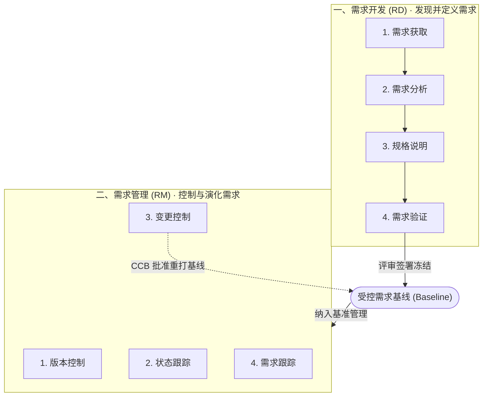

import { Card, CardGrid, Steps } from '@astrojs/starlight/components';
import QuizCard from '../../../components/interactive/QuizCard';

> “在软件开发的所有活动中，没有任何单一活动比做错需求对最终系统带来更灾难性的损害；也没有任何单一活动比正确确定需求，在后续开发中带来更大的工程收益。” —— Fred Brooks，《人月神话》

工程实践中，导致超过半数大型软件项目延期、超支甚至报废的根源，往往不是编码技巧不足，而是在源头“做错了东西”。本笔记围绕软件需求工程核心知识体系，将需求工程理论转化为直观工程隐喻、严谨模型推导、单步交互画布与随堂真题自测。

---

## 工程隐喻：跨海大桥与立体战役

<CardGrid>
  <Card title="1. 跨海大桥：源头的 200 倍杠杆" icon="approve-check-circle">
    **软件需求**决定大桥的通航净宽、设计载重与两岸地标；**架构设计**决定斜拉或悬索选型；**编码实现**是打桩铺面。合龙后若发现需要的是复线高铁桥而非公路桥，再完美的施工也只能推倒重来。需求阶段修复缺陷成本为 **1**，延至运维阶段则飙升至 **200 倍**。
  </Card>
  <Card title="2. 立体战役：双轮驱动协作" icon="setting">
    **需求开发（RD）** 如同“前沿侦察与参谋”：侦察现场（获取）、沙盘分解（分析）、绘制地图（规格说明）与联席会审（验证）；**需求管理（RM）** 如同“战时指挥与调度”：统一地图版本（版本控制）、掌握战果（状态跟踪）、按规调兵（变更控制）与弹药溯源（需求跟踪）。
  </Card>
</CardGrid>

---

## 核心全景：双轮驱动与基线枢纽

需求工程由**需求开发（RD）** 与**需求管理（RM）** 两大支柱构成，并以**受控需求基线（Baseline）** 为核心交接枢纽闭环运转：

---

## 15 讲全课程通关路线图

全课程划分为七大递进模块，每讲均包含概念推演、交互式可视化实验室与随堂自测：

| 模块 | 模块主题 | 讲次导航 | 核心工程概念与产出物 | 交互实验室配套 |
| :---: | :--- | :--- | :--- | :--- |
| **模块一** | **工程基础与用户视角** | [01. 软件需求概述与工程基础](/se-req/01-intro/) | 需求定义、三层抽象、7 大特质、IBM 修复成本阶梯 | IBM 缺陷放大成本阶梯模拟器 |
| | | [02. 用户视角与客户权利义务](/se-req/02-user-view/) | 客户 vs 最终用户、产品倡导者、Wiegers 10+10 契约 | 客户权利义务 10+10 互动沙盘 |
| **模块二** | **过程框架与需求获取** | [03. 需求工程过程框架与核心活动](/se-req/03-process-framework/) | RD/RM 双轮驱动、初始/脉络/细节三次循环、需求基线 | 需求工程双轮拓扑画布 |
| | | [04. 需求获取技术与场景分析](/se-req/04-elicitation/) | Favored/Secondary/Disfavored 分类、5 大获取方法、场景推演 | 化学品采购与管制场景推演器 |
| **模块三** | **系统分析与建模实战** | [05. 需求分析任务与关联图边界](/se-req/05-analysis-boundary/) | 提炼/建模/审查、系统关联图（Context Diagram）、数据字典 | 高校图书馆系统关联图画布 |
| | | [06. 需求建模方法与技术](/se-req/06-modeling/) | 分层 DFD、黑洞/奇迹/灰洞反模式、UML 视图、决策表 | 图书预订 DFD 精化 + 行李费决策表 |
| **模块四** | **规格编制与质量折中** | [07. 需求文档编制与SRS标准规范](/se-req/07-srs-spec/) | IEEE 830 标准模板、系统特性写法、TBD 销项闭环 | 医疗 PACS SRS 逐章合规审查 |
| | | [08. 软件质量属性与架构折中](/se-req/08-quality-attributes/) | 用户/开发者质量属性、可用性公式（MTTF/MTTR）、折中矩阵 | 四类典型架构质量权衡推演 |
| **模块五** | **风险削减与量化验证** | [09. 通过原型来减少风险](/se-req/09-prototyping/) | 原型三大目的、抛弃式 vs 演化式、水平 vs 垂直四象限 | 四象限原型选型决策推演 |
| | | [10. 确定需求的优先级别与Wiegers定量模型](/se-req/10-prioritization/) | 85-10-5 陷阱、相对收益/损失/成本/风险量化、ROI 排序 | Wiegers 优先级逐步推导追踪 |
| | | [11. 需求确认验证与规范评审流程](/se-req/11-verification/) | 验证 vs 确认、Fagan 正式审查 6 阶段、五大角色纪律 | 正式审查六阶段生命周期演练 |
| **模块六** | **受控演化与全链路追溯** | [12. 需求管理实践与状态跟踪机制](/se-req/12-management-practice/) | 基线专人维护、需求状态机（已建议→已批准→已实现→已验证） | 需求生命周期状态机画布 |
| | | [13. 需求变更管理与影响分析模型](/se-req/13-change-management/) | CCB 职责与组成、变更 4 步闭环、13 项影响分析清单 | CCB 变更请求处理流程演练 |
| | | [14. 需求跟踪能力与全链路矩阵](/se-req/14-traceability/) | 需求跟踪矩阵（RTM）、顺向防遗漏与逆向防镀金、孤立元素辨析 | RTM 全链路双向追溯拓扑画布 |
| **模块七** | **全景总结与终极冲刺** | [15. 需求工程总结与知识体系全景](/se-req/15-summary/) | REBOK 全景脑图、六大核心要点、十大黄金工程定律 | REBOK 知识体系全景拓扑 |

---

## 学习路径建议

<Steps>
1. **期末冲刺快速通关路径（约 2–3 小时）**
   重点精读：[01. 需求基础](/se-req/01-intro/)（三层需求与成本阶梯）、[02. 用户视角](/se-req/02-user-view/)（10+10 权利义务）、[03. 过程框架](/se-req/03-process-framework/)（双轮与三次循环）、[05. 关联图边界](/se-req/05-analysis-boundary/)（边界与黑洞奇迹避坑）、[10. 优先级模型](/se-req/10-prioritization/)（Wiegers 公式计算）、[11. 确认与评审](/se-req/11-verification/)（正式审查六阶段）、[13. 变更控制](/se-req/13-change-management/)（CCB 与 13 项影响分析），并完成每讲文末随堂自测。

2. **架构与业务分析工程实战路径（约 6–8 小时）**
   按 `01` 到 `15` 完整顺序精读，重点实操系统关联图、DFD 分层分解、决策表穷尽分支、IEEE 830 SRS 规范编写、质量属性冲突折中以及 RTM 双向追溯矩阵的建立与维护。

3. **考研与软考系统分析师认证路径（约 4–5 小时）**
   聚焦结构化分析（关联图、DFD 父子平衡、数据字典、决策表/树）与面向对象建模（用例图、时序图、活动图）对比，结合第 08 讲非功能质量属性度量公式与第 15 讲六大要点、十大定律进行综合演练。
</Steps>

---

## 随堂直觉自测

<QuizCard
  client:visible
  question="需求工程通常分为两大组成部分，它们是（ ）"
  options={[
    "需求开发与需求管理",
    "需求获取与需求分析",
    "需求设计与需求测试",
    "需求定义与需求验证"
  ]}
  answer={0}
  explanation="【答案解析】需求工程由“需求开发（Requirements Development）”和“需求管理（Requirements Management）”两大部分组成。前者包含获取、分析、规格说明、验证；后者包含版本控制、状态跟踪、变更控制与跟踪能力。"
/>

<QuizCard
  client:visible
  question="根据 IBM 公司的统计，在系统运行维护阶段修复一个由需求遗漏引起的缺陷，其代价是需求阶段的（ ）"
  options={[
    "5 倍",
    "10 倍",
    "20~50 倍",
    "200 倍"
  ]}
  answer={3}
  explanation="【答案解析】IBM 缺陷修复成本阶梯显示：需求阶段为 1，设计阶段为 5，编码阶段为 10，系统测试阶段为 20~50，运行维护阶段急剧上升到 200 倍！这充分证明了在源头做好需求分析的巨大工程经济价值。"
/>
