本文档精选《软件需求分析》课程中贯穿全周期的 **12 个核心工程机制、架构模型与算法流程**，通过规范的 Mermaid 流程图与序列图，提供清晰、精准的可视化导读。

---

## 一、软件需求三层次金字塔与交付制品映射全景

软件需求不是单一维度的平铺直叙，而是由抽象到具象、层层分解并最终映射到正式工程制品的金字塔结构。

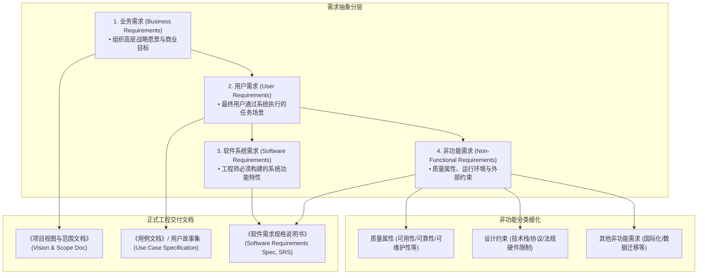

- **图解精要**：
  1. **自顶向下驱动**：业务需求决定了系统的方向，用户需求是将业务需求细化为用户视角的任务，功能需求与非功能需求是支撑用户任务的技术契约。
  2. **交付文档对齐**：业务需求对应《项目视图与范围文档》；用户需求对应《用例文档》；功能需求与非功能需求共同汇聚在最核心的《软件需求规格说明书》(SRS) 中。

---

## 二、需求工程双轮驱动生命周期闭环流程

需求工程由“需求开发”与“需求管理”两大协同运行的轮轨组成，两者紧密交织，支撑软件全生命周期的演进。

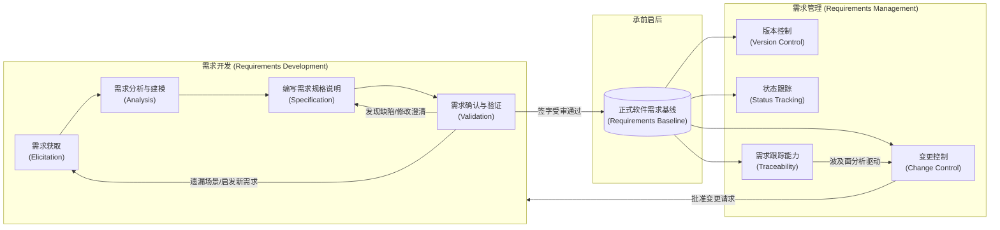

- **图解精要**：
  1. 需求开发是一项高度迭代的活动，验证发现的问题会迅速回流到获取和规格编写阶段。
  2. 一旦需求获得开发方与客户共同承诺，即进入“基线（Baseline）”，此时由需求管理活动全面接管；任何改动必须遵循严格的变更控制。

---

## 三、系统关联图与业务边界模型 (Context Diagram)

系统关联图是最高抽象层级的数据流图（0层DFD），用于明确界定系统自身与外部世界人员、外设及第三方系统的绝对边界。

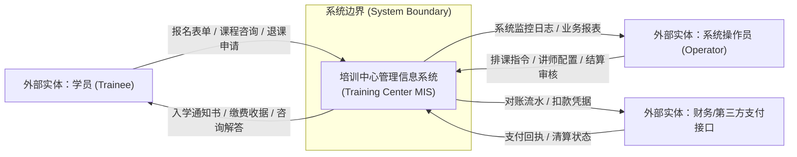

- **图解精要**：
  1. 系统内部在此处不分解为子模块，仅体现为一个整体系统核心加工。
  2. 凡是在矩形外部实体内部发生的逻辑都不属于本系统开发范围，明确界定了研发契约边界。

---

## 四、结构化分析三层数据流图 (DFD) 分解体系

以经典“图书预订系统”为例，展示数据流图自顶向下、逐层精化的分解过程。

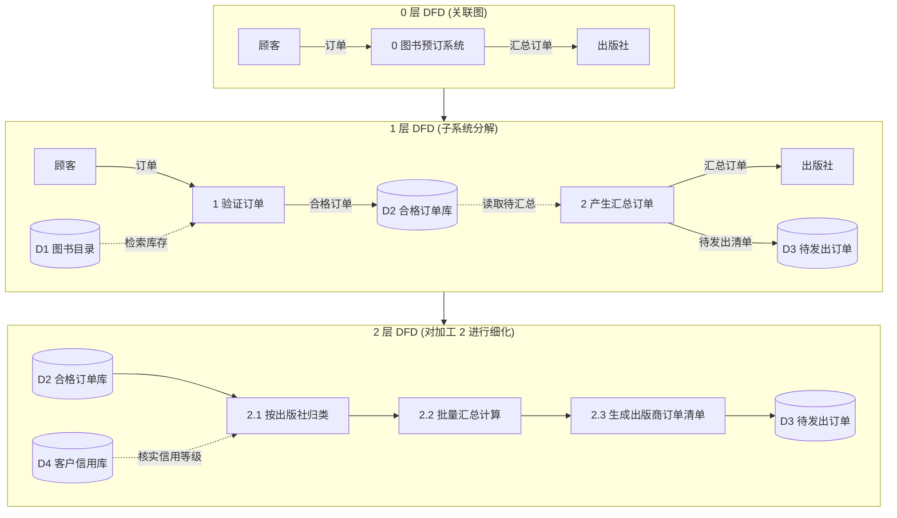

- **图解精要**：
  1. **父子平衡原则**：子图的输入/输出数据流必须与父图中被分解加工的输入/输出数据流严格对应。
  2. **数据守恒**：加工必须有输入和输出，数据不能从外部实体直接流入数据存储，也不能在两个数据存储之间凭空流动。

---

## 五、面向对象需求模型全家桶 (UML 交互与结构)

在面向对象需求分析中，用例图、活动图和时序图构成了一套完整刻画人机行为的建模组合。

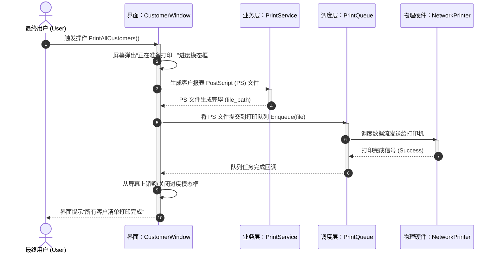

- **图解精要**：
  1. 时序图以垂直生命线体现时间的流逝，水平实线箭头表示同步调用，虚线箭头表示响应返回。
  2. 清楚界定了边界对象（Window）、控制对象（Service/Queue）与实体/设备对象的调用责任。

---

## 六、复杂业务逻辑判定两大法宝：决策表与决策树

以航班超重行李托运费率算法为例，对比决策表与决策树的建模逻辑。

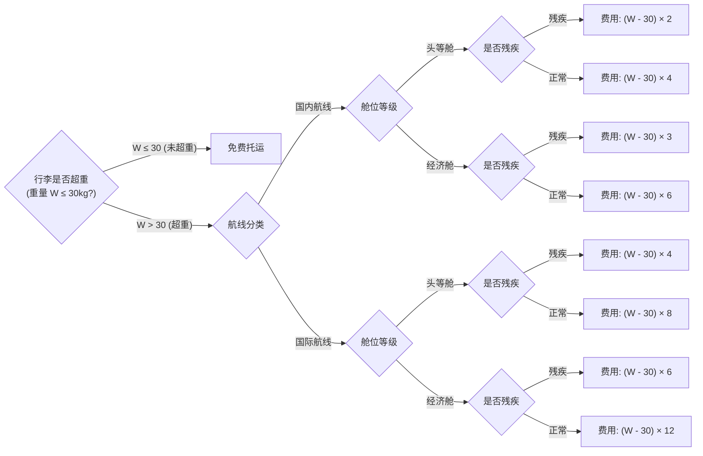

- **图解精要**：
  1. 树状分支自左向右逐步根据判断条件进行过滤，叶子节点输出确定性的收费动作。
  2. 与决策表相比，决策树更适合向业务人员直观讲解执行逻辑，而决策表更利于程序员进行穷尽性条件覆盖检验。

---

## 七、四象限需求原型选型矩阵与演化路径

需求原型按“功能维度（水平/垂直）”与“代码生命周期（抛弃式/演化式）”划分为四大类型。

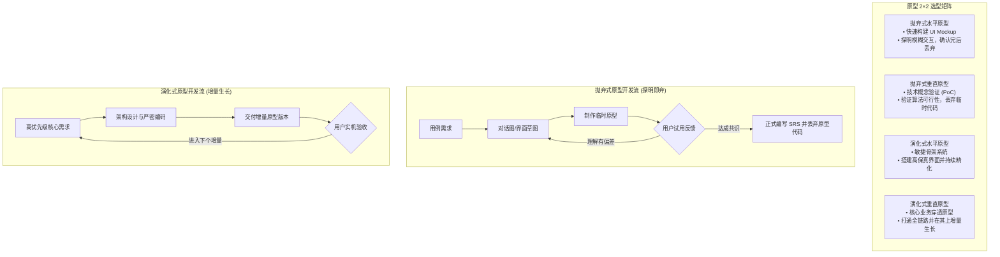

- **图解精要**：
  1. 抛弃式原型的核心目标是“收集反馈与降低风险”，严禁用其拼凑出生产代码。
  2. 演化式原型的核心是“以正规架构打底”，每一行原型代码都是正式系统的一部分。

---

## 八、Karl Wiegers 优先级决策计算管道模型

基于相对收益、损失、成本与风险四个维度，通过客观数学公式计算需求优先级排序。

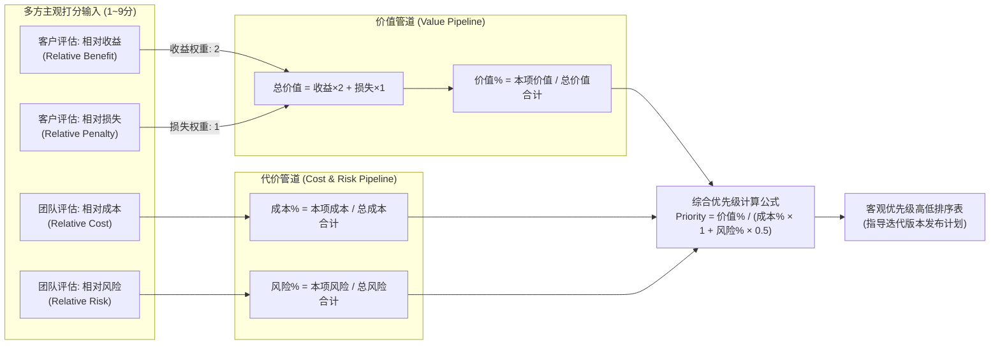

- **图解精要**：
  1. 收益和损失由客户主导评估，成本和风险由研发团队主导评估，平衡了业务诉求与工程代价。
  2. 最终结果按数值从大到小排序，数值越高代表单位代价所换取的业务回报越丰厚。

---

## 九、规范需求评审 (Formal Inspection) 6 阶段协同流程

同行评审是软件工程中发现需求缺陷最有效的手段，必须遵循严密的纪律与角色分工。

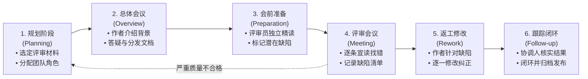

- **图解精要**：
  1. 评审会议的黄金法则是“只找缺陷，不现场讨论解决方案”，确保会议高效聚焦。
  2. 会前充分准备是评审成功的基石；没有准备的评审会往往沦为无意义的辩论。

---

## 十、变更控制委员会 (CCB) 决策与影响分析闭环

在需求基线确立后，任何变更请求均需经过规范的变更控制全流程。

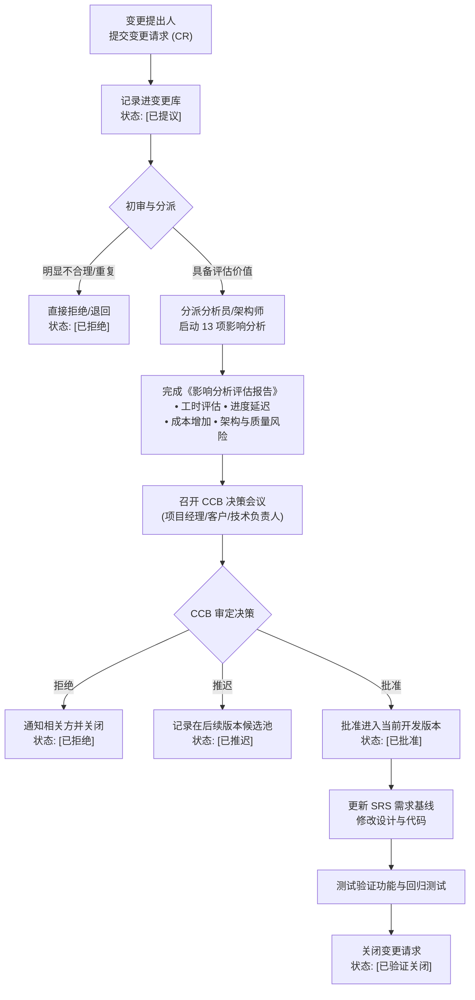

- **图解精要**：
  1. CCB 是变更审批的唯一中枢，防止开发者与客户口头私下约定变更。
  2. 影响分析必须全面覆盖工时、交付期、架构稳定性与测试成本，杜绝盲目变更。

---

## 十一、端到端双向需求跟踪能力联系链 (Traceability Links)

需求跟踪建立起业务目标、软件需求、技术设计、源代码与测试验证之间的无缝映射。

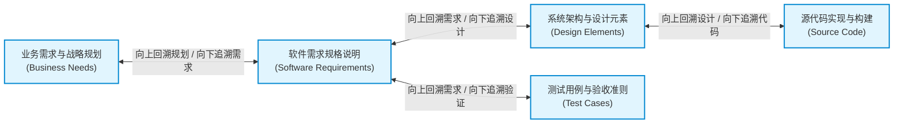

- **图解精要**：
  1. **正向追溯（Forward Traceability）**：确保每一项客户需求都在下游有对应的架构设计、代码文件和测试用例覆盖，防止漏做功能。
  2. **反向回溯（Backward Traceability）**：确保每一行代码和每一个设计组件都能向上找到最初的需求授权依据，彻底杜绝“镀金（Gold-Plating）”无用代码。

---

## 十二、需求状态生命周期流转状态机模型

跟踪单条需求从提出到交付退役的规范生命周期状态转换。

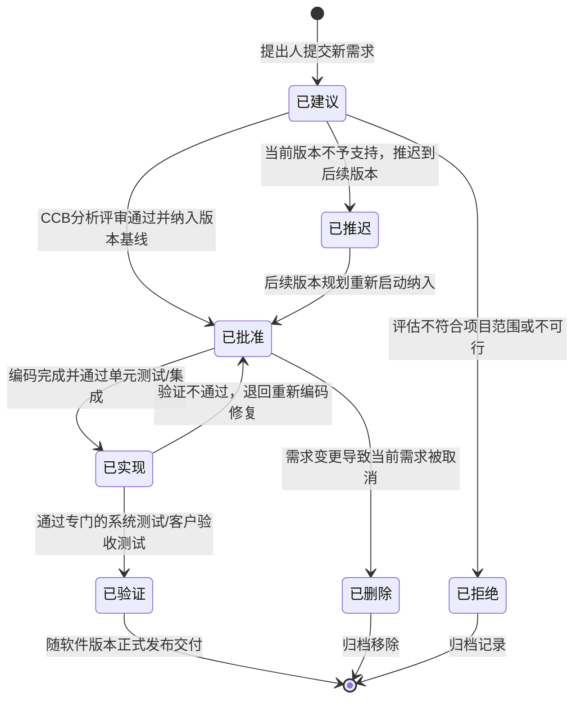

- **图解精要**：
  1. 清晰定义了状态迁移的“入口准则”与“出口准则”。
  2. 项目经理通过统计各状态需求的占比分布，能够精确获知软件工程当前所处的研发阶段与整体健康度。
